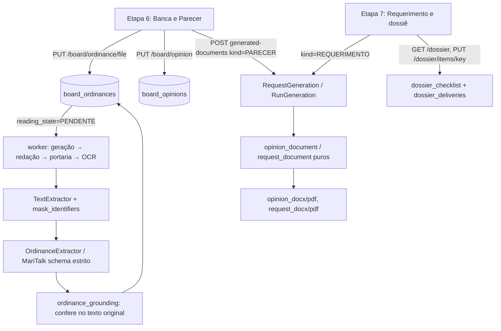

# Banca, Parecer, Requerimento e checklist do dossiê Design

**Spec**: `.specs/features/banca-parecer/spec.md`
**Status**: Approved

---

## Architecture Overview

Quatro peças sobre o que já existe:

1. **Portaria da banca como entidade própria** (`BoardOrdinance`), com arquivo no mesmo `FileStorage` do processo e estado de leitura na própria linha. Não é um `Document`: nenhuma consulta das Etapas 2 a 5, da conclusão nem da exclusão passa a vê-la por acidente (PORT-09). A leitura é um *runner* novo na thread única do worker (AD-008), que reaproveita o extrator de texto e OCR, o mascaramento e o cliente da MariTalk, com schema estrito e conferência de origem no texto original da página (AD-009).
2. **Parecer e Requerimento como dois tipos novos de documento gerado** (`PARECER`, `REQUERIMENTO`), com o mesmo ciclo de versão imutável, fila, instantâneo e download da Etapa 5 (AD-011, AD-012). O texto é montado por regras puras do domínio, sem IA (PAR-11, REQ-08).
3. **Checklist do dossiê por processo**, a partir do `dossier_order.json` estendido (chave e origem de cada item), com marcas "Entregue" numa tabela própria.
4. **Etapas 6 e 7** no frontend, no molde da Etapa 5.



---

## Code Reuse Analysis

### Existing Components to Leverage

| Component | Location | How to Use |
| --------- | -------- | ---------- |
| Worker com `runners` e `recoverers` | `backend/app/infrastructure/jobs/worker.py:42-43,61-68`, `main.py:60-61` | Runner `RunOrdinanceReading.run_next` e recoverer da leitura interrompida; ordem: geração, redação, portaria, OCR |
| Extração de texto e OCR | `domain/repositories/ports.py:443` (`TextExtractor`), `presentation/dependencies.py:251` | Texto por página da portaria |
| Mascaramento | `domain/rules/masking.py:61` (`mask_identifiers`), `application/services/document_analyzer.py:474-478` (texto com marcas de página) | Só texto mascarado vai à IA (PORT-04) |
| Conferência de origem | `domain/rules/grounding.py:72,127,142` (`date_in_text`, `identifier_in_text`, `name_in_text`) | Número, data e nome conferidos na página citada (PORT-03) |
| Cliente MariTalk com schema estrito | `infrastructure/ai/maritalk.py:100`, `infrastructure/ai/report_writer.py:38-41,85-121` | `MariTalkOrdinanceExtractor` no mesmo molde |
| Validação de envio | `domain/rules/upload_validation.py:105`, `use_cases/documents.py:72` (20 MB) | PDF, PNG, JPEG até 20 MB (PORT-10) |
| Geração de documentos | `use_cases/generated_documents.py:177-205` (pedido), `:488-497` (`_produce`), índice `uq_generated_documents_generating` (`0006_generated_documents.py:60-67`) → 409 `GERACAO_EM_ANDAMENTO` (`repositories.py:1519-1527`) | Tipos novos no mesmo fluxo; uma geração por tipo por vez já vale |
| Instantâneo | `domain/rules/generation_snapshot.py:45-72` | Totais e subtotais da Tabela para PAR-04/PAR-10; passa a gravar o mínimo |
| Escritores DOCX/PDF | `infrastructure/documents/report_docx.py:67-86`, `report_pdf.py`, `docx_support.py`, `pdf_styles.py`, `text_safety.py` | Molde dos escritores do Parecer e do Requerimento |
| Rascunho com versão otimista | `report_drafts` (`models.py:546-563`, `repositories.py:1865-1867`) | Mesmo padrão (`expected_version=0` cria; diferente → 409) para portaria, parecer e cidade |
| Ordem do dossiê | `infrastructure/documents/config/dossier_order.json`, `config_loader.py:348-376`, `domain/entities/report.py:127-133` | Ganha `key` e `source`; 9 itens |
| Conclusão e exclusão | `domain/rules/conclusion_rules.py:19,56`, `use_cases/conclusion.py:33,143-145`, `use_cases/purge_inputs.py:40-52`, `repositories.py:2132-2226` | Arquivo da portaria entra na limpeza; aviso de pendentes |
| Página da Etapa 5 | `frontend/src/pages/ProcessGenerated.tsx:55-97`, `components/GeneratedBlock.tsx:56-75`, `usePolling` | Molde das Etapas 6 e 7; `GeneratedBlock` reaproveitado para PARECER e REQUERIMENTO |

### Integration Points

| System | Integration Method |
| ------ | ------------------ |
| Banco | Migração `0011_board_opinion` (a `0010` é do `normativo`): `ALTER TYPE generated_kind ADD VALUE` (REQUERIMENTO, PARECER) e tabelas novas |
| MariTalk | Só pelo backend, texto mascarado, schema estrito, prazo e tentativas do cliente atual (AD-005) |
| Pontuação | `compute_process_score` para comparar o total atual com o da última Tabela (PAR-10) |
| Conclusão | `ConclusionPreview.pending_board`; `PurgeInputDocuments` apaga o arquivo da portaria |
| Exclusão | `delete_all` apaga as tabelas novas e o arquivo; `busy_reasons` ganha `LEITURA_PORTARIA` |

---

## Components

### Domínio

- **Location**: `backend/app/domain/entities/board.py` (novo), `domain/rules/ordinance_grounding.py`, `domain/rules/board_rules.py`, `domain/rules/opinion_document.py`, `domain/rules/request_document.py`, `domain/rules/dossier_checklist.py`, `domain/rules/pt_format.py` (acrescenta `format_long_date`), `domain/entities/generated.py`, `domain/rules/conclusion_rules.py`
- **Interfaces**:
  - `BoardRole` (`PRESIDENTE`, `MEMBRO`, `SUPLENTE`); `ValueSource` (`EXTRAIDO`, `INFORMADO`); `ReadingState` (`SEM_ARQUIVO`, `PENDENTE`, `LENDO`, `LIDA`, `FALHOU`); `OpinionConclusion` (`FAVORAVEL`, `DESFAVORAVEL`)
  - `BoardMember(name, role, page: int | None, source)`; `BoardOrdinance(process_id, number, number_page, number_source, ordinance_date, date_page, date_source, members, file, reading_state, reading_code, warnings, version)`
  - `validate_board_data(number, members) -> list[FieldError]` — até 15 membros, nome não vazio e até 200, número até 50, `MEMBRO_REPETIDO` (nome comparado sem maiúsculas nem acentos) (PORT-11, Edge Case)
  - `ground_ordinance(ai: OrdinanceAi, pages: Mapping[int, str]) -> GroundedOrdinance` — cada valor conferido no texto **original** da página citada; sem origem → vazio + `VALOR_SEM_ORIGEM`; lista vazia → `MEMBROS_NAO_ENCONTRADOS` (PORT-02, PORT-03)
  - `build_opinion(process, professor, unit, ordinance, opinion, table_snapshot, versions_used, minimum) -> OpinionDocument` — seções na ordem de PAR-03; frase da conclusão de PAR-05; "Mínimo de referência: não definido pela norma aplicável" (PAR-06)
  - `build_request(process, professor, unit, city, opening_date, last_opinion_date) -> RequestDocument` — textos literais do modelo PROGEP (REQ-02..07); cidade vazia → "__________"; sem Parecer → "___/___/___"
  - `dossier_checklist(order, ready_by_kind, ordinance, deliveries, current_table_version_id) -> list[ChecklistItem]` — estados `GERADO`, `REGISTRADA`, `ENTREGUE`, `PENDENTE`; aviso de outra versão da tabela (DOS-02..06)
  - `format_long_date(d) -> "10 de março de 2025"` (meses com acento)
  - `DocumentKind` ganha `REQUERIMENTO` e `PARECER`; `GenerationCode` ganha `CONCLUSAO_AUSENTE`, `BANCA_SEM_MEMBROS`, `TABELA_AUSENTE`, `TABELA_DESATUALIZADA`
  - `summarize_purge`: `artifacts` só com Tabela, Relatório e Comprovante; `ConclusionPreview.pending_board: tuple[str, ...]` (DOS-07)
- **Reuses**: `grounding.py`, `masking.py`, `pt_format.py`, `generation_snapshot.py`

### Leitura da portaria

- **Location**: `application/use_cases/board.py` (novo), `infrastructure/ai/ordinance_extractor.py` (novo), `domain/repositories/ports.py` (`OrdinanceExtractor`, `BoardRepository`), `infrastructure/jobs/` (registro do runner)
- **Interfaces**:
  - `UploadOrdinance.execute(actor, process_id, staged_file, expected_version, replace: bool)` — grava o arquivo, marca `PENDENTE`; com portaria anterior exige `replace=True`, apaga o arquivo anterior depois do commit e audita (PORT-01, PORT-08)
  - `RunOrdinanceReading.run_next()` — pega `PENDENTE` com `FOR UPDATE SKIP LOCKED`, extrai texto, mascara, chama `OrdinanceExtractor.extract(masked_text)`, aplica `ground_ordinance`, grava `LIDA` só nos campos de origem `EXTRAIDO` ou vazios (não sobrescreve `INFORMADO`); erro ou prazo → `FALHOU` com `reading_code` (PORT-07)
  - `recover_interrupted()` — `LENDO` na partida volta a `FALHOU` com `INTERROMPIDA`
  - `RereadOrdinance.execute(actor, process_id, expected_version)` — "Ler de novo"
  - `SaveOrdinanceData.execute(actor, process_id, number, date, members, expected_version)` — marca como `INFORMADO` o que mudou; audita; sem justificativa (PORT-05, PORT-06, PORT-12)
  - `GetBoard.execute(actor, process_id) -> BoardView` (portaria + parecer + cidade)
- **Dependencies**: `TextExtractor`, `FileStorage`, `MariTalkClient`, `AuditService`
- **Reuses**: o padrão de `MariTalkReportWriter`; `validate_upload`

### Parecer e Requerimento

- **Location**: `application/use_cases/board.py` (`SaveOpinion`, `SaveRequestSettings`), `use_cases/generated_documents.py`, `infrastructure/documents/opinion_docx.py`, `opinion_pdf.py`, `request_docx.py`, `request_pdf.py`, `document_writer.py` (`write_opinion`, `write_request`), `download_names.py`
- **Interfaces**:
  - `SaveOpinion.execute(actor, process_id, conclusion | None, date, place, notes, expected_version)` — sem valor inicial para a conclusão (PAR-01, PAR-12, PAR-13)
  - `SaveRequestSettings.execute(actor, process_id, city, expected_version)` — cidade fora de `functional_processes`, para não cair na justificativa da Etapa 1
  - `RequestGeneration` com validação por tipo:
    - `PARECER` e `REQUERIMENTO`: processo gravável, senão 409 `PROCESSO_SOMENTE_LEITURA` (BNAV-02); não exigem atividades nem tabela escolhida
    - `PARECER`, nesta ordem: `CONCLUSAO_AUSENTE`, `BANCA_SEM_MEMBROS`, `TABELA_AUSENTE`, `TABELA_DESATUALIZADA` (422) (PAR-07..10)
    - `TABELA_DESATUALIZADA`: `Decimal(snapshot["total"]) != compute_process_score(...).result.total` **ou** `snapshot.table_version.id` diferente da versão escolhida
    - Tabela, Relatório e Comprovante: regras atuais (DEL-13 continua)
  - `_produce` com despacho explícito por tipo e `ValueError` para tipo desconhecido (hoje cai em `_table`)
  - `RunGeneration` do Parecer repete a verificação de `TABELA_DESATUALIZADA` antes de escrever (a pontuação pode mudar entre pedido e execução)
  - Instantâneo do Parecer: `table_generation_id`, versões de Tabela, Relatório e Comprovante usadas, total, subtotais, mínimo, conclusão, membros. Do Requerimento: campos preenchidos e data do Parecer usada
  - `build_snapshot` da Tabela passa a gravar `minimum: {status, value}`; Tabela antiga sem o campo → o Parecer usa `score.minimum` calculado na hora (seguro: o total já foi conferido igual)
- **Reuses**: escritores do Relatório, `xml_safe`, `set_default_font`, Liberation Serif

### Checklist do dossiê

- **Location**: `infrastructure/documents/config/dossier_order.json`, `config_loader.py`, `domain/entities/report.py` (`DossierItem.key`, `source`), `application/use_cases/dossier.py` (novo), `presentation/api/dossier.py`
- **Interfaces**:
  - JSON com 9 itens, cada um com `order`, `key`, `title`, `source` (`GERADO` com `generated_by`, `PORTARIA_BANCA` ou `MANUAL`); o Requerimento passa a `generated_by: "REQUERIMENTO"`, e o Parecer a `"PARECER"`
  - `GET /api/processes/{id}/dossier` → `list[ChecklistItemOut]`
  - `PUT /api/processes/{id}/dossier/items/{key}` com `{"entregue": bool}` → 422 para chave que não é `MANUAL`; 409 em processo somente leitura; marcar é `INSERT`, desmarcar `DELETE` (idempotente), com auditoria (DOS-04)
  - `GET /api/dossier-order` fica (compatibilidade), lendo o mesmo arquivo

### API da banca

- **Location**: `presentation/api/board.py` (novo), `presentation/schemas/board.py` (novo)
- **Interfaces** (todas com 404 fora do acesso, BNAV-03):
  - `GET /api/processes/{id}/board`
  - `PUT /api/processes/{id}/board/ordinance/file` (multipart, `expected_version`, `replace`)
  - `POST /api/processes/{id}/board/ordinance/reread` (`expected_version`)
  - `GET /api/processes/{id}/board/ordinance/file`
  - `PUT /api/processes/{id}/board/ordinance` (número, data, membros, `expected_version`)
  - `PUT /api/processes/{id}/board/opinion` (conclusão, data, local, observações, `expected_version`)
  - `PUT /api/processes/{id}/request-settings` (cidade, `expected_version`)
  - Geração e download pelas rotas existentes de `generated-documents` com `kind` `PARECER` ou `REQUERIMENTO`

### Frontend

- **Location**: `frontend/src/components/StepNav.tsx`, `App.tsx`, `pages/ProcessBoard.tsx` (novo), `pages/ProcessDossier.tsx` (novo), `components/OrdinanceForm.tsx`, `components/OpinionForm.tsx`, `components/DossierChecklist.tsx` (novos), `components/ConcludeDialog.tsx`, `pages/ProcessGenerated.tsx`, `api/board.ts` (novo), `api/generated.ts`, `labels.ts`
- **Interfaces**:
  - `StepNav`: `TOTAL_STEPS = 7`; `6: "Banca e Parecer"` (`/processos/:id/banca`), `7: "Requerimento e dossiê"` (`/processos/:id/dossie`); sem "em breve" (BNAV-01)
  - Etapa 6: bloco Portaria (envio, estado de leitura com `usePolling` em `PENDENTE`/`LENDO`, campos com a página de origem ou "informado pela pessoa", avisos, "Ler de novo", confirmação de substituição); bloco Parecer (conclusão em botões de rádio sem seleção inicial, data, local, observações com contador de 5 000) e `GeneratedBlock` do `PARECER`
  - Etapa 7: campo Cidade, `GeneratedBlock` do `REQUERIMENTO`, `DossierChecklist` e o botão **Concluir** (sai da Etapa 5)
  - `ConcludeDialog`: considera faltantes só Tabela, Relatório e Comprovante; lista `pending_board` como aviso que não bloqueia (DOS-07)
  - Etapa 5: sai o `DossierOrder` (substituído pelo checklist) e sai o botão Concluir
  - Somente leitura em `ARQUIVADO`/`CONCLUIDO`: botões desabilitados com `disabledReason` (BNAV-02)
  - `labels.ts`: rótulos dos tipos, códigos, funções, estados e avisos novos (os `Record` tipados acusam o que faltar)

---

## Data Models

### Migração `0011_board_opinion`

`ALTER TYPE generated_kind ADD VALUE IF NOT EXISTS 'REQUERIMENTO'` e `'PARECER'` (irreversível, como a `0007`). Os valores novos não são usados dentro da própria migração (o Alembic roda numa transação). Enums novos: `board_role`, `value_source`, `ordinance_reading_state`, `opinion_conclusion`.

```python
# board_ordinances (uma por processo)
id UUID PK
process_id UUID UNIQUE NOT NULL FK functional_processes NO ACTION
number VARCHAR(50) NULL;  number_page INT NULL;  number_source value_source NULL
ordinance_date DATE NULL;  date_page INT NULL;   date_source value_source NULL
members JSONB NOT NULL DEFAULT '[]'      # [{name, role, page, source}]
original_name VARCHAR(255) NULL; internal_name VARCHAR(64) UNIQUE NULL; mime VARCHAR(50) NULL
size_bytes INT NULL; sha256 CHAR(64) NULL; page_count INT NULL; file_deleted_at TIMESTAMPTZ NULL
reading_state ordinance_reading_state NOT NULL DEFAULT 'SEM_ARQUIVO'
reading_code VARCHAR(40) NULL; reading_attempts INT NOT NULL DEFAULT 0
reading_requested_at / reading_started_at / reading_finished_at TIMESTAMPTZ NULL
raw_json JSONB NULL; warnings JSONB NOT NULL DEFAULT '[]'
version INT NOT NULL DEFAULT 1; created_by, updated_by UUID NULL; created_at, updated_at TIMESTAMPTZ
INDEX parcial ix_board_ordinances_pending WHERE reading_state = 'PENDENTE'

# board_opinions
id UUID PK; process_id UUID UNIQUE NOT NULL FK
conclusion opinion_conclusion NULL     # sem valor padrão (PAR-12)
opinion_date DATE NULL; place VARCHAR(100) NULL
notes TEXT NULL CHECK (char_length(notes) <= 5000)
version INT NOT NULL DEFAULT 1; updated_by UUID NULL; updated_at TIMESTAMPTZ

# request_settings
id UUID PK; process_id UUID UNIQUE NOT NULL FK; city VARCHAR(100) NULL; version INT NOT NULL DEFAULT 1

# dossier_deliveries
process_id UUID FK; item_key VARCHAR(40); marked_by UUID NULL; marked_at TIMESTAMPTZ
PRIMARY KEY (process_id, item_key)
```

O `downgrade` remove as tabelas e os enums novos e mantém os valores de `generated_kind` (como a `0007`).

---

## Error Handling Strategy

| Error Scenario | Handling | User Impact |
| -------------- | -------- | ----------- |
| Arquivo inválido ou acima de 20 MB | `validate_upload` → 422 | Mensagem com o limite (PORT-10) |
| Portaria já existe e `replace` falso | 409 `PORTARIA_EXISTENTE` | Diálogo de confirmação da substituição |
| IA falha, prazo esgota ou texto ilegível | `FALHOU` com `reading_code` | Motivo na tela, campos editáveis, "Ler de novo" (PORT-07) |
| Valor da IA sem origem na página | Campo vazio + `VALOR_SEM_ORIGEM` | Aviso no campo (PORT-03) |
| Gravação concorrente | 409 `VERSAO_DESATUALIZADA` | "Os dados foram alterados por outra pessoa; recarregue" (PORT-12) |
| Parecer sem conclusão, sem membros, sem Tabela ou com Tabela desatualizada | 422 com o código | Mensagem do código; para `TABELA_DESATUALIZADA`, "A pontuação mudou depois da última Tabela; gere a Tabela de novo" |
| Processo arquivado ou concluído | 409 `PROCESSO_SOMENTE_LEITURA` | Botões desabilitados (BNAV-02) |
| Reinício durante leitura ou geração | Leitura → `FALHOU`/`INTERROMPIDA`; geração → `FALHOU`/`INTERROMPIDA` (AD-012) | Pedir de novo |
| Exclusão com leitura em andamento | 409 `OPERACAO_EM_ANDAMENTO` (motivo `LEITURA_PORTARIA`) | Mensagem atual da exclusão |

---

## Risks & Concerns

| Concern | Location (file:line) | Impact | Mitigation |
| ------- | -------------------- | ------ | ---------- |
| Tipo desconhecido vira Tabela em silêncio | `backend/app/application/use_cases/generated_documents.py:493-497` | Requerimento gerado como Tabela | Despacho explícito com erro para tipo desconhecido; teste por tipo |
| `artifacts` com todos os tipos | `backend/app/domain/rules/conclusion_rules.py:56`, `frontend/src/components/ConcludeDialog.tsx:53` | Conclusão bloqueada na tela por Parecer e Requerimento | `artifacts` só com os três exigidos; `pending_board` como aviso |
| `_STEMS` sem os tipos novos | `backend/app/application/services/download_names.py:10-14` | KeyError no download | Nomes "Requerimento" e "Parecer" e teste |
| Instantâneo da Tabela sem mínimo | `backend/app/domain/rules/generation_snapshot.py:45-72` | Parecer sem mínimo de Tabelas antigas | Gravar `minimum` daqui em diante; Tabela antiga usa o cálculo atual (total já conferido igual) |
| Pedido exige tabela e atividades para todo tipo | `use_cases/generated_documents.py:177-205`, `application/services/generation_inputs.py:110-116` | Requerimento recusado com `ATIVIDADE_SEM_CATEGORIA` | Validação por tipo; o Requerimento não carrega as entradas de geração |
| DEL-13 (gerar em `CONCLUIDO`) e BNAV-02 (409) no mesmo caso de uso | `use_cases/generated_documents.py:178` | Regra trocada por engano | Ramo por tipo, com teste dos dois lados |
| `ADD VALUE` irreversível e teste que enumera os tipos | `alembic/versions/0007_process_purge.py:21,60`, `tests/integration/documents/test_generated_schema.py:15,111` | Volta de versão exige o dump | Dump antes do deploy (procedimento atual); teste atualizado na mesma tarefa |
| Thread única ocupada pela leitura da portaria | `infrastructure/jobs/worker.py:42-68` (AD-008) | OCR das Etapas 2 espera | Uma portaria por processo, curta; ordem geração → redação → portaria → OCR |
| Nenhum teste de geração em processo arquivado ou concluído | `backend/tests/integration/api/test_generated_*` | BNAV-02 sem rede | Testes novos para os quatro tipos de estado |
| Teste preso aos 7 itens do dossiê | `backend/tests/.../test_dossier_order_file.py:10,30` | Falha ao acrescentar itens | Atualizado na tarefa do checklist |
| Docente não guarda a carreira | `backend/app/domain/entities/professor.py:22-34` | "(X) Magistério Superior" sem fonte direta | Vem de `career_structures.code == "MAGISTERIO_SUPERIOR"`, a única estrutura semeada |

---

## Tech Decisions

| Decision | Choice | Rationale |
| -------- | ------ | --------- |
| Onde fica a portaria | Entidade própria `board_ordinances`, não `Document` | Um `Document` com papel novo exigiria filtro em 9 lugares (Etapa 2, vínculo, Comprovante, entradas de geração, conclusão, exclusão, limites, rotas, processamento) e esbarraria no SHA-256 único por processo |
| Membros | JSONB na própria linha | A gravação troca a lista inteira com versão otimista; as regras ficam no domínio |
| Migração | `0011_board_opinion`, depois da `0010_norms` do `normativo` | Ordem de execução das features |
| `TABELA_DESATUALIZADA` | Total diferente **ou** versão da tabela diferente | A versão da tabela mudou (como na AD-023) sem mudar o total → Parecer citaria tabela errada |
| Cidade | Tabela `request_settings`, fora do processo | Editar o processo em andamento pede justificativa (regra 5); a cidade não é dado do processo |
| Texto da opção do Requerimento | "(X) PROGRESSÃO FUNCIONAL POR DESEMPENHO ACADÊMICA/PROMOÇÃO", literal do modelo | A spec foi corrigida para o texto do modelo (erro de transcrição) |
| Classe no texto | Os seis campos do processo, como o servidor os digitou: "do nível 4 da classe B (Adjunto) para o nível 1 da classe C (Associado)". Nada vem da estrutura de carreira nem de `next_class` | Decisão do usuário em 2026-11-20: há saltos e as denominações mudam (NMOV-01 do `normativo`) |
| Carreira no Requerimento | "(X) Magistério Superior / ( ) Ensino Básico e Tecnológico" pela estrutura do docente | Só `MAGISTERIO_SUPERIOR` existe |
| Checklist e Etapa 5 | `DossierOrder` sai da Etapa 5; o botão **Concluir** vai para a Etapa 7 | O checklist o substitui, e o aviso de pendentes (DOS-07) fica junto da conclusão |
| Arquivo da portaria na prévia da conclusão e da exclusão | Somado a "documentos de entrada" | É arquivo de entrada (AD-015) |
| Leitura da portaria | Não sobrescreve campo `INFORMADO` ao ler de novo | Regra 1: a correção humana prevalece |

Decisão de projeto para o `STATE.md` (AD-025, ao executar): documentos da banca (portaria) são entidades próprias, fora de `documents`; Parecer e Requerimento são tipos de documento gerado sem IA.
