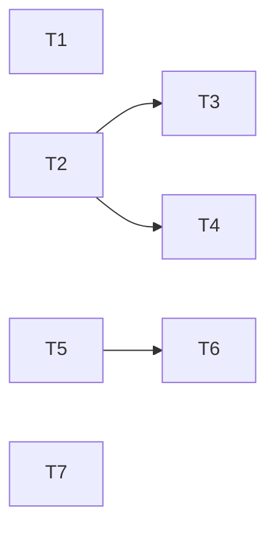
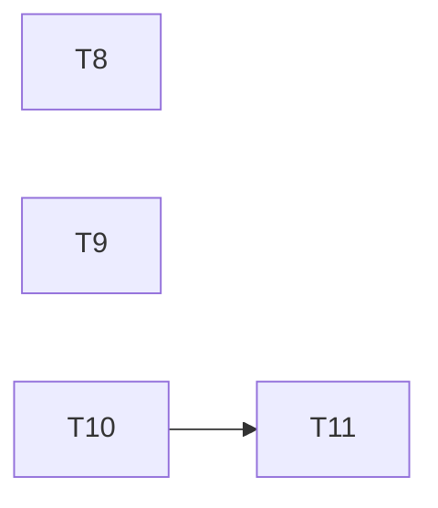
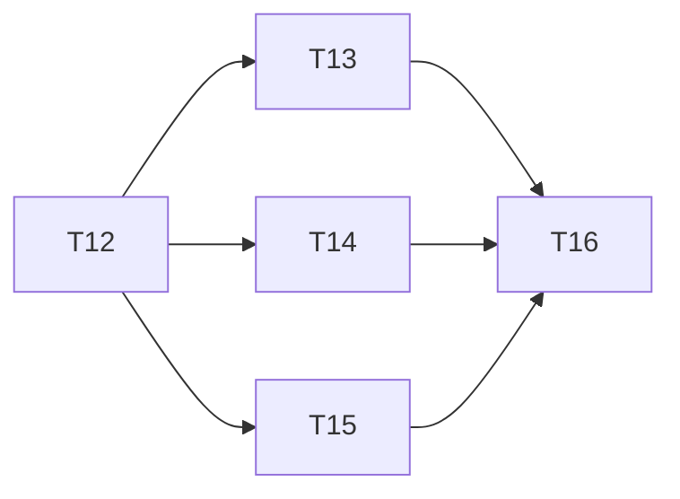
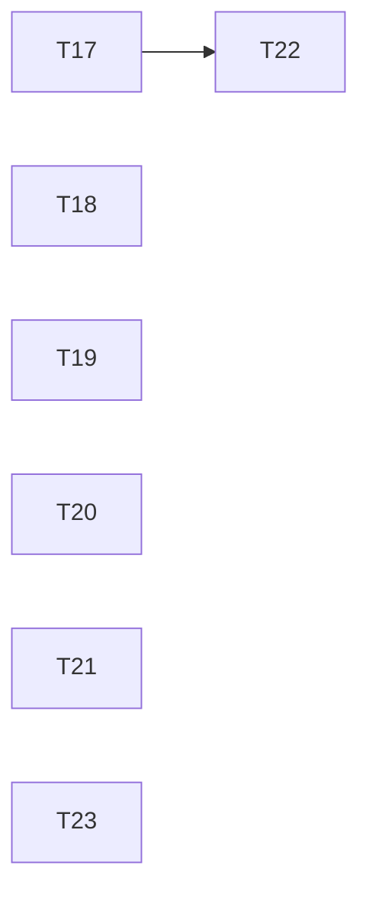
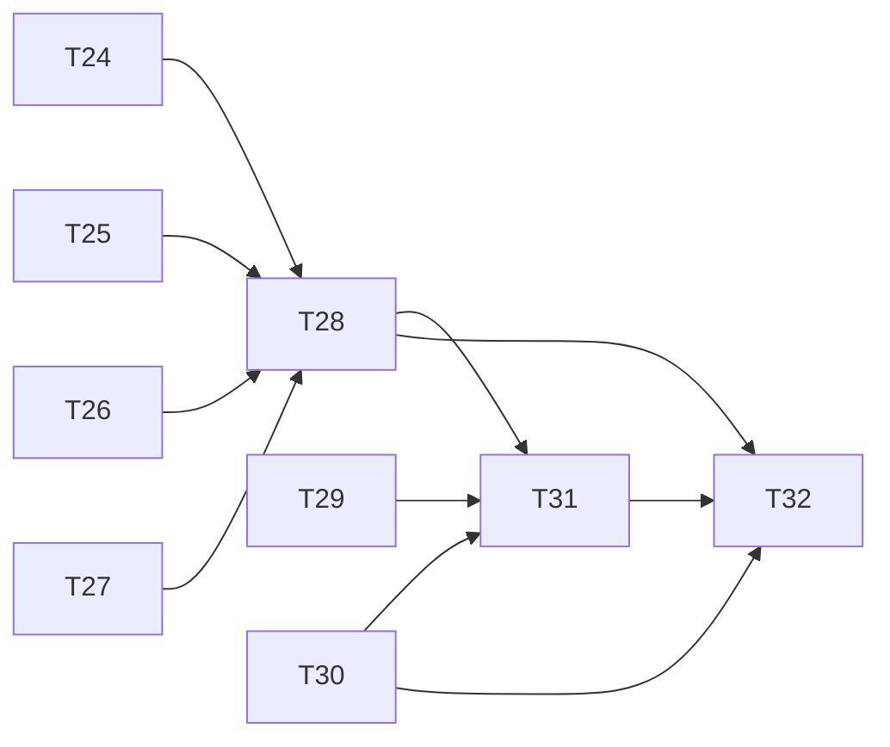
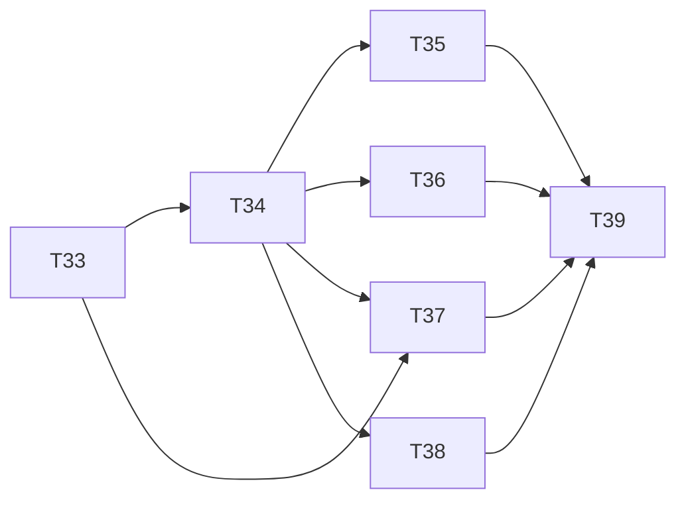
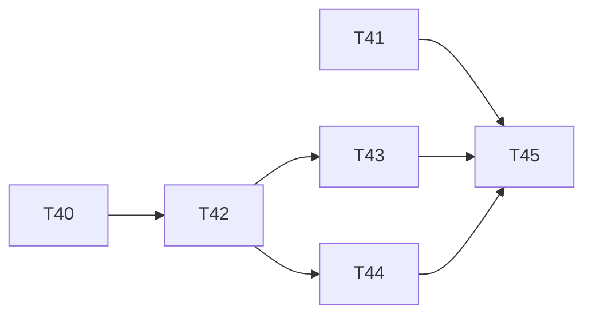
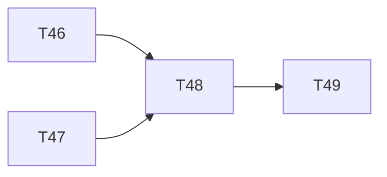
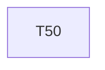
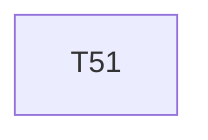

# Banca, Parecer, Requerimento e checklist do dossiê (banca-parecer) Tasks

## Execution Protocol (MANDATORY -- do not skip)

Implement these tasks with the `tlc-spec-driven` skill: **activate it by name and follow its Execute flow and Critical Rules.** Do not search for skill files by filesystem path. The skill is the source of truth for the full flow (per-task cycle, sub-agent delegation, adequacy review, Verifier, discrimination sensor).

**If the skill cannot be activated, STOP and tell the user - do not proceed without it.**

---

**Design**: `.specs/features/banca-parecer/design.md`
**Spec**: `.specs/features/banca-parecer/spec.md`
**Status**: Approved (usuário, 2026-11-22: "Aprovar e executar" + decisões da seção Notas confirmadas; 7 lotes por sub-agente + Verifier)

Regras de execução desta feature:

- Cada tarefa escreve primeiro os testes que derivam dos critérios de aceitação da spec e só então o código (os itens `Done when` começam pelo teste). Teste existente que muda por causa de requisito novo é listado na tarefa com o requisito que justifica a mudança; nenhum teste é apagado sem substituto nem enfraquecido.
- Só dados sintéticos; `Documentos/`, `Modelos/`, `requeriment.txt`, `test/` e `corpus-reports/` nunca são abertos. As portarias, os PDFs e as imagens de teste são gerados no próprio teste. O modelo público da PROGEP (`docs/referencias/normas/PROGEP-Modelo-Requerimento-Progressao-Promocao.docx`) pode ser lido só para conferir os textos literais do Requerimento (T9).
- Um commit por tarefa (Conventional Commits, terminando com `Co-Authored-By: Claude Sonnet 5.5 <noreply@anthropic.com>`), marcando a tarefa neste arquivo e a rastreabilidade da spec no mesmo commit.
- Sem push, deploy nem acesso à VM sem autorização explícita. A migração `0011` chega à VM só no deploy autorizado, **depois da `0010` do `normativo`** (a `0011` tem `down_revision = "0010"`), com dump antes: o `ALTER TYPE ... ADD VALUE` não se desfaz.
- **Gate em níveis**: o gate completo do backend leva cerca de 14 minutos, então cada tarefa roda o nível `targeted` (ou `quick`) com os arquivos que ela escreve e os testes existentes que ela lista; o gate `full` roda só na **última tarefa de backend de cada fase** (T7, T11, T16, T23, T32, T39), e o `build` ao fim da documentação (T50) e na verificação (T51). Tarefas de frontend rodam o gate `front`.
- Classe, denominação e nível do processo saem sempre dos seis campos que o servidor digitou na Etapa 1 (NMOV-01 do `normativo`): nenhuma tarefa deduz a classe seguinte, a denominação ou o nível, e nenhum texto de documento usa `next_class` nem a estrutura de carreira para isso.
- O Parecer e o Requerimento são gerados sem IA (PAR-11, REQ-08), e a conclusão do Parecer nunca é preenchida nem sugerida pelo sistema (PAR-12). A IA só lê a portaria (PORT-02), recebe só texto mascarado (PORT-04), e a chave da MariTalk fica só no backend (nunca em log, resposta, exceção nem pacote do frontend).
- Sem campo de justificativa nas Etapas 6 e 7 (regra 5). A auditoria da portaria, do Parecer, da cidade e das marcas guarda identificadores, contagens, códigos e datas; **nome de membro da banca não entra no registro de auditoria** (decisão confirmada pelo usuário em 2026-11-22, ver Notas).
- Documentos já gerados não mudam (AD-012): o Parecer e o Requerimento são versões imutáveis, numeradas só em `PRONTO`.
- Cada tarefa que adiciona caso de uso a `Container` o liga na tarefa de ligação (T34); os testes de caso de uso montam o caso de uso direto com `uow_factory`, como em `backend/tests/integration/doc_usecases/`.

---

## Test Coverage Matrix

> Generated from project guidelines, spec, design and the existing suites. Guidelines found: `CLAUDE.md` (regras 1 a 11, regra 5 sem justificativa, regra 8 conclusão, regra 9 exclusão, gate), AD-001 (teste de arquitetura `backend/tests/architecture/test_layers.py`: domínio e aplicação sem FastAPI, SQLAlchemy nem `app.infrastructure`), AD-002, AD-004 (integração em PostgreSQL real), AD-005, AD-006, AD-008 (thread única do worker), AD-009 (saída da IA não confiável e conferida na página), AD-011 (DOCX com python-docx e PDF com reportlab, sem LibreOffice), AD-012 (versão imutável), AD-015 (arquivo de entrada), AD-018 (exclusão do processo), AD-023, AD-024, `backend/pyproject.toml` (`ruff` com `E,F,I,B,UP`, linha 100; marcador `integration`) e `frontend/package.json` (`lint`, `build`, `vitest`). Existing tests sampled: `backend/tests/unit/domain/test_conclusion_purge.py`, `test_download_names.py`, `test_generated_entities.py`, `test_generation_snapshot.py`, `backend/tests/unit/infrastructure/test_report_docx.py`, `test_report_pdf.py`, `test_document_writer.py`, `test_dossier_order_file.py`, `test_maritalk.py`, `backend/tests/integration/doc_usecases/test_request_generation.py`, `test_run_generation_report.py`, `test_conclude_process.py`, `test_worker_runners.py`, `backend/tests/integration/documents/test_report_draft_repository.py`, `test_process_purge_repository.py`, `backend/tests/integration/api/test_generated_documents_api.py`, `test_conclusion_api.py`, `test_dossier_order_api.py`, `frontend/src/components/GeneratedBlock.test.tsx`, `ConcludeDialog.test.tsx`, `StepNav.test.tsx`, `frontend/src/pages/ProcessGenerated.test.tsx`.

| Code Layer | Required Test Type | Coverage Expectation | Location Pattern | Run Command |
| --- | --- | --- | --- | --- |
| Domain (entities, rules, documentos puros) | unit | All branches; 1:1 to spec ACs (PORT-02, 03, 11; PAR-03 a 06, 12, 13; REQ-02 a 07; DOS-01 a 06, DOS-07 na parte pura); every edge case of the spec (`MEMBRO_REPETIDO`, `MEMBROS_NAO_ENCONTRADOS`, cidade vazia, sem Parecer, mínimo não definido, salto de classe copiado como digitado) | `backend/tests/unit/domain/test_*.py` | `cd backend && .venv/bin/pytest tests/unit tests/architecture -q` |
| Infrastructure documents e IA (escritores DOCX e PDF, carregador de configuração, `MariTalkOrdinanceExtractor`) | unit | Mesmo conteúdo e mesma ordem em DOCX e PDF; texto limpo por `xml_safe`; JSON estrito, só texto mascarado, chave fora de log e `repr`; cada falha do provedor no código certo; arquivo de configuração inválido nomeia o campo | `backend/tests/unit/infrastructure/test_*.py` | `cd backend && .venv/bin/pytest tests/unit tests/architecture -q` |
| Use cases + services | integration | Happy + every listed edge case + error paths (404 fora do acesso, 409 somente leitura, 409 versão, 422 por campo, ordem das recusas do Parecer); auditoria de cada escrita; arquivo removido do disco só depois do commit; leitura que falha, que é interrompida e que não sobrescreve o que a pessoa digitou | `backend/tests/integration/doc_usecases/test_*.py`, `backend/tests/integration/test_*.py` | `cd backend && .venv/bin/pytest tests/integration -q` |
| Repositories / migrations / models | integration | `upgrade` e `downgrade` da `0011` (valores de enum que ficam, tabelas e enums que saem); versão otimista (`expected_version=0` cria); `SKIP LOCKED` da fila; JSONB dos membros; exclusão do processo com as quatro tabelas novas e `busy_reasons` com `LEITURA_PORTARIA` | `backend/tests/integration/test_*.py`, `backend/tests/integration/documents/test_*.py` | `cd backend && .venv/bin/pytest tests/integration -q` |
| API routes and schemas | integration | Todas as rotas novas: happy path + 401 + 404 fora do acesso + 409 somente leitura + 409 versão + 422 por campo; geração e download dos dois tipos novos; aceitação ponta a ponta (portaria, Parecer, Requerimento, checklist) | `backend/tests/integration/api/test_*.py`, `backend/tests/unit/presentation/test_*.py` | `cd backend && .venv/bin/pytest tests/integration/api tests/unit/presentation -q` |
| Composition root (`dependencies.py`, `main.py`, worker) | integration | Container expõe os casos de uso novos; ordem dos executores (geração, redação, portaria, OCR); recuperador da portaria chamado na partida; fake injetável | `backend/tests/integration/api/test_*wiring.py`, `backend/tests/integration/doc_usecases/test_worker_*.py` | `cd backend && .venv/bin/pytest tests/integration -q` |
| Frontend components/pages/api | unit | Cada requisito de tela (PORT-01 a 08, 11; PAR-01, 12, 13; DOS-02 a 07; BNAV-01, 02): render + interação + estados (sem arquivo, lendo, lida, falhou, informada, somente leitura), API simulada com `mockFetch` | `frontend/src/**/*.test.tsx`, `frontend/src/labels.test.ts` | `cd frontend && npm test -- --run` |
| Types / docs | none | build gate only | - | build gate only |

## Gate Check Commands

| Gate Level | When to Use | Command |
| --- | --- | --- |
| Quick | Tarefas só com testes unitários de backend (domínio, escritores, extrator) | `cd backend && .venv/bin/ruff check . && .venv/bin/pytest tests/unit tests/architecture -q` |
| Targeted | Tarefas com testes de integração de backend: só os arquivos que a tarefa escreve ou muda, mais os testes existentes que ela lista | `cd backend && .venv/bin/ruff check . && .venv/bin/pytest <arquivos da tarefa> -q` |
| Full | Última tarefa de backend de cada fase (cerca de 14 minutos) | `cd backend && .venv/bin/ruff check . && .venv/bin/pytest -q` |
| Front | Tarefas de frontend | `cd frontend && npm run lint && npm run build && npm test -- --run` |
| Build | Fim da documentação e verificação | `cd backend && .venv/bin/ruff check . && .venv/bin/pytest -q && cd ../frontend && npm run lint && npm run build && npm test -- --run` |

---

## Execution Plan

Phases are ordered and run sequentially - each phase completes before the next begins, and tasks within a phase execute in order. A tarefa que depende de fase anterior lista a dependência em `Depends on`; o diagrama de cada fase mostra só as dependências da própria fase.

Lotes de execução (fases inteiras, ~7 tarefas cada; uma fase nunca é dividida entre workers): **Lote 1** = Fase 1 (7 tarefas de domínio e curtas); **Lote 2** = Fases 2 e 3 (9); **Lote 3** = Fase 4 (7); **Lote 4** = Fase 5 (9, cadeia estreita de escritores e geração); **Lote 5** = Fase 6 (7); **Lote 6** = Fase 7 (6); **Lote 7** = Fases 8 e 9 (5); a Fase 10 (Verifier) roda sozinha, por agente diferente do autor.

### Phase 1: Entidades, regras da banca e tipos de documento (domínio puro)

### Phase 2: Textos do Parecer e do Requerimento e checklist (domínio puro)

### Phase 3: Persistência

### Phase 4: Portaria da banca (casos de uso, leitura pela IA e conclusão)

### Phase 5: Parecer e Requerimento (escritores e geração)

### Phase 6: Dossiê, ligação e API

### Phase 7: Frontend, navegação e Etapa 6

### Phase 8: Frontend, Etapa 7 e conclusão

### Phase 9: Documentação

### Phase 10: Verificação independente

---

## Task Breakdown

### Phase 1: Entidades, regras da banca e tipos de documento (domínio puro)

#### T1: Data por extenso

**Status**: Done

**What**: `format_long_date(d: date) -> str` escreve a data como "10 de março de 2025": dia sem zero à esquerda e sem ordinal, mês em português com acento, ano com quatro dígitos, sem depender do idioma do sistema.
**Where**: `backend/app/domain/rules/pt_format.py` (modify)
**Depends on**: None
**Reuses**: `format_date` e as demais funções de `pt_format.py`
**Requirement**: REQ-05, PAR-03

**Tools**:

- MCP: NONE
- Skill: NONE

**Done when**:

- [x] Testes primeiro em `backend/tests/unit/domain/test_pt_format.py`: `date(2025, 3, 10)` dá "10 de março de 2025" (o exemplo da spec); os doze meses com a grafia certa, incluindo "março"; dia 1 dá "1 de janeiro de 2026" (sem zero e sem "1º"); 29 de fevereiro de 2024; o resultado não muda com `LC_TIME` diferente (nada de `strftime("%B")`)
- [x] Gate check passes: `cd backend && .venv/bin/ruff check . && .venv/bin/pytest tests/unit tests/architecture -q`
- [x] Test count: os testes novos passam e nenhum teste existente foi apagado

**Tests**: unit
**Gate**: quick

**Commit**: `feat(domain): format a date in long form`

---

#### T2: Entidades da banca

**Status**: Done

**What**: `BoardRole` (`PRESIDENTE`, `MEMBRO`, `SUPLENTE`), `ValueSource` (`EXTRAIDO`, `INFORMADO`), `ReadingState` (`SEM_ARQUIVO`, `PENDENTE`, `LENDO`, `LIDA`, `FALHOU`), `OpinionConclusion` (`FAVORAVEL`, `DESFAVORAVEL`), `OrdinanceReadingCode` (`IA_INDISPONIVEL`, `IA_CREDENCIAL_RECUSADA`, `RESPOSTA_INVALIDA`, `TEXTO_ILEGIVEL`, `INTERROMPIDA`, `ERRO_INTERNO`), `OrdinanceWarningCode` (`VALOR_SEM_ORIGEM`, `MEMBROS_NAO_ENCONTRADOS`), `BoardMember(name, role, page, source)`, `OrdinanceFile(internal_name, original_name, mime, size_bytes, sha256, page_count, deleted_at)`, `BoardOrdinance`, `BoardOpinion` e `RequestSettings` com `version`, e `can_read_transition(current, target)`. `BoardOrdinance.is_registered` é verdadeiro com ao menos um membro (DOS-03) e `BoardOpinion.conclusion` não tem valor padrão.
**Where**: `backend/app/domain/entities/board.py` (new)
**Depends on**: None
**Reuses**: padrão de `domain/entities/norm.py` (`NormFile`, dataclass com `version`) e de `domain/entities/generated.py` (`can_transition`)
**Requirement**: PORT-02, PORT-05, PORT-07, PAR-01, PAR-12

**Tools**:

- MCP: NONE
- Skill: NONE

**Done when**:

- [x] Testes primeiro em `backend/tests/unit/domain/test_board.py` (novo): os valores literais de cada enum; `BoardOpinion` novo tem `conclusion is None`, data, local e observações vazios (PAR-12: nenhum valor inicial); `BoardOrdinance` novo está em `SEM_ARQUIVO`, sem membros, `is_registered` falso, e com um membro passa a verdadeiro; `can_read_transition` aceita `SEM_ARQUIVO` a `PENDENTE`, `PENDENTE` a `LENDO`, `LENDO` a `LIDA` ou `FALHOU`, `LIDA` ou `FALHOU` a `PENDENTE` e recusa qualquer outra
- [x] Teste de arquitetura passa (o domínio não importa FastAPI nem SQLAlchemy)
- [x] Gate check passes: `cd backend && .venv/bin/ruff check . && .venv/bin/pytest tests/unit tests/architecture -q`
- [x] Test count: os testes novos passam e nenhum teste existente foi apagado

**Tests**: unit
**Gate**: quick

**Commit**: `feat(domain): add the board, ordinance and opinion entities`

---

#### T3: Validação dos dados da banca

**Status**: Done

**What**: `BoardFieldError(FieldError)` com `code` opcional, `validate_board_data(number, members) -> list[BoardFieldError]` (até 15 membros; nome não vazio e até 200 caracteres; número até 50; `MEMBRO_REPETIDO` para o mesmo nome sem maiúsculas nem acentos), `validate_opinion_fields(place, notes)` (local até 100, observações até 5 000) e `validate_city(city)` (até 100).
**Where**: `backend/app/domain/rules/board_rules.py` (new)
**Depends on**: T2
**Reuses**: `FieldError` de `domain/rules/norm_rules.py:17`; `normalize_title` de `domain/rules/grounding.py` para comparar nomes sem acento
**Requirement**: PORT-11, PAR-13, REQ-05

**Tools**:

- MCP: NONE
- Skill: NONE

**Done when**:

- [x] Testes primeiro em `backend/tests/unit/domain/test_board_rules.py` (novo): 15 membros passam e 16 dão erro no campo `members`; nome vazio, só com espaços, com 200 caracteres (passa) e com 201 (erro no campo do membro, `members[2].name`); número com 50 caracteres passa e com 51 dá erro em `number`; lista vazia passa (a pessoa pode gravar sem membros); "José da Silva" e "JOSE DA SILVA" dão `MEMBRO_REPETIDO` com o código no erro e o índice do segundo; o mesmo nome com funções diferentes também é repetido; observações com 5 000 caracteres passam e com 5 001 dão erro em `notes`; local com 100 passa e com 101 dá erro em `place`; cidade com 100 passa e com 101 dá erro em `city`
- [x] Teste de arquitetura passa
- [x] Gate check passes: `cd backend && .venv/bin/ruff check . && .venv/bin/pytest tests/unit tests/architecture -q`
- [x] Test count: os testes novos passam e nenhum teste existente foi apagado

**Tests**: unit
**Gate**: quick

**Commit**: `feat(domain): validate the data of the board, the opinion and the city`

---

#### T4: Conferência da portaria lida pela IA

**Status**: Done

**What**: `OrdinanceAi` (número, página do número, data, página da data, membros com nome, função e página), `GroundedOrdinance` com os avisos, `ground_ordinance(ai, pages) -> GroundedOrdinance` e `merge_reading(current, grounded)`. Cada valor é conferido no texto **original** da página citada; sem origem o valor fica vazio com `VALOR_SEM_ORIGEM`; lista sem membro dá `MEMBROS_NAO_ENCONTRADOS`; `merge_reading` não sobrescreve campo de origem `INFORMADO`.
**Where**: `backend/app/domain/rules/ordinance_grounding.py` (new)
**Depends on**: T2
**Reuses**: `identifier_in_text`, `date_in_text`, `name_in_text` (`domain/rules/grounding.py:72,127,142`)
**Requirement**: PORT-02, PORT-03, Edge Case (`MEMBROS_NAO_ENCONTRADOS`)

**Tools**:

- MCP: NONE
- Skill: NONE

**Done when**:

- [x] Testes primeiro em `backend/tests/unit/domain/test_ordinance_grounding.py` (novo), com páginas sintéticas: número, data e três membros que aparecem na página citada ficam com a página e `EXTRAIDO`; o número que só aparece em outra página fica vazio com `VALOR_SEM_ORIGEM` no campo; data em "10 de março de 2025" e em "10/03/2025" confere; nome com acento e caixa diferentes confere; página que não existe (0 ou 99) não dá origem; membro cujo nome não está na página é descartado com `VALOR_SEM_ORIGEM` e os outros ficam; função fora de `PRESIDENTE`, `MEMBRO` e `SUPLENTE` descarta o membro com o aviso; sem nenhum membro a lista fica vazia com `MEMBROS_NAO_ENCONTRADOS`; `merge_reading` mantém número, data e lista de origem `INFORMADO`, troca os de origem `EXTRAIDO` ou vazios, e a lista de membros é um campo só (basta um membro `INFORMADO` para a lista inteira ficar)
- [x] Teste de arquitetura passa
- [x] Gate check passes: `cd backend && .venv/bin/ruff check . && .venv/bin/pytest tests/unit tests/architecture -q`
- [x] Test count: os testes novos passam e nenhum teste existente foi apagado

**Tests**: unit
**Gate**: quick

**Commit**: `feat(domain): ground the ordinance read by the AI in the text of its pages`

---

#### T5: Tipos de documento gerado e códigos novos

**Status**: Done

**What**: `DocumentKind` ganha `REQUERIMENTO` e `PARECER`; `GenerationCode` ganha `CONCLUSAO_AUSENTE`, `BANCA_SEM_MEMBROS`, `TABELA_AUSENTE`, `TABELA_DESATUALIZADA` e `PORTARIA_EXISTENTE`; `ARTIFACT_KINDS = (TABELA, RELATORIO, COMPROVANTE)` é a lista que a conclusão exige; `_STEMS` de `download_names` ganha "Requerimento" e "Parecer".
**Where**: `backend/app/domain/entities/generated.py` (modify; os dois nomes novos em `backend/app/domain/rules/download_names.py`)
**Depends on**: None
**Reuses**: enums existentes de `generated.py`; `_STEMS` de `download_names.py:10-14` (o arquivo está em `domain/rules/`, não em `application/services/` como o design cita)
**Requirement**: PAR-02, REQ-01, PAR-07, PAR-08, PAR-09, PAR-10, PORT-08

**Tools**:

- MCP: NONE
- Skill: NONE

**Done when**:

- [x] Testes primeiro: `backend/tests/unit/domain/test_generated_entities.py:54` passa a esperar os cinco valores de `DocumentKind` na ordem `TABELA`, `RELATORIO`, `COMPROVANTE`, `REQUERIMENTO`, `PARECER` e os cinco códigos novos em `GenerationCode`; `backend/tests/unit/domain/test_download_names.py` ganha os quatro nomes novos (`Requerimento_2020-2024_v2.pdf`, `.docx`, `Parecer_2020-2024_v2.pdf`, `.docx`) e a parametrização sobre `list(DocumentKind)` cobre os cinco tipos; `ARTIFACT_KINDS` tem só os três tipos exigidos, nessa ordem
- [x] Testes existentes que enumeram `DocumentKind` e passam a usar `ARTIFACT_KINDS` (PAR-02, REQ-01: com o tipo novo, pedir "todos os tipos" geraria Parecer e Requerimento sem os pré-requisitos): `backend/tests/integration/doc_usecases/test_request_generation.py:30,79`, `test_request_refusals.py:178`, `conclusion_support.py:87` (`add_all_ready`), `backend/tests/integration/api/generated_support.py:114` (`add_all_ready`) e `test_conclusion_acceptance.py:80`; `test_generation_snapshot.py:156` segue passando sobre os cinco tipos
- [x] Gate check passes: `cd backend && .venv/bin/ruff check . && .venv/bin/pytest tests/unit/domain/test_generated_entities.py tests/unit/domain/test_download_names.py tests/unit/domain/test_generation_snapshot.py tests/integration/doc_usecases/test_request_generation.py tests/integration/doc_usecases/test_request_refusals.py tests/integration/api/test_conclusion_acceptance.py tests/architecture -q`
- [x] Test count: os testes novos passam e nenhum teste existente foi apagado

**Tests**: unit
**Gate**: targeted

**Commit**: `feat(domain): add the Requerimento and Parecer document kinds and their refusal codes`

---

#### T6: Conclusão com os tipos novos e aviso dos pendentes

**Status**: Done

**What**: `summarize_purge` monta `artifacts` só com `ARTIFACT_KINDS`, soma o arquivo da portaria (quando ainda existe) a `files` e `bytes`, e devolve `pending_board`; `pending_board_items(ready_kinds, ordinance_registered)` lista, nesta ordem, `REQUERIMENTO`, `PORTARIA_BANCA` e `PARECER` que ainda não existem; `ConclusionPreview.pending_board: tuple[str, ...] = ()`; `check_conclusion` segue exigindo só os três tipos.
**Where**: `backend/app/domain/rules/conclusion_rules.py` (modify; o campo novo em `backend/app/domain/entities/conclusion.py`)
**Depends on**: T5
**Reuses**: `_KIND_ORDER` (passa a ser `ARTIFACT_KINDS`), `PurgeableDocument` (a portaria também tem tamanho e marca de arquivo excluído)
**Requirement**: DOS-07, Edge Case (conclusão apaga o arquivo da portaria e mantém os dados)

**Tools**:

- MCP: NONE
- Skill: NONE

**Done when**:

- [x] Testes primeiro em `backend/tests/unit/domain/test_conclusion_purge.py` e `test_conclusion_check.py`: `artifacts` tem exatamente as chaves `TABELA`, `RELATORIO` e `COMPROVANTE` mesmo com `REQUERIMENTO` e `PARECER` prontos; `pending_board` com nada pronto e portaria sem membro é `("REQUERIMENTO", "PORTARIA_BANCA", "PARECER")`; com Parecer pronto sai `PARECER`; com portaria registrada (ao menos um membro) sai `PORTARIA_BANCA`; com tudo pronto é vazio; `check_conclusion` com os três tipos prontos e Parecer e Requerimento pendentes continua permitido (o aviso não bloqueia); a portaria com arquivo soma 1 arquivo e os bytes, e com `file_deleted_at` preenchido não soma
- [x] Testes existentes que mudam por DOS-07: `test_conclusion_purge.py:45-57` (`dict.fromkeys(DocumentKind, False)` passa a `ARTIFACT_KINDS`) e `test_conclusion_entities.py` (o campo novo tem padrão vazio, então a construção atual segue valendo)
- [x] Teste de arquitetura passa
- [x] Gate check passes: `cd backend && .venv/bin/ruff check . && .venv/bin/pytest tests/unit tests/architecture -q`
- [x] Test count: os testes novos passam e nenhum teste existente foi apagado

**Tests**: unit
**Gate**: quick

**Commit**: `feat(domain): list the pending board documents when concluding a process`

---

#### T7: Mínimo de referência no instantâneo da Tabela

**Status**: Done

**What**: `build_snapshot` ganha `minimum: MinimumComparison | None = None` e grava `snapshot["minimum"] = {"status": "ATINGE" | "NAO_ATINGE" | "NAO_DEFINIDO", "value": "100.00" | None}` quando recebe o valor; sem o argumento a chave não aparece (Tabela antiga).
**Where**: `backend/app/domain/rules/generation_snapshot.py` (modify)
**Depends on**: None
**Reuses**: `MinimumComparison` e `MinimumStatus` de `domain/rules/scoring_verification.py:24-42`; `_money` do mesmo arquivo
**Requirement**: PAR-04, PAR-06

**Tools**:

- MCP: NONE
- Skill: NONE

**Done when**:

- [x] Testes primeiro em `backend/tests/unit/domain/test_generation_snapshot.py`: com `MinimumComparison(ATINGE, Decimal("100"), Decimal("211"))` o instantâneo traz `{"status": "ATINGE", "value": "100.00"}`; `NAO_ATINGE` idem com o valor; `NAO_DEFINIDO` traz `value` nulo; sem o argumento a chave `minimum` não existe; o instantâneo continua sobrevivendo a ida e volta por JSON e continua igual para a mesma entrada
- [x] Teste existente: `test_the_snapshot_survives_a_json_round_trip_unchanged` (parametrizado nos cinco tipos) passa sem mudança
- [x] Gate check passes: `cd backend && .venv/bin/ruff check . && .venv/bin/pytest -q` (última tarefa de backend da fase: gate completo)
- [x] Test count: os testes novos passam e nenhum teste existente foi apagado

**Tests**: unit
**Gate**: full

**Commit**: `feat(domain): keep the reference minimum in the snapshot of a generated version`

---

### Phase 2: Textos do Parecer e do Requerimento e checklist (domínio puro)

#### T8: Texto do Parecer

**Status**: Done

**What**: `OpinionDocument` e `build_opinion(process, professor, unit, ordinance, opinion, table_snapshot, versions_used, minimum, group_names, page) -> OpinionDocument`, com as seções na ordem de PAR-03: cabeçalho (UFPA e unidade), título "PARECER", identificação, portaria (número e data), interstício, documentos analisados (versão usada de Tabela, Relatório e Comprovante), pontos por grupo I a VIII e Total geral, mínimo de referência, conclusão, observações, local e data e uma linha de assinatura por membro. Sem conclusão, `ValueError`.
**Where**: `backend/app/domain/rules/opinion_document.py` (new)
**Depends on**: T1, T2, T7
**Reuses**: `format_decimal`, `format_interstice`, `format_long_date` de `domain/rules/pt_format.py`; `roman` de `domain/rules/table_document.py`; `ReportDocument` e `PageSetup` de `domain/entities/report.py` como molde (o `page` vem da configuração do Relatório, para os dois documentos terem a mesma aparência)
**Requirement**: PAR-03, PAR-04, PAR-05, PAR-06, PAR-11, PAR-12, NMOV-01 (do `normativo`)

**Tools**:

- MCP: NONE
- Skill: NONE

**Done when**:

- [x] Testes primeiro em `backend/tests/unit/domain/test_opinion_document.py` (novo): as seções saem na ordem de PAR-03; os pontos por grupo e o Total geral são os do instantâneo, formatados "211,00", sem recalcular (um instantâneo com subtotais que não somam o total é copiado como veio: o Parecer nunca soma de novo); a identificação traz classe, denominação e nível atuais e pretendidos exatamente como informados, com um processo sintético de salto (nível 4 da classe B "Adjunto" para o nível 1 da classe C "Associado") e com denominações fora do padrão, nada deduzido; a frase da conclusão é "A banca manifesta-se FAVORÁVEL à progressão de <docente>, do nível 4 da classe B (Adjunto) para o nível 1 da classe C (Associado), referente ao interstício de 23/11/2022 a 23/11/2024." com "promoção" na modalidade de promoção e "DESFAVORÁVEL" na outra conclusão (PAR-05); mínimo `NAO_DEFINIDO` escreve "Mínimo de referência: não definido pela norma aplicável" sem número (PAR-06) e mínimo numérico escreve o valor; uma linha de assinatura por membro, com nome e função, na ordem da portaria; observações vazias não criam seção; local vazio escreve "__________" e data vazia "___/___/___"; sem conclusão levanta `ValueError` (PAR-12: o domínio nunca escreve um Parecer sem a escolha da pessoa); a função não lê relógio nem chama IA (PAR-11)
- [x] Teste de arquitetura passa
- [x] Gate check passes: `cd backend && .venv/bin/ruff check . && .venv/bin/pytest tests/unit tests/architecture -q`
- [x] Test count: os testes novos passam e nenhum teste existente foi apagado

**Tests**: unit
**Gate**: quick

**Commit**: `feat(domain): build the text of the Parecer from the table snapshot and the ordinance`

---

#### T9: Texto do Requerimento

**Status**: Done

**What**: `RequestDocument` e `build_request(process, professor, unit, career_code, city, last_opinion_date, page) -> RequestDocument` com os textos literais do modelo da PROGEP: cabeçalho MEC, UFPA e PROGEP, título, "Prezado Sr. Presidente da CPPD,", a opção "(X) PROGRESSÃO FUNCIONAL POR DESEMPENHO ACADÊMICA/PROMOÇÃO", o parágrafo do pedido, a linha da avaliação de desempenho, "<cidade>, <data de abertura por extenso>.", "Nestes termos, pede deferimento.", assinatura, "Assinatura do (a) requerente", "Matrícula SIAPE: <siape>" e a observação da LGPD. Cidade vazia dá "__________"; sem Parecer a data da avaliação é "___/___/___"; a parte "REVISÃO" não entra.
**Where**: `backend/app/domain/rules/request_document.py` (new)
**Depends on**: T1
**Reuses**: `format_long_date`, `format_interstice`, `format_date` de `domain/rules/pt_format.py`; `PageSetup` de `domain/entities/report.py`; o modelo público `docs/referencias/normas/PROGEP-Modelo-Requerimento-Progressao-Promocao.docx` (só para conferir os textos literais)
**Requirement**: REQ-02, REQ-03, REQ-04, REQ-05, REQ-06, REQ-07, REQ-08

**Tools**:

- MCP: NONE
- Skill: NONE

**Done when**:

- [x] Texto literal de cada frase fixa conferido contra o modelo público da PROGEP (leitura do `.docx` público; o teste não abre o arquivo, usa os textos copiados)
- [x] Testes primeiro em `backend/tests/unit/domain/test_request_document.py` (novo): o cabeçalho, o título "REQUERIMENTO DE PROGRESSÃO/PROMOÇÃO/REVISÃO - DOCENTES (MAGISTÉRIO SUPERIOR E EBTT)" e a opção "(X) PROGRESSÃO FUNCIONAL POR DESEMPENHO ACADÊMICA/PROMOÇÃO" saem como no modelo (REQ-02); um processo sintético de promoção do nível 4 da classe B para o nível 1 da classe C traz nome, SIAPE, "(X) Magistério Superior" (código `MAGISTERIO_SUPERIOR`), unidade, "promoção", nível, classe e denominação como informados e o interstício em dd/mm/aaaa a dd/mm/aaaa (REQ-03); código de carreira desconhecido deixa as duas opções sem marca; a linha da avaliação traz a data do último Parecer em dd/mm/aaaa e, sem Parecer, "___/___/___" (REQ-04); a linha final é "Belém, 10 de março de 2025." para cidade "Belém" e data de abertura 10/03/2025, e "__________, 10 de março de 2025." sem cidade (REQ-05, REQ-06); "Matrícula SIAPE: <siape>" e a observação da LGPD no fim; nenhuma seção de revisão (a palavra REVISÃO só aparece no título, REQ-07); a função não chama IA nem lê relógio (REQ-08)
- [x] Teste de arquitetura passa
- [x] Gate check passes: `cd backend && .venv/bin/ruff check . && .venv/bin/pytest tests/unit tests/architecture -q`
- [x] Test count: os testes novos passam e nenhum teste existente foi apagado

**Tests**: unit
**Gate**: quick

**Commit**: `feat(domain): build the text of the Requerimento from the PROGEP model`

---

#### T10: Ordem do dossiê com chave e origem

**Status**: Done

**What**: `DossierSource` (`GERADO`, `PORTARIA_BANCA`, `MANUAL`); `DossierItem` ganha `key` e `source`; `load_dossier_order` lê os dois campos e valida (chave única e não vazia; `GERADO` exige `generated_by`; os outros não podem tê-lo); `dossier_order.json` passa a ter 9 itens com os dois da banca no fim, e o Requerimento e o Parecer com `generated_by`.
**Where**: `backend/app/domain/entities/report.py` (modify; o carregador em `backend/app/infrastructure/documents/config_loader.py` e os dados em `backend/app/infrastructure/documents/config/dossier_order.json`)
**Depends on**: T5
**Reuses**: `load_dossier_order` e `_generated_by` (`config_loader.py:327-355`), `DossierItem` (`entities/report.py:127`)
**Requirement**: DOS-01

**Tools**:

- MCP: NONE
- Skill: NONE

**Done when**:

- [x] Testes primeiro em `backend/tests/unit/infrastructure/test_dossier_order_file.py`: o arquivo tem 9 itens com `order` de 1 a 9; os três primeiros e o quarto a sétimo mantêm os títulos de hoje; o oitavo é "Portaria da banca" (`PORTARIA_BANCA`) e o nono "Parecer da banca" (`PARECER`); os gerados são `REQUERIMENTO`, `RELATORIO`, `TABELA`, `COMPROVANTE` e `PARECER`, nessa ordem; as chaves são `REQUERIMENTO`, `PORTARIA_ULTIMA_PROGRESSAO`, `DECLARACAO_EXERCICIOS_ANTERIORES`, `RELATORIO`, `TABELA`, `COMPROVANTE`, `CURRICULO_LATTES`, `PORTARIA_BANCA` e `PARECER`; só os três primeiros itens que o sistema não produz são `MANUAL`
- [x] Testes novos em `backend/tests/unit/infrastructure/test_report_config_loader.py`: chave repetida, chave ausente, `source` fora dos três valores, `GERADO` sem `generated_by` e `MANUAL` com `generated_by` recusam o arquivo nomeando `dossier_order.json` e o campo
- [x] Testes existentes que mudam por DOS-01: `test_dossier_order_file.py` (as três funções: ordem 1 a 7, os três gerados, "4 itens sem gerador" e a ordem dos gerados), o fixture `DOSSIER` e os casos de `test_report_config_loader.py:312-356` (o arquivo passa a ter `key` e `source`), e `backend/tests/integration/api/test_dossier_order_api.py` (a rota `GET /api/dossier-order` segue com `order`, `title` e `generated_by`, agora com 9 itens e cinco tipos marcados; o JSON temporário do segundo teste ganha `key` e `source`)
- [x] Gate check passes: `cd backend && .venv/bin/ruff check . && .venv/bin/pytest tests/unit tests/architecture tests/integration/api/test_dossier_order_api.py -q`
- [x] Test count: os testes novos passam e nenhum teste existente foi apagado

**Tests**: unit
**Gate**: targeted

**Commit**: `feat(documents): give each dossier item a key and a source and add the two board documents`

---

#### T11: Checklist do dossiê

**Status**: Done

**What**: `ChecklistState` (`GERADO`, `REGISTRADA`, `ENTREGUE`, `PENDENTE`), `ChecklistItem(key, order, title, source, state, version_number, generation_id, outdated_table)` e `dossier_checklist(order, ready_by_kind, ordinance, delivered_keys, current_table_version_id) -> list[ChecklistItem]`: item gerado com versão `PRONTO` é `GERADO` com o número e o id da última versão; `PORTARIA_BANCA` com ao menos um membro é `REGISTRADA`; item `MANUAL` marcado é `ENTREGUE`; todo o resto é `PENDENTE`; a Tabela cuja última versão usou outra versão da tabela de pontuação traz `outdated_table`.
**Where**: `backend/app/domain/rules/dossier_checklist.py` (new)
**Depends on**: T2, T5, T10
**Reuses**: `DossierItem` (T10), `GeneratedDocument.table_version_id` via o instantâneo (`schemas/generated.py:112` mostra o mesmo cálculo), a regra de aviso de `frontend/src/components/GeneratedBlock.tsx` (`outdated`)
**Requirement**: DOS-01, DOS-02, DOS-03, DOS-05, DOS-06

**Tools**:

- MCP: NONE
- Skill: NONE

**Done when**:

- [x] Testes primeiro em `backend/tests/unit/domain/test_dossier_checklist.py` (novo), com o arquivo real de configuração (T10) e dados sintéticos: a lista sai na ordem do arquivo e com os nove itens (DOS-01); só Tabela, Relatório e Comprovante prontos dão três `GERADO`, cada um com o número da última versão e o id, e seis `PENDENTE` (o teste independente da spec); a última versão `PRONTO` vale (uma `FALHOU` mais nova não esconde a pronta); portaria sem membro é `PENDENTE` e com um membro é `REGISTRADA` (DOS-03); item `MANUAL` marcado é `ENTREGUE` e desmarcado `PENDENTE`; marca em chave que não é `MANUAL` é ignorada; item sem versão, sem registro e sem marca é `PENDENTE` (DOS-05); `outdated_table` verdadeiro só na Tabela, só quando as duas versões existem e diferem, e falso para Relatório e Comprovante (DOS-06)
- [x] Teste de arquitetura passa
- [x] Gate check passes: `cd backend && .venv/bin/ruff check . && .venv/bin/pytest -q` (última tarefa de backend da fase: gate completo)
- [x] Test count: os testes novos passam e nenhum teste existente foi apagado

**Tests**: unit
**Gate**: full

**Commit**: `feat(domain): derive the state of each item of the dossier checklist`

---

### Phase 3: Persistência

#### T12: Migração `0011_board_opinion` e modelos

**Status**: Done

**What**: Migração `0011` (depois da `0010_norms`): `ALTER TYPE generated_kind ADD VALUE IF NOT EXISTS 'REQUERIMENTO'` e `'PARECER'` (sem usá-los na própria migração), enums `board_role`, `value_source`, `ordinance_reading_state` e `opinion_conclusion`, tabelas `board_ordinances`, `board_opinions`, `request_settings` e `dossier_deliveries` como no design (único por processo, `CHECK char_length(notes) <= 5000`, índice parcial `ix_board_ordinances_pending`), `downgrade` que remove tabelas e enums e mantém os valores de `generated_kind`; os quatro modelos em `models.py`.
**Where**: `backend/alembic/versions/0011_board_opinion.py` (new; os modelos `BoardOrdinanceModel`, `BoardOpinionModel`, `RequestSettingsModel` e `DossierDeliveryModel` em `backend/app/infrastructure/database/models.py`)
**Depends on**: T2, T5
**Reuses**: `0007_process_purge.py:21,60` (`ADD VALUE` irreversível), `0010_norms.py`, `ReportDraftModel` (`models.py:577`), `_enum` (`models.py:44`), `test_migration_norms.py`
**Requirement**: PORT-01, PORT-05, PORT-12, PAR-01, PAR-12, PAR-13, DOS-04

**Tools**:

- MCP: NONE
- Skill: NONE

**Done when**:

- [x] Testes primeiro em `backend/tests/integration/test_migration_board.py` (novo): `upgrade` cria as quatro tabelas, os quatro enums e o índice parcial; duas portarias do mesmo processo falham; `members` nasce `[]`, `reading_state` nasce `SEM_ARQUIVO` e `conclusion` nasce nulo; observações com 5 001 caracteres falham pelo `CHECK`; chave primária composta de `dossier_deliveries` recusa a marca repetida; depois do `upgrade` é possível inserir `generated_documents` de tipo `PARECER` e `REQUERIMENTO` e continua valendo uma só linha `GERANDO` por processo e tipo; `downgrade` a `0010` remove as tabelas e os quatro enums e **mantém** os valores `PARECER` e `REQUERIMENTO` em `generated_kind`; `upgrade` de novo volta ao estado anterior
- [x] Testes existentes que mudam por causa das tabelas e dos valores novos: `backend/tests/integration/test_migrations.py` (`TABLES` ganha as quatro tabelas), `backend/tests/integration/documents/test_generated_schema.py` (confere os cinco valores de `generated_kind` depois do `upgrade` e que o `downgrade` até a `0005` e a volta ao `head` seguem passando) e `backend/tests/integration/documents/test_process_purge_repository.py::test_every_foreign_key_to_the_process_is_handled` (`HANDLED_DIRECT` ganha as quatro tabelas; a exclusão em si vem na T16)
- [x] `test_models_match_migrated_schema` passa (modelos e migração iguais)
- [x] Gate check passes: `cd backend && .venv/bin/ruff check . && .venv/bin/pytest tests/integration/test_migration_board.py tests/integration/test_migrations.py tests/integration/test_migration_norms.py tests/integration/documents/test_generated_schema.py tests/integration/documents/test_process_purge_repository.py -q`
- [x] Test count: os testes novos passam e nenhum teste existente foi apagado

**Tests**: integration
**Gate**: targeted

**Commit**: `feat(db): add the board, opinion, request settings and dossier delivery tables`

---

#### T13: Repositório da portaria da banca

**Status**: Done

**What**: Porta `BoardRepository` (`get`, `create` com `expected_version=0`, `save_data` com versão otimista, `set_file`, `request_reading`, `lock`, `claim_next_pending` com `FOR UPDATE SKIP LOCKED`, `finish_read`, `finish_failed`, `recover_interrupted`, `mark_file_deleted`), `SqlBoardRepository` e `uow.board`.
**Where**: `backend/app/infrastructure/database/repositories.py` (modify; a porta e o atributo do `UnitOfWork` em `backend/app/domain/repositories/ports.py`)
**Depends on**: T2, T12
**Reuses**: `SqlReportDraftRepository` (`repositories.py:1974`: `create` com `expected_version=0`, `_lock`, `_edit`), `SqlGenerationRepository.claim_next` e `recover_interrupted`, `_is_unique_violation`
**Requirement**: PORT-01, PORT-05, PORT-07, PORT-09, PORT-12

**Tools**:

- MCP: NONE
- Skill: NONE

**Done when**:

- [x] Testes primeiro em `backend/tests/integration/documents/test_board_repository.py` (novo): grava e lê uma portaria sem arquivo e com arquivo, com os membros (página nula, `EXTRAIDO` e `INFORMADO`) idênticos na volta pelo JSONB; `create` com versão diferente de 0 levanta `StaleVersion` e um segundo `create` levanta `Conflict`; `save_data` com versão velha levanta `StaleVersion` e com a versão certa sobe a versão (PORT-12); `set_file` devolve o arquivo anterior para o chamador apagar; `claim_next_pending` pega a `PENDENTE` mais antiga, passa a `LENDO` e soma uma tentativa, e duas sessões não pegam a mesma (`SKIP LOCKED`); `finish_read` grava `LIDA` com os campos, os avisos e o JSON bruto; `finish_failed` grava `FALHOU` com o código; `recover_interrupted` passa `LENDO` a `FALHOU` com `INTERROMPIDA` e deixa `PENDENTE` onde está; `mark_file_deleted` preenche `file_deleted_at` e não toca em número, data nem membros; portaria é uma por processo e não aparece em `uow.documents` (PORT-09)
- [x] Gate check passes: `cd backend && .venv/bin/ruff check . && .venv/bin/pytest tests/integration/documents/test_board_repository.py tests/integration/test_migrations.py -q`
- [x] Test count: os testes novos passam e nenhum teste existente foi apagado

**Tests**: integration
**Gate**: targeted

**Commit**: `feat(db): add the board ordinance repository`

---

#### T14: Repositórios do Parecer e da cidade

**Status**: Done

**What**: Portas `OpinionRepository` e `RequestSettingsRepository` (`get`, `create` com `expected_version=0`, `update` com versão otimista), `SqlOpinionRepository`, `SqlRequestSettingsRepository`, `uow.opinions` e `uow.request_settings`.
**Where**: `backend/app/infrastructure/database/repositories.py` (modify; as portas e os atributos do `UnitOfWork` em `backend/app/domain/repositories/ports.py`)
**Depends on**: T2, T12
**Reuses**: `SqlReportDraftRepository.create` e `_edit` (`repositories.py:1974`), `SqlLayoutRepository`
**Requirement**: PAR-01, PAR-12, PAR-13, REQ-05, PORT-12

**Tools**:

- MCP: NONE
- Skill: NONE

**Done when**:

- [x] Testes primeiro em `backend/tests/integration/documents/test_board_opinion_repository.py` (novo): `get` sem linha devolve `None`; `create` com versão 0 grava com `conclusion` nula quando ninguém a escolheu (PAR-12); `create` com versão diferente de 0 levanta `StaleVersion`; segundo `create` levanta `Conflict`; `update` com versão velha levanta `StaleVersion` e com a certa sobe a versão; as observações de 5 000 caracteres voltam inteiras; a conclusão volta ao valor gravado e pode voltar a `None`; o mesmo para a cidade (`request_settings`), até 100 caracteres
- [x] Gate check passes: `cd backend && .venv/bin/ruff check . && .venv/bin/pytest tests/integration/documents/test_board_opinion_repository.py -q`
- [x] Test count: os testes novos passam e nenhum teste existente foi apagado

**Tests**: integration
**Gate**: targeted

**Commit**: `feat(db): add the opinion and request settings repositories`

---

#### T15: Repositório das marcas "Entregue"

**Status**: Done

**What**: Porta `DossierDeliveryRepository` (`mark(process_id, key, user_id, now) -> bool`, `unmark(process_id, key) -> bool`, `keys(process_id) -> set[str]`), `SqlDossierDeliveryRepository` e `uow.dossier_deliveries`; marcar é `INSERT ... ON CONFLICT DO NOTHING` e desmarcar é `DELETE`, ambos idempotentes, e devolvem se algo mudou.
**Where**: `backend/app/infrastructure/database/repositories.py` (modify; a porta e o atributo do `UnitOfWork` em `backend/app/domain/repositories/ports.py`)
**Depends on**: T12
**Reuses**: `SqlEvidenceRepository` (padrão de `add`, `remove` e consultas por processo)
**Requirement**: DOS-04

**Tools**:

- MCP: NONE
- Skill: NONE

**Done when**:

- [x] Testes primeiro em `backend/tests/integration/documents/test_dossier_delivery_repository.py` (novo): marcar grava e devolve `True`; marcar de novo devolve `False` e não duplica; `keys` lista só as chaves do processo; desmarcar devolve `True` e depois `False`; marcas de outro processo não aparecem; `marked_by` e `marked_at` ficam gravados
- [x] Gate check passes: `cd backend && .venv/bin/ruff check . && .venv/bin/pytest tests/integration/documents/test_dossier_delivery_repository.py -q`
- [x] Test count: os testes novos passam e nenhum teste existente foi apagado

**Tests**: integration
**Gate**: targeted

**Commit**: `feat(db): add the dossier delivery repository`

---

#### T16: Exclusão do processo com a portaria e a banca

**Status**: Pending

**What**: `BusyReason.LEITURA_PORTARIA` e, em `busy_reasons`, a portaria `PENDENTE` ou `LENDO` deixa o processo ocupado; `delete_all` apaga as quatro tabelas novas antes do processo e devolve, como `StoredFile` da área `INPUT`, o arquivo da portaria quando ele ainda existe.
**Where**: `backend/app/infrastructure/database/repositories.py` (modify; `BusyReason` em `backend/app/domain/repositories/ports.py`)
**Depends on**: T13, T14, T15
**Reuses**: `SqlProcessPurgeRepository` (`repositories.py:2252`), `StoredFileArea.INPUT`, a exclusão de arquivos de `DeleteProcess` (`use_cases/processes.py`)
**Requirement**: Edge Case (processo excluído apaga a portaria, os dados, as marcas, os Pareceres e os Requerimentos), PORT-07

**Tools**:

- MCP: NONE
- Skill: NONE

**Done when**:

- [ ] Testes primeiro em `backend/tests/integration/documents/test_process_purge_repository.py`: `PROCESS_TABLES`, `rows()` e `populate()` passam a incluir `board_ordinances`, `board_opinions`, `request_settings` e `dossier_deliveries` (preenchidos pelos repositórios novos) e `delete_all` deixa zero linhas em todas; o arquivo da portaria volta em `delete_all` como arquivo de entrada e uma portaria cujo arquivo a conclusão já apagou não devolve arquivo; a exclusão de um processo não toca na portaria de outro; `busy_reasons` traz `LEITURA_PORTARIA` com a portaria `PENDENTE` ou `LENDO` e não traz com `LIDA`, `FALHOU` ou `SEM_ARQUIVO`; os Pareceres e Requerimentos gerados saem com os demais documentos gerados
- [ ] Testes em `backend/tests/integration/doc_usecases/test_delete_process.py`: o arquivo da portaria sai do disco depois do commit; leitura da portaria em andamento recusa a exclusão com 409 `OPERACAO_EM_ANDAMENTO`; o diretório do processo some quando fica vazio
- [ ] Gate check passes: `cd backend && .venv/bin/ruff check . && .venv/bin/pytest -q` (última tarefa de backend da fase: gate completo)
- [ ] Test count: os testes novos passam e nenhum teste existente foi apagado

**Tests**: integration
**Gate**: full

**Commit**: `feat(db): delete the board data with the process and refuse while the ordinance is being read`

---

### Phase 4: Portaria da banca (casos de uso, leitura pela IA e conclusão)

#### T17: Extrator da portaria pela MariTalk

**Status**: Pending

**What**: Porta `OrdinanceExtractor.extract(text: str) -> OrdinanceAi` e `OrdinanceExtractionError(code)` (`IA_INDISPONIVEL`, `IA_CREDENCIAL_RECUSADA`, `RESPOSTA_INVALIDA`); `MariTalkOrdinanceExtractor` com schema JSON estrito (número, data AAAA-MM-DD, membros com nome, função e página, tudo obrigatório e anulável, `additionalProperties: false`), prompt que manda copiar só o que está no texto e nunca inventar, e resposta conferida contra o schema antes de virar `OrdinanceAi`.
**Where**: `backend/app/infrastructure/ai/ordinance_extractor.py` (new; a porta e o erro em `backend/app/domain/repositories/ports.py`)
**Depends on**: T2, T4
**Reuses**: `MariTalkReportWriter` (`infrastructure/ai/report_writer.py:38-41,85-121`), `MariTalkClient.chat` (`infrastructure/ai/maritalk.py:77`), `validate_against_schema` (`infrastructure/ai/schemas.py`), `_ALERT_OF` de `maritalk.py:195`
**Requirement**: PORT-02, PORT-04

**Tools**:

- MCP: NONE
- Skill: NONE

**Done when**:

- [ ] Testes primeiro em `backend/tests/unit/infrastructure/test_ordinance_extractor.py` (novo), com `httpx.MockTransport`: o corpo do pedido leva `response_format` com `strict: true`, todas as propriedades em `required` e `additionalProperties: false`; a mensagem do usuário é exatamente o texto recebido (a porta só aceita `str`: nunca caminho nem bytes do arquivo, PORT-04); resposta válida vira `OrdinanceAi` com as páginas; campo a mais, campo ausente, função fora das três e tipo errado dão `RESPOSTA_INVALIDA`; 401 dá `IA_CREDENCIAL_RECUSADA`; erro de rede, 5xx e prazo dão `IA_INDISPONIVEL`; a chave só aparece no cabeçalho `Authorization`, nunca no `repr`, na exceção nem no log (`caplog`)
- [ ] Teste de arquitetura passa
- [ ] Gate check passes: `cd backend && .venv/bin/ruff check . && .venv/bin/pytest tests/unit tests/architecture -q`
- [ ] Test count: os testes novos passam e nenhum teste existente foi apagado

**Tests**: unit
**Gate**: quick

**Commit**: `feat(ai): read the ordinance with a strict schema through the MariTalk client`

---

#### T18: Envio, substituição e nova leitura da portaria

**Status**: Pending

**What**: `UploadOrdinance.execute(actor, process_id, incoming, expected_version, replace)` valida o arquivo (PDF, PNG ou JPEG até 20 MB), guarda no `FileStorage` do processo, marca `PENDENTE`, audita e, com arquivo anterior, exige `replace=True` (senão 409 `PORTARIA_EXISTENTE`) e apaga o arquivo anterior só depois do commit; `RereadOrdinance.execute(actor, process_id, expected_version)` volta a leitura a `PENDENTE`. Nenhuma linha de `documents` é criada.
**Where**: `backend/app/application/use_cases/board.py` (new)
**Depends on**: T5, T13
**Reuses**: `ReplaceDocument` (`use_cases/documents.py`: arquivo novo, o antigo só depois do commit), `validate_upload`, `UploadRejected`, `IncomingFile`, `DocumentLimits.for_validation` (`documents.py:70`), `_ScoringUseCase._readable` e `_writable`, `AuditService`
**Requirement**: PORT-01, PORT-07, PORT-08, PORT-09, PORT-10, PORT-12, BNAV-02, BNAV-03

**Tools**:

- MCP: NONE
- Skill: NONE

**Done when**:

- [ ] Testes primeiro em `backend/tests/integration/doc_usecases/test_ordinance_upload.py` (novo), com PDF, PNG e JPEG sintéticos gerados no teste: o envio guarda o arquivo no disco, deixa `PENDENTE`, grava nome, tamanho, SHA-256 e páginas e audita (PORT-01); 20 MB + 1 byte e arquivo que não é PDF, PNG nem JPEG dão `UploadRejected` no campo `arquivo` com a mensagem do limite e nada fica no disco (PORT-10); segundo envio sem `replace` dá 409 `PORTARIA_EXISTENTE` e o arquivo anterior fica; com `replace` o arquivo anterior sai do disco **depois** do commit (falha no commit mantém os dois arquivos conhecidos e remove o novo), o novo é lido e a substituição é auditada (PORT-08); portaria só com dados digitados e sem arquivo aceita o envio sem `replace`; versão velha dá `StaleVersion` com o código `VERSAO_DESATUALIZADA` (PORT-12); processo concluído ou arquivado dá 409 `PROCESSO_SOMENTE_LEITURA` (BNAV-02); quem não acessa o processo recebe `NotFound` (BNAV-03); nenhum `Document` é criado, a lista da Etapa 2, `load_generation_inputs` e `compute_process_score` ficam iguais antes e depois do envio (PORT-09); "Ler de novo" passa a `PENDENTE`, sem arquivo recusa com 422 no campo `arquivo` e com leitura `PENDENTE` ou `LENDO` dá 409 `OPERACAO_EM_ANDAMENTO` (PORT-07)
- [ ] Gate check passes: `cd backend && .venv/bin/ruff check . && .venv/bin/pytest tests/integration/doc_usecases/test_ordinance_upload.py tests/architecture -q`
- [ ] Test count: os testes novos passam e nenhum teste existente foi apagado

**Tests**: integration
**Gate**: targeted

**Commit**: `feat(board): upload, replace and re-read the ordinance of the board`

---

#### T19: Gravação dos dados da portaria

**Status**: Pending

**What**: `SaveOrdinanceData.execute(actor, process_id, number, date, members, expected_version)` valida com `validate_board_data` (422 por campo, `MEMBRO_REPETIDO` com o código), marca como `INFORMADO` só o que mudou (o que a pessoa não tocou mantém a origem e a página), aceita a portaria digitada sem arquivo (`expected_version=0` cria) e audita número, data, contagens e campos alterados, sem nome de membro e sem justificativa.
**Where**: `backend/app/application/use_cases/board.py` (modify)
**Depends on**: T3, T13
**Reuses**: `_EditUseCase._versioned` (`use_cases/generated_documents.py`: `StaleVersion` com `VERSAO_DESATUALIZADA`), `ValidationFailed` com `code`, `AuditService.record`
**Requirement**: PORT-05, PORT-06, PORT-11, PORT-12, BNAV-02, BNAV-03

**Tools**:

- MCP: NONE
- Skill: NONE

**Done when**:

- [ ] Testes primeiro em `backend/tests/integration/doc_usecases/test_ordinance_save.py` (novo): corrigir um nome grava e marca só esse membro como `INFORMADO` (os outros mantêm `EXTRAIDO` e a página); editar o número marca só o número; limpar a data a deixa vazia e `INFORMADO` (uma nova leitura não a ressuscita); gravar sem arquivo cria a linha em `SEM_ARQUIVO` com origem `INFORMADO` em tudo (PORT-06); o evento de auditoria sai sem justificativa e sem nome de membro (PORT-05); 16 membros, nome vazio, nome com 201 caracteres e número com 51 dão 422 no campo certo (PORT-11); `MEMBRO_REPETIDO` dá 422 com o código; duas gravações a partir da mesma versão: a primeira vale e a segunda dá 409 `VERSAO_DESATUALIZADA` (PORT-12); processo arquivado ou concluído dá 409 `PROCESSO_SOMENTE_LEITURA`; fora do acesso dá `NotFound`
- [ ] Gate check passes: `cd backend && .venv/bin/ruff check . && .venv/bin/pytest tests/integration/doc_usecases/test_ordinance_save.py tests/architecture -q`
- [ ] Test count: os testes novos passam e nenhum teste existente foi apagado

**Tests**: integration
**Gate**: targeted

**Commit**: `feat(board): save the number, the date and the members of the ordinance`

---

#### T20: Leitura da banca e download do arquivo da portaria

**Status**: Pending

**What**: `GetBoard.execute(actor, process_id) -> BoardView` (portaria, Parecer e cidade, cada um com a própria versão; linha ausente volta como entidade vazia de versão 0) e `DownloadOrdinanceFile.execute(actor, process_id)` com o caminho, o nome de exibição e o tipo do arquivo; arquivo ausente é `NotFound` e arquivo apagado pela conclusão é `Gone` (`ARQUIVO_EXCLUIDO`).
**Where**: `backend/app/application/use_cases/board.py` (modify)
**Depends on**: T13, T14
**Reuses**: `DownloadDocument` e `refuse_deleted_file` (`use_cases/documents.py`), `_ScoringUseCase._readable`
**Requirement**: PORT-01, PORT-02, BNAV-03

**Tools**:

- MCP: NONE
- Skill: NONE

**Done when**:

- [ ] Testes primeiro em `backend/tests/integration/doc_usecases/test_board_read.py` (novo): processo sem nada devolve portaria `SEM_ARQUIVO` de versão 0, Parecer com conclusão `None` e versão 0 e cidade vazia (PAR-12: a leitura nunca preenche a conclusão, nem com a Tabela pronta e o total acima do mínimo); depois de gravar os três, a leitura devolve cada um com a sua versão; o arquivo baixa com o tipo e o nome de exibição; sem arquivo `NotFound`; arquivo apagado pela conclusão levanta `Gone` com `ARQUIVO_EXCLUIDO` e os dados da portaria seguem na leitura; quem não acessa o processo recebe `NotFound` em ambos
- [ ] Gate check passes: `cd backend && .venv/bin/ruff check . && .venv/bin/pytest tests/integration/doc_usecases/test_board_read.py tests/architecture -q`
- [ ] Test count: os testes novos passam e nenhum teste existente foi apagado

**Tests**: integration
**Gate**: targeted

**Commit**: `feat(board): read the board of a process and download its ordinance`

---

#### T21: Gravação da minuta do Parecer e da cidade

**Status**: Pending

**What**: `SaveOpinion.execute(actor, process_id, conclusion | None, date, place, notes, expected_version)` e `SaveRequestSettings.execute(actor, process_id, city, expected_version)`: validam com `validate_opinion_fields` e `validate_city`, criam com `expected_version=0`, auditam sem justificativa e nunca preenchem a conclusão; a cidade fica em `request_settings`, fora de `functional_processes`.
**Where**: `backend/app/application/use_cases/board.py` (modify)
**Depends on**: T3, T14
**Reuses**: `SaveReportSection` e `_EditUseCase` (`use_cases/report_draft.py`, `generated_documents.py`)
**Requirement**: PAR-01, PAR-12, PAR-13, REQ-05, BNAV-02, BNAV-03

**Tools**:

- MCP: NONE
- Skill: NONE

**Done when**:

- [ ] Testes primeiro em `backend/tests/integration/doc_usecases/test_opinion_save.py` (novo): gravar data, local e observações sem escolher conclusão mantém `conclusion` nula (PAR-12); escolher `FAVORAVEL` e `DESFAVORAVEL` grava e audita sem justificativa; limpar a conclusão volta a `None`; observações com 5 000 caracteres passam e com 5 001 dão 422 em `notes`; local com 101 dá 422 em `place` (PAR-13); a cidade com 100 passa e com 101 dá 422 em `city`; gravar a cidade não muda `functional_processes.version` nem exige justificativa da Etapa 1; versão velha dá 409 `VERSAO_DESATUALIZADA`; processo concluído ou arquivado dá 409 `PROCESSO_SOMENTE_LEITURA`; fora do acesso `NotFound`
- [ ] Gate check passes: `cd backend && .venv/bin/ruff check . && .venv/bin/pytest tests/integration/doc_usecases/test_opinion_save.py tests/architecture -q`
- [ ] Test count: os testes novos passam e nenhum teste existente foi apagado

**Tests**: integration
**Gate**: targeted

**Commit**: `feat(board): save the draft of the Parecer and the city of the Requerimento`

---

#### T22: Executor da leitura da portaria

**Status**: Pending

**What**: `RunOrdinanceReading` com `run_next()` (pega a `PENDENTE` mais antiga com `SKIP LOCKED`, extrai o texto por página, **mascara** com `mask_identifiers`, monta o texto com as marcas `[PÁGINA n]`, chama o `OrdinanceExtractor`, confere com `ground_ordinance` no texto original e grava `LIDA` com `merge_reading` sob o bloqueio da linha, sem sobrescrever campo `INFORMADO`), `recover_interrupted()` (`LENDO` na partida vira `FALHOU` com `INTERROMPIDA`, auditado) e a falha de qualquer etapa como `FALHOU` com o código.
**Where**: `backend/app/application/use_cases/ordinance_reading.py` (new)
**Depends on**: T2, T4, T13, T17
**Reuses**: `mask_identifiers` (`domain/rules/masking.py:61`), o texto com marcas de página de `document_analyzer.py:474-478` (`_masked_ai_text` é privado: o executor monta o seu), `ocr_needs_review` (`domain/rules/text_quality.py`), `TextExtractor` (`ports.py:495`), `FileStorage`, `RunGeneration.run_next` e `RecoverInterruptedGenerations` (`use_cases/generated_documents.py`), `analyzer_fakes.py` dos testes
**Requirement**: PORT-02, PORT-03, PORT-04, PORT-07, Edge Case (reinício durante a leitura)

**Tools**:

- MCP: NONE
- Skill: NONE

**Done when**:

- [ ] Testes primeiro em `backend/tests/integration/doc_usecases/test_ordinance_reading.py` (novo), com `FakeTextExtractor` e um `OrdinanceExtractor` falso que grava o texto que recebeu: portaria sintética de três membros vira `LIDA` com número, data e membros com a página de origem (PORT-02); o texto que o extrator recebeu traz `[CPF]`, `[EMAIL]` e `[TELEFONE]` no lugar dos dados sintéticos da página e **mantém os nomes**, e o extrator só recebe `str` (PORT-04); a conferência usa o texto original da página citada: valor que só está em outra página fica vazio com `VALOR_SEM_ORIGEM` (PORT-03); portaria sem membro termina `LIDA` com `MEMBROS_NAO_ENCONTRADOS`; ler de novo não sobrescreve o campo `INFORMADO` nem a lista de membros que a pessoa salvou, e a pessoa gravar enquanto a leitura roda (versão sobe) não faz a leitura perder a gravação nem falhar; erro do extrator vira `FALHOU` com o código e os campos seguem editáveis (PORT-07); texto vazio ou ilegível vira `FALHOU` com `TEXTO_ILEGIVEL` sem chamar a IA; exceção inesperada vira `FALHOU` com `ERRO_INTERNO` e o log só tem o tipo; `run_next` devolve `False` sem portaria `PENDENTE` e leva a mais antiga primeiro; `recover_interrupted` passa `LENDO` a `FALHOU` com `INTERROMPIDA`, audita sem usuário e deixa `PENDENTE` na fila; repetir a recuperação não muda nada
- [ ] Gate check passes: `cd backend && .venv/bin/ruff check . && .venv/bin/pytest tests/integration/doc_usecases/test_ordinance_reading.py tests/architecture -q`
- [ ] Test count: os testes novos passam e nenhum teste existente foi apagado

**Tests**: integration
**Gate**: targeted

**Commit**: `feat(board): read the queued ordinances in the background and recover the interrupted ones`

---

#### T23: Conclusão e prévia com a portaria e o aviso dos pendentes

**Status**: Pending

**What**: `PurgeInputDocuments` também apaga o arquivo da portaria (marca `file_deleted_at` e mantém número, data e membros) e o conta em `removed`, `pending` e `bytes_freed`; `GetConclusionPreview` devolve `files` e `bytes` com a portaria, `artifacts` com os três tipos e `pending_board`; `ConcludeProcess` conta a portaria entre os arquivos que ainda faltam antes de concluir.
**Where**: `backend/app/application/services/purge_inputs.py` (modify; a prévia e o cálculo de `left` em `backend/app/application/use_cases/conclusion.py`)
**Depends on**: T5, T6, T13, T16
**Reuses**: `PurgeInputDocuments._purge` (`purge_inputs.py:40-67`), `summarize_purge` e `pending_board_items` (T6), `ConcludeProcess.execute` (`conclusion.py:60-110`), `uow.process_purge.busy_reasons` (T16)
**Requirement**: DOS-07, PORT-09, Edge Case (conclusão apaga o arquivo da portaria e mantém os dados)

**Tools**:

- MCP: NONE
- Skill: NONE

**Done when**:

- [ ] Testes primeiro em `backend/tests/integration/doc_usecases/test_conclusion_preview.py` e `test_conclude_process.py`: a prévia de um processo com um documento e a portaria com arquivo soma 2 arquivos e os bytes dos dois; `pending_board` é `("REQUERIMENTO", "PORTARIA_BANCA", "PARECER")` sem nenhum dos três e vai perdendo cada item conforme o Requerimento fica `PRONTO`, a portaria ganha um membro e o Parecer fica `PRONTO`; a conclusão com Tabela, Relatório e Comprovante prontos e os três da banca pendentes **conclui** (o aviso não bloqueia); a conclusão apaga o arquivo da portaria do disco, mantém `number`, `ordinance_date` e `members` e marca `file_deleted_at`; falha ao apagar o arquivo da portaria deixa o processo `EM_ANDAMENTO` com `EXCLUSAO_PARCIAL` e repetir termina; repetir a conclusão não faz nada (DEL-09); leitura da portaria `PENDENTE` ou `LENDO` recusa a conclusão com 409 `OPERACAO_EM_ANDAMENTO`
- [ ] Testes existentes que mudam por DOS-07: `backend/tests/integration/doc_usecases/test_purge_inputs.py` e `conclusion_support.py` (a portaria entra na contagem quando existe; sem portaria os números de hoje não mudam) e `test_conclusion_preview.py` (o campo novo `pending_board`)
- [ ] Gate check passes: `cd backend && .venv/bin/ruff check . && .venv/bin/pytest -q` (última tarefa de backend da fase: gate completo)
- [ ] Test count: os testes novos passam e nenhum teste existente foi apagado

**Tests**: integration
**Gate**: full

**Commit**: `feat(conclusion): remove the ordinance file when concluding and list the pending board documents`

---

### Phase 5: Parecer e Requerimento (escritores e geração)

#### T24: Parecer em DOCX

**Status**: Pending

**What**: `write_opinion_docx(model, target)` escreve o `OpinionDocument` em A4 com a fonte e as margens do `page` do modelo, cabeçalho centralizado, identificação, tabela dos pontos por grupo com o Total geral, conclusão, observações, local e data e uma linha de assinatura por membro, com `xml_safe` em todo texto e o rodapé `Página N de M`.
**Where**: `backend/app/infrastructure/documents/opinion_docx.py` (new)
**Depends on**: T8
**Reuses**: `write_report_docx` (`infrastructure/documents/report_docx.py:67-86`), `table_docx.py` (tabela e sombreamento), `docx_support.py` (`set_default_font`, `shade`, `add_page_footer`), `xml_safe`
**Requirement**: PAR-03

**Tools**:

- MCP: NONE
- Skill: NONE

**Done when**:

- [ ] Testes primeiro em `backend/tests/unit/infrastructure/test_opinion_docx.py` (novo): o DOCX abre, é A4 com as margens do modelo, e o texto sai na ordem de PAR-03 (cabeçalho, "PARECER", identificação, portaria, interstício, documentos analisados, pontos, Total geral, mínimo, conclusão, observações, local e data, assinaturas); o Total geral do documento é o do modelo; três membros dão três linhas de assinatura com nome e função; caractere de controle num nome ou nas observações não quebra o arquivo; o rodapé tem os campos `PAGE` e `NUMPAGES`; o arquivo é escrito no caminho dado, nunca em fluxo
- [ ] Gate check passes: `cd backend && .venv/bin/ruff check . && .venv/bin/pytest tests/unit tests/architecture -q`
- [ ] Test count: os testes novos passam e nenhum teste existente foi apagado

**Tests**: unit
**Gate**: quick

**Commit**: `feat(documents): write the Parecer as DOCX`

---

#### T25: Parecer em PDF

**Status**: Pending

**What**: `write_opinion_pdf(model, target)` desenha o mesmo `OpinionDocument` com reportlab e a Liberation Serif versionada, na mesma ordem do DOCX, com `Página N de M` no rodapé.
**Where**: `backend/app/infrastructure/documents/opinion_pdf.py` (new)
**Depends on**: T8
**Reuses**: `write_report_pdf` (`report_pdf.py`), `table_pdf.py`, `pdf_styles.py` (`build_styles`, `margins_from_page`, `NumberedCanvas`), `xml_safe`
**Requirement**: PAR-03

**Tools**:

- MCP: NONE
- Skill: NONE

**Done when**:

- [ ] Testes primeiro em `backend/tests/unit/infrastructure/test_opinion_pdf.py` (novo): o PDF começa com `%PDF`, é A4 e o texto, lido com `pymupdf`, traz as seções na mesma ordem do DOCX (as posições dos títulos crescem) e o Total geral igual ao do modelo; três membros dão três linhas de assinatura; caractere de controle não aparece como caixa vazia; só a fonte Liberation Serif é listada; a primeira linha do texto do DOCX e a do PDF coincidem (mesmo conteúdo e mesma ordem, AD-011)
- [ ] Gate check passes: `cd backend && .venv/bin/ruff check . && .venv/bin/pytest tests/unit tests/architecture -q`
- [ ] Test count: os testes novos passam e nenhum teste existente foi apagado

**Tests**: unit
**Gate**: quick

**Commit**: `feat(documents): write the Parecer as PDF`

---

#### T26: Requerimento em DOCX

**Status**: Pending

**What**: `write_request_docx(model, target)` escreve o `RequestDocument` em A4: cabeçalho centralizado, título, saudação, a opção marcada, o parágrafo do pedido justificado, a linha da avaliação de desempenho, a linha de local e data, "Nestes termos, pede deferimento.", a linha de assinatura, "Assinatura do (a) requerente", a matrícula e a observação da LGPD.
**Where**: `backend/app/infrastructure/documents/request_docx.py` (new)
**Depends on**: T9
**Reuses**: `write_report_docx` (`report_docx.py:67-86`), `docx_support.py`, `xml_safe`
**Requirement**: REQ-02, REQ-03, REQ-05

**Tools**:

- MCP: NONE
- Skill: NONE

**Done when**:

- [ ] Testes primeiro em `backend/tests/unit/infrastructure/test_request_docx.py` (novo): o DOCX abre e os parágrafos saem na ordem do modelo (cabeçalho, título, "Prezado Sr. Presidente da CPPD,", opção, pedido, avaliação, local e data, "Nestes termos, pede deferimento.", assinatura, "Assinatura do (a) requerente", "Matrícula SIAPE", LGPD); o parágrafo do pedido traz nome, SIAPE e interstício do modelo; a linha em branco "___/___/___" e "__________" saem como estão; caractere de controle no nome não quebra o arquivo; não há parágrafo de revisão
- [ ] Gate check passes: `cd backend && .venv/bin/ruff check . && .venv/bin/pytest tests/unit tests/architecture -q`
- [ ] Test count: os testes novos passam e nenhum teste existente foi apagado

**Tests**: unit
**Gate**: quick

**Commit**: `feat(documents): write the Requerimento as DOCX`

---

#### T27: Requerimento em PDF

**Status**: Pending

**What**: `write_request_pdf(model, target)` desenha o mesmo `RequestDocument` com reportlab e a Liberation Serif, na mesma ordem do DOCX.
**Where**: `backend/app/infrastructure/documents/request_pdf.py` (new)
**Depends on**: T9
**Reuses**: `write_report_pdf` (`report_pdf.py`), `pdf_styles.py`, `xml_safe`
**Requirement**: REQ-02, REQ-03, REQ-05

**Tools**:

- MCP: NONE
- Skill: NONE

**Done when**:

- [ ] Testes primeiro em `backend/tests/unit/infrastructure/test_request_pdf.py` (novo): o PDF é A4, o texto lido com `pymupdf` traz as frases na mesma ordem do DOCX, o parágrafo do pedido inteiro e a linha final "Belém, 10 de março de 2025."; a cidade em branco sai "__________"; só a Liberation Serif é listada; caractere de controle não vira caixa
- [ ] Gate check passes: `cd backend && .venv/bin/ruff check . && .venv/bin/pytest tests/unit tests/architecture -q`
- [ ] Test count: os testes novos passam e nenhum teste existente foi apagado

**Tests**: unit
**Gate**: quick

**Commit**: `feat(documents): write the Requerimento as PDF`

---

#### T28: Escritor de documentos com os dois tipos novos

**Status**: Pending

**What**: `DocumentWriter` (porta) ganha `write_opinion(model, fmt, target)` e `write_request(model, fmt, target)`; `FileDocumentWriter` os despacha para os escritores de DOCX e PDF.
**Where**: `backend/app/infrastructure/documents/document_writer.py` (modify; a porta em `backend/app/domain/repositories/ports.py:710`)
**Depends on**: T24, T25, T26, T27
**Reuses**: `FileDocumentWriter.write_report` (o despacho por formato)
**Requirement**: PAR-02, REQ-01

**Tools**:

- MCP: NONE
- Skill: NONE

**Done when**:

- [ ] Testes primeiro em `backend/tests/unit/infrastructure/test_document_writer.py`: o Parecer em PDF é um PDF com "PARECER" e o Total geral; em DOCX é um DOCX com o parágrafo "PARECER"; o Requerimento em PDF e em DOCX traz "Prezado Sr. Presidente da CPPD,"; os testes existentes da Tabela e do Relatório seguem passando
- [ ] Gate check passes: `cd backend && .venv/bin/ruff check . && .venv/bin/pytest tests/unit tests/architecture -q`
- [ ] Test count: os testes novos passam e nenhum teste existente foi apagado

**Tests**: unit
**Gate**: quick

**Commit**: `feat(documents): write the Parecer and the Requerimento through the document writer`

---

#### T29: Validação do pedido de geração por tipo

**Status**: Pending

**What**: `RequestGeneration.execute` passa a validar por tipo. `PARECER` e `REQUERIMENTO`: processo gravável, senão 409 `PROCESSO_SOMENTE_LEITURA` (BNAV-02), e não exigem tabela escolhida nem atividades; `PARECER`, nesta ordem: `CONCLUSAO_AUSENTE`, `BANCA_SEM_MEMBROS`, `TABELA_AUSENTE`, `TABELA_DESATUALIZADA` (422), a última calculada por um auxiliar compartilhado `check_opinion_table(uow, process)` que compara o total e a versão da tabela do instantâneo da última Tabela `PRONTO` com o cálculo de agora. Tabela, Relatório e Comprovante seguem como hoje, com a geração em `CONCLUIDO` (DEL-13).
**Where**: `backend/app/application/use_cases/generated_documents.py` (modify)
**Depends on**: T5, T13, T14
**Reuses**: `RequestGeneration.execute` (`generated_documents.py:171-205`), `compute_process_score`, `GenerationRepository.latest_ready_by_kind`, `GenerationRefused`, `Conflict` com `PROCESSO_SOMENTE_LEITURA` de `_EditUseCase._editable`, o índice `uq_generated_documents_generating` (`0006_generated_documents.py:60-67`) que já devolve 409 `GERACAO_EM_ANDAMENTO` para qualquer tipo (`SqlGenerationRepository.add`, `repositories.py:1655`)
**Requirement**: PAR-07, PAR-08, PAR-09, PAR-10, PAR-12, REQ-01, BNAV-02

**Tools**:

- MCP: NONE
- Skill: NONE

**Done when**:

- [ ] Testes primeiro em `backend/tests/integration/doc_usecases/test_request_opinion.py` (novo): sem conclusão dá 422 `CONCLUSAO_AUSENTE` mesmo sem membros e sem Tabela (a ordem); com conclusão e sem membros `BANCA_SEM_MEMBROS`; com membros e sem Tabela `PRONTO` `TABELA_AUSENTE`; Tabela `PRONTO` e uma atividade validada que muda o total depois dela dá `TABELA_DESATUALIZADA` com a mensagem "A pontuação mudou depois da última Tabela; gere a Tabela de novo"; o mesmo total com **outra versão da tabela de pontuação** também dá `TABELA_DESATUALIZADA` (decisão do design); tudo em ordem grava a linha `GERANDO` do tipo `PARECER` e audita; o Parecer não exige atividades nem tabela escolhida e o Requerimento é aceito num processo sem atividade nem Tabela e sem nenhuma outra geração; processo `CONCLUIDO` ou `ARQUIVADO` recusa `PARECER` e `REQUERIMENTO` com 409 `PROCESSO_SOMENTE_LEITURA`, enquanto Tabela e Relatório continuam sendo aceitos em `CONCLUIDO` (DEL-13: os dois lados no mesmo teste); pedido do mesmo tipo com outro `GERANDO` dá 409 `GERACAO_EM_ANDAMENTO`; tipos diferentes coexistem; fora do acesso `NotFound`
- [ ] Testes existentes que mudam por causa do pedido por tipo: `backend/tests/integration/doc_usecases/test_request_generation.py` e `test_request_refusals.py` (a parametrização sobre os cinco tipos passa a separar os três tipos de Tabela, Relatório e Comprovante dos dois da banca, que têm as próprias recusas; a recusa de espaço `ESPACO_INSUFICIENTE` vale para os cinco)
- [ ] Gate check passes: `cd backend && .venv/bin/ruff check . && .venv/bin/pytest tests/integration/doc_usecases/test_request_opinion.py tests/integration/doc_usecases/test_request_generation.py tests/integration/doc_usecases/test_request_refusals.py tests/architecture -q`
- [ ] Test count: os testes novos passam e nenhum teste existente foi apagado

**Tests**: integration
**Gate**: targeted

**Commit**: `feat(generation): validate the request of a Parecer or a Requerimento by kind`

---

#### T30: Despacho explícito por tipo e mínimo na Tabela

**Status**: Pending

**What**: `RunGeneration._build_and_close` e `_produce` passam a despachar por tipo com ramos explícitos para Tabela, Relatório e Comprovante (que continuam carregando as entradas de geração) e `ValueError` para qualquer outro tipo, sem cair em `_table`; `_table` passa o `minimum` ao instantâneo (`inputs.score.minimum`) e `_FAILURE_MESSAGES` ganha a mensagem de `TABELA_DESATUALIZADA`.
**Where**: `backend/app/application/use_cases/generated_documents.py` (modify)
**Depends on**: T7
**Reuses**: `RunGeneration._build_and_close` e `_produce` (`generated_documents.py:393-497`), `build_snapshot(minimum=...)` (T7), `_FAILURE_MESSAGES` (`generated_documents.py:297-310`)
**Requirement**: PAR-04, PAR-06

**Tools**:

- MCP: NONE
- Skill: NONE

**Done when**:

- [ ] Testes primeiro em `backend/tests/integration/doc_usecases/test_run_generation_table.py` e `test_run_generation_failure.py`: o instantâneo da Tabela gerada traz `minimum` com `status` e `value` do cálculo de agora; na estrutura sem mínimo definido traz `NAO_DEFINIDO` com `value` nulo; um tipo que não é nenhum dos cinco (objeto de teste com `kind` inventado) levanta `ValueError` em `_produce` e a linha termina `FALHOU` com `ERRO_INTERNO`, com o log só com o tipo da exceção (risco do design: o tipo desconhecido não vira Tabela em silêncio); Relatório e Comprovante seguem gerando como antes
- [ ] Testes existentes: `test_run_generation_table.py`, `test_run_generation_report.py` e `test_run_generation_comprovante.py` seguem passando sem enfraquecer
- [ ] Gate check passes: `cd backend && .venv/bin/ruff check . && .venv/bin/pytest tests/integration/doc_usecases/test_run_generation_table.py tests/integration/doc_usecases/test_run_generation_report.py tests/integration/doc_usecases/test_run_generation_comprovante.py tests/integration/doc_usecases/test_run_generation_failure.py tests/architecture -q`
- [ ] Test count: os testes novos passam e nenhum teste existente foi apagado

**Tests**: integration
**Gate**: targeted

**Commit**: `fix(generation): dispatch by kind with an explicit error and keep the minimum in the Tabela snapshot`

---

#### T31: Geração do Parecer

**Status**: Pending

**What**: `RunGeneration` produz o `PARECER`: lê num só `uow` o processo, o docente, a unidade, a portaria, a minuta, a última Tabela `PRONTO` e as últimas versões de Relatório e Comprovante, **repete** `check_opinion_table` (a pontuação pode mudar entre o pedido e a execução: a linha termina `FALHOU` com `TABELA_DESATUALIZADA`), monta o `OpinionDocument` com `build_opinion`, escreve DOCX e PDF e grava o instantâneo (`table_generation_id`, `table_version`, `interstice`, `total`, `subtotals`, `minimum` da Tabela ou, em Tabela antiga sem o campo, o cálculo de agora, versões usadas, conclusão, data, local, número e data da portaria e os membros). Não chama a IA.
**Where**: `backend/app/application/use_cases/generated_documents.py` (modify)
**Depends on**: T8, T28, T29, T30
**Reuses**: `RunGeneration._table` como molde (`generated_documents.py:499-545`), `check_opinion_table` (T29), `build_opinion` (T8), `self._report_config.load().layout.page`, `_Produced`, `_unique`
**Requirement**: PAR-02, PAR-03, PAR-04, PAR-10, PAR-11, PAR-14, Edge Case (reinício durante a geração)

**Tools**:

- MCP: NONE
- Skill: NONE

**Done when**:

- [ ] Testes primeiro em `backend/tests/integration/doc_usecases/test_run_generation_opinion.py` (novo), num processo sintético com Tabela `PRONTO`, portaria de três membros e conclusão `FAVORAVEL`: a execução grava a versão 1 `PRONTO` com DOCX e PDF, e o Total geral do instantâneo e dos dois arquivos é o da Tabela (zero divergência); a frase da conclusão e as três linhas de assinatura estão nos dois arquivos; o instantâneo guarda o número da Tabela e as versões de Relatório e Comprovante usadas (ausentes ficam `None`); Tabela antiga sem `minimum` no instantâneo usa o mínimo calculado agora; mudar uma atividade validada entre o pedido e a execução faz a linha terminar `FALHOU` com `TABELA_DESATUALIZADA`, sem arquivo e sem consumir número; pedir de novo gera a versão 2 e as duas ficam no histórico e no disco (PAR-14); um provedor de IA que falha se chamado não é chamado nunca (PAR-11); uma linha `GERANDO` iniciada antes de um reinício vira `FALHOU` com `INTERROMPIDA` (`RecoverInterruptedGenerations`, para o tipo novo)
- [ ] Testes existentes: `test_recover_generations.py` e `test_generated_versions.py` seguem passando
- [ ] Gate check passes: `cd backend && .venv/bin/ruff check . && .venv/bin/pytest tests/integration/doc_usecases/test_run_generation_opinion.py tests/integration/doc_usecases/test_recover_generations.py tests/integration/doc_usecases/test_generated_versions.py tests/architecture -q`
- [ ] Test count: os testes novos passam e nenhum teste existente foi apagado

**Tests**: integration
**Gate**: targeted

**Commit**: `feat(generation): generate the Parecer from the table snapshot, the ordinance and the conclusion`

---

#### T32: Geração do Requerimento

**Status**: Pending

**What**: `RunGeneration` produz o `REQUERIMENTO` sem carregar as entradas de geração (nem atividades nem tabela): lê o processo, o docente, a unidade, a cidade, a estrutura de carreira do docente (`career_versions.structure_code`) e a data do Parecer da última versão `PRONTO`, monta com `build_request`, escreve DOCX e PDF e grava o instantâneo (campos preenchidos, cidade, data de abertura, data do Parecer usada e a versão desse Parecer).
**Where**: `backend/app/application/use_cases/generated_documents.py` (modify)
**Depends on**: T9, T28, T30, T31
**Reuses**: `RunGeneration._table` como molde, `uow.request_settings` (T14), `uow.career_versions.structure_code` (`ports.py:146`), `uow.generations.latest_ready_by_kind`
**Requirement**: REQ-01, REQ-04, REQ-05, REQ-06, REQ-08, PAR-14

**Tools**:

- MCP: NONE
- Skill: NONE

**Done when**:

- [ ] Testes primeiro em `backend/tests/integration/doc_usecases/test_run_generation_request.py` (novo): num processo sintético de promoção do nível 4 da classe B para o nível 1 da classe C, sem atividade, sem Tabela e sem Parecer, a execução grava a versão 1 com DOCX e PDF, a linha "Belém, <data de abertura por extenso>." (com a cidade gravada), a linha da avaliação "___/___/___" e "(X) Magistério Superior" nos dois arquivos; sem cidade a linha traz "__________"; depois de gerar um Parecer `PRONTO` com data 05/12/2024, o Requerimento novo traz "05/12/2024" na linha da avaliação (o teste independente da spec); Parecer sem data deixa a linha em branco; o instantâneo guarda a cidade e a data usada; nenhuma chamada à IA (REQ-08); pedir de novo gera a versão 2 e a 1 continua (os documentos já gerados não mudam, AD-012)
- [ ] Gate check passes: `cd backend && .venv/bin/ruff check . && .venv/bin/pytest -q` (última tarefa de backend da fase: gate completo)
- [ ] Test count: os testes novos passam e nenhum teste existente foi apagado

**Tests**: integration
**Gate**: full

**Commit**: `feat(generation): generate the Requerimento from the data of the process`

---

### Phase 6: Dossiê, ligação e API

#### T33: Casos de uso do checklist do dossiê

**Status**: Pending

**What**: `GetDossier.execute(actor, process_id) -> list[ChecklistItem]` (lê a ordem pelo provedor injetado, a última versão `PRONTO` por tipo, a portaria, as marcas e a versão da tabela escolhida do processo, e chama `dossier_checklist`) e `SetDossierDelivery.execute(actor, process_id, key, delivered)`: 422 para chave que não é `MANUAL`, 409 em processo somente leitura, marcar e desmarcar idempotentes e auditados sem justificativa.
**Where**: `backend/app/application/use_cases/dossier.py` (new)
**Depends on**: T5, T10, T11, T13, T15
**Reuses**: `dossier_checklist` (T11), `load_dossier_order` (injetado como `Callable`, como `Container.dossier_order`), `_EditUseCase._editable` e `_ScoringUseCase._readable`, `AuditService`
**Requirement**: DOS-02, DOS-03, DOS-04, DOS-05, DOS-06, BNAV-02, BNAV-03

**Tools**:

- MCP: NONE
- Skill: NONE

**Done when**:

- [ ] Testes primeiro em `backend/tests/integration/doc_usecases/test_dossier.py` (novo): processo só com Tabela, Relatório e Comprovante prontos dá três `GERADO` e seis `PENDENTE` (o teste independente da spec); marcar "Currículo Lattes" e recarregar mostra `ENTREGUE` e o evento de auditoria (sem justificativa); marcar de novo não grava evento; desmarcar volta a `PENDENTE` e audita; chave de item gerado ou da portaria (`TABELA`, `PORTARIA_BANCA`) e chave inexistente dão 422; processo `CONCLUIDO` ou `ARQUIVADO` dá 409 `PROCESSO_SOMENTE_LEITURA` na marca (a leitura continua permitida); a portaria com membro mostra `REGISTRADA`; a última Tabela gerada com outra versão da tabela traz `outdated_table` e a escolha de outra versão o limpa; fora do acesso `NotFound` nas duas operações
- [ ] Gate check passes: `cd backend && .venv/bin/ruff check . && .venv/bin/pytest tests/integration/doc_usecases/test_dossier.py tests/architecture -q`
- [ ] Test count: os testes novos passam e nenhum teste existente foi apagado

**Tests**: integration
**Gate**: targeted

**Commit**: `feat(dossier): read the checklist of a process and mark the delivered items`

---

#### T34: Ligação dos casos de uso, do executor e do extrator falso

**Status**: Pending

**What**: `Container` e `build_container` ganham `get_board`, `upload_ordinance`, `reread_ordinance`, `save_ordinance_data`, `download_ordinance_file`, `save_opinion`, `save_request_settings`, `run_ordinance_reading`, `get_dossier` e `set_dossier_delivery`; `build_container` e `create_app` aceitam `ordinance_extractor` (o falso dos testes; produção usa o `MariTalkOrdinanceExtractor`); o worker recebe os executores na ordem **geração, redação, portaria, OCR** e o recuperador da portaria; a fixture `make_client` aceita `ordinance_extractor`.
**Where**: `backend/app/presentation/dependencies.py` (modify; `backend/app/main.py` e a fixture `make_client` em `backend/tests/integration/api/conftest.py`)
**Depends on**: T17, T18, T19, T20, T21, T22, T23, T33
**Reuses**: `build_container` (`dependencies.py`), `create_app` e a lista de `runners` e `recoverers` (`main.py:61-62`), `DocumentWorker` (`infrastructure/jobs/worker.py:42-68`), `make_client` (`tests/integration/api/conftest.py`)
**Requirement**: PORT-01, PORT-07, DOS-04

**Tools**:

- MCP: NONE
- Skill: NONE

**Done when**:

- [ ] Testes primeiro: `backend/tests/integration/api/test_generation_wiring.py` (o container expõe os casos de uso novos; a aplicação sobe com o executor ligado e desligado; a partida chama o recuperador da portaria e fecha como `INTERROMPIDA` a leitura que ficou `LENDO`); `backend/tests/integration/doc_usecases/test_worker_runners.py` (a ordem é geração, redação, portaria e só então o OCR; uma geração esperando é pega antes da portaria e a portaria antes de um documento esperando; um executor da portaria que levanta não derruba a thread e o log só tem o tipo); `test_worker_lifespan.py` segue passando
- [ ] `create_app(..., ordinance_extractor=fake)` troca o extrator; sem ele a aplicação usa o `MariTalkOrdinanceExtractor` e a chave só entra pelas configurações do backend
- [ ] Gate check passes: `cd backend && .venv/bin/ruff check . && .venv/bin/pytest tests/integration/api/test_generation_wiring.py tests/integration/doc_usecases/test_worker_runners.py tests/integration/doc_usecases/test_worker_lifespan.py tests/architecture -q`
- [ ] Test count: os testes novos passam e nenhum teste existente foi apagado

**Tests**: integration
**Gate**: targeted

**Commit**: `feat(app): wire the board use cases and run the ordinance reading in the worker`

---

#### T35: Rotas da banca, do Parecer e da cidade

**Status**: Pending

**What**: `GET /api/processes/{id}/board`, `PUT /api/processes/{id}/board/ordinance` (número, data, membros, `expected_version`), `PUT /api/processes/{id}/board/opinion` (conclusão, data, local, observações, `expected_version`) e `PUT /api/processes/{id}/request-settings` (cidade, `expected_version`), todas com 404 fora do acesso, 409 `PROCESSO_SOMENTE_LEITURA` e 409 `VERSAO_DESATUALIZADA`, e os schemas de entrada e saída; registro em `main.py`.
**Where**: `backend/app/presentation/api/board.py` (new; schemas em `backend/app/presentation/schemas/board.py`, registro em `backend/app/main.py`)
**Depends on**: T34
**Reuses**: `api/norms.py`, `api/report_draft.py` (corpo com `expected_version`, `StaleVersion` com código), `presentation/errors.py` (`ValidationFailed`, `Conflict`), `schemas/generated.py:_Body` (`extra="forbid"`)
**Requirement**: PORT-02, PORT-05, PORT-06, PORT-11, PORT-12, PAR-01, PAR-12, PAR-13, BNAV-02, BNAV-03

**Tools**:

- MCP: NONE
- Skill: NONE

**Done when**:

- [ ] Testes primeiro em `backend/tests/integration/api/test_board_api.py` (novo): `GET /board` num processo novo devolve portaria `SEM_ARQUIVO` versão 0, Parecer com `conclusion` nula e cidade vazia; o `PUT` da portaria grava número, data e membros e devolve a versão nova com `source` `INFORMADO`; 16 membros, nome vazio, número com 51 caracteres e `MEMBRO_REPETIDO` dão 422 com o campo (e o código no repetido); duas gravações da mesma versão: 200 e 409 `VERSAO_DESATUALIZADA`; o `PUT` do Parecer grava sem conclusão e com `FAVORAVEL`, e observações com 5 001 dão 422 em `notes`; o `PUT` da cidade grava até 100 e recusa 101; corpo com campo desconhecido dá 422; sem sessão 401; processo concluído e arquivado dão 409 `PROCESSO_SOMENTE_LEITURA` nas três gravações e o `GET` segue 200; docente de outro processo e secretaria de outra unidade recebem 404 nas quatro rotas; ADMIN e dono acessam
- [ ] Gate check passes: `cd backend && .venv/bin/ruff check . && .venv/bin/pytest tests/integration/api/test_board_api.py tests/architecture -q`
- [ ] Test count: os testes novos passam e nenhum teste existente foi apagado

**Tests**: integration
**Gate**: targeted

**Commit**: `feat(api): add the routes of the board, the opinion and the city`

---

#### T36: Rotas do arquivo da portaria

**Status**: Pending

**What**: `PUT /api/processes/{id}/board/ordinance/file` (multipart com o arquivo, `expected_version` e `replace`), `POST /api/processes/{id}/board/ordinance/reread` (`expected_version`) e `GET /api/processes/{id}/board/ordinance/file` (inline, `nosniff`, `CSP sandbox`; 404 sem arquivo e 410 `ARQUIVO_EXCLUIDO` depois da conclusão), com a mensagem do limite em 422.
**Where**: `backend/app/presentation/api/board.py` (modify)
**Depends on**: T34
**Reuses**: `_stage` de `api/documents.py:41` e a rota de arquivo de `api/norms.py:attach_norm_file` e `get_norm_file`, o download seguro de `api/documents.py:111-126`
**Requirement**: PORT-01, PORT-07, PORT-08, PORT-10, BNAV-02, BNAV-03

**Tools**:

- MCP: NONE
- Skill: NONE

**Done when**:

- [ ] Testes primeiro em `backend/tests/integration/api/test_board_file_api.py` (novo), com o extrator falso e um PDF sintético: o envio devolve 200 com a leitura `PENDENTE`; depois de rodar o executor (`run_next`) a leitura volta `LIDA` com número, data e três membros com a página de origem (o teste independente da spec, PORT-02); com o extrator falhando a leitura volta `FALHOU` com o motivo e os campos seguem editáveis pela rota da T35 (PORT-07); "Ler de novo" refaz; o envio de 20 MB + 1 byte e de arquivo de outro tipo dão 422 no campo `arquivo` com a mensagem do limite (PORT-10); segundo envio sem `replace` dá 409 `PORTARIA_EXISTENTE` e com `replace=true` troca (PORT-08); o `GET` do arquivo devolve o PDF com `X-Content-Type-Options: nosniff` e `Content-Security-Policy` com `sandbox`; sem arquivo 404; arquivo apagado pela conclusão 410; processo arquivado dá 409 no envio e na nova leitura; fora do acesso 404 nas três rotas; sem sessão 401
- [ ] Gate check passes: `cd backend && .venv/bin/ruff check . && .venv/bin/pytest tests/integration/api/test_board_file_api.py tests/architecture -q`
- [ ] Test count: os testes novos passam e nenhum teste existente foi apagado

**Tests**: integration
**Gate**: targeted

**Commit**: `feat(api): upload, re-read and view the ordinance file`

---

#### T37: Rotas do checklist do dossiê

**Status**: Pending

**What**: `GET /api/processes/{id}/dossier` (lista de `ChecklistItemOut` com `key`, `order`, `title`, `source`, `state`, `version_number`, `generation_id`, `outdated_table`) e `PUT /api/processes/{id}/dossier/items/{key}` com `{"entregue": bool}` (devolve a lista nova); `GET /api/dossier-order` fica, lendo o mesmo arquivo e com o mesmo formato de antes.
**Where**: `backend/app/presentation/api/dossier.py` (modify; os schemas em `backend/app/presentation/schemas/generated.py`)
**Depends on**: T33, T34
**Reuses**: `dossier_order` da rota atual (`api/dossier.py:19-21`), `DossierItemOut` (`schemas/generated.py:523`, sem mudança de formato)
**Requirement**: DOS-01, DOS-02, DOS-03, DOS-04, DOS-05, DOS-06, BNAV-02, BNAV-03

**Tools**:

- MCP: NONE
- Skill: NONE

**Done when**:

- [ ] Testes primeiro em `backend/tests/integration/api/test_dossier_api.py` (novo): `GET /dossier` num processo só com Tabela, Relatório e Comprovante prontos devolve nove itens na ordem do arquivo, três `GERADO` e seis `PENDENTE`; marcar "CURRICULO_LATTES" com `{"entregue": true}` e recarregar mostra `ENTREGUE`; desmarcar volta a `PENDENTE`; marcar `TABELA`, `PORTARIA_BANCA` ou chave inexistente dá 422; corpo sem `entregue` dá 422; a portaria com um membro mostra `REGISTRADA`; a Tabela gerada com outra versão da tabela traz `outdated_table`; processo concluído e arquivado dão 409 `PROCESSO_SOMENTE_LEITURA` na marca; fora do acesso 404; sem sessão 401; `GET /api/dossier-order` segue respondendo `order`, `title` e `generated_by` (compatibilidade)
- [ ] Gate check passes: `cd backend && .venv/bin/ruff check . && .venv/bin/pytest tests/integration/api/test_dossier_api.py tests/integration/api/test_dossier_order_api.py tests/architecture -q`
- [ ] Test count: os testes novos passam e nenhum teste existente foi apagado

**Tests**: integration
**Gate**: targeted

**Commit**: `feat(api): add the dossier checklist routes`

---

#### T38: API dos documentos gerados com os dois tipos novos

**Status**: Pending

**What**: As rotas existentes de `generated-documents` aceitam e devolvem `PARECER` e `REQUERIMENTO` (pedido, listagem por `kind`, detalhe com o resumo do instantâneo e download com o nome "Parecer_<anos>_v<n>" e "Requerimento_<anos>_v<n>"); `ConclusionPreviewOut` ganha `pending_board` e `artifacts` com os três tipos; testes de somente leitura e de 404 para os cinco tipos.
**Where**: `backend/app/presentation/schemas/generated.py` (modify; as rotas de `backend/app/presentation/api/generated_documents.py` só mudam de teste)
**Depends on**: T34
**Reuses**: `GenerationRequest`, `GeneratedDocumentOut`, `SnapshotSummaryOut` (`schemas/generated.py:53-165`), `ConclusionPreviewOut` (`:533`), `api/generated_documents.py`, `tests/integration/api/generated_support.py`
**Requirement**: PAR-02, PAR-14, REQ-01, DOS-07, BNAV-02, BNAV-03

**Tools**:

- MCP: NONE
- Skill: NONE

**Done when**:

- [ ] Testes primeiro em `backend/tests/integration/api/test_generated_documents_api.py` e em `backend/tests/unit/presentation/test_generated_schemas.py`: `POST` com `kind` `REQUERIMENTO` devolve 202 e a linha `GERANDO`; `POST` com `PARECER` sem conclusão devolve 422 com `code` `CONCLUSAO_AUSENTE` no corpo `detail[0]`, e a sequência `BANCA_SEM_MEMBROS`, `TABELA_AUSENTE`, `TABELA_DESATUALIZADA` a cada pré-requisito cumprido; depois de executar o executor, `GET ?kind=PARECER` lista a versão 1 `PRONTO` e o download do DOCX e do PDF devolve o arquivo exato com `Content-Disposition` `Parecer_2022-2024_v1.docx` e o `ETag` do SHA-256; pedir de novo gera a versão 2 (PAR-14); o resumo do detalhe do Parecer traz o `total` e os `subtotals`; **nos quatro estados do processo** (`RASCUNHO`, `EM_ANDAMENTO`, `CONCLUIDO`, `ARQUIVADO`) o teste parametrizado confere que `PARECER` e `REQUERIMENTO` dão 409 `PROCESSO_SOMENTE_LEITURA` em `CONCLUIDO` e `ARQUIVADO` e são aceitos nos outros dois, e que Tabela e Relatório seguem aceitos em `CONCLUIDO` (DEL-13) (risco do design: nenhum teste cobria geração em processo concluído ou arquivado nesse nível); `GET /conclusion` traz `pending_board` e `artifacts` só com os três tipos; os cinco tipos dão 404 a quem não acessa o processo
- [ ] Testes existentes que mudam: `backend/tests/integration/api/test_conclusion_api.py` (o corpo da prévia ganha `pending_board`) e `test_conclusion_acceptance.py` (já ajustado na T5 para os três tipos; passa a conferir o aviso)
- [ ] Gate check passes: `cd backend && .venv/bin/ruff check . && .venv/bin/pytest tests/integration/api/test_generated_documents_api.py tests/integration/api/test_conclusion_api.py tests/integration/api/test_conclusion_acceptance.py tests/unit/presentation/test_generated_schemas.py tests/architecture -q`
- [ ] Test count: os testes novos passam e nenhum teste existente foi apagado

**Tests**: integration
**Gate**: targeted

**Commit**: `feat(api): generate and download the Parecer and the Requerimento and list the pending board documents`

---

#### T39: Aceitação ponta a ponta da banca, do Parecer e do Requerimento

**Status**: Pending

**What**: Teste de aceitação pela API, com o extrator falso, que percorre a portaria, o Parecer, o Requerimento, o checklist e a conclusão num processo sintético, e confere os critérios de sucesso da spec.
**Where**: `backend/tests/integration/api/test_banca_parecer_acceptance.py` (new)
**Depends on**: T35, T36, T37, T38
**Reuses**: `generated_support.py` (`scenario`), `documents_support.py`, `test_generated_versions_acceptance.py` como molde
**Requirement**: PORT-02, PORT-09, PAR-02, PAR-11, PAR-12, REQ-04, DOS-02, DOS-07, BNAV-02

**Tools**:

- MCP: NONE
- Skill: NONE

**Done when**:

- [ ] Teste de aceitação em `backend/tests/integration/api/test_banca_parecer_acceptance.py` (novo): portaria sintética de três membros enviada com o extrator falso, lida, com um nome corrigido pela pessoa; Tabela gerada; conclusão `FAVORAVEL` escolhida; Parecer gerado com o mesmo Total geral da Tabela, a frase da conclusão e três linhas de assinatura (lidos no DOCX e no PDF); mudar uma atividade validada dá `TABELA_DESATUALIZADA` e gerar a Tabela de novo libera; Requerimento gerado com a data do Parecer; checklist com Requerimento, Relatório, Tabela, Comprovante, Portaria da banca e Parecer prontos, e Currículo Lattes marcado "Entregue"; a portaria não aparece em `GET /documents`, não cria atividade e não muda `GET /scoring` (PORT-09); em nenhum momento a conclusão veio preenchida sem ação da pessoa e o extrator falso não foi chamado na geração dos dois documentos (PAR-11, PAR-12); a conclusão do processo apaga o arquivo da portaria e mantém os dados, e arquivar bloqueia tudo com 409
- [ ] Gate check passes: `cd backend && .venv/bin/ruff check . && .venv/bin/pytest -q` (última tarefa de backend da fase: gate completo)
- [ ] Test count: os testes novos passam e nenhum teste existente foi apagado

**Tests**: integration
**Gate**: full

**Commit**: `test(banca-parecer): accept the whole flow from the ordinance to the dossier through the API`

---

### Phase 7: Frontend, navegação e Etapa 6

#### T40: Tipos e rótulos dos documentos gerados

**Status**: Pending

**What**: `DocumentKind` ganha `REQUERIMENTO` e `PARECER`; `DOCUMENT_KINDS` lista os cinco e `ARTIFACT_KINDS` os três da conclusão; `ConclusionPreview` passa a ter `artifacts: Record<ArtifactKind, boolean>` e `pending_board: string[]`; `GENERATION_CODES` ganha os cinco códigos novos; rótulos em português dos tipos, dos códigos e dos itens pendentes.
**Where**: `frontend/src/api/generated.ts` (modify; os rótulos em `frontend/src/labels.ts`)
**Depends on**: T38
**Reuses**: os `Record` tipados de `labels.ts` (`GENERATION_CODE_LABELS`, `DOCUMENT_KIND_LABELS`), `labels.test.ts`
**Requirement**: PAR-07, PAR-08, PAR-09, PAR-10, DOS-07

**Tools**:

- MCP: NONE
- Skill: NONE

**Done when**:

- [ ] Testes primeiro em `frontend/src/labels.test.ts`: todo código de `GENERATION_CODES` tem rótulo em português e só eles (os cinco novos incluídos, `TABELA_DESATUALIZADA` com "A pontuação mudou depois da última Tabela; gere a Tabela de novo"); `DOCUMENT_KIND_LABELS` tem os cinco tipos ("Requerimento" e "Parecer" os novos); há rótulo para cada item de `pending_board` (`REQUERIMENTO`, `PORTARIA_BANCA`, `PARECER`)
- [ ] Teste existente: `frontend/src/test/generatedFixtures.ts` (`preview()` ganha `pending_board: []`) e `GeneratedBlock.test.tsx` seguem passando com os tipos novos
- [ ] `npm run build` sem erro de tipo (os `Record` tipados acusam o que faltar)
- [ ] Gate check passes: `cd frontend && npm run lint && npm run build && npm test -- --run`
- [ ] Test count: os testes novos passam e nenhum teste existente foi apagado

**Tests**: unit
**Gate**: front

**Commit**: `feat(frontend): add the Requerimento and Parecer kinds, codes and labels`

---

#### T41: Navegação com sete etapas

**Status**: Pending

**What**: `StepNav` com `TOTAL_STEPS = 7`, `6: "Banca e Parecer"` (`/processos/:id/banca`), `7: "Requerimento e dossiê"` (`/processos/:id/dossie`), `enabled` padrão de 1 a 7 e nenhuma etapa "em breve".
**Where**: `frontend/src/components/StepNav.tsx` (modify)
**Depends on**: None
**Reuses**: `STEP_TITLES` e `stepPath` do próprio arquivo
**Requirement**: BNAV-01

**Tools**:

- MCP: NONE
- Skill: NONE

**Done when**:

- [ ] Testes primeiro em `frontend/src/components/StepNav.test.tsx`: a navegação mostra sete itens com as Etapas 6 "Banca e Parecer" e 7 "Requerimento e dossiê" habilitadas, nenhuma com "em breve"; as hrefs são `/processos/p1`, `/documentos`, `/atividades`, `/pontuacao`, `/gerados`, `/banca` e `/dossie`; a etapa atual leva `aria-current`; sem processo salvo as etapas aparecem sem link; o bloqueio de avanço (SEC-05) continua fechando as etapas depois da bloqueada, a 6 e a 7 inclusive
- [ ] Testes existentes que mudam por BNAV-01: `StepNav.test.tsx:16-30` ("habilita as Etapas 1 a 5 e mantém as 6 a 9 com 'em breve'"), `:99-101` ("as etapas 6 a 9 seguem 'em breve'") e `frontend/src/pages/ProcessStep1.test.tsx:131-165` (exibe as 9 etapas com 6 a 9 "em breve" passa a esperar 7 etapas habilitadas)
- [ ] Gate check passes: `cd frontend && npm run lint && npm run build && npm test -- --run`
- [ ] Test count: os testes novos passam e nenhum teste existente foi apagado

**Tests**: unit
**Gate**: front

**Commit**: `feat(frontend): show the seven steps of the process and enable the board and dossier steps`

---

#### T42: Cliente da API da banca e do dossiê

**Status**: Pending

**What**: Tipos `BoardView`, `Ordinance`, `BoardMember`, `ReadingState`, `Opinion`, `ChecklistItem` e funções `getBoard`, `saveOrdinance`, `uploadOrdinance` (`FormData` com `expected_version` e `replace`), `rereadOrdinance`, `saveOpinion`, `saveCity`, `getDossier` e `setDelivered`, mais os rótulos em português das funções (`PRESIDENTE`, `MEMBRO`, `SUPLENTE`), das origens, dos estados e dos motivos da leitura, dos avisos (`VALOR_SEM_ORIGEM`, `MEMBROS_NAO_ENCONTRADOS`) e dos estados do checklist.
**Where**: `frontend/src/api/board.ts` (new; os rótulos em `frontend/src/labels.ts`)
**Depends on**: T40
**Reuses**: `request` com `FormData` (`api/client.ts:26-31`), `api/generated.ts`, o upload de `NormForms.tsx`
**Requirement**: PORT-01, PORT-02, PORT-03, PORT-07, PAR-01, DOS-02, DOS-03, DOS-05

**Tools**:

- MCP: NONE
- Skill: NONE

**Done when**:

- [ ] Testes primeiro em `frontend/src/api/board.test.ts` (novo), com `mockFetch`: cada função chama o método e o caminho certos com o corpo certo (`PUT /api/processes/p1/board/ordinance`, `PUT .../board/ordinance/file` com `FormData` com o arquivo, `expected_version` e `replace`, `POST .../board/ordinance/reread`, `PUT .../board/opinion`, `PUT .../request-settings`, `GET .../dossier`, `PUT .../dossier/items/CURRICULO_LATTES` com `{entregue: true}`); o 409 `VERSAO_DESATUALIZADA` e o 422 por campo chegam como `ApiError`
- [ ] Testes em `frontend/src/labels.test.ts`: cada função, origem, estado, motivo e aviso tem rótulo, e só eles
- [ ] Gate check passes: `cd frontend && npm run lint && npm run build && npm test -- --run`
- [ ] Test count: os testes novos passam e nenhum teste existente foi apagado

**Tests**: unit
**Gate**: front

**Commit**: `feat(frontend): add the client of the board and dossier API`

---

#### T43: Formulário da portaria

**Status**: Pending

**What**: `OrdinanceForm` com envio do PDF ou imagem (com a confirmação da substituição quando já há arquivo), número, data e lista de membros editáveis (nome e função), a página de origem ou "informado pela pessoa" em cada valor, o aviso `VALOR_SEM_ORIGEM` no campo, `MEMBROS_NAO_ENCONTRADOS`, o motivo e "Ler de novo" quando a leitura `FALHOU`, e o registro sem arquivo; erro por campo do 422 e mensagem do 409.
**Where**: `frontend/src/components/OrdinanceForm.tsx` (new)
**Depends on**: T42
**Reuses**: `NormForms.tsx` (envio por `FormData`, erro por campo), `FieldError.tsx`, `Modal.tsx`, `GENERATION_CODE_LABELS`, `generationErrorMessage`
**Requirement**: PORT-01, PORT-02, PORT-03, PORT-05, PORT-06, PORT-07, PORT-08, PORT-10, PORT-11, BNAV-02

**Tools**:

- MCP: NONE
- Skill: NONE

**Done when**:

- [ ] Testes primeiro em `frontend/src/components/OrdinanceForm.test.tsx` (novo): sem portaria mostra o envio e os campos vazios; escolher um PDF envia `FormData` com `expected_version` 0; com a leitura `LIDA` os três membros aparecem com "página 2" e o número com a sua página; valor sem origem mostra o aviso no campo e o campo vazio; corrigir um nome e salvar envia a lista e mostra "informado pela pessoa" nesse membro; adicionar e remover membro; salvar os dados sem arquivo mostra todos como "informado pela pessoa"; leitura `FALHOU` mostra o motivo em português, mantém os campos editáveis e o botão "Ler de novo" chama a rota de nova leitura; `MEMBROS_NAO_ENCONTRADOS` mostra o aviso; enviar outro arquivo com portaria existente abre a confirmação da substituição e só envia `replace: true` depois de confirmar; 422 no `members[1].name` mostra o erro junto do nome e 422 de arquivo mostra a mensagem do limite; 409 `VERSAO_DESATUALIZADA` mostra o texto de recarregar; somente leitura desabilita o envio, os campos, "Ler de novo" e o salvar, com o motivo (BNAV-02)
- [ ] Gate check passes: `cd frontend && npm run lint && npm run build && npm test -- --run`
- [ ] Test count: os testes novos passam e nenhum teste existente foi apagado

**Tests**: unit
**Gate**: front

**Commit**: `feat(frontend): add the ordinance form`

---

#### T44: Formulário da minuta do Parecer

**Status**: Pending

**What**: `OpinionForm` com a conclusão em botões de rádio **sem seleção inicial** (Favorável e Desfavorável), a data, o local e as observações com contador de 5 000 caracteres, salvar com a versão e erro por campo; nenhuma conclusão é marcada nem sugerida pela tela.
**Where**: `frontend/src/components/OpinionForm.tsx` (new)
**Depends on**: T42
**Reuses**: `formatCount` e `GENERATION_CODE_LABELS` de `labels.ts`, `ReportDraftEditor.tsx` (contador e salvar com versão), `FieldError.tsx`
**Requirement**: PAR-01, PAR-12, PAR-13, BNAV-02

**Tools**:

- MCP: NONE
- Skill: NONE

**Done when**:

- [ ] Testes primeiro em `frontend/src/components/OpinionForm.test.tsx` (novo): com a minuta vazia nenhum rádio está marcado; com o total acima do mínimo e a Tabela pronta, ainda nenhum está marcado (PAR-12); escolher "Favorável" e salvar envia `conclusion: "FAVORAVEL"` com `expected_version`; o contador mostra "4 998 / 5 000" com 2 caracteres a menos e bloqueia o salvar acima de 5 000; 422 de `place` e de `notes` aparecem junto do campo; 409 mostra o texto de recarregar; somente leitura desabilita tudo com o motivo
- [ ] Gate check passes: `cd frontend && npm run lint && npm run build && npm test -- --run`
- [ ] Test count: os testes novos passam e nenhum teste existente foi apagado

**Tests**: unit
**Gate**: front

**Commit**: `feat(frontend): add the form of the Parecer draft`

---

#### T45: Página da Etapa 6, Banca e Parecer

**Status**: Pending

**What**: `ProcessBoard` na rota `/processos/:id/banca`: `StepNav` na Etapa 6, o bloco da portaria (`OrdinanceForm`, com `usePolling` enquanto a leitura está `PENDENTE` ou `LENDO`), o bloco do Parecer (`OpinionForm` e o `GeneratedBlock` do `PARECER`), e o estado somente leitura em processo `ARQUIVADO` ou `CONCLUIDO`.
**Where**: `frontend/src/pages/ProcessBoard.tsx` (new; a rota em `frontend/src/App.tsx`)
**Depends on**: T41, T43, T44
**Reuses**: `ProcessGenerated.tsx:55-97` (carga do processo, `readOnly`), `GeneratedBlock.tsx:56-75` (`disabledReason`), `usePolling` (`hooks/usePolling.ts`), `STATUS_LABELS`
**Requirement**: PORT-01, PORT-02, PORT-07, PAR-01, PAR-02, PAR-12, BNAV-01, BNAV-02

**Tools**:

- MCP: NONE
- Skill: NONE

**Done when**:

- [ ] Testes primeiro em `frontend/src/pages/ProcessBoard.test.tsx` (novo): a rota mostra a navegação com a Etapa 6 atual, o bloco da portaria e o bloco do Parecer com o botão "Gerar Parecer"; com a leitura `PENDENTE` a página consulta de novo a cada 3 s (relógio falso) até `LIDA` e para; "Gerar Parecer" com a conclusão ausente mostra a mensagem de `CONCLUSAO_AUSENTE`, e com a pontuação mudada a de `TABELA_DESATUALIZADA`; a lista de versões do Parecer traz os links de DOCX e PDF; processo `ARQUIVADO` e `CONCLUIDO` mostram o aviso de somente leitura, desabilitam envio, gravação e geração com o motivo e mantêm o download das versões já geradas; a rota `/processos/p1/banca` existe em `App.tsx`
- [ ] Gate check passes: `cd frontend && npm run lint && npm run build && npm test -- --run`
- [ ] Test count: os testes novos passam e nenhum teste existente foi apagado

**Tests**: unit
**Gate**: front

**Commit**: `feat(frontend): add the board and Parecer step`

---

### Phase 8: Frontend, Etapa 7 e conclusão

#### T46: Confirmação da conclusão com o aviso dos pendentes

**Status**: Pending

**What**: `ConcludeDialog` considera faltantes só Tabela, Relatório e Comprovante (`ARTIFACT_KINDS`) e lista `pending_board` como aviso que não bloqueia o botão.
**Where**: `frontend/src/components/ConcludeDialog.tsx` (modify)
**Depends on**: T40
**Reuses**: `ConcludeDialog.tsx:53` (`missing`), `doc-warning sev-ALERTA` do próprio diálogo, os rótulos de `pending_board` (T40)
**Requirement**: DOS-07

**Tools**:

- MCP: NONE
- Skill: NONE

**Done when**:

- [ ] Testes primeiro em `frontend/src/components/ConcludeDialog.test.tsx`: com `pending_board` `["REQUERIMENTO", "PORTARIA_BANCA", "PARECER"]` o diálogo mostra "Ainda não gerados ou registrados: Requerimento, Portaria da banca, Parecer" e o botão "Concluir e excluir" **fica habilitado** depois de marcar a confirmação (o aviso não bloqueia); com a lista vazia o aviso não aparece; com `artifacts` sem a Tabela o botão fica desligado e "Falta gerar: Tabela de Pontuação" aparece como hoje; `artifacts` sem as chaves dos tipos da banca não os trata como faltantes
- [ ] Teste existente: a fixture `preview()` de `test/generatedFixtures.ts` (T40) e os testes `DEL-01`, `DEL-03`, `DEL-04` seguem passando sem mudança de asserção
- [ ] Gate check passes: `cd frontend && npm run lint && npm run build && npm test -- --run`
- [ ] Test count: os testes novos passam e nenhum teste existente foi apagado

**Tests**: unit
**Gate**: front

**Commit**: `feat(frontend): warn of the pending board documents when concluding`

---

#### T47: Checklist do dossiê na tela

**Status**: Pending

**What**: `DossierChecklist` mostra os itens na ordem recebida, com a situação (Gerado, Registrada, Entregue, Pendente), o número da última versão e o link de download dos itens gerados, a caixa "Entregue" nos itens que o sistema não produz (grava na hora, sem justificativa) e o aviso "Gerada com outra versão da tabela de pontuação; gere de novo" no item da Tabela.
**Where**: `frontend/src/components/DossierChecklist.tsx` (new)
**Depends on**: T42
**Reuses**: `DossierOrder.tsx` (a lista numerada e o erro de leitura), o aviso `OUTDATED_TABLE_NOTICE` de `GeneratedBlock.tsx`, `setDelivered` (T42)
**Requirement**: DOS-01, DOS-02, DOS-03, DOS-04, DOS-05, DOS-06, BNAV-02

**Tools**:

- MCP: NONE
- Skill: NONE

**Done when**:

- [ ] Testes primeiro em `frontend/src/components/DossierChecklist.test.tsx` (novo), incorporando o que `DossierOrder.test.tsx` cobria (ORD-01: a lista na ordem recebida da API com o número de cada item, sem reordenar, e a mensagem de erro em vez da lista): três itens `GERADO` com "versão 2" e o link `/api/generated-documents/<id>/files/pdf` e seis `PENDENTE` (o teste independente da spec); "Portaria da banca" `REGISTRADA`; marcar a caixa "Currículo Lattes" faz `PUT .../dossier/items/CURRICULO_LATTES` com `{entregue: true}` e a lista nova mostra `ENTREGUE`, desmarcar volta a `PENDENTE`; a caixa só aparece nos itens `MANUAL`; o aviso da outra versão da tabela aparece só no item da Tabela; somente leitura desabilita as caixas com o motivo; erro de gravação aparece em `role="alert"`
- [ ] Gate check passes: `cd frontend && npm run lint && npm run build && npm test -- --run`
- [ ] Test count: os testes novos passam e nenhum teste existente foi apagado

**Tests**: unit
**Gate**: front

**Commit**: `feat(frontend): add the dossier checklist`

---

#### T48: Página da Etapa 7, Requerimento e dossiê

**Status**: Pending

**What**: `ProcessDossier` na rota `/processos/:id/dossie`: `StepNav` na Etapa 7, o campo Cidade (grava por `PUT /request-settings` com a versão), o `GeneratedBlock` do `REQUERIMENTO` (que ganha `onReady`, chamado quando uma versão chega a `PRONTO`, para o checklist se atualizar), o `DossierChecklist` e a seção **Concluir o processo** com o `ConcludeDialog` (movida da Etapa 5), com os mesmos textos e estados de hoje (`EM_ANDAMENTO` mostra o botão; `RASCUNHO` o link para a Etapa 1).
**Where**: `frontend/src/pages/ProcessDossier.tsx` (new; `onReady` em `frontend/src/components/GeneratedBlock.tsx` e a rota em `frontend/src/App.tsx`)
**Depends on**: T41, T46, T47
**Reuses**: `ProcessGenerated.tsx:55-97` (carga, `readOnly`, seção de concluir e `ConcludeDialog`), `GeneratedBlock.tsx:56-75`, `saveCity` (T42)
**Requirement**: REQ-01, REQ-05, REQ-06, DOS-02, DOS-04, DOS-07, BNAV-01, BNAV-02

**Tools**:

- MCP: NONE
- Skill: NONE

**Done when**:

- [ ] Testes primeiro em `frontend/src/pages/ProcessDossier.test.tsx` (novo), incluindo os testes que saem de `ProcessGenerated.test.tsx` (UIG-09, CAINI-10 e CAINI-11): a página mostra a Etapa 7 atual, o campo Cidade, o bloco do Requerimento e o checklist; digitar a cidade e salvar envia `PUT /request-settings` com `expected_version`; "Gerar Requerimento" gera, a versão aparece e o checklist passa o item a `GERADO` sem recarregar a página; só o processo `EM_ANDAMENTO` oferece o botão que abre a confirmação (UIG-09), e ao concluir a página recarrega o processo; `RASCUNHO` mostra o texto, o link para a Etapa 1 e nenhum botão de concluir (CAINI-10); `EM_ANDAMENTO` mostra o botão e não o texto de rascunho (CAINI-11); a confirmação lista como aviso os pendentes da banca sem bloquear (DOS-07); processo `ARQUIVADO` e `CONCLUIDO` mostram o aviso de somente leitura, desabilitam cidade, geração e marcas com o motivo e mantêm o download; a rota `/processos/p1/dossie` existe em `App.tsx`
- [ ] Teste existente: `GeneratedBlock.test.tsx` segue passando com o `onReady` opcional (sem a propriedade nada muda) e ganha um teste da chamada quando a versão fica `PRONTO`
- [ ] Gate check passes: `cd frontend && npm run lint && npm run build && npm test -- --run`
- [ ] Test count: os testes novos passam e nenhum teste existente foi apagado

**Tests**: unit
**Gate**: front

**Commit**: `feat(frontend): add the Requerimento and dossier step with the conclusion`

---

#### T49: Etapa 5 sem a ordem do dossiê e sem o botão Concluir

**Status**: Pending

**What**: `ProcessGenerated` deixa de mostrar o `DossierOrder` e a seção "Concluir o processo" (movidos para a Etapa 7); `DossierOrder.tsx` e o teste dele saem, substituídos pelo `DossierChecklist` (T47).
**Where**: `frontend/src/pages/ProcessGenerated.tsx` (modify; remoção de `frontend/src/components/DossierOrder.tsx` e de `DossierOrder.test.tsx`)
**Depends on**: T48
**Reuses**: `ProcessGenerated.tsx:55-97`, `ProcessGenerated.test.tsx`
**Requirement**: DOS-01, DOS-07, BNAV-01

**Tools**:

- MCP: NONE
- Skill: NONE

**Done when**:

- [ ] Testes primeiro em `frontend/src/pages/ProcessGenerated.test.tsx`: a Etapa 5 mostra os três blocos (Tabela, Relatório e Comprovante) e **não** mostra "Ordem do dossiê" nem "Concluir o processo" nem o botão de concluir em nenhum status
- [ ] Testes existentes que mudam por DOS-01 e DOS-07: `ProcessGenerated.test.tsx:65-76` (o teste "mostra a navegação ... os três blocos e a ordem do dossiê" perde a ordem do dossiê), `:131-168` (UIG-09 e a conclusão), `:208-237` (CAINI-10 e CAINI-11) saem daqui e estão em `ProcessDossier.test.tsx` (T48); `DossierOrder.test.tsx` (os quatro testes) tem os equivalentes em `DossierChecklist.test.tsx` (T47). Os testes de UIG-02, UIG-03, UIG-06, DEL-13 e GI-11 continuam como estão
- [ ] Nenhuma referência restante a `DossierOrder` (`grep` no `frontend/src`)
- [ ] Gate check passes: `cd frontend && npm run lint && npm run build && npm test -- --run`
- [ ] Test count: contagem antes e depois registrada; os testes removidos estão listados com o equivalente que os substitui

**Tests**: unit
**Gate**: front

**Commit**: `refactor(frontend): move the dossier order and the conclusion from step 5 to step 7`

---

### Phase 9: Documentação

#### T50: Decisão AD-025 e passos de deploy

**Status**: Pending

**What**: `STATE.md` ganha a AD-025 (portaria da banca é entidade própria, fora de `documents`; Parecer e Requerimento são tipos de documento gerado sem IA; conclusão escolhida pela pessoa) e o que ficou de limite conhecido; `docs/deploy/vm.md` ganha a seção do deploy da banca e do Parecer (migração `0011` depois da `0010`, valores de enum que não se desfazem, dump antes, conferência pós-deploy, fumaça sintética), sem executar nada.
**Where**: `.specs/STATE.md` (modify; seção em `docs/deploy/vm.md`)
**Depends on**: T49
**Reuses**: AD-024 e a seção "Deploy das normas" (`docs/deploy/vm.md:180-218`)
**Requirement**: PORT-09, PAR-11, PAR-12, REQ-08

**Tools**:

- MCP: NONE
- Skill: NONE

**Done when**:

- [ ] AD-025 registrada com decisão, motivo, custo (arquivo da portaria no mesmo armazenamento do processo; thread única ocupada pela leitura, AD-008; `ADD VALUE` irreversível), escopo e data
- [ ] Seção de deploy com: o que muda na VM (migração `0011`, nenhuma semeadura, nenhuma mudança de `docker-compose.yml`), antes do deploy (nada em processamento, ponto de retorno e **dump antes**, `0010` já aplicada), a conferência (`alembic current` em `0011 (head)`, `SELECT unnest(enum_range(NULL::generated_kind))` com os cinco valores, as quatro tabelas, o log do backend sem erro de migração e a ordem do executor), a fumaça só com dados sintéticos (portaria sintética lida pela IA falsa ou digitada, Parecer, Requerimento e checklist) e o retorno (restaurar o dump e as imagens; o `downgrade` remove as tabelas e os enums mas mantém `REQUERIMENTO` e `PARECER`)
- [ ] Gate check passes: `cd backend && .venv/bin/ruff check . && .venv/bin/pytest -q && cd ../frontend && npm run lint && npm run build && npm test -- --run`

**Tests**: none
**Gate**: build

**Commit**: `docs(banca-parecer): record AD-025 and the deploy steps`

---

### Phase 10: Verificação independente

#### T51: Verifier

**Status**: Pending

**What**: Agente diferente do autor confere cada critério da spec contra os testes (valor esperado = valor da spec), roda o sensor de discriminação numa cópia isolada (mutantes de comportamento em `ordinance_grounding.py`, `board_rules.py`, `opinion_document.py`, `request_document.py`, `dossier_checklist.py`, `conclusion_rules.py`, `RequestGeneration`, `RunOrdinanceReading` e `OpinionForm.tsx`) e escreve `.specs/features/banca-parecer/validation.md` com veredito, evidência `file:line`, resultado do sensor e faixa de commits.
**Where**: `.specs/features/banca-parecer/validation.md` (new)
**Depends on**: T50
**Reuses**: `validation.md` do `normativo`
**Requirement**: todos

**Tools**:

- MCP: NONE
- Skill: `tlc-spec-driven`

**Done when**:

- [ ] `validation.md` com veredito PASS ou lacunas viradas em tarefas de correção (até 3 voltas)
- [ ] `python3 <skill-dir>/scripts/validate_state.py banca-parecer` passa
- [ ] A árvore real fica igual à de antes do sensor (`git status --porcelain`)
- [ ] Gate check passes: `cd backend && .venv/bin/ruff check . && .venv/bin/pytest -q && cd ../frontend && npm run lint && npm run build && npm test -- --run`

**Tests**: none
**Gate**: build

**Commit**: `docs(banca-parecer): record the independent verification`

---

## Phase Execution Map

Fases e lotes (as fases rodam em sequência e as tarefas de uma fase rodam na ordem; não há paralelismo dentro da fase):

| Fase | Tarefas | Quantidade | Lote | Gate `full` na última tarefa de backend |
| --- | --- | --- | --- | --- |
| 1. Entidades, regras da banca e tipos | T1 a T7 | 7 | Lote 1 | T7 |
| 2. Textos do Parecer e do Requerimento e checklist | T8 a T11 | 4 | Lote 2 | T11 |
| 3. Persistência | T12 a T16 | 5 | Lote 2 | T16 |
| 4. Portaria da banca | T17 a T23 | 7 | Lote 3 | T23 |
| 5. Parecer e Requerimento | T24 a T32 | 9 | Lote 4 | T32 |
| 6. Dossiê, ligação e API | T33 a T39 | 7 | Lote 5 | T39 |
| 7. Frontend, navegação e Etapa 6 | T40 a T45 | 6 | Lote 6 | só `front` |
| 8. Frontend, Etapa 7 e conclusão | T46 a T49 | 4 | Lote 7 | só `front` |
| 9. Documentação | T50 | 1 | Lote 7 | `build` |
| 10. Verifier | T51 | 1 | sozinho | `build` |

O orquestrador conta as tarefas, empacota fases inteiras em lotes de cerca de 7 tarefas e oferece despachar um sub-agente por lote; cada lote executa todas as suas tarefas em ordem e devolve um resumo compacto antes do próximo. O Verifier (T51) roda sempre sozinho e por agente diferente do autor.

---

## Rastreabilidade (requisito para tarefa)

Conferência de cobertura: os 44 requisitos da spec têm ao menos uma tarefa. A linha "Coverage" da spec é atualizada na execução, não agora.

| Requisito | Tarefas |
| --- | --- |
| PORT-01 | T12, T13, T18, T20, T34, T36, T42, T43, T45 |
| PORT-02 | T4, T17, T20, T22, T35, T36, T39, T42, T43, T45 |
| PORT-03 | T4, T22, T42, T43 |
| PORT-04 | T17, T22 |
| PORT-05 | T12, T13, T19, T35, T43 |
| PORT-06 | T19, T35, T43 |
| PORT-07 | T2, T13, T16, T18, T22, T34, T36, T42, T43, T45 |
| PORT-08 | T5, T18, T36, T43 |
| PORT-09 | T13, T18, T23, T39, T50 |
| PORT-10 | T18, T36, T43 |
| PORT-11 | T3, T19, T35, T43 |
| PORT-12 | T12, T13, T14, T18, T19, T35 |
| PAR-01 | T2, T12, T14, T21, T35, T42, T44, T45 |
| PAR-02 | T5, T28, T31, T38, T39, T45 |
| PAR-03 | T8, T24, T25, T31 |
| PAR-04 | T7, T8, T30, T31 |
| PAR-05 | T8 |
| PAR-06 | T7, T8, T30 |
| PAR-07 | T5, T29, T38, T40 |
| PAR-08 | T5, T29, T38, T40 |
| PAR-09 | T5, T29, T38, T40 |
| PAR-10 | T5, T29, T31, T38, T40 |
| PAR-11 | T8, T31, T39, T50 |
| PAR-12 | T2, T8, T12, T14, T20, T21, T29, T35, T39, T44, T45, T50 |
| PAR-13 | T3, T12, T14, T21, T35, T44 |
| PAR-14 | T31, T32, T38 |
| REQ-01 | T5, T28, T29, T32, T38, T48 |
| REQ-02 | T9, T26, T27 |
| REQ-03 | T9, T26, T27 |
| REQ-04 | T9, T32, T39 |
| REQ-05 | T1, T3, T9, T14, T21, T26, T27, T32, T48 |
| REQ-06 | T9, T32, T48 |
| REQ-07 | T9 |
| REQ-08 | T9, T32, T50 |
| DOS-01 | T10, T11, T37, T47, T49 |
| DOS-02 | T11, T33, T37, T47, T48 |
| DOS-03 | T11, T33, T37, T47 |
| DOS-04 | T12, T15, T33, T34, T37, T47, T48 |
| DOS-05 | T11, T33, T37, T47 |
| DOS-06 | T11, T33, T37, T47 |
| DOS-07 | T6, T23, T38, T40, T46, T48, T49 |
| BNAV-01 | T41, T45, T48, T49 |
| BNAV-02 | T18, T19, T21, T29, T33, T35, T36, T37, T38, T39, T43, T44, T45, T47, T48 |
| BNAV-03 | T18, T19, T20, T21, T33, T35, T36, T37, T38 |

---

## Notas

**Tarefas com `Where` de mais de um arquivo (aviso do validador, aceito).** Cada uma é uma mudança inseparável, e o arquivo secundário muda em poucas linhas que só fazem sentido com o principal:

- T5: `DocumentKind` e os dois nomes de `_STEMS` (um teste de nome de arquivo por tipo depende da pontuação do enum).
- T6: a regra de conclusão e o campo `pending_board` da entidade que ela devolve.
- T10: `DossierItem.key` e `source` (entidade), o carregador que os lê e o JSON que os traz: separá-los deixaria o carregador ou o arquivo inválidos entre dois commits.
- T12: a migração e os quatro modelos (`test_models_match_migrated_schema` exige os dois iguais).
- T13, T14, T15, T16: o repositório e a porta correspondente em `ports.py` (a porta é a assinatura do repositório, mesmo padrão da T11 do `normativo`).
- T17: o extrator e a porta com o erro dele.
- T23: a limpeza dos arquivos e a prévia da conclusão (`purge_inputs.py` e `conclusion.py` compartilham a contagem de arquivos pendentes).
- T28: o despacho do escritor e a porta `DocumentWriter`.
- T34: `dependencies.py`, `main.py` e a fixture `make_client` (a mesma ligação em três pontos).
- T35: rotas, schemas e o registro em `main.py`; T37: as rotas e os schemas da lista do checklist; T38: schemas de resposta com as rotas só testadas.
- T40 e T42: tipos da API e os rótulos em português que o compilador exige junto (os `Record` tipados de `labels.ts` acusam o rótulo que falta).
- T45: a página e a rota em `App.tsx`; T48: a página, o `onReady` de `GeneratedBlock` e a rota em `App.tsx`; T49: a página e a remoção do componente que ela deixa de usar; T50: `STATE.md` e `docs/deploy/vm.md`.

**Decisões do plano que o usuário confirma na aprovação**, por não estarem fechadas na spec nem no design:

1. O executor da leitura fica em `application/use_cases/ordinance_reading.py` (o design põe tudo em `board.py`): o arquivo `board.py` já tem seis casos de uso e o executor é de outra natureza (fila e thread), como `document_processing.py`.
2. A auditoria da portaria não guarda nome de membro (terceiros), só número, data, contagens e campos alterados.
3. "Portaria anterior" do design (substituição) é a que **tem arquivo**: portaria só digitada aceita o envio sem `replace`, e a leitura não sobrescreve o que a pessoa digitou.
4. A lista de membros é um campo só na leitura: se a pessoa já salvou a lista, a nova leitura a mantém inteira.
5. Textos que a spec não fixa: Parecer sem data mostra "___/___/___" e sem local "__________"; observações vazias não criam seção; Relatório ou Comprovante ainda não gerados aparecem como "não gerado" em "documentos analisados"; mínimo numérico escreve "Mínimo de referência: <valor> pontos"; Requerimento com Parecer sem data deixa a linha da avaliação em branco; código de carreira desconhecido deixa as duas opções sem marca.
6. `build_opinion` e `build_request` recebem também a configuração de página (`page`) do modelo do Relatório, e `build_opinion` recebe os nomes dos grupos (`group_names`), para os escritores terem o layout sem ler configuração; `build_request` recebe o código da carreira.
7. `GET /api/dossier-order` mantém o formato de antes (`order`, `title`, `generated_by`), sem `key` nem `source`.
8. O JSON bruto da leitura da portaria (`raw_json`) fica depois da conclusão, como o `extraction_runs.raw_json` da AD-021; a conclusão apaga só o arquivo.
