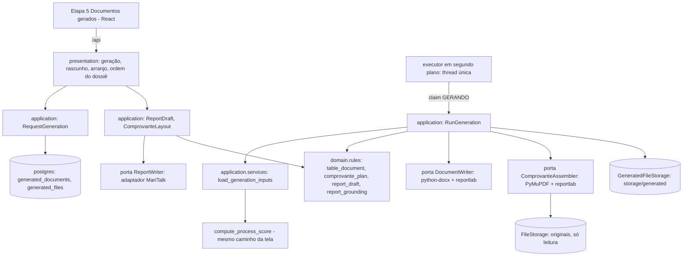

# Documentos Gerados Design

**Spec**: `.specs/features/documentos-gerados/spec.md`
**Status**: Draft

Lições confirmadas aplicáveis: nenhuma (`lessons.py list --status confirmed` vazio). Decisões ativas respeitadas: AD-001 (camadas e teste de arquitetura), AD-005 (MariTalk), AD-006 (resultado calculado, sem tabela de resultados), AD-008 (executor em processo, estados no banco), AD-009 (saída da IA não confiável).

---

## Architecture Overview

Três geradores compartilham um mesmo fluxo: o pedido cria uma linha de geração no estado `GERANDO`, o executor em processo a pega, lê o processo numa única unidade de trabalho, monta o documento a partir de **funções puras do domínio** (modelo da Tabela, plano do Comprovante, seções do Relatório) e entrega o modelo a **adaptadores de infraestrutura** que escrevem DOCX (python-docx), PDF (reportlab) e o PDF montado com as páginas originais (PyMuPDF). O arquivo vai para o armazenamento por arquivo temporário e renomeação; só então a linha vira `PRONTO` com versão numerada, hash e instantâneo. O resultado da pontuação é sempre recalculado na hora (AD-006) pelo mesmo caminho da tela.



### Abordagens consideradas (arquitetura de geração)

| Abordagem | Resumo | Veredito |
| --- | --- | --- |
| **A. Linha de geração própria + executor existente com um segundo runner** | Tabela `generated_documents` guarda estado e versão; o `DocumentWorker` ganha um runner de geração além do de OCR | **Recomendada**: semântica de `INTERROMPIDA` difere da de `processing_jobs`, que reenfileira (AD-008); a thread única continua única |
| B. Reusar `processing_jobs` com `document_id` anulável | Uma tabela de tarefas para tudo | Descartada: `document_id` é obrigatório com `ON DELETE CASCADE` e a recuperação reenfileira até 3 vezes; a spec exige `FALHOU/INTERROMPIDA` sem repetir (VER-08) |
| C. Gerar dentro da requisição | Síncrono | Descartada: o Comprovante de 400 páginas e a espera do nginx tornam a requisição frágil (CMP-11, VER-04) |

---

## Pesquisa de bibliotecas (medida, com dados sintéticos)

Máquina de desenvolvimento (16 núcleos, Python 3.12.3), venv temporário fora do repositório, PyMuPDF 1.28.2 (o pino atual) e Pillow 13.0.0. Os tempos valem como ordem de grandeza: a VM tem 1 CPU com `cpus: 0.75`. Os picos são `ru_maxrss` do processo inteiro, incluindo o interpretador e as importações. O contêiner da VM não foi medido (sem acesso à VM).

### (a) DOCX

| Abordagem | Dependências novas (instaladas) | Resultado do protótipo | Veredito |
| --- | --- | --- | --- |
| **python-docx 1.2.0** (MIT, 2025-06-16) | `lxml` 6.1.3 (12 MB, roda por wheel `manylinux`, sem compilador) e a própria lib (3 MB); `typing_extensions` já vem com o pydantic | Tabela de 140 linhas em 0,19 s, 40 KB, pico 34 MB. Linha de título repetida (`w:tblHeader`), rodapé "Página X de Y" por campos `PAGE` e `NUMPAGES`, acentos corretos. Convertido por LibreOffice (só no meu ambiente, para conferir o desenho) o arquivo abre em 4 páginas, com o cabeçalho repetido | **Recomendada** |
| DOCX montado à mão (`zipfile` + XML) | Nenhuma | Não prototipado | Descartada: o Word é estrito com o XML e não há como validar sem o Word; o ganho é evitar 15 MB |
| `docxtpl` (modelo `.docx` com Jinja) | python-docx, jinja2 | Não prototipado | Descartada: o modelo recebido é um texto de exemplo sem marcadores; o formato por seção vem da configuração |

Armadilhas encontradas e tratadas no design: com `autofit` o python-docx ignora a largura das células e o LibreOffice divide as colunas em partes iguais (a Tabela saiu com 12 páginas em vez de 4). Cabe gravar a largura em `tblGrid` (`table.columns[i].width`) e `w:tblLayout fixed`. Não há API para campo de página: o rodapé usa `fldChar` e `instrText`. **Incerteza**: não testei a abertura no Word; só em LibreOffice.

### (b) PDF da Tabela e do Relatório, sem LibreOffice

| Abordagem | Dependências novas | Medido (Tabela, 8 colunas, quebra de página) | Veredito |
| --- | --- | --- | --- |
| **reportlab 5.1.0** (BSD, 2026-10-22; última 4.x: 4.5.1, 2026-05-12) | `charset-normalizer` (pequena); 9 MB instalados; Pillow já existe | 140 linhas: 0,13 s, pico 32 MB, PDF de 60 KB. 1000 linhas: 0,92 s, 52 MB. `Table(repeatRows=1)` repete o cabeçalho, larguras em porcentagem, "Página N de M" por segundo passe do canvas, fonte TTF embutida em subconjunto, acentos corretos. Relatório (A4, margens do modelo, parágrafos justificados, marcadores): 0,03 s, 44 KB | **Recomendada** |
| PyMuPDF `Story` (HTML e CSS) | Nenhuma | 140 linhas: 0,07 s, pico 57 MB (inclui a importação do PyMuPDF). **Não repete o cabeçalho** da tabela; largura de coluna só em pontos absolutos (`%` e `<colgroup>` são ignorados); o cabeçalho precisou ser redesenhado a cada página por `pagefn` com a altura medida | Descartada: funciona, mas com contorno frágil; seria código de layout próprio |
| fpdf2 2.9.0 (LGPL-3.0, 2026-10-29) | `fonttools` (29 MB instalados) | 140 linhas: 0,38 s, pico 55 MB; 1000 linhas: 2,35 s. Repete o cabeçalho e tem `{nb}` | Descartada: mais lenta, 3 vezes mais pesada em dependências e licença LGPL sem ganho |

Recomendação: reportlab para tudo que é gerado (Tabela, Relatório, capa, sumário e separadores do Comprovante) e PyMuPDF só para juntar páginas originais. Efeito na imagem do backend: cerca de +24 MB (lxml, python-docx, reportlab, charset-normalizer), sem pacote `apt`. **Incerteza**: reportlab 5.1.0 tem 27 dias; a tarefa de pino roda a suíte em 5.1.0 e, se algo falhar, cai para 4.5.1, que tem a mesma API usada aqui.

### Fonte

A imagem `python:3.12-slim` não tem fontes. O PDF usa **Liberation Serif** (Regular, Bold, Italic, BoldItalic; SIL OFL 1.1, 1,5 MB), com métricas do Times New Roman, versionada em `backend/app/infrastructure/documents/fonts/` com o texto da licença. As fontes do PyMuPDF (Base 14) só cobrem Latin-1 e não servem para nomes com outros caracteres. O DOCX apenas nomeia "Times New Roman", que o Word resolve.

### Comprovante: memória e conteúdo original (protótipo)

Fontes sintéticas: 400 páginas "digitalizadas" (um JPEG por página, 1240 x 1754 px) em 10 PDFs.

| Cenário | Saída | Pico do processo | Acima da linha de base |
| --- | --- | --- | --- |
| 400 páginas, 126 KB por página, acumulando num documento só | 50 MB | 127 MB | +73 MB |
| 400 páginas, 224 KB por página, acumulando | 88 MB | 179 MB | +125 MB |
| 400 páginas, 126 KB, **salvamento incremental a cada 25 páginas** | 50 MB | 62 MB | +8 MB |
| 400 páginas, 224 KB, incremental | 88 MB | 65 MB | +11 MB |
| **Fluxo completo** (capa, sumário de 2 páginas, 8 separadores, 400 originais, 411 páginas), incremental | 50 MB (88 MB no caso pesado) | **74 MB (75 MB)** | +11 MB |

A linha de base (54 a 63 MB) é só `import pymupdf` mais reportlab; no backend real o PyMuPDF já está carregado (repouso de 96 MB no `STATE.md`). Tempo do fluxo completo: 1,1 s. O limite da spec (320 MB) fica muito acima. `store_shrink(100)` entre páginas não mudou nada nas medições (as imagens JPEG passam sem decodificar); fica como seguro barato para o caminho de PNG.

Fora do caminho comum, medido:

| Caso | Resultado |
| --- | --- |
| Página PDF de 52 megapixels (JPEG de 5 MB) | pico +10 MB, 0,0 s: anexa sem rasterizar (edge case da spec confirmado) |
| JPEG de 40 megapixels como origem | +17 MB, 0,0 s: o JPEG entra sem decodificar |
| **PNG de 12 megapixels** como origem | **+103 MB** |
| **PNG de 40 megapixels** como origem | **+324 MB**, 6,1 s: o PyMuPDF decodifica o PNG inteiro |

O custo do PNG é linear (cerca de 8 MB por megapixel). Esse número decide o limite de imagem (ver Tech Decisions).

Conferência de que o conteúdo original não muda (400 páginas e amostras de 50 a 60 por rodada):

- Os bytes das imagens embutidas na saída são idênticos aos da origem (nenhuma recompressão), em todas as páginas amostradas.
- A área do original, renderizada a 2x, é **idêntica pixel a pixel** à página de origem; o texto extraído é igual; a faixa leva o número ("Comprovante p. N") e a numeração, em ordem, confere nas 411 páginas; as entradas do sumário apontam as páginas certas.
- Primeira versão falhou: a linha divisória de 0,5 pt desenhada em `y = h` invadia 0,25 pt do original (uma linha de pixels diferente, delta até 63). A faixa passa a começar em `y = h` sem borda e a divisória fica dentro dela (`y = h + 0,5`). Com isso o teste de igualdade passa.
- `show_pdf_page` não preserva três coisas, todas verificadas:
  1. **`/Rotate`**: a página rotacionada sai sem rotação e deformada. Correção: copiar a página para um PDF temporário de uma página e chamar `remove_rotation()`; fica idêntica pixel a pixel em 90, 180 e 270 graus.
  2. **Anotações e campos** (carimbo, texto livre, destaque, campo preenchido, aparência de assinatura): somem. Correção: no mesmo PDF temporário, `bake(annots=True, widgets=True)` antes de anexar. A página sai visualmente igual (diferença máxima de 1 nível de cinza em 2 590 bytes de uma região de anotação); perde a interatividade, o que não importa num Comprovante.
  3. **Página rotacionada e com CropBox menor que a MediaBox** (combinação rara): `remove_rotation()` perde o recorte e o ajuste que tentei não ficou idêntico. Fallback do design: rasterizar essa página a 200 dpi em JPEG qualidade 92 e emitir o alerta `PAGINA_RASTERIZADA` com a página; o conteúdo visível é preservado, a página deixa de ser vetorial. Uma tarefa conta quantas páginas do corpus real caem nesse caso, por script local.

---

## Code Reuse Analysis

### Existing Components to Leverage

| Component | Location | How to Use |
| --- | --- | --- |
| `calculate`, `ScoringResult`, `ScoringRow`, `Counters`, `Alert` | `backend/app/domain/rules/scoring_engine.py`, `process_verification.py` | Entrada do modelo da Tabela; o total só soma `VALIDADA` (`scoring_engine.py:240`, `_subtotals`), então a Tabela e a tela batem por construção |
| `CalculateProcessScore` | `backend/app/application/use_cases/scoring.py:646` | O corpo vira a função `compute_process_score(uow, process) -> ProcessScore`; o caso de uso a chama com o ator, o executor a chama sem ator (o acesso já foi checado no pedido) |
| `AccessPolicy`, `AuditService` | `backend/app/application/services/` | 404 fora do acesso; auditoria só com identificadores |
| `DocumentWorker`, `claim_next` com `SKIP LOCKED` | `backend/app/infrastructure/jobs/worker.py:43`, `repositories.py:1085` | Mesma thread; ganha um segundo runner de geração |
| `extraction_runs` e seu gatilho de imutabilidade | `backend/alembic/versions/0003_documents.py:90` | Mesmo padrão para `generated_documents` e `generated_files` |
| `LocalFileStorage` | `backend/app/infrastructure/storage/local_storage.py` | Padrão de permissões 0700/0600 e nome interno aleatório; o regex atual só aceita `pdf/jpg/png` (linha 15), então nasce `LocalGeneratedStorage` ao lado |
| `ActivityEvidence`, `EvidenceRepository` | `ports.py`, `repositories.py:1146` | Origem das páginas; ganha `list_for_activities(ids)` para evitar N+1 |
| `MariTalkExtractor` (`_post`, tentativa com modelo reserva) | `backend/app/infrastructure/ai/maritalk.py` | O envio HTTP vira `MariTalkClient` compartilhado; `MariTalkReportWriter` é um segundo adaptador |
| `mask_identifiers`, `normalize_title`, `numerals_from_words`, `date_in_text` | `backend/app/domain/rules/{masking,scoring_periods,number_words,grounding}.py` | Máscara da descrição enviada à IA e a normalização da conferência da redação |
| `DocAlertCode`, `Alert`, enums `StrEnum` | `domain/entities/document.py` | Novo `GenerationCode` e alertas no mesmo formato |
| Erros de domínio e mapeamento HTTP | `domain/errors.py`, `presentation/errors.py` | Novo `GenerationRefused(code, message)` mapeado para 422 com `{field, code, message}` (a mesma forma que `documents.py` já usa) |
| `StepNav`, `AlertList`, `FieldError`, `api/client.ts`, `labels.ts` | `frontend/src/` | A etapa nova segue as telas 2 a 4 |
| Polling a cada 3 s | `frontend/src/pages/ProcessDocuments.tsx:13,102` | Extraído para `hooks/usePolling.ts`, usado pela etapa nova |
| Fixtures de integração, `synthetic_docs.py` | `backend/tests/integration/`, `backend/tests/support/` | PostgreSQL efêmero (AD-004); PDFs e imagens sintéticos existentes servem de origem |

### Integration Points

| System | Integration Method |
| --- | --- |
| `functional_processes`, `activities`, `activity_evidences`, `documents` | Só leitura na geração; `generated_documents.process_id` com FK sem cascata |
| Pontuação | `compute_process_score` e `ScoringResult` |
| MariTalk | Porta `ReportWriter`; `MARITALK_*` já existentes |
| nginx | `proxy_read_timeout 90s` em `/api/` para a redação por seção (ver Risks) |
| Imagem do backend | `python-docx==1.2.0`, `lxml==6.1.3`, `reportlab==5.1.0` em `requirements.txt` |

---

## Components

### Domain: entidades

- **Purpose**: tipos e estados, sem dependência de framework.
- **Location**: `backend/app/domain/entities/{generated.py,report.py,comprovante.py}`
- **Interfaces**:
  - `DocumentKind` (`TABELA`, `RELATORIO`, `COMPROVANTE`), `DocumentFormat` (`DOCX`, `PDF`), `GenerationState` (`GERANDO`, `PRONTO`, `FALHOU`) e `can_transition` (`GERANDO` para `PRONTO` ou `FALHOU`; nada mais)
  - `GeneratedDocument(id, process_id, kind, state, version_number, requested_by, requested_at, started_at, finished_at, error_code, error_message, snapshot, alerts, plan_hash, files)` e `GeneratedFile(format, internal_name, sha256, size_bytes)`
  - `GenerationCode` e `GenerationAlertCode` (lista em Error Handling Strategy)
  - `ReportTemplate` (página, linhas do cabeçalho, identificação, seções com `match`, `group_by`, formato da entrada), `ReportDraft(process_id, template_id, template_version, sections, version)`, `DraftSection(key, title, free_text, entries, warnings)`, `DraftEntry(activity_id, text, source: MODELO|IA|USUARIO, warnings)`
  - `ComprovanteLayout(process_id, activities: tuple[LayoutActivity, ...], base_evidence_keys, version)`, `LayoutActivity(activity_id, pages: tuple[LayoutPage, ...])`, `LayoutPage(document_id, page, repeat_justification)`

### Domain: regras puras

- **Purpose**: tudo que decide conteúdo, ordem e numeração; nada lê arquivo nem banco.
- **Location**: `backend/app/domain/rules/{table_document.py,comprovante_plan.py,report_draft.py,report_grounding.py,generation_snapshot.py,download_names.py,pt_format.py}`
- **Interfaces**:
  - `build_table_document(header, version, result, activities, comprovante_numbers, excluded) -> TableDocument`: 7 colunas (item "I.1", atividade, quantidade, pontos unitários, total, comprovante, status); o grupo vira uma faixa com o nome da tabela e o subtotal, também para grupos vazios (zero); seção de horas de PIT separada (TAB-05); contagens e alertas iguais aos do motor
  - `derive_layout(activities, evidences, documents) -> ComprovanteLayout`: ordem dos grupos e itens da tabela, e dentro do item por data (ARR-01)
  - `plan_comprovante(layout, activities, documents, toc_capacity) -> ComprovantePlan`: lista ordenada de páginas (`CAPA`, `SUMARIO`, `SEPARADOR`, `ORIGINAL`) com o número de cada uma, a primeira página de cada grupo, item e atividade, as remissões (mesma página em outra atividade, CMP-05) ou a repetição justificada (CMP-06), a atividade sem página (CMP-07) e o `plan_hash`. As verificações de limite (`COMPROVANTE_GRANDE_DEMAIS`) e de documento ausente (`ORIGINAL_INDISPONIVEL`) saem do plano como erros tipados
  - `layout_staleness(layout, activities, evidences) -> Staleness`: atividade validada que saiu, revalidada ou mudou de item, ou vínculo novo (ARR-08); o arranjo mostra o aviso e a geração usa só as atividades atuais
  - `propose_draft(template, activities, group_map) -> ReportDraft` e `reconcile_draft(draft, activities) -> ReportDraft`: distribui pelo mapa de grupo para seção, ordena e acrescenta ao fim as atividades novas; o texto de cada entrada é o texto-modelo (`template_text`); o que o usuário já editou nunca é tocado (REL-07)
  - `check_wording(wording, facts, vocabulary) -> WordingCheck(accepted, reasons)`: ver "Redação pela MariTalk"
  - `build_snapshot(...) -> dict` e `plan_hash(plan) -> str` (SHA-256 do plano em JSON canônico)
  - `download_name(kind, fmt, interstice, version) -> str`: por exemplo `Tabela_de_Pontuacao_2020-2024_v2.pdf`, sem o nome do docente (VER-03)
  - `pt_format`: datas `dd/mm/aaaa`, decimais com vírgula, "1º Período de 2023"
- **Dependencies**: stdlib e as regras de pontuação existentes
- **Reuses**: `ScoringResult`, `normalize_title`, `numerals_from_words`, `Interstice`

### Application: casos de uso

- **Location**: `backend/app/application/use_cases/{generated_documents.py,report_draft.py,comprovante_layout.py}` e `application/services/generation_inputs.py`
- **Interfaces**:
  - `load_generation_inputs(uow, process) -> GenerationInputs`: processo, docente, unidade, `ProcessScore`, atividades `VALIDADA` com grupo e item, vínculos por atividade, documentos (nome original, mime, páginas, nome interno), contagem do que fica de fora e por quê. Uma unidade de trabalho de leitura; a renderização roda sem conexão aberta (como `ProcessDocument`)
  - `RequestGeneration.execute(actor, process_id, kind) -> GeneratedDocument`: confere acesso (404), tabela escolhida (`TABELA_NAO_ESCOLHIDA`), atividades (`SEM_ATIVIDADES_VALIDADAS`), descrição (`ATIVIDADE_SEM_DESCRICAO`, só Relatório), limites e plano (só Comprovante), espaço livre em disco; cria a linha `GERANDO` (o índice parcial único devolve 409 `GERACAO_EM_ANDAMENTO` sem corrida, VER-04) e audita. Retorna 202
  - `RunGeneration.execute(generation_id)`: o executor; monta o modelo, escreve em arquivo temporário, calcula o hash, renomeia, e numa transação grava a versão, os arquivos, o instantâneo e a auditoria. Falha: apaga temporários e marca `FALHOU` com código e mensagem fixa por código, sem texto de documento (VER-05)
  - `RecoverInterruptedGenerations.execute()`: na partida, toda linha `GERANDO` com `started_at` preenchido vira `FALHOU` com `INTERROMPIDA` e auditoria (VER-08); a linha ainda não iniciada continua na fila; temporários `.tmp-*` e arquivos sem linha são removidos
  - `ListGeneratedDocuments`, `GetGeneratedDocument`, `DownloadGeneratedFile` (audita `operation: DOWNLOAD`, como `DownloadDocument`)
  - `GetReportDraft`, `SaveReportEntry`, `SaveReportSection`, `MoveReportEntry`, `RequestSectionWording`
  - `GetComprovanteLayout`, `SaveComprovanteLayout` (bloqueio otimista, 404 para documento ou página fora do processo, ARR-05: o servidor recusa mover atividade de item)
- **Dependencies**: portas `DocumentWriter`, `ComprovanteAssembler`, `ReportWriter`, `GeneratedFileStorage`, `FileStorage`, `Clock`; `AccessPolicy`, `AuditService`
- **Reuses**: `compute_process_score`, `_ScoringUseCase._readable`

### Infrastructure: documentos

- **Location**: `backend/app/infrastructure/documents/`
  - `pdf_styles.py` (fonte, estilos, margens), `table_docx.py`, `table_pdf.py`, `report_docx.py`, `report_pdf.py` (implementam `DocumentWriter`), `front_matter.py` (capa, sumário e separadores com reportlab), `comprovante_assembler.py` e `source_pages.py` (PyMuPDF), `config_loader.py`, `fonts/`, `config/`
- **Interfaces**:
  - `DocumentWriter.write_table(model, fmt, target)` e `write_report(model, fmt, target)`
  - `ComprovanteAssembler.assemble(plan, resolver, target, on_progress) -> AssemblyResult(pages, size_bytes, alerts)`; `resolver` abre o original por `(document_id)` e devolve o caminho
  - `source_pages.attach(out, src, pno, number)`: o procedimento por página validado no protótipo: página sem rotação nem anotação vai direto por `show_pdf_page` na área `(0, 0, w, h)` da folha de altura `h + 24 pt`; com rotação ou anotações passa antes por um PDF temporário de uma página (`insert_pdf(annots=True, widgets=True)`, `bake`, `remove_rotation`); rotacionada com recorte cai no fallback rasterizado; imagem JPEG vira PDF por `convert_to_pdf` e entra pelo mesmo caminho; PNG acima de 12 megapixels é recusado antes de começar
  - Montagem: abre uma origem por vez, `store_shrink(100)` a cada página, salvamento incremental a cada 25 páginas (`save` na primeira, `saveIncr` depois, reabrindo o arquivo), e uma passada final de `garbage=3, deflate=True`. Páginas geradas (capa, sumário, separadores) entram com `insert_pdf` de um PDF de reportlab
  - Capa, sumário e separadores desenham linhas de altura fixa direto no canvas (sem fluxo), de modo que `toc_pages = ceil(linhas / LINHAS_POR_PAGINA)` é cálculo do domínio e o renderizador só confere (o protótipo mostrou que um fluxo de reportlab quebra linhas e erra a previsão; a solução de duas passadas funcionou, mas a capacidade fixa elimina a segunda passada)
- **Reuses**: PyMuPDF 1.28.2 e Pillow já instalados

### Infrastructure: armazenamento, IA, executor, banco

- **Armazenamento**: `LocalGeneratedStorage` em `storage/generated/{process_id}/{uuid4}.{docx|pdf}`, 0700/0600; `new_temp_path(process_id)` devolve `.tmp-{uuid}`; `commit(temp, ext) -> internal_name` por `os.replace` no mesmo diretório; nada é lido para a memória (o `FileStorage.save(bytes)` atual não serve para 60 MB)
- **MariTalk**: `MariTalkClient` (extraído de `maritalk.py`: cabeçalho, mapeamento de status, modelo reserva) com um prazo total por chamada; `MariTalkReportWriter` implementa `ReportWriter.draft(section_title, items) -> Mapping[UUID, str]`, levanta `AiWritingError(code)` com `REDACAO_INDISPONIVEL`; `temperature` 0, `response_format` JSON estrito `{items: [{id, texto}]}`, `max_tokens` 4000, prazo de 60 s, sem repetição
- **Executor**: `DocumentWorker` recebe `runners: Sequence[Callable[[], bool]]`; `run_once` tenta primeiro a geração (o usuário espera por ela) e depois o OCR; `start()` chama os dois recuperadores. Um runner que levanta exceção fecha a linha como `FALHOU/ERRO_INTERNO`; o log leva só o tipo da exceção e os identificadores
- **Banco**: modelos e repositórios `generations`, `report_drafts`, `comprovante_layouts` na `UnitOfWork`; migração `0005_generated_documents.py`

### Presentation

- **Location**: `backend/app/presentation/api/{generated_documents.py,report_draft.py,comprovante_layout.py,dossier.py}`, `presentation/schemas/generated.py`
- **Rotas** (todas sob `/api`, sessão e CSRF existentes; recurso fora do acesso responde 404):

| Método e caminho | Função | Respostas |
| --- | --- | --- |
| `POST /processes/{id}/generated-documents` `{kind}` | pede a geração | 202 com a linha `GERANDO`; 409 `GERACAO_EM_ANDAMENTO`; 422 com `code` |
| `GET /processes/{id}/generated-documents?kind=` | linhas em ordem decrescente (em andamento primeiro) com estado, versão, alertas, arquivos | 200 |
| `GET /generated-documents/{gid}` | uma linha, com o resumo do instantâneo (total, subtotais, contagens) | 200 / 404 |
| `GET /generated-documents/{gid}/files/{docx\|pdf}` | download do arquivo gravado | 200 `FileResponse`, `attachment`, `nosniff`, `ETag` com o SHA-256; 404 se a linha não é `PRONTO` ou o arquivo sumiu |
| `GET /processes/{id}/report-draft` | rascunho salvo ou proposta (`saved: false`, `version: 0`), com seções, entradas, avisos e atividades novas | 200 |
| `PUT /processes/{id}/report-draft/entries/{activity_id}` `{expected_version, text}` | edita o texto de uma atividade (fonte vira `USUARIO`) | 200 / 409 / 422 (mais de 20 000 caracteres) |
| `PUT /processes/{id}/report-draft/sections/{key}` `{expected_version, free_text}` | texto livre da seção | idem |
| `POST /processes/{id}/report-draft/entries/{activity_id}/move` `{expected_version, section_key}` | move a atividade (REL-08) | idem |
| `POST /processes/{id}/report-draft/sections/{key}/wording` | pede a redação da seção | 200 com a seção atualizada |
| `GET /processes/{id}/comprovante-layout` | arranjo salvo ou derivado (`saved`, `version`, `stale`, `invalid`, `plan` com a numeração prevista) | 200 |
| `PUT /processes/{id}/comprovante-layout` `{expected_version, activities}` | salva o arranjo | 200 / 409 `VERSAO_DESATUALIZADA` / 404 / 422 |
| `GET /dossier-order` | lista ordenada da configuração, com a marca de "gerado pelo sistema" | 200 |

  Os `GET` nunca gravam. A primeira gravação do rascunho ou do arranjo usa `expected_version: 0`. Processo concluído ou arquivado: gerar e baixar valem; as rotas de gravação respondem 409 `PROCESSO_SOMENTE_LEITURA`.

### Frontend

- **Location**: `frontend/src/pages/ProcessGenerated.tsx`; `frontend/src/components/{GeneratedBlock.tsx,ReportDraftEditor.tsx,ComprovanteLayoutEditor.tsx,DossierOrder.tsx}`; `frontend/src/hooks/usePolling.ts`; tipos em `api/types.ts`; rótulos em `labels.ts` (`GENERATION_STATE_LABELS`, `GENERATION_CODE_LABELS`)
- A etapa nova é a **Etapa 5 · Documentos gerados** (`processos/:id/gerados`), `STEP_TITLES[5]` e `stepPath(5)` em `StepNav.tsx`, `enabled` passa a incluir 5. A spec chama a etapa de "Etapa 4", mas a Etapa 4 é a Pontuação e a Etapa 2 já se chama Documentos (decisão do usuário, ver abaixo)
- `GeneratedBlock` (um por tipo): aviso de atividades fora (UIG-06), botão Gerar, estado, alertas em português (UIG-05), histórico com links por formato (links `<a href>`, o cookie de sessão basta no `GET`). Enquanto houver linha `GERANDO`, `usePolling` consulta a lista a cada 3 s e para em `PRONTO` ou `FALHOU` (UIG-04)
- `ReportDraftEditor`: uma seção por cartão, textarea por atividade com contador de 20 000, selo da fonte (modelo, IA, editado), avisos, "Pedir redação" por seção, "Mover para" por atividade; gravação por entrada com `expected_version`; 409 recarrega e avisa
- `ComprovanteLayoutEditor`: por grupo, item e atividade, a lista de páginas com subir, descer, remover, "Acrescentar página" (documento e número) e "repetir com justificativa"; aviso de arranjo desatualizado; mostra a numeração prevista do plano. Sem arrastar e soltar (nenhuma dependência nova, acessível por teclado)
- `DossierOrder`: lista da API, com os três documentos gerados marcados
- 360 px: cartões empilhados, tabelas viram listas; teste estático como o de `styles.test.ts`

---

## Fluxos

### Geração (vale para os três tipos)

1. `RequestGeneration` valida e grava `GERANDO` (202). A resposta devolve o `id`; a tela passa a consultar.
2. O executor pega a linha mais antiga com `started_at IS NULL` (`SKIP LOCKED`), marca `started_at`, chama `RunGeneration`.
3. `load_generation_inputs` lê tudo numa unidade de trabalho e a fecha.
4. O modelo é montado por função pura: Tabela e Comprovante pelo mesmo `plan_comprovante` (a numeração da coluna "comprovante" da Tabela é a do plano atual; o `plan_hash` vai no instantâneo das duas versões e a tela avisa `NUMERACAO_DIVERGENTE` se o último Comprovante `PRONTO` tem outro `plan_hash`).
5. Escrita em `.tmp-*`; hash SHA-256 e tamanho; confere os 60 MB (Comprovante); renomeia.
6. Numa transação: `version_number = max(version_number) + 1` por (processo, tipo) (o índice único recusa corrida; uma nova tentativa), linhas de arquivo, instantâneo, alertas, `PRONTO`, auditoria. A versão só ganha número aqui: uma geração que falha não gasta número.
7. Falha em qualquer ponto: temporários e arquivos já renomeados são apagados, a linha vira `FALHOU` com código e mensagem fixa. Nenhum arquivo parcial (CMP-09, CMP-10, VER-05).

### Redação pela MariTalk (REL-03 a REL-07, REL-12)

1. `RequestSectionWording` lê o rascunho e as atividades da seção; separa as entradas cuja fonte não é `USUARIO` (o texto editado nunca vai à IA nem é reescrito).
2. Envia só, por atividade: `id` opaco, tipo do critério da tabela (descrição institucional), título, datas, carga horária, período letivo, quantidade, descrição **após `mask_identifiers`**. Nunca o texto das páginas, nunca o nome do docente, nunca SIAPE, nunca o `evidence_note`.
3. Prazo total de 60 s, uma chamada por seção, sem repetição além do modelo reserva já previsto na AD-005. Erro, resposta fora do schema ou prazo: `REDACAO_INDISPONIVEL` e texto-modelo.
4. Cada texto passa por `check_wording` contra os campos enviados; reprovado, vale o texto-modelo e a seção ganha `REDACAO_REJEITADA` com o motivo (`NUMERO`, `DATA`, `NOME`, `VOCABULARIO`, `COMPRIMENTO`, `PALAVRA_PROIBIDA`).
5. Nova unidade de trabalho: relê o rascunho; se a versão mudou, aplica a proposta só às entradas que continuam sem fonte `USUARIO` (nenhum 409 para o usuário e nenhuma perda de edição).

`check_wording` (AD-009, no sentido da geração): (i) todo número (inteiros, decimais, ordinais, datas em `dd/mm/aaaa` e por extenso, ano, período letivo) tem de aparecer nos campos enviados, comparados já normalizados (acentos, `numerals_from_words`, `hours_in_text`, `date_in_text`); (ii) todo nome próprio (palavra capitalizada fora do início da frase, ou sigla) tem de aparecer nos campos ou na lista `allowed_terms` da configuração (UFPA, "Universidade Federal do Pará" e a unidade); (iii) no máximo `max_new_words` palavras de conteúdo (5 letras ou mais) fora dos campos e do vocabulário permitido (verbos e conectivos formais da configuração e do texto-modelo); (iv) comprimento até duas vezes o texto-modelo mais 120 caracteres; (v) lista de palavras proibidas da configuração (avaliativas e de resultado: "objetivo", "resultado", "metodologia", "excelente", "relevante", "visando", "contribuindo"). **Limite honesto**: a conferência pega número, data, nome e palavra nova; uma afirmação qualitativa feita só de palavras já permitidas passaria. A revisão humana na tela e o prompt restritivo cobrem o resto, e o risco fica registrado (REL-12).

Texto-modelo determinístico: por seção, o `entry.line` ou `entry.fields` da configuração preenchido com os campos da atividade; a linha ou o campo que não tem valor não aparece (assunção da spec sobre campos que o sistema não tem). O campo "curso" do 1.1 e 1.2 só aparece se estiver no título ou na descrição, pois a atividade não guarda o curso.

### Comprovante

Página de saída = folha com a altura do original mais uma faixa de 24 pt. O original ocupa `(0, 0, w, h)` sem alteração; a faixa, abaixo, leva "Comprovante  p. N". Estrutura: capa (página 1, sem número impresso), sumário (grupos, itens e atividades; a atividade ocupa duas linhas: título e "origem: arquivo, p. X; Comprovante p. N a M" ou "ver p. N"), um separador por grupo (só o título, como no `Comprovante Documentos_2020_2024.pdf` recebido), originais. Todas as páginas geradas imprimem o próprio número no pé. O plano calcula tudo antes de escrever (CMP-04).

---

## Data Models

Migração `0005_generated_documents.py` (a última é a `0004`).

```python
# enums: generated_kind(TABELA, RELATORIO, COMPROVANTE), generated_state(GERANDO, PRONTO, FALHOU),
#        generated_format(DOCX, PDF)
generated_documents(
    id uuid pk, process_id fk functional_processes, kind generated_kind, state generated_state,
    version_number int null,            # só em PRONTO; unique(process_id, kind, version_number) onde não nulo
    requested_by fk users, requested_at timestamptz, started_at timestamptz null, finished_at timestamptz null,
    error_code varchar(40) null, error_message varchar(300) null,   # mensagem fixa por código, sem dados pessoais
    snapshot jsonb null, alerts jsonb null, plan_hash char(64) null)
# índice parcial único (process_id, kind) WHERE state = 'GERANDO'   -> VER-04
# índice (process_id, kind, requested_at desc)
generated_files(
    id uuid pk, generated_document_id fk generated_documents, format generated_format,
    internal_name varchar(64) unique, sha256 char(64), size_bytes bigint, created_at timestamptz,
    unique(generated_document_id, format))
report_drafts(
    id uuid pk, process_id fk unique, template_id varchar(60), template_version int,
    content jsonb,                       # {sections: [{key, title, free_text, warnings, entries: [{activity_id, text, source, warnings}]}]}
    version int, created_by fk users, created_at, updated_by fk users, updated_at)
comprovante_layouts(
    id uuid pk, process_id fk unique, content jsonb,   # {activities: [{activity_id, pages: [{document_id, page, repeat_justification}]}], base_evidence_keys: [...]}
    version int, updated_by fk users, updated_at)
```

Gatilhos, no padrão do `extraction_runs`: `generated_documents` só aceita `UPDATE` quando `OLD.state = 'GERANDO'` e recusa `DELETE`; `generated_files` recusa `UPDATE` e `DELETE`. Sem `ON DELETE CASCADE` para o processo (a versão é o registro do que foi entregue). Os documentos de origem não têm FK no arranjo: o `document_id` guardado no JSON que aponta para um documento excluído vira `ORIGINAL_INDISPONIVEL` na geração e entrada inválida no arranjo (edge case da spec).

Instantâneo (`snapshot`), igual nos três tipos com acréscimos por tipo:

```json
{"table_version": {"id": "...", "name": "...", "norm_reference": "..."},
 "interstice": {"start": "2020-01-01", "end": "2024-12-31"},
 "total": "211.00", "subtotals": {"1": "0.00", "2": "52.00"}, "pit_hours": {"2023.1": "24"}, "pit_total_hours": "92",
 "activities": [{"id": "...", "group": 2, "item": 3, "quantity": "1", "points": "20.00", "status": "PONTUADA"}],
 "excluded": {"pendentes": 2, "sem_enquadramento": 1},
 "alerts": ["SEM_COMPROVANTE"], "template": {"id": "ufpa-modelo-2", "version": 1},
 "layout": {"plan_hash": "...", "entries": [...]},        // Tabela e Comprovante
 "report": {"sections": [{"key": "1.1", "entries": [{"activity_id": "...", "text": "...", "source": "IA"}]}]}   // Relatório
}
```

Configuração versionada (`backend/app/infrastructure/documents/config/`):

- `report_templates.json`: `default`, e por modelo `version`, `page` (A4, margens 31,75 mm laterais e 25,4 mm verticais, Times New Roman, 9 pt, lidos do `Modelo Relatorio Atividades 2.docx`), `header_lines` (`Serviço Público Federal`, `Universidade Federal do Pará`, `{unit_name}`), `title`, `identification` (Nome, Professor com classe e nível, unidade, período de interstício, "ATIVIDADES DESENVOLVIDAS"), `group_map` e `sections`. Cada seção: `key`, `title`, `match` (lista de `{group, item?}`), `group_by` (`academic_period` | `item` | `none`), `period_label`, `entry` (`line` ou `fields`, com marcadores como `{title}`, `{course_hours}`, `{period}`), `subtitle` opcional e `order_items` para separar concluídas e em andamento no 1.3. `entry_style` aceita `campos` (modelo 2) e `narrativo` (modelo 1: parágrafo corrido sob o item, com a coluna "Nº documentação" apontando o número do Comprovante); só o estilo `campos` é entregue. Também: `allowed_terms`, `formal_vocabulary`, `forbidden_words`, `max_new_words`
- Mapa de grupo para seção (spec): I.1 para 1.1, I.2 para 1.2, II para 1.3, III para 6 ("Participação em bancas e comissões examinadoras"), IV para 3, V para 2, VI para 4, VII para 6 ("Capacitação"), VIII para 6; a 5 só recebe atividades movidas
- `dossier_order.json`: lista de `{order, title, generated_by: null | TABELA | RELATORIO | COMPROVANTE}` com os itens do `ordenamentodecomoosdocumentosdevemestarsequenciadosnorelatrio.pdf`: requerimento à CPPD (conforme modelo), portaria da última progressão, declaração de pagamento de exercícios anteriores preenchida, relatório de progressão funcional, documentação comprobatória em ordem e numerada, currículo Lattes atualizado. O modelo não cita a Tabela de Pontuação; a configuração a coloca depois do Relatório e antes da documentação comprobatória (a confirmar pelo usuário)
- Validação do arquivo na partida: JSON inválido ou seção sem `key` derruba o carregamento com mensagem clara (como `load_settings`)

Novas variáveis de `Settings` (valores padrão entre parênteses): `generation_max_pages` (400), `generation_max_output_mb` (60), `generation_png_max_megapixels` (12), `generation_min_free_mb` (200), `wording_timeout_seconds` (60), `report_template_id` (do arquivo).

---

## Error Handling Strategy

Códigos novos (domínio: `GenerationCode` e `GenerationAlertCode`). Recusas de pedido saem como 422 `{"detail": [{"field": "geracao", "code": "...", "message": "..."}]}`; falhas do executor ficam na linha como `error_code` e `error_message`.

| Código | Quando | Onde aparece |
| --- | --- | --- |
| `SEM_ATIVIDADES_VALIDADAS` | Nenhuma atividade `VALIDADA` com grupo e item (TAB-07) | 422 no pedido |
| `TABELA_NAO_ESCOLHIDA` | Processo sem versão de tabela (TAB-08) | 422 |
| `ATIVIDADE_SEM_DESCRICAO` | Atividade validada sem descrição e sem título, citando o `id` (REL-10) | 422 |
| `COMPROVANTE_GRANDE_DEMAIS` | Mais de 400 páginas anexadas, ou saída acima de 60 MB (estimada no pedido pela soma proporcional dos tamanhos de origem; conferida de novo no arquivo final) (CMP-09) | 422 ou `FALHOU` |
| `IMAGEM_GRANDE_DEMAIS` (novo) | Origem PNG acima de 12 megapixels | 422, citando documento |
| `ORIGINAL_INDISPONIVEL` | Arquivo ausente do armazenamento, documento excluído ou página inexistente, com documento e página (CMP-10) | `FALHOU`; no pedido já sai 422 quando o plano acusa |
| `INTERROMPIDA` | Servidor reiniciou durante a geração (VER-08) | `FALHOU` |
| `ESPACO_INSUFICIENTE` (novo) | Menos de `generation_min_free_mb` livres no volume | 422 |
| `ERRO_INTERNO` | Exceção inesperada; só o tipo é registrado | `FALHOU` |
| `GERACAO_EM_ANDAMENTO` | Segundo pedido igual enquanto há `GERANDO` (VER-04) | 409 |
| `VERSAO_DESATUALIZADA` | `expected_version` diferente (ARR-07) | 409 |
| `PROCESSO_SOMENTE_LEITURA` | Gravação de rascunho ou arranjo em processo concluído ou arquivado | 409 |
| `PAGINA_FORA_DO_DOCUMENTO` | Página fora de `1..page_count` | 422 |
| (404) | Processo, documento, atividade, linha ou arquivo fora do acesso ou inexistente | 404 sem distinguir |

Alertas do resultado (listados no bloco, em português, UIG-05): `ATIVIDADE_SEM_COMPROVANTE` (CMP-07), `REDACAO_REJEITADA` e `REDACAO_INDISPONIVEL` (REL-04, REL-05), `ARRANJO_DESATUALIZADO` (ARR-08), `NUMERACAO_DIVERGENTE` (Tabela e Comprovante com `plan_hash` diferente), `ATIVIDADES_FORA_DO_DOCUMENTO` (contagem por motivo), `PAGINA_REPETIDA_JUSTIFICADA`, `PAGINA_RASTERIZADA`, `RASCUNHO_DESATUALIZADO` (atividades novas ou removidas desde a última edição do Relatório), além dos alertas de pontuação da Tabela (TAB-06) com o texto da tela.

| Cenário | Tratamento | Impacto para o usuário |
| --- | --- | --- |
| MariTalk indisponível, erro ou mais de 60 s | Texto-modelo e `REDACAO_INDISPONIVEL`; o pedido responde 200 | A seção sai preenchida e avisada |
| Resposta da IA com número, data, nome ou palavra nova | Texto-modelo e `REDACAO_REJEITADA` | O usuário vê o motivo e edita |
| Edição concorrente do rascunho ou do arranjo | 409 `VERSAO_DESATUALIZADA` | A tela recarrega e avisa |
| Arquivo gerado sumiu do volume | 404 no download; log com `generation_id` | Pede nova geração |
| Reinício no meio da geração | `INTERROMPIDA` | Botão de gerar de novo |

---

## Observabilidade e auditoria

- **Auditoria** (`AuditService`, só identificadores e códigos): `generated_document` `CREATE` no pedido (`kind`, `state`), `STATUS` no fim (`state`, `version_number`, `error_code`, hash e tamanho por formato), `UPDATE` com `operation: DOWNLOAD`; `report_draft` `UPDATE` com as chaves de seção e a contagem de entradas alteradas, `operation: WORDING` com a seção, a fonte e os códigos dos avisos; `comprovante_layout` `UPDATE` com contagens de páginas acrescentadas, removidas, reordenadas e repetições justificadas. Texto de atividade, do rascunho e justificativas não vão para a auditoria.
- **Logs** (`app.documents.generation`): `generation_id`, `kind`, `state`, `duration_ms`, `pages`, `size_bytes`, `error_code` e `peak_rss_mb` (`resource.getrusage`) ao fim de cada geração, para confirmar o CMP-11 na VM sem instrumentação extra. Nenhum nome, título, texto ou caminho.
- A auditoria da geração e do download não duplica o log de acesso existente.

---

## Risks & Concerns

| Concern | Location (file:line) | Impact | Mitigation |
| --- | --- | --- | --- |
| `CalculateProcessScore` exige ator e abre a própria unidade de trabalho; o executor não tem ator | `backend/app/application/use_cases/scoring.py:646` | Duplicar o cálculo faria a Tabela divergir da tela | Extrair `compute_process_score(uow, process)` sem mudar o comportamento; os testes existentes de pontuação seguem como rede de proteção; um teste novo compara a Tabela com a resposta de `/scoring` |
| `show_pdf_page` descarta `/Rotate`, anotações e campos (verificado) | `source_pages.py` (novo) | Página rotacionada deformada; carimbo ou aparência de assinatura some do Comprovante | `remove_rotation` e `bake` num PDF temporário; teste de igualdade por pixel com rotação 90, 180, 270, anotação e campo; fallback rasterizado para rotação com recorte, com alerta |
| PNG grande decodifica inteiro: +324 MB com 40 megapixels (verificado) | `source_pages.py`; limites em `inspector.py` (100 megapixels aceitos no envio) | Estouro dos 384 MB do contêiner | `IMAGEM_GRANDE_DEMAIS` acima de 12 MP (+103 MB) antes de começar; JPEG passa sem decodificar. A spec manda não falhar por página grande, mas fala de página PDF; o caso do PNG é decisão do usuário (ver abaixo) |
| Montar acumulando num documento só custa até +125 MB com 88 MB de saída (verificado) | `comprovante_assembler.py` | Pico alto se o limite de 60 MB for contornado por estimativa errada | Salvamento incremental a cada 25 páginas (+8 a +11 MB); a estimativa de 60 MB é conferida no arquivo final e a geração falha sem arquivo parcial |
| Pontos de memória fora do Comprovante: `UnitOfWork` aberta durante a renderização | `generated_documents.py` (novo) | Conexão presa por segundos | Ler tudo em uma unidade de trabalho, fechar, renderizar (como `ProcessDocument`) |
| Thread única: o Comprovante atrasa o OCR e vice-versa | `backend/app/infrastructure/jobs/worker.py:43` | Espera de alguns segundos | Medido: 1,1 s para 400 páginas; a geração roda antes do OCR porque o usuário a espera; o OCR em curso termina a página antes |
| `GET` não grava, mas o rascunho precisa existir para a redação | `report_draft.py` (novo) | Corrida na primeira gravação | `expected_version: 0` cria; unique em `process_id` devolve 409 e a tela recarrega |
| Redação síncrona de até 60 s passa do `proxy_read_timeout` padrão de 60 s do nginx | `nginx/nginx.conf` (sem a diretiva) e nginx do servidor da VM, fora do repositório | O nginx corta a requisição e o usuário vê 504 com a seção ainda sendo escrita | `proxy_read_timeout 90s` em `/api/` no compose e, no deploy, no site do servidor (mudança remota que exige aprovação do usuário); alternativa: tornar a redação um job (ver decisão do usuário) |
| A conferência da redação pega número, data, nome e palavra nova, não toda afirmação qualitativa | `report_grounding.py` (novo) | Texto plausível mas não escrito nos dados passa | Prompt restritivo, vocabulário fechado e `max_new_words`, lista de palavras proibidas, comprimento limitado, texto sempre editável e rótulo "IA" na tela; testes com respostas falsas (número inventado, nome novo, elogio) e com respostas fiéis em vários formatos |
| Conferência pode recusar texto fiel por formato (data por extenso, número com ponto) | `report_grounding.py` | Muita seção cai no texto-modelo | Normalizar como o `grounding.py` existente; tarefa de medição com respostas sintéticas de formatos variados |
| `MariTalkExtractor` mistura transporte e regras de extração | `backend/app/infrastructure/ai/maritalk.py:72-127` (`extract` e `_post`) | Duplicar o laço de tentativas e o modelo reserva num segundo adaptador | Extrair `MariTalkClient`; os testes do extrator (transporte falso) seguem como cobertura |
| `FileStorage.save(bytes)` carrega o conteúdo inteiro | `backend/app/infrastructure/storage/local_storage.py:35` | 60 MB em memória | `LocalGeneratedStorage` grava por caminho, nunca por `bytes` |
| Volume cresce sem retenção (até 60 MB por versão de Comprovante) | `docker-compose.yml` (volume `storage`) | Disco da VM compartilhada | Pré-checagem de espaço livre (`ESPACO_INSUFICIENTE`); tamanho visível no histórico; política de retenção é decisão do usuário |
| PyMuPDF é AGPL-3.0 (ou licença comercial da Artifex); já é dependência desde `inteligencia-documental` e nunca foi discutida | `backend/requirements.txt:13` | Obrigação de oferecer o código a quem usa o serviço pela rede | O repositório é público; o usuário confirma que a AGPL é aceitável (não é parecer jurídico) |
| `api/client.ts` mostra "Verifique os campos destacados" para todo 422 | `frontend/src/api/client.ts:68` | A recusa `SEM_ATIVIDADES_VALIDADAS` ficaria sem texto | `errorMessage` passa a ler `message` do primeiro item com `code`; teste do cliente |
| Nomes de arquivo de download com dados do docente | `presentation/api/generated_documents.py` (novo) | Dado pessoal em cabeçalho e histórico do navegador | Nome sem o docente (`download_name`), montado no servidor |
| Pino de `reportlab==5.1.0` com 27 dias | `backend/requirements.txt` | Regressão numa versão jovem | Suíte roda no pino; queda para 4.5.1 se falhar |
| Não testei o DOCX no Word | `table_docx.py`, `report_docx.py` | Diferença de layout no Word | Testes leem o XML (`tblHeader`, `tblGrid`, campos) e a abertura é conferida em LibreOffice em ambiente de desenvolvimento; a spec já aceita que PDF e DOCX divirjam na aparência |

---

## Tech Decisions (only non-obvious ones)

| Decision | Choice | Rationale |
| --- | --- | --- |
| Bibliotecas | python-docx (DOCX), reportlab (PDF gerado), PyMuPDF (juntar originais) | Medido acima; reportlab dá cabeçalho repetido, largura em porcentagem e numeração "N de M" sem contorno |
| Fonte do PDF | Liberation Serif versionada no repositório | A imagem slim não tem fontes; a licença OFL permite; evita variação entre ambientes |
| Linha da geração | `generated_documents` própria, não `processing_jobs` | Semântica de `INTERROMPIDA` e FK obrigatória para documento |
| Versão numerada | Atribuída só em `PRONTO` | Falha não gasta número; o índice único resolve corrida |
| Imutabilidade | Gatilho no banco, como em `extraction_runs` | VER-01 vale mesmo contra erro de código |
| Rascunho e arranjo | JSONB com bloqueio otimista por `version` (um documento por processo), não linhas por entrada | São documentos editados por uma pessoa e lidos inteiros; ao contrário dos critérios da tabela (AD-007), nada os consulta por campo |
| `GET` do rascunho e do arranjo | Devolve proposta sem gravar; a primeira gravação usa `expected_version: 0` | `GET` sem efeito colateral e a mesma regra para os dois |
| Numeração do Comprovante | Função pura de plano, compartilhada pela Tabela e pelo Comprovante, com capacidade fixa de linhas no sumário | A Tabela cita números antes de o Comprovante existir; capacidade fixa elimina a previsão por renderização |
| Tabela com 7 colunas | Grupo vira faixa, item vira coluna ("I.1") | Atende TAB-03 e cabe em A4 paisagem |
| Redação | Uma chamada por seção, só campos da atividade, conferência determinística, texto-modelo de reserva | REL-03 a REL-06 e AD-009 |
| Origem em imagem | JPEG passa sem decodificar; PNG até 12 MP; página com a dimensão do `dpi` da imagem (150 dpi quando ausente), no máximo 14 400 pt de lado | O custo de memória do PNG é linear e medido |
| Nome do download | Tipo, interstício e versão, sem o docente | LGPD |
| Página rotacionada | `remove_rotation` num PDF temporário; anotações incorporadas | Medido: a única forma que manteve o conteúdo idêntico |
| Hash no download | `ETag` com o SHA-256 gravado; o arquivo não é relido | Evita ler 60 MB a cada download; o teste confere byte a byte |

> **Decisões de projeto candidatas a `AD-NNN`** (não gravadas em `STATE.md`): 
> - AD-011: documentos gerados sem LibreOffice (python-docx, reportlab, PyMuPDF), com fonte versionada e pinos.
> - AD-012: versão de documento gerado é imutável, numerada só em `PRONTO`, com instantâneo e hash; uma geração perdida na partida vira `FALHOU/INTERROMPIDA` (não reenfileira).
> - AD-013: as páginas originais do Comprovante entram sem alterar o conteúdo (rotação e anotações incorporadas, nunca rasterizadas salvo o fallback alertado) e a numeração vem de um plano puro do domínio, compartilhado com a Tabela.
> - AD-014: a redação por IA só recebe campos da atividade e só vale depois da conferência determinística; texto editado pelo usuário nunca é reescrito; falha cai no texto-modelo. Estende a AD-009 ao sentido da geração.

---

## Cobertura dos requisitos

| Requisitos | Onde são atendidos |
| --- | --- |
| TAB-01 a TAB-08 | `compute_process_score`, `build_table_document`, `table_docx.py`, `table_pdf.py`, `RequestGeneration` (códigos de recusa) |
| CMP-01 a CMP-04, CMP-08 | `plan_comprovante`, `front_matter.py`, `source_pages.attach`, conversão de imagem |
| CMP-05 a CMP-07 | `plan_comprovante` (remissão, repetição justificada, atividade sem página) |
| CMP-09 a CMP-11 | Limites em `RequestGeneration` e no arquivo final; `ORIGINAL_INDISPONIVEL`; montagem incremental (74 MB medidos) |
| ARR-01 a ARR-08 | `derive_layout`, `SaveComprovanteLayout`, `layout_staleness`, `GET`/`PUT /comprovante-layout` |
| REL-01 a REL-12 | `propose_draft`, `reconcile_draft`, `RequestSectionWording`, `check_wording`, `report_*.py`, rotas do rascunho |
| VER-01 a VER-08 | `generated_documents`, gatilhos, índice parcial, `RunGeneration`, `RecoverInterruptedGenerations`, auditoria |
| UIG-01 a UIG-07 | `ProcessGenerated`, `GeneratedBlock`, `ReportDraftEditor`, `ComprovanteLayoutEditor`, `usePolling` |
| ORD-01, ORD-02 | `dossier_order.json`, `GET /dossier-order`, `DossierOrder` |

## Ajustes sugeridos à spec (para o usuário aprovar)

1. UIG-01 e o título da história: a etapa é a Etapa 5; "Etapa 4" já é a Pontuação.
2. Acrescentar o código `IMAGEM_GRANDE_DEMAIS` e o limite de 12 megapixels para PNG (CMP-08 e edge case de página grande).
3. Acrescentar o alerta `PAGINA_RASTERIZADA` (página rotacionada com recorte) ao CMP-03.
4. A Tabela tem 7 colunas com o grupo em faixa (TAB-03).

## Fora deste design

Tarefas, ordem de implementação e a migração de dados de teste ficam para a fase Tasks. Os scripts de protótipo ficaram fora do repositório; o que vale vira teste: igualdade por pixel e por bytes de imagem do Comprovante, numeração e sumário, limites, pico de memória (400 páginas sintéticas, `ru_maxrss` abaixo de 320 MB), conferência da redação e imutabilidade da versão.
