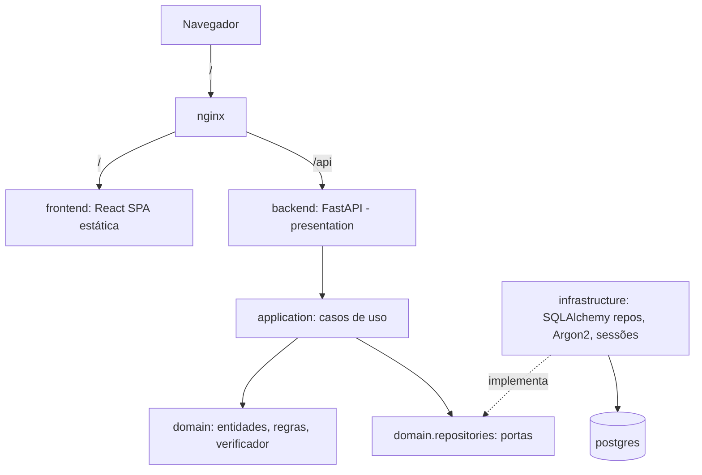

# Fundação Design

**Spec**: `.specs/features/fundacao/spec.md`
**Status**: Approved (abordagem fixada pelos requisitos do usuário: Clean Architecture, FastAPI, SQLAlchemy, Alembic, PostgreSQL, React/TS, Docker Compose + Nginx)

---

## Architecture Overview

Monólito modular em quatro camadas. O domínio é Python puro, sem importar FastAPI, SQLAlchemy ou clientes de IA. A aplicação orquestra casos de uso através de portas (interfaces). A infraestrutura implementa as portas. A apresentação expõe REST e serve a SPA via nginx.



Regra de dependência: `presentation → application → domain` e `infrastructure → domain`. A composição (injeção) acontece só em `presentation/dependencies.py` e `main.py`. Um teste de arquitetura (`tests/architecture/test_layers.py`) falha se `app/domain` ou `app/application` importarem `fastapi`, `sqlalchemy`, `httpx` ou `app.infrastructure`.

---

## Code Reuse Analysis

### Existing Components to Leverage

| Component | Location | How to Use |
| --- | --- | --- |
| Nenhum código existente | — | Repositório contém só README e `.specs/` |
| Fontes normativas | `docs/referencias/normas/FONTES.md`, Res. 4.644 (PDF) | Origem dos dados semeados das versões de carreira (citadas em cada registro) |
| Casos reais | `Modelos/Portaria_2022_2024.pdf`, `Modelos/Requerimento.pdf` | Dados dos testes de aceitação PROC-10/PROC-11 (transcritos como fixtures, sem PDF no teste) |

### Integration Points

| System | Integration Method |
| --- | --- |
| PostgreSQL 16 | SQLAlchemy 2.x (psycopg 3), migrações Alembic aplicadas no entrypoint do backend |
| MariTalk | Fora desta feature; apenas variáveis de configuração (AD-005) |

---

## Components

### Domain — valores e regras de carreira

- **Purpose**: Representar estruturas de carreira versionadas e calcular interstício sem dependências externas.
- **Location**: `backend/app/domain/entities/career.py`, `backend/app/domain/rules/interstice.py`
- **Interfaces**:
  - `Interstice(start: date, end: date)`; `.months() -> int` (meses civis completos; fim de mês ajustado); `.days() -> int`; `.crosses(d: date) -> bool`
  - `CareerVersion(name, valid_from, valid_to, norm_reference, classes: tuple[CareerClass, ...])`; `.covers(d) -> bool`; `.get_class(code) -> CareerClass | None`; `.next_class(code) -> CareerClass | None`; `.min_months(modality, target_class) -> int`
  - `CareerClass(code, denominations: tuple[str, ...], levels: tuple[int, ...], promotion_min_months: int)`
  - `select_version(versions, end_date) -> CareerVersion | None`
- **Dependencies**: stdlib (`datetime`, `dataclasses`, `calendar`)
- **Reuses**: —

### Domain — verificador do processo

- **Purpose**: Produzir a lista determinística de alertas de um processo (PROC-05..09, CARR-04..07, DADOS_INCOMPLETOS).
- **Location**: `backend/app/domain/rules/process_verification.py`
- **Interfaces**:
  - `verify_process(p: ProcessSnapshot, versions: Sequence[CareerVersion]) -> list[Alert]`
  - `Alert(code: AlertCode, severity: Severity, message: str, norm_reference: str)`; `Severity = ERRO | ALERTA | REQUER_ANALISE_NORMATIVA`
- **Dependencies**: entidades de carreira e de processo
- **Reuses**: `Interstice`, `select_version`
- **Nota**: função pura; nunca altera o snapshot (PROC-03). Ordem dos alertas estável (pela ordem das checagens) para testes de igualdade de conjunto.

### Domain — entidades e portas

- **Location**: `backend/app/domain/entities/{user,professor,process,academic_unit,audit}.py`, `backend/app/domain/repositories/*.py`
- **Interfaces** (Protocols): `UserRepository`, `SessionRepository`, `LoginAttemptRepository`, `ProfessorRepository`, `ProcessRepository`, `AcademicUnitRepository`, `CareerVersionRepository`, `AuditRepository`, `PasswordHasher`, `UnitOfWork` (context manager com `commit()`)
- `ProcessStatus` com tabela de transições permitidas (`can_transition(from, to, actor_role, is_owner)`).
- Erros de domínio: `NotFound`, `Conflict`, `ValidationFailed(field, message)`, `Forbidden`, `StaleVersion`.

### Application — casos de uso

- **Purpose**: Orquestrar autorização, validação, persistência e auditoria em uma transação.
- **Location**: `backend/app/application/use_cases/{auth,users,professors,processes,units,career}.py`, `backend/app/application/services/{access_policy,audit_service}.py`
- **Interfaces**:
  - `Login.execute(email, password, now) -> (Session, User)`; `Logout`; `GetCurrentSession(token, now)`
  - `CreateUser`, `CreateProfessor`, `UpdateProfessor`, `CreateProcess`, `UpdateProcess(id, changes, justification, expected_version)`, `GetProcess -> (process, interstice_months, interstice_days, alerts)`, `ListProcesses`, `GetProcessHistory`, `ChangeProcessStatus`, CRUD de unidades, `CreateCareerVersion`
  - `AccessPolicy.can_read_process(actor, process) -> bool` (AUTH-08/09: falha → `NotFound`)
  - `AuditService.record(actor, entity, entity_id, before: dict, after: dict, justification)` grava só campos alterados
- **Dependencies**: portas do domínio; relógio injetado (`Clock`) para testes de expiração de sessão.

### Infrastructure

- **Location**: `backend/app/infrastructure/database/{models.py,repositories.py,session.py,seed.py}`, `backend/app/infrastructure/security/{argon2_hasher.py,tokens.py}`, `backend/alembic/`
- **Interfaces**: implementações SQLAlchemy das portas; `SqlUnitOfWork`; `seed_reference_data(uow)` idempotente (versões de carreira, unidades de UNIT-03, ADMIN inicial a partir de `ADMIN_EMAIL`/`ADMIN_PASSWORD`).
- Sessões: token aleatório de 32 bytes (`secrets.token_urlsafe`) no cookie; banco guarda só `sha256(token)`, `csrf_token`, `created_at`, `last_seen_at`.
- Rate limit de login: tabela `login_attempts` (funciona com múltiplos workers).

### Presentation

- **Location**: `backend/app/presentation/api/{auth,users,professors,processes,units,career,health}.py`, `backend/app/presentation/schemas/*.py`, `backend/app/presentation/{dependencies.py,errors.py,csrf.py}`, `backend/app/main.py`, `backend/app/core/config.py`
- **Interfaces**: REST sob `/api`; `errors.py` mapeia erros de domínio → HTTP (NotFound 404, Conflict/StaleVersion 409, ValidationFailed 422 `{"detail":[{"field","message"}]}`, Forbidden 403, não autenticado 401, rate limit 429).
- `config.py` (pydantic-settings, `extra="ignore"`): falha de inicialização nomeia variável ausente (INFRA-07).
- Logging: formatador que registra método, rota-template, status, duração e `user_id`; nunca corpo da requisição (AUD-04).

### Frontend

- **Location**: `frontend/src/{api/client.ts,auth/,pages/{Login,Dashboard,ProfessorForm,ProcessStep1}.tsx,components/{StepNav,AlertList,FieldError}.tsx}`
- **Interfaces**: `api.request(method, path, body?)` com `credentials:"include"` e header `X-CSRF-Token` obtido de `GET /api/auth/me`; `RequireAuth` redireciona para `/login` (UI-01).
- Stack: React 19, Vite, TypeScript, react-router; CSS próprio responsivo (sem biblioteca de UI).

### Deploy

- **Location**: `docker-compose.yml`, `backend/Dockerfile`, `frontend/Dockerfile`, `nginx/nginx.conf`, `.env.example`, `scripts/init.sh`
- Serviços: `postgres` (16-alpine, healthcheck `pg_isready`), `backend` (entrypoint: `alembic upgrade head` → seed → uvicorn), `frontend` (build Vite → nginx estático interno), `nginx` (porta 80; `/api` → backend, `/` → frontend). Volumes nomeados `pgdata` e `storage`.

---

## Data Models

Tabelas desta feature (nomes conforme seção 16 do prompt; demais tabelas entram nas features seguintes).

```python
users(id uuid pk, email citext unique, name, role enum(ADMIN,SECRETARIA,DOCENTE),
      password_hash, professor_id uuid fk null unique, active bool, created_at)
user_units(user_id fk, unit_id fk, pk(user_id, unit_id))          # vínculo SECRETARIA ↔ unidade
sessions(id uuid pk, user_id fk, token_hash char(64) unique, csrf_token,
         created_at, last_seen_at)
login_attempts(id pk, email, attempted_at, success bool)          # índice (email, attempted_at)
academic_units(id uuid pk, name, acronym, kind enum(CAMPUS,INSTITUTO,FACULDADE),
               parent_id fk null, archived bool)
career_structures(id uuid pk, code unique, name)                   # "MAGISTERIO_SUPERIOR"
career_versions(id uuid pk, structure_id fk, name, valid_from date, valid_to date null,
                norm_reference text not null, definition jsonb not null, created_at)
    # definition = {"progression_min_months":24,
    #               "classes":[{"code":"A","denominations":[...],"levels":[1,2],"promotion_min_months":24}, ...]}
professors(id uuid pk, full_name, siape char(7) unique, titration enum, position, career_structure_id fk,
           unit_id fk, faculty, campus, work_regime enum(20H,40H,DE), archived bool, version int)
functional_processes(id uuid pk, professor_id fk, unit_id fk, modality enum(PROGRESSAO,PROMOCAO),
     current_class, current_denomination, current_level int,
     target_class, target_denomination, target_level int,
     start_date, end_date, opening_date, notes, status enum(RASCUNHO,EM_ANDAMENTO,CONCLUIDO,ARQUIVADO),
     resp_name, resp_position, resp_appointment, resp_admin_unit,
     created_by fk users, created_at, updated_at, version int)    # version = optimistic lock
audit_logs(id bigserial pk, occurred_at timestamptz, user_id fk null, entity, entity_id,
           action enum(CREATE,UPDATE,ARCHIVE,STATUS), changes jsonb, justification text null)
    # sem endpoints de escrita; REVOKE UPDATE, DELETE para o papel da aplicação (AUD-02)
```

**Relationships**: professor 1—N processes; unit 1—N professors/processes; user 0..1—1 professor; user N—N units; career_structure 1—N career_versions. Processos guardam classe/nível como texto+inteiro (não FK), porque precisam aceitar valores inexistentes na estrutura (PROC-03, CARR-04).

### Dados semeados das versões de carreira (CARR-02)

| Versão | Vigência | Classes (código: denominações; níveis; promoção para esta classe) | Fonte |
| --- | --- | --- | --- |
| Res. 4.644/2015-CONSEPE | até 31/12/2024 | A: Adjunto A, Assistente A, Auxiliar; 1–2; — · B: Assistente; 1–2; 24 · C: Adjunto; 1–4; 24 · D: Associado; 1–4; 24 · E: Titular; único (1); 24 | Res. 4.644 arts. 2º, 4º, 5º |
| Lei 12.772/2012 c/ redação da Lei 15.141/2025 | a partir de 01/01/2025 | A: Assistente; 1; — · B: Adjunto; 1–4; 36 · C: Associado; 1–4; 24 · D: Titular; 1; 24 | Lei 12.772 art. 1º §1º, Anexo I, art. 12 §§2º–3º |

Progressão: 24 meses nas duas versões.

---

## Error Handling Strategy

| Error Scenario | Handling | User Impact |
| --- | --- | --- |
| Validação de campo (SIAPE, senha curta, justificativa ausente) | `ValidationFailed` → 422 `{detail:[{field,message}]}` | Mensagem junto ao campo (UI-05) |
| Recurso inexistente ou sem permissão de leitura | `NotFound` → 404 | "Processo não encontrado" (não revela existência) |
| SIAPE duplicado, processo somente leitura, versão desatualizada | `Conflict`/`StaleVersion` → 409 | Mensagem explicando o conflito e pedindo recarregar |
| Regras de negócio violadas no processo | Não é erro: alertas na resposta 200 | Lista de alertas por severidade (UI-03) |
| Banco indisponível | health 503; demais rotas 503 genérico | "Serviço indisponível" |
| Variável obrigatória ausente | `SystemExit` com nome da variável | Container não sobe; log claro |

---

## Risks & Concerns

| Concern | Location (file:line) | Impact | Mitigation |
| --- | --- | --- | --- |
| `.env` local contém chave MariTalk real e variáveis de outro projeto (Chatwoot, WhatsApp); a chave atual retorna 401 | `.env:2` | Vazamento se commitado; IA indisponível nas próximas features | `.env` no `.gitignore` (feito); `config.py` ignora extras; usuário deve gerar nova chave antes de `inteligencia-documental` |
| Cookie `Secure` não é gravado por navegadores em HTTP fora de `localhost` | `nginx/nginx.conf` | Login falha na VM antes do HTTPS | `COOKIE_SECURE` configurável (padrão `true`); HTTPS na feature `implantacao` |
| Dados semeados de carreira são interpretação normativa | `infrastructure/database/seed.py` | Regra errada propaga para todos os processos | Cada versão guarda `norm_reference`; versões usadas por processos são imutáveis (CARR-08); feature `normativo` revisará |
| Testes de integração precisam de PostgreSQL | `tests/integration/conftest.py` | Suíte não roda sem Docker | Fixture sobe `postgres:16-alpine` em porta efêmera ou usa `TEST_DATABASE_URL` (AD-004) |
| Documentos pessoais em `Documentos/` e `Modelos/` | raiz do repo | LGPD | Ambos no `.gitignore`; fixtures de teste transcrevem só os campos necessários |

---

## Tech Decisions (only non-obvious ones)

| Decision | Choice | Rationale |
| --- | --- | --- |
| Definição de classes da carreira | JSONB em `career_versions.definition`, validado por schema Pydantic na entrada | Versões são imutáveis e lidas inteiras; tabelas normalizadas não trazem ganho |
| Contagem de meses | `relativedelta`-equivalente próprio (stdlib) com ajuste de fim de mês | Evita dependência; regra explícita e testada (edge case 29/02) |
| Concorrência | Coluna `version` + `expected_version` no PUT → 409 | Edge case de gravação simultânea |
| Rate limit de login | Tabela no Postgres, janela deslizante de 15 min | Correto com vários workers sem Redis |
| Frontend servido por container próprio atrás do nginx | Sim | Serviços previstos no prompt (frontend, backend, postgres, nginx) |
