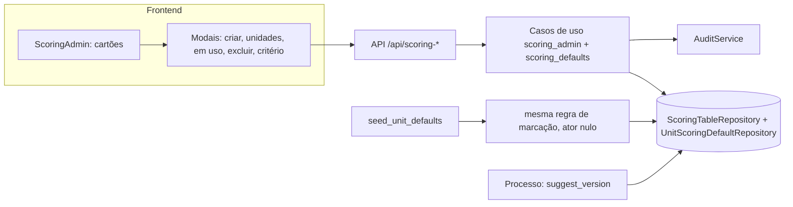

# Gestão das tabelas de pontuação Design

**Spec**: `.specs/features/gestao-tabelas/spec.md`
**Status**: Draft (aguarda a aprovação do usuário)

Base: leitura do código por seis leitores independentes em 2026-11-23 (casos de uso de administração, sugestão e semente, persistência e API, tela, testes, consumidores). Toda afirmação abaixo sobre o código atual vem dessa leitura, com o arquivo citado.

---

## Architecture Overview

Quatro peças sobre o que já existe:

1. **Versão em uso por unidade** (`UnitScoringDefault`): uma linha por unidade acadêmica apontando uma versão. É lida na sugestão do processo (`suggest_version`, `application/use_cases/scoring.py:126-138`) antes da busca por vigência, e escrita só por casos de uso do ADMIN e pela semente.
2. **Ciclo de vida da tabela**: arquivar e desarquivar (a coluna `scoring_tables.archived` já existe e hoje só a semente escreve, `seed.py:263-279`), excluir versão e excluir tabela, cada um com prévia e recusas por regra.
3. **API aditiva**: rotas novas e campos novos nas respostas; nenhum campo existente muda de sentido (`in_use` continua "algum processo usa").
4. **Tela nova da lista**: cartões por tabela e por versão, formulários em `Modal`, leitura aberta a todos os perfis e escrita só do ADMIN. Os formulários de duplicar, nova versão e CSV que já existem (`frontend/src/components/ScoringAdminForms.tsx`) são reaproveitados.



### Correções às premissas da spec

- A spec dizia que nenhuma operação de administração tem tela. Já existem `DuplicateForm`, `VersionForm` e `CsvForm` (`ScoringAdminForms.tsx:81-214`), dentro do cartão de critérios. Eles são movidos para modais, não reescritos.
- A dívida "`api/client.ts` só envia JSON" está desatualizada: `request()` aceita `FormData` com CSRF (`client.ts:25-40`), e o CSV já usa isso.
- A tela e o item de menu são só do ADMIN hoje (`App.tsx:105-109, 134-141`, `Layout.tsx:11-12`); a leitura para os demais perfis (GTAB-15) exige abrir a rota.
- A edição de critério tem uma terceira regra de somente leitura que a spec não lista: só a versão mais recente da tabela é editável (`scoring_admin.py:346-353`).

### Abordagens para a "versão em uso"

| Opção | Como | Vantagem | Desvantagem |
| ----- | ---- | -------- | ----------- |
| **A. Tabela nova `scoring_unit_defaults` (recomendada)** | Chave primária `unit_id`, `version_id` com `ON DELETE RESTRICT` | Uma linha por unidade garantida pelo banco; o banco também barra a exclusão da versão em uso; nenhuma coluna mexida nas tabelas existentes; casa com a spec e com a AD-028 | Uma tabela e um repositório a mais |
| B. Coluna em `academic_units` | `default_scoring_version_id` | Sem tabela nova | Mexe na tabela de unidades, que o seed e outras features leem; `ON DELETE` na coluna de outra feature |
| C. Coluna em `scoring_table_versions` | `is_default_for_unit_ids` (array) | Sem tabela nova | Perde a unicidade por unidade no banco; consultas por unidade pioram |

Recomendação: **A**. As opções B e C quebram a garantia "no máximo uma por unidade" do banco ou invadem tabelas de outras features.

---

## Code Reuse Analysis

### Existing Components to Leverage

| Component | Location | Como é usado |
| --------- | -------- | ------------ |
| `require_admin`, `AuditService.record` (sem evento se nada mudou), `Conflict(code=...)`, `ValidationFailed` | `application/use_cases/users.py:19-21`, `application/services/audit_service.py:47-72`, `presentation/errors.py:50-69` | Toda escrita nova; a idempotência (marcar de novo, arquivar o arquivado) vem do `record` |
| `AuditAction.CREATE/UPDATE/ARCHIVE/DELETE` | `domain/entities/audit.py:11-16` | Sem migração de enum |
| `version_in_use`, `list_using_version`, `set_table_archived`, `set_table_units` | `infrastructure/database/repositories.py:897-904, 374-385, 736-740, 728-734` | Guardas e escritas |
| `pg_insert(...).on_conflict_do_update`, `SELECT ... FOR UPDATE` | `repositories.py:2640-2662, 2677-2760` | Marcação por unidade e exclusão sob trava |
| `DeletePreviewOut` e `GET .../delete-preview` + `DELETE` 204 | `presentation/api/processes.py:81-98`, `use_cases/processes.py:257-306` | Molde das prévias de exclusão |
| `AdoptSupersedingVersion` | `use_cases/scoring_adoption.py:15-56` | Ponto onde a marcação de uma versão substituída é desfeita |
| `Modal`, `DeleteProcessDialog`, `Norms.tsx` (`isAdmin`, `showArchived`) | `components/Modal.tsx`, `components/ProcessDialogs.tsx:118-207`, `pages/Norms.tsx` | Diálogos, confirmação com lista, página de gestão com filtro de arquivadas |
| `ScoringAdminForms` (`Field`, `useSubmit`, `FormProblem`, três formulários) | `components/ScoringAdminForms.tsx:9-214` | Extraídos para módulo compartilhado e abertos em modais |
| `ReviewHighlight` (critérios, cartão em 480 px) | `components/ReviewHighlight.tsx` | Leitura dos critérios; ganha o modo de edição |
| `request()` com `FormData`, `ApiError`, `errorMessage` | `api/client.ts:5-86` | CSV, erros 409/422 |

### Integration Points

| Sistema | Ligação |
| ------- | ------- |
| Etapa 4 (`ProcessScoring`, `TablePicker`) | Consome `GET /api/scoring-tables` e hoje filtra arquivadas no cliente (`ProcessScoring.tsx:63-66`); passa a ter a recusa também no backend (GTAB-24) |
| Semente (`docker-entrypoint.sh:28-29`, `seed.py:282-334`) | Nova função `seed_unit_defaults` chamada por `main()` depois de `seed_scoring_tables` |
| Documentos gerados | Nenhuma ligação com FK para tabela ou versão (`models.py`): excluir uma versão sem processo não quebra documento algum |

---

## Components

### Domínio e aplicação (Python puro)

- `domain/entities/scoring.py`: `UnitScoringDefault(unit_id, version_id)` (dataclass congelada).
- `domain/rules/scoring_table_choice.py` (puro): `pick_unit_default(default, candidates)` devolve a versão em uso quando ela passa nas guardas (não substituída, tabela não arquivada, tabela ainda associada à unidade); senão `None`, e a sugestão cai na vigência.
- `application/use_cases/scoring_defaults.py` (novo): `SetUnitDefaultVersion`, `ClearUnitDefaultVersion`, `SeedUnitDefaults` (ator nulo).
- `application/use_cases/scoring_admin.py`: `ArchiveScoringTable(archive: bool)`, `DeleteScoringVersion`, `DeleteScoringTable`, `PreviewDeleteVersion`, `PreviewDeleteTable`; `ListScoringTables` ganha `process_count`, `default_for_unit_ids` e os motivos; `SetTableUnits` recusa tirar a unidade que tem a versão em uso (emenda A4).
- `application/use_cases/scoring.py`: `suggest_version` consulta a versão em uso antes da vigência; `ChooseProcessTable` recusa escolha nova de versão de tabela arquivada (emenda A5).
- `application/use_cases/scoring_adoption.py`: ao marcar uma versão como substituída, desfaz a marcação das unidades que a tinham, com auditoria sem usuário.

### Persistência

- `models.py`: `ScoringUnitDefaultModel` (`scoring_unit_defaults`).
- `ports.py` e `repositories.py`: no `ScoringTableRepository` (sem mexer no `UnitOfWork`): `get_unit_default`, `list_unit_defaults`, `set_unit_default` (upsert), `clear_unit_default`, `unit_ids_defaulting_to(version_id)`, `version_process_counts()` (um `GROUP BY`), `superseding_version_ids()` (versões que substituem outra), `delete_version`, `delete_table` (apaga as versões da tabela num único `DELETE`, depois a tabela), `count_criteria`. `list_versions_for_unit` passa a excluir tabela arquivada.
- A lista (`ListScoringTables`) deixa de carregar grupos e critérios só para descartá-los: método `list_version_headers` para o caminho do resumo.

### API (`/api`)

| Método e rota | Corpo ou resposta | Papel |
| ------------- | ----------------- | ----- |
| `PUT /scoring-units/{unit_id}/default-version` | `{version_id}` → `UnitDefaultOut` | ADMIN |
| `DELETE /scoring-units/{unit_id}/default-version` | 204 | ADMIN |
| `POST /scoring-tables/{id}/archive` e `/unarchive` | `TableOut` | ADMIN |
| `GET /scoring-versions/{id}/delete-preview` | `{name, criteria, blocked}` | autenticado |
| `DELETE /scoring-versions/{id}` | 204 | ADMIN |
| `GET /scoring-tables/{id}/delete-preview` | `{name, versions, criteria, units, blocked}` | autenticado |
| `DELETE /scoring-tables/{id}` | 204 | ADMIN |
| `GET /scoring-tables` (existente) | `VersionSummaryOut` ganha `process_count`, `default_for_unit_ids`, `read_only_reason`, `delete_blocked_reason`; `TableOut` ganha `archive_blocked_reason`, `delete_blocked_reason`; `in_use` fica como está | autenticado |

Os motivos são códigos estáveis, e a tela traduz cada um em texto (L-037). Códigos: `VERSAO_SUBSTITUIDA` (já existe), `VERSAO_NAO_MAIS_RECENTE`, `VERSAO_USADA_POR_PROCESSO`, `VERSAO_EM_USO_DE_UNIDADE`, `VERSAO_SUBSTITUI_OUTRA`, `TABELA_ARQUIVADA`, `TABELA_COM_VERSAO_EM_USO`, `TABELA_OFICIAL_PROTEGIDA`, `UNIDADE_COM_VERSAO_EM_USO`. Marcação com tabela não associada à unidade: 422 no campo `unit_id`, como GTAB-03. A prévia traz `blocked` (código, texto e quantidade de processos ou lista de siglas), para a tela mostrar o motivo antes do clique.

### Frontend

- `pages/ScoringAdmin.tsx`: reescrita da lista em cartões. Carrega `/api/scoring-tables` e `/api/units`; filtro por unidade e "Mostrar arquivadas" no cliente (a lista já vem completa); `p[role=status]` fixo no topo para a confirmação.
- Componentes novos: `ScoringTableCard`, `VersionRow`, `ScoringAdminDialogs` (criar tabela, unidades, escolher unidade em uso, excluir versão e tabela com prévia, editar critério), módulo `formKit` (o que sai de `ScoringAdminForms`).
- Tela aberta a todos os autenticados: `AdminOnly` sai da rota, o link do menu aparece para todos e os botões de escrita só para o ADMIN (`useAuth`, como `Norms.tsx`).
- Botões: por versão "Ver critérios", "Definir como em uso", "Nova versão a partir desta" e "Excluir versão"; por tabela "Importar CSV", "Duplicar", "Unidades", "Histórico", "Arquivar" ou "Desarquivar" e "Excluir tabela"; "Nova tabela" no cabeçalho. Todos visíveis, em linhas que quebram, com `min-height` de 2,75 rem e rótulo de texto; botão não permitido fica desabilitado com o motivo em texto logo abaixo (padrão de `GeneratedBlock`), ligado por `aria-describedby`.
- CSS: classes novas com prefixo `.tbl-` num bloco próprio; `.scoring-table` não muda (`ReviewHighlight` e `Norms` a usam). A causa do quebra-letra é o `overflow-wrap: anywhere` global em `body` (`styles.css:22-25`); o bloco novo usa `overflow-wrap: break-word` e `min-width: 0` e nunca `<table>`.

---

## Data Models

### Migração `0012_unit_defaults` (`down_revision = "0011"`)

```
scoring_unit_defaults
  unit_id     uuid  PK  FK academic_units(id)             -- uma linha por unidade
  version_id  uuid  NOT NULL  FK scoring_table_versions(id)  -- sem ON DELETE (RESTRICT): o banco barra a exclusão
  updated_at  timestamptz NOT NULL default now()
```

Modelo no molde de `DossierDeliveryModel` e da `0011`; o `downgrade` remove a tabela. O teste de tabelas (`tests/integration/test_migrations.py`, conjunto `TABLES`) e o de `compare_metadata` ganham a tabela nova; cinco testes de migração passam por esta revisão e precisam continuar verdes.

### Auditoria

- Marcar: entidade `unit_scoring_default`, `entity_id` = id da unidade, `changes = {version_id: {before, after}}`; ação `CREATE` na primeira marcação, `UPDATE` na troca, `DELETE` ao desmarcar. A semente grava com `user_id` nulo.
- Arquivar e desarquivar: entidade `scoring_table`, `{archived: {before, after}}`, ação `ARCHIVE` ao arquivar e `UPDATE` ao desarquivar.
- Excluir versão: entidade `scoring_version`, ação `DELETE`, `before = {name, table_id, criteria}`; excluir tabela: entidade `scoring_table`, ação `DELETE`, `before = {name, versions, criteria, unit_ids}`. As linhas de auditoria não têm FK e o gatilho as torna imutáveis, então a exclusão não as apaga.

---

## Error Handling Strategy

| Cenário | Tratamento | Impacto |
| ------- | ---------- | ------- |
| Escrita de quem não é ADMIN | `require_admin` no primeiro passo do caso de uso: 403 | Toda rota nova entra nas duas listas de rotas de escrita do teste de 403 e de 401 (`test_scoring_admin_api.py:138-162`) |
| Marcação de versão substituída ou de tabela arquivada | 409 com código | Mensagem em texto na tela |
| Marcação de tabela não associada à unidade | 422 no campo `unit_id` | Erro junto do campo |
| Excluir ou arquivar o que está bloqueado | 409 com código, texto e, quando couber, quantidade ou siglas; nada é apagado | A prévia já mostra o bloqueio |
| Corrida: excluir a versão enquanto um processo a escolhe ou enquanto outra pessoa a marca | Trava `SELECT ... FOR UPDATE` na versão e reconferência dentro da transação; violação de FK (23503) que escapar vira 409 genérico, nunca 500 | Estado final consistente |
| Duas pessoas marcam a mesma unidade | `INSERT ... ON CONFLICT (unit_id) DO UPDATE`; vale a última, com a auditoria lendo o valor anterior sob trava | Um só registro por unidade |
| Exclusão de tabela falha no meio | Uma transação só; sem exclusão parcial | Nada some |

Nome de tabela repetido continua **422 no campo `name`** (pré-checagem em `scoring_admin.py:105-106`, fixado pelos testes `test_scoring_admin_api.py:115,189`); a linha da spec que dizia 409 é corrigida (emenda A7).

---

## Risks & Concerns

| Concern | Onde | Mitigação |
| ------- | ---- | --------- |
| A semente roda a cada partida e desfaz o que o ADMIN faz: remarca a unidade que ele limpou, recria a tabela oficial excluída, re-arquiva e desassocia as tabelas antigas desarquivadas (`seed.py:263-315`) | Seed | `seed_unit_defaults` só marca a unidade que **nunca teve** evento de marcação na auditoria (A1); `_archive_legacy_tables` pula a tabela que **alguma pessoa** já alterou (evento de auditoria com usuário na tabela, A2); a tabela oficial e suas versões não se excluem (A3) |
| Mudar a semente `seed_scoring_tables` altera o ponto de partida de cerca de 7 testes de sugestão por vigência (`test_table_choice.py:42,157,174`, `test_process_score.py:65`, `test_scoring_process_api.py:91`, `test_scoring_alert_norms.py:135`) | Testes | A semente da marcação fica numa função separada, chamada por `main()` e não pelas fixtures; os testes novos a pedem de forma explícita |
| `archived` não é lido em lugar nenhum no backend (`suggest_version`, `ChooseProcessTable`, `list_versions_for_unit`) | Sugestão e escolha | Filtro no repositório (`list_versions_for_unit`) e recusa na escolha nova (A5); a leitura e o cálculo de processo que já usa a tabela não filtram |
| `SetTableUnits` pode deixar uma marcação órfã (`repositories.py:728-734`) | Unidades | Recusa 409 enquanto a unidade tem a versão em uso daquela tabela (A4); além disso a sugestão ignora marcação que falha nas guardas |
| Nenhum `IntegrityError` além do de unicidade é tratado (`repositories.py:119-162`) | Exclusão e corrida | Trava de linha, reconferência e mapeamento de 23503 para 409 |
| `ListScoringTables` faz N+1 e carrega todos os critérios (`scoring_admin.py:51-60`, `repositories.py:697-782`) | Desempenho | Duas consultas agrupadas (processos por versão, marcações) e `list_version_headers` sem grupos |
| Duplicar uma tabela copia `norm_code` da oficial (`scoring_admin.py:225-230`), o que cita a norma errada nas tabelas novas | Duplicar | A cópia para outra tabela limpa `norm_code` (A6) |
| Histórico: a exclusão tira a versão da lista do histórico, e o histórico de tabela excluída dá 404 (`scoring_admin.py:618-633`) | Auditoria | Os eventos ficam no banco (imutáveis); o histórico mostra o que existe; a exclusão registra os dados no `before`; sem tela de histórico de entidade excluída |
| `body { overflow-wrap: anywhere }` e o teste estático UI-06 (nenhuma largura mínima acima de 360 px) | CSS | Bloco `.tbl-*` com `min-width: 0`, sem larguras fixas; teste estático novo no molde de GRES-08 |
| O teste de 360 px é só estático (L-021) | Verificação | O Verificador renderiza a tela num navegador sem cabeça; sem navegador, o limite entra em `validation.md` como risco residual |
| `in_use` é lido por `TablePicker`, `ProcessScoring` e cerca de 18 asserções | Compatibilidade | `in_use` não muda; campos novos são aditivos; só a etiqueta da tela é renomeada |
| O endpoint de histórico é aberto a todos os autenticados, e GTAB-17 diz "quando o ADMIN abre" | Leitura | A API segue aberta (é leitura, ADM-11); o botão "Histórico" aparece só para o ADMIN |

---

## Tech Decisions

| Decisão | Escolha | Por quê |
| ------- | ------- | ------- |
| Onde mora a marcação | Tabela nova `scoring_unit_defaults` com `ON DELETE RESTRICT` | Opção A acima |
| Onde ficam os métodos | No `ScoringTableRepository`, sem repositório novo no `UnitOfWork` | Menos fiação e nenhum protocolo novo |
| Semente | Função `seed_unit_defaults` separada, regra "só unidade sem evento de marcação anterior", ator nulo, na mesma transação | Respeita GTAB-04 e a idempotência; não muda fixtures |
| Quem desfaz a marcação da versão substituída | `AdoptSupersedingVersion` (único lugar onde se substitui versão, `scoring_adoption.py:40-41`) e a guarda preguiçosa na sugestão | A guarda cobre os testes que chamam `set_superseded` direto |
| Filtros da lista | No cliente | A lista já vem completa; um parâmetro novo no backend não traz ganho |
| Layout | Cartões em todas as larguras, sem `<table>` | Elimina a causa do quebra-letra e já é o padrão do teste UIG-07 |
| Formulários | `Modal`, com os atuais extraídos para `formKit` | Foco, Esc e prisão de Tab prontos; lista limpa |
| Tela de critérios | Continua no cartão abaixo da lista (estado local), ganha edição por critério em `Modal` | Evita rota nova e mexer nos testes de navegação |
| Formato do 409 | `detail` em texto pronto + `code` estável | A tela mostra o texto; os testes afirmam o código (L-037) |
| Duplicar-nome | Mantém 422 no campo `name` | É o que a tela e os testes usam |

---

## Emendas à spec (a aprovar junto com este desenho)

A spec foi aprovada antes da leitura do código. Estas emendas decorrem dela; só entram na spec depois da sua aprovação.

| Emenda | Mudança |
| ------ | ------- |
| A1 | **GTAB-09** passa a marcar só a unidade que tem a tabela oficial associada, **nenhuma versão em uso e nenhum evento de marcação anterior** na auditoria. Assim uma unidade que o ADMIN limpou (GTAB-04) ou que perdeu a marcação (Edge Case da versão substituída) não é remarcada na partida seguinte |
| A2 | Novo **GTAB-41**: a semente que arquiva e desassocia as tabelas antigas (OFI-09) não age em tabela que alguma pessoa já alterou, para o ADMIN poder desarquivar e reassociar |
| A3 | Novo **GTAB-42**: a tabela oficial da UFPA e suas versões não se excluem (409 `TABELA_OFICIAL_PROTEGIDA`), porque a semente as recria; podem ser arquivadas e marcadas |
| A4 | Novo **GTAB-43**: tirar de uma tabela a unidade que tem a versão dela em uso é recusado com 409 `UNIDADE_COM_VERSAO_EM_USO`, listando as siglas |
| A5 | Novo **GTAB-44**: a escolha de uma versão de tabela arquivada no processo é recusada com 409 `TABELA_ARQUIVADA`, salvo se for a versão que o processo já tem; a sugestão por vigência ignora tabela arquivada |
| A6 | Novo **GTAB-45**: duplicar uma tabela, ou criar versão em outra tabela a partir de uma versão, não copia o `norm_code` |
| A7 | **Edge Case** do nome repetido: 422 no campo `name`, não 409 |
| A8 | **GTAB-19**: a versão que não é a mais recente da tabela também fica só leitura (`VERSAO_NAO_MAIS_RECENTE`), como o backend já recusa |
| A9 | **GTAB-35**: "Nova versão" age sobre a versão escolhida como origem; "Importar CSV", "Duplicar" e "Unidades" agem sobre a tabela |
| A10 | **GTAB-10 e a etiqueta**: o campo `in_use` não muda; os campos novos são `process_count` e `default_for_unit_ids` |

---

## Plano de testes (resumo; as tarefas detalham)

- Backend: unidade pura (`pick_unit_default`), casos de uso com PostgreSQL real (marcar, trocar, desmarcar, arquivar, excluir com cada recusa, corrida), API (403 e 401 das rotas novas, códigos e campos), migração (`0012` sobe e desce), semente (idempotência, regra A1, A2) e regressão dos testes de sugestão listados nos riscos.
- Frontend: lista em cartões e etiquetas, ações por perfil, desabilitado com motivo, formulários e erros, prévia de exclusão, filtros, estado vazio, carregamento e falha, teste estático de 360 px do bloco `.tbl-*`.
- Gate: backend completo (cerca de 14 a 19 minutos) só na última tarefa de backend de cada fase; frontend `npm run lint && npm run build && REQUIRE_DIST=1 npm test -- --run`.
