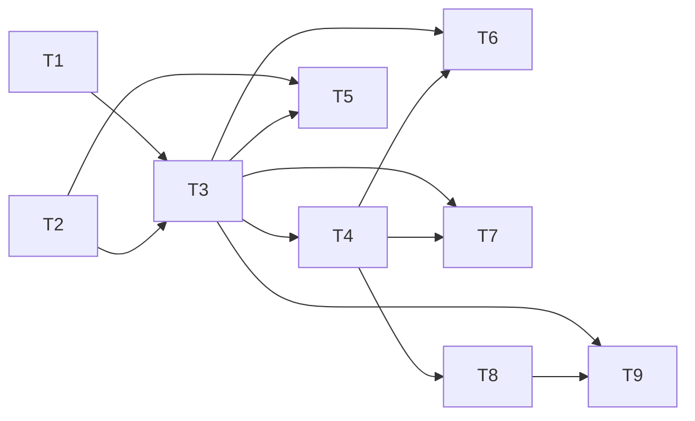
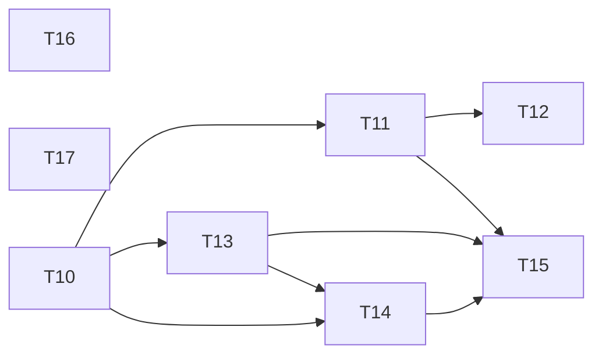
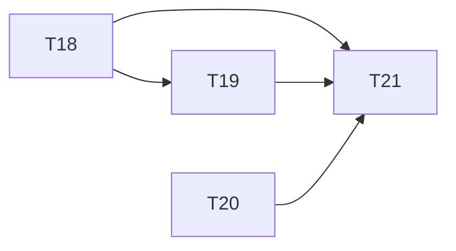
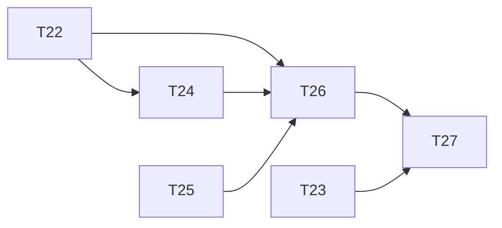
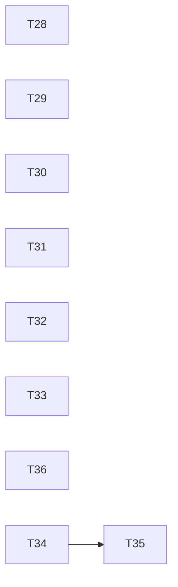
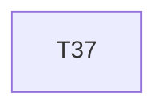
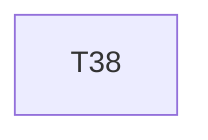

# Gestão das tabelas de pontuação (gestao-tabelas) Tasks

## Execution Protocol (MANDATORY -- do not skip)

Implement these tasks with the `tlc-spec-driven` skill: **activate it by name and follow its Execute flow and Critical Rules.** Do not search for skill files by filesystem path. The skill is the source of truth for the full flow (per-task cycle, sub-agent delegation, adequacy review, Verifier, discrimination sensor).

**If the skill cannot be activated, STOP and tell the user - do not proceed without it.**

---

**Design**: `.specs/features/gestao-tabelas/design.md` (aprovado em 2026-11-23, com as emendas A1 a A10)
**Spec**: `.specs/features/gestao-tabelas/spec.md` (aprovada em 2026-11-23; GTAB-01 a GTAB-45)
**Status**: Approved (usuário, 2026-11-23: "Aprovado", com as emendas A11 a A13; 4 lotes por sub-agente em sequência, cada um conferido no git antes do seguinte, mais o Verifier; o usuário autorizou o deploy depois da execução)

Regras de execução desta feature:

- Cada tarefa escreve primeiro os testes que derivam dos critérios de aceitação da spec e só então o código (os itens `Done when` começam pelo teste). Teste existente que muda por causa de requisito novo é listado na tarefa com o motivo.
- Só dados sintéticos; `Documentos/`, `Modelos/`, `requeriment.txt`, `test/`, `backend/img/` e `corpus-reports/` nunca são abertos nem copiados para teste. Nunca ler nem imprimir `AcessoVM.txt` nem arquivos `.env`.
- Um commit por tarefa (Conventional Commits, terminando com `Co-Authored-By: Claude Sonnet 5.5 <noreply@anthropic.com>`), marcando a tarefa neste arquivo e a rastreabilidade da spec no mesmo commit. Em cada commit, `git add` só dos caminhos da tarefa: nunca `git add -A`, `git add backend` nem `git add .`, para não levar `backend/img/`, `requeriment.txt` nem `test/`.
- Sem push, deploy nem acesso à VM sem autorização explícita do usuário para essa ação. Uma migração nova (`0012`) e uma semente nova; nada é executado na VM.
- **Gate em níveis** (o gate completo do backend leva de 14 a 19 minutos): cada tarefa roda o nível `quick`, `targeted` ou `front` com os arquivos que ela escreve e os testes existentes que ela lista; o gate `full` roda só na última tarefa de backend de cada fase de backend. Os testes instáveis conhecidos (`tests/integration/doc_usecases/test_worker.py::test_a_database_error_while_claiming_does_not_kill_the_thread` e `tests/unit/infrastructure/test_comprovante_assembler.py::test_an_output_above_the_limit_fails_and_leaves_no_file`) rodam de novo sozinhos com `python -m pytest -p no:cacheprovider` antes de qualquer conclusão de falha.
- A semente da marcação (`seed_unit_defaults`) **não** é chamada pelas fixtures dos testes nem por `seed_scoring_tables`; só `main()` a chama. Assim os testes de sugestão por vigência listados nas tarefas continuam valendo sem edição.
- A ordem das guardas e os códigos de bloqueio (`scoring_table_guards.py`) são a fonte única: os casos de uso, a lista de tabelas e a tela usam os mesmos códigos, e os testes afirmam o código e o texto (L-037).
- `in_use` na API continua significando "algum processo usa a versão"; os campos novos são aditivos. A etiqueta da tela "Em uso" passa a ser a marcação da unidade; o antigo sentido vira "Usada por processo".
- Processos que já escolheram tabela e documentos já gerados nunca mudam (AD-012): nenhuma operação desta feature reavalia nem recalcula processo.
- A chave da MariTalk fica só no backend; esta feature não usa IA.

---

## Test Coverage Matrix

> Generated from project guidelines, spec and the existing suites. Guidelines found: `CLAUDE.md` (regras 1 a 11, regra 5 sem justificativa nas Etapas 2 a 4, gate do backend e do frontend), AD-001 (teste de arquitetura `backend/tests/architecture/test_layers.py`), AD-004 (integração em PostgreSQL real), AD-012, AD-027, AD-028, as lições L-009, L-021 e L-037 e as suítes `backend/tests/` e `frontend/src/**/*.test.tsx`.

| Code Layer | Required Test Type | Coverage Expectation | Location Pattern | Run Command |
| --- | --- | --- | --- | --- |
| Domain (regra da versão em uso, bloqueios) | unit | Todos os ramos; 1 a 1 com GTAB-03, 06, 07, 19, 20, 25, 27, 29, 42; cada bloqueio sozinho e combinado, na ordem dita | `backend/tests/unit/domain/test_*.py` | `cd backend && .venv/bin/pytest tests/unit tests/architecture -q` |
| Migração e repositórios | integration | Unicidade por unidade, `RESTRICT` da versão, `downgrade`/`upgrade`, upsert, contagens agrupadas, filtro de arquivada, `compare_metadata` | `backend/tests/integration/test_migration_*.py`, `backend/tests/integration/test_scoring_repositories.py` | `cd backend && .venv/bin/pytest tests/integration -q` |
| Casos de uso e semente | integration | Caminho feliz e cada recusa na ordem dita; auditoria com e sem usuário; idempotência; corrida; atomicidade da exclusão; semente que respeita o que o ADMIN fez | `backend/tests/integration/scoring/test_*.py`, `backend/tests/integration/test_seed_*.py` | `cd backend && .venv/bin/pytest tests/integration -q` |
| API routes and schemas | integration | Cada rota feliz, 401, 403, 404, 409 com `code`, 422 por campo; campos novos aditivos; contagem de consultas da lista; as rotas novas nas listas de 401 e 403 | `backend/tests/integration/api/test_*.py` | `cd backend && .venv/bin/pytest tests/integration/api -q` |
| Frontend components/pages | unit | Cartões, etiquetas, filtros e estados; botões por perfil; desabilitado com motivo; cada diálogo (corpo enviado, erro junto do campo, sucesso anunciado, foco); prévia de exclusão; teste estático de 360 px e de 44 px | `frontend/src/**/*.test.tsx`, `frontend/src/styles.test.ts` | `cd frontend && npm test -- --run` |
| Docs | none | Só o gate de build | - | build gate only |

## Gate Check Commands

| Gate Level | When to Use | Command |
| --- | --- | --- |
| Quick | Tarefas só com testes unitários de backend | `cd backend && .venv/bin/ruff check . && .venv/bin/pytest tests/unit tests/architecture -q` |
| Targeted | Tarefas com testes de integração de backend: só os arquivos que a tarefa escreve ou muda, mais os testes existentes que ela lista | `cd backend && .venv/bin/ruff check . && .venv/bin/pytest <arquivos da tarefa> -q` |
| Full | Última tarefa de backend de cada fase de backend (14 a 19 minutos) | `cd backend && .venv/bin/ruff check . && .venv/bin/pytest -q` |
| Front | Tarefas de frontend e de documentação | `cd frontend && npm run lint && npm run build && REQUIRE_DIST=1 npm test -- --run` |
| Build | Fim da documentação e verificação | `cd backend && .venv/bin/ruff check . && .venv/bin/pytest -q && cd ../frontend && npm run lint && npm run build && REQUIRE_DIST=1 npm test -- --run` |

---

## Execution Plan

Phases are ordered and run sequentially - each phase completes before the next begins, and tasks within a phase execute in order. A tarefa que depende de fase anterior lista a dependência em `Depends on`; o diagrama de cada fase mostra só as setas de dentro da fase.

Lotes de execução (fases inteiras, cerca de 7 a 10 tarefas cada; uma fase nunca é dividida entre workers): **Lote 1** = Fase 1 (9 tarefas); **Lote 2** = Fase 2 (8 tarefas); **Lote 3** = Fase 3 e Fase 4 (10 tarefas); **Lote 4** = Fase 5 e Fase 6 (10 tarefas); a Fase 7 (Verifier) roda sozinha, por agente diferente do autor.

### Phase 1: Versão em uso por unidade: banco, regra e API (backend)

### Phase 2: Arquivar, excluir e regras vizinhas (backend)

### Phase 3: Motivos, semente das tabelas antigas e aceitação (backend)

### Phase 4: Tela: base e lista em cartões (frontend)

### Phase 5: Tela: operações e documentação (frontend e docs)

### Phase 6: Documentação

### Phase 7: Verifier

---

## Task Breakdown

### Phase 1: Versão em uso por unidade: banco, regra e API (backend)

#### T1: Tabela da marcação em uso (migração 0012 e modelo)

**Status**: Done

**What**: Cria `scoring_unit_defaults` (`unit_id` chave primária com FK para `academic_units`, `version_id` NOT NULL com FK para `scoring_table_versions` sem `ON DELETE`, `updated_at` com default `now()`), o `ScoringUnitDefaultModel` em `models.py` e o `downgrade`, que remove a tabela. Nenhum dado semeado.
**Where**: `backend/alembic/versions/0012_unit_defaults.py` (new)
**Depends on**: None
**Reuses**: `0011_board_opinion.py` (estilo de `op.create_table` e de constraints nomeadas), `DossierDeliveryModel` em `backend/app/infrastructure/database/models.py`, o conjunto `TABLES` de `backend/tests/integration/test_migrations.py`
**Requirement**: GTAB-01

**Tools**:

- MCP: NONE
- Skill: NONE

**Done when**:

- [x] Testes primeiro em `backend/tests/integration/test_migration_unit_defaults.py` (novo): depois de `upgrade head` a tabela existe com chave primária `unit_id` e as duas FKs; inserir duas linhas com a mesma `unit_id` falha por unicidade; apagar uma versão referenciada falha por violação de FK (sem `ON DELETE`); `downgrade` para `0011` remove a tabela e um novo `upgrade head` a recria
- [x] `backend/tests/integration/test_migrations.py` (modifica): `TABLES` ganha `scoring_unit_defaults` e o teste `compare_metadata` segue sem diferença entre o modelo e a migração
- [x] Os testes de migração que atravessam esta revisão seguem verdes: `test_scoring_schema.py`, `test_migration_min_hours.py`, `test_migration_unit_points_override.py`, `test_migration_activity_merge.py`, `test_migration_version_superseded.py`, `test_migration_norms.py` e `test_migration_board.py`
- [x] Gate check passes: `cd backend && .venv/bin/ruff check . && .venv/bin/pytest tests/integration/test_migration_unit_defaults.py tests/integration/test_migrations.py tests/integration/test_scoring_schema.py tests/integration/test_migration_min_hours.py tests/integration/test_migration_unit_points_override.py tests/integration/test_migration_activity_merge.py tests/integration/test_migration_version_superseded.py tests/integration/test_migration_norms.py tests/integration/test_migration_board.py -q`
- [x] Test count: os testes novos passam e nenhum teste existente foi apagado ou enfraquecido

**Tests**: integration
**Gate**: targeted

**Commit**: `feat(db): add the table of in-use scoring versions per unit`

---

#### T2: Regra pura da versão em uso e entidade

**Status**: Done

**What**: `UnitScoringDefault(unit_id, version_id)` (dataclass congelada, em `backend/app/domain/entities/scoring.py`) e `pick_unit_default(default_version, *, table_archived, table_unit_ids, unit_id)`: devolve a versão em uso quando ela não está substituída, a tabela não está arquivada e a tabela ainda está associada à unidade; senão `None`. A vigência não é exigida (GTAB-07).
**Where**: `backend/app/domain/rules/scoring_table_choice.py` (modify)
**Depends on**: None
**Reuses**: `ScoringTableVersion.is_superseded` e `covers` (`domain/entities/scoring.py:67-73`); o teste de arquitetura de camadas (`backend/tests/architecture/test_layers.py`)
**Requirement**: GTAB-03, GTAB-06, GTAB-07

**Tools**:

- MCP: NONE
- Skill: NONE

**Done when**:

- [x] Testes primeiro em `backend/tests/unit/domain/test_scoring_table_choice.py` (modifica): devolve a versão quando as três guardas passam; devolve-a também fora de vigência; cada guarda que falha (versão substituída, tabela arquivada, unidade fora da tabela) devolve `None`; sem versão em uso devolve `None`
- [x] As asserções que o arquivo já tem seguem verdes e o módulo não importa FastAPI, SQLAlchemy nem `app.infrastructure` (o teste de arquitetura passa)
- [x] Gate check passes: `cd backend && .venv/bin/ruff check . && .venv/bin/pytest tests/unit tests/architecture -q`
- [x] Test count: os testes novos passam e nenhum teste existente foi apagado ou enfraquecido

**Tests**: unit
**Gate**: quick

**Commit**: `feat(domain): pick the in-use version of a unit with its guards`

---

#### T3: Repositório: marcações, travas, exclusões e consultas agrupadas

**Status**: Done

**What**: A porta `ScoringTableRepository` (`domain/repositories/ports.py`) e o `SqlScoringTableRepository` ganham: `get_unit_default(unit_id)`, `list_unit_defaults()`, `set_unit_default(unit_id, version_id)` (upsert `pg_insert(...).on_conflict_do_update(index_elements=[unit_id], set_=...)`, atualiza `updated_at`), `clear_unit_default(unit_id)`, `unit_ids_defaulting_to(version_id)`; travas `lock_unit(unit_id)`, `lock_table(table_id)` e `lock_version(version_id)` (`SELECT ... FOR UPDATE`, devolvem se a linha existe); `version_process_counts()` (um `GROUP BY` sobre `functional_processes.scoring_table_version_id`, todos os status), `superseding_version_ids()` (versões apontadas por `superseded_by_id`), `list_version_headers(table_id)` (versões sem grupos nem critérios) e `count_criteria(version_id)`; `delete_version(version_id)` e `delete_table(table_id)` (as versões da tabela saem num único `DELETE`, depois a tabela; uma violação de FK 23503 vira `Conflict`, nunca `IntegrityError` solto). `list_versions_for_unit` passa a excluir tabela arquivada. `ScoringTableRecord` não muda.
**Where**: `backend/app/infrastructure/database/repositories.py` (modify)
**Depends on**: T1, T2
**Reuses**: `pg_insert` (já importado em `repositories.py`) e `with_for_update` (usado em `SqlProcessPurgeRepository`); `_insert` e o mapeamento de 23505 (`repositories.py:119-162`); `version_in_use` e `list_versions_for_unit` (`repositories.py:792-802, 897-904`); a auto-FK `superseded_by_id` sem `ON DELETE` (`0009_version_superseded.py`, `models.py:266`)
**Requirement**: GTAB-01, GTAB-10, GTAB-24, GTAB-44

**Tools**:

- MCP: NONE
- Skill: NONE

**Done when**:

- [x] Testes primeiro em `backend/tests/integration/test_scoring_repositories.py` (modifica): marcar, ler, listar e limpar; marcar de novo a mesma unidade com outra versão troca a versão (uma linha só); `unit_ids_defaulting_to`; contagem de processos agrupada (0, 1 e 3 processos em status diferentes na mesma versão, e em outra); `superseding_version_ids`; `list_version_headers` sem grupos; `count_criteria`; `list_versions_for_unit` não devolve versão de tabela arquivada e devolve o mesmo que antes quando a tabela não está arquivada
- [x] Exclusões: `delete_table` apaga, num só `DELETE`, uma tabela cujas duas versões se encadeiam por `superseded_by_id`, e some tudo (versões, grupos, critérios, associações); `delete_version` de versão marcada em `scoring_unit_defaults` ou usada por processo levanta `Conflict`, e nada é apagado
- [x] Travas: com uma unidade de trabalho segurando `lock_unit` (ou `lock_table`, `lock_version`) sem confirmar, uma segunda espera; ao confirmar a primeira, a segunda prossegue (teste com duas conexões e `threading`, com tempo limite)
- [x] `test_table_and_version_round_trip_with_groups_and_criteria` segue verde (o `ScoringTableRecord` não ganhou campo)
- [x] Os testes que usam `list_versions_for_unit` seguem verdes: `backend/tests/integration/scoring/test_table_choice.py`, `backend/tests/integration/test_seed_scoring.py`, `backend/tests/integration/scoring/test_min_hours_persistence.py` e `backend/tests/integration/test_scoring_version_norm_code.py`
- [x] Gate check passes: `cd backend && .venv/bin/ruff check . && .venv/bin/pytest tests/integration/test_scoring_repositories.py tests/integration/scoring/test_table_choice.py tests/integration/test_seed_scoring.py tests/integration/scoring/test_min_hours_persistence.py tests/integration/test_scoring_version_norm_code.py -q`
- [x] Test count: os testes novos passam e nenhum teste existente foi apagado ou enfraquecido

**Tests**: integration
**Gate**: targeted

**Commit**: `feat(scoring): store, lock, delete and query scoring tables by unit`

---

#### T4: Casos de uso: marcar e desmarcar a versão em uso

**Status**: Done

**What**: `SetUnitDefaultVersion(actor, unit_id, version_id)` e `ClearUnitDefaultVersion(actor, unit_id)` em `scoring_defaults.py` (novo), com a constante `UNIT_DEFAULT_ENTITY = "unit_scoring_default"`. Ordem: `require_admin` (403); versão existe (404); unidade existe e não está arquivada, e a tabela da versão está associada a ela (422 no campo `unit_id`, com verificação própria, porque `_check_units` olha só `None` e usa o campo `unit_ids`); trava na ordem fixa unidade, tabela, versão (`lock_unit`, `lock_table`, `lock_version`); **relê** a versão e a tabela sob a trava e então confere versão não substituída (409 `VERSAO_SUBSTITUIDA`) e tabela não arquivada (409 `TABELA_ARQUIVADA`); grava e audita. Auditoria: entidade `unit_scoring_default`, `entity_id` = id da unidade, `{version_id: {before, after}}`, ação `CREATE` na primeira marcação, `UPDATE` na troca e `DELETE` ao desmarcar; marcar a mesma versão de novo e desmarcar quem não tem marcação não gravam evento.
**Where**: `backend/app/application/use_cases/scoring_defaults.py` (new)
**Depends on**: T3
**Reuses**: `require_admin` (`use_cases/users.py:19-21`), `AuditService.record` (sem evento quando nada muda), `Conflict(code=...)` e `ValidationFailed` (`presentation/errors.py`), as travas do repositório
**Requirement**: GTAB-02, GTAB-03, GTAB-04, GTAB-24

**Tools**:

- MCP: NONE
- Skill: NONE

**Done when**:

- [x] Testes primeiro em `backend/tests/integration/scoring/test_unit_defaults.py` (novo): o ADMIN marca (evento `CREATE` com o usuário), troca (`UPDATE` com antes e depois), marca de novo a mesma versão (nenhum evento novo), desmarca (`DELETE`) e desmarca quem não tem marcação (nenhum evento)
- [x] Cada recusa e a ordem delas: não ADMIN 403; versão inexistente 404; unidade arquivada ou inexistente e tabela não associada à unidade, 422 em `unit_id`; versão substituída 409 `VERSAO_SUBSTITUIDA`; tabela arquivada 409 `TABELA_ARQUIVADA`; com tabela arquivada e versão substituída juntas vale o 422 antes dos 409
- [x] Corrida (duas unidades de trabalho, a primeira segura a trava e a segunda espera): duas marcações da mesma unidade com versões diferentes terminam com uma linha só, um evento `CREATE` e um `UPDATE`, e a versão final é a da última; marcar uma versão enquanto a tabela dela está sendo arquivada termina em 409 `TABELA_ARQUIVADA` e sem marcação, ou com a marcação e o arquivamento recusado, nunca os dois
- [x] Gate check passes: `cd backend && .venv/bin/ruff check . && .venv/bin/pytest tests/integration/scoring/test_unit_defaults.py -q`
- [x] Test count: os testes novos passam e nenhum teste existente foi apagado ou enfraquecido

**Tests**: integration
**Gate**: targeted

**Commit**: `feat(scoring): mark and clear the in-use version of a unit`

---

#### T5: Sugestão do processo parte da versão em uso

**Status**: Done

**What**: `suggest_version` consulta primeiro a versão em uso da unidade do docente (`get_unit_default`, a versão, a tabela e `pick_unit_default`); se passa, é a sugestão, mesmo fora de vigência; senão cai na sugestão por vigência de SEL-02, agora sem tabela arquivada (`list_versions_for_unit`). A sugestão continua sem ser aplicada antes da confirmação, e o processo que já tem tabela escolhida não muda quando a marcação muda.
**Where**: `backend/app/application/use_cases/scoring.py` (modify)
**Depends on**: T2, T3
**Reuses**: `suggest_version` e `table_state` (`use_cases/scoring.py:126-169`), `verify_table_choice` (`domain/rules/scoring_table_choice.py`), `CreateVersionFrom` para o caso da versão encerrada, as fixtures de `backend/tests/integration/scoring/conftest.py`
**Requirement**: GTAB-05, GTAB-06, GTAB-07, GTAB-08, GTAB-24, GTAB-44

**Tools**:

- MCP: NONE
- Skill: NONE

**Done when**:

- [x] Testes primeiro em `backend/tests/integration/scoring/test_table_choice.py` (modifica): a unidade com versão em uso recebe essa versão como sugestão mesmo havendo outra versão mais recente e vigente, e depois da sugestão o processo continua sem versão gravada e sem evento de auditoria (a sugestão não é aplicada); versão em uso fora de vigência na data final do interstício é sugerida e, ao ser confirmada no processo, produz `TABELA_FORA_DE_VIGENCIA`; unidade sem versão em uso mantém a sugestão por vigência de antes
- [x] Versão em uso substituída, de tabela arquivada ou de tabela que já não tem a unidade cai na vigência; quando só existe essa marcação e nenhuma versão vigente, o resultado continua `TABELA_NAO_ENCONTRADA`; a sugestão por vigência ignora tabela arquivada; um processo que já escolheu uma tabela continua com ela depois de a marcação mudar
- [x] Versão em uso encerrada (Edge Case): criar uma versão nova sobre a marcada (`CreateVersionFrom`, que fecha a anterior em `valid_to`) não muda a marcação, a sugestão continua sendo a versão antiga e a confirmação dela no processo produz `TABELA_FORA_DE_VIGENCIA` se o interstício termina depois do fim
- [x] Os testes que afirmam a sugestão por vigência seguem verdes sem edição, porque as fixtures não semeiam marcações: `test_table_choice.py:42, 157, 174`, `backend/tests/integration/scoring/test_process_score.py`, `backend/tests/integration/api/test_scoring_process_api.py`, `backend/tests/integration/api/test_scoring_alert_norms.py`
- [x] Gate check passes: `cd backend && .venv/bin/ruff check . && .venv/bin/pytest tests/integration/scoring/test_table_choice.py tests/integration/scoring/test_process_score.py tests/integration/api/test_scoring_process_api.py tests/integration/api/test_scoring_alert_norms.py -q`
- [x] Test count: os testes novos passam e nenhum teste existente foi apagado ou enfraquecido

**Tests**: integration
**Gate**: targeted

**Commit**: `feat(scoring): suggest the in-use version of the unit before the vigência rule`

---

#### T6: Versão substituída desfaz a marcação das unidades

**Status**: Done

**What**: `AdoptSupersedingVersion`, ao marcar uma versão como substituída, desmarca as unidades cuja versão em uso é essa (`unit_ids_defaulting_to` e `clear_unit_default`), com um evento de auditoria sem usuário por unidade (entidade `unit_scoring_default`, ação `DELETE`), na mesma transação. As demais unidades ficam como estão.
**Where**: `backend/app/application/use_cases/scoring_adoption.py` (modify)
**Depends on**: T3, T4
**Reuses**: `AdoptSupersedingVersion.execute` (`scoring_adoption.py:15-56`, o único lugar onde se substitui versão), `UNIT_DEFAULT_ENTITY` de `scoring_defaults.py`
**Requirement**: GTAB-09

**Tools**:

- MCP: NONE
- Skill: NONE

**Done when**:

- [x] Testes primeiro em `backend/tests/integration/scoring/test_adopt_superseding_version.py` (modifica): a unidade cuja versão em uso é a substituída perde a marcação, com um evento `DELETE` de `user_id` nulo na entidade `unit_scoring_default`; a unidade com outra versão em uso não muda; uma segunda execução não grava evento; sem marcação não há evento
- [x] Os testes de adoção que já existem seguem verdes
- [x] Gate check passes: `cd backend && .venv/bin/ruff check . && .venv/bin/pytest tests/integration/scoring/test_adopt_superseding_version.py -q`
- [x] Test count: os testes novos passam e nenhum teste existente foi apagado ou enfraquecido

**Tests**: integration
**Gate**: targeted

**Commit**: `feat(scoring): clear the in-use mark when its version is superseded`

---

#### T7: Semente da marcação inicial

**Status**: Done

**What**: `seed_unit_defaults(uow)`, chamada por `main()` depois de `seed_scoring_tables` (as fixtures dos testes não a chamam): para cada unidade de `OFFICIAL_TABLE_UNITS` que tem a tabela oficial associada, nenhuma versão em uso e nenhum evento de auditoria da entidade `unit_scoring_default` com o id dela, marca a versão cujo nome é `version_name` de `ufpa.json` e grava um evento `CREATE` sem usuário. Se a tabela, a versão ou a unidade não existe, ou a versão está substituída ou a tabela arquivada, não marca e só registra no log, sem levantar erro (a semente roda sob `set -eu` na partida do contêiner). Mesma transação e mesmo `AuditService(SystemClock())` de `link_table_norms`.
**Where**: `backend/app/infrastructure/database/seed.py` (modify)
**Depends on**: T3, T4
**Reuses**: `link_table_norms` e `seed_scoring_tables` (`seed.py:234-315`), `uow.audit.list_for` (`ports.py:250-253`), `main()` (`seed.py:318-334`), `backend/docker-entrypoint.sh:28-29`
**Requirement**: GTAB-09

**Tools**:

- MCP: NONE
- Skill: NONE

**Done when**:

- [x] Testes primeiro em `backend/tests/integration/test_seed_scoring.py` (modifica): a primeira execução marca FASI e IFCH com a versão oficial atual e grava dois eventos sem usuário; a segunda execução não grava evento nem muda a linha; depois de o ADMIN desmarcar a FASI, nova execução não a remarca; unidade que perdeu a marcação por substituição (evento `DELETE` da tarefa anterior) não é remarcada; unidade sem a tabela oficial associada não é marcada; as fixtures que chamam só `seed_scoring_tables` seguem sem marcação
- [x] Robustez: sem a tabela oficial, sem a versão, sem a unidade, com a versão substituída ou com a tabela arquivada, a função termina sem levantar e sem marcar
- [x] `test_main_entrypoint_seeds_the_official_table` passa a conferir também as duas marcações, e `backend/tests/integration/test_seed.py` (que roda `main`) segue verde
- [x] Gate check passes: `cd backend && .venv/bin/ruff check . && .venv/bin/pytest tests/integration/test_seed_scoring.py tests/integration/test_seed_links.py tests/integration/test_seed.py -q`
- [x] Test count: os testes novos passam e nenhum teste existente foi apagado ou enfraquecido

**Tests**: integration
**Gate**: targeted

**Commit**: `feat(seed): mark the official version as in use for FASI and IFCH once`

---

#### T8: Rotas de marcar e desmarcar a versão em uso

**Status**: Done

**What**: `PUT /api/scoring-units/{unit_id}/default-version` (corpo `{version_id}`, resposta `UnitDefaultOut` com `unit_id` e `version_id`) e `DELETE` (204), com os esquemas `UnitDefaultIn` e `UnitDefaultOut` em `schemas/scoring_admin.py` e os dois casos de uso ligados em `app/presentation/dependencies.py`.
**Where**: `backend/app/presentation/api/scoring_tables_admin.py` (modify)
**Depends on**: T4
**Reuses**: As rotas e a fiação de `DuplicateScoringTable` (`scoring_tables_admin.py:40-48`, `dependencies.py:195, 360`), o mapeamento de erros de `presentation/errors.py`
**Requirement**: GTAB-02, GTAB-04, GTAB-15

**Tools**:

- MCP: NONE
- Skill: NONE

**Done when**:

- [x] Testes primeiro em `backend/tests/integration/api/test_scoring_admin_api.py` (modifica): `PUT` 200 com o corpo esperado e `DELETE` 204; 403 para SECRETARIA e DOCENTE; 401 sem sessão; 404 de versão inexistente; 422 em `unit_id`; 409 com os códigos `VERSAO_SUBSTITUIDA` e `TABELA_ARQUIVADA` no corpo
- [x] As duas rotas entram nas listas de rotas de escrita dos testes de 403 e de 401 (`test_every_write_route_is_403_for_non_admin`, `test_every_route_is_401_without_a_session`, `test_scoring_admin_api.py:138-162`)
- [x] Gate check passes: `cd backend && .venv/bin/ruff check . && .venv/bin/pytest tests/integration/api/test_scoring_admin_api.py -q`
- [x] Test count: os testes novos passam e nenhum teste existente foi apagado ou enfraquecido

**Tests**: integration
**Gate**: targeted

**Commit**: `feat(api): routes to set and clear the in-use version of a unit`

---

#### T9: Lista de tabelas com contagem de processos e unidades em uso

**Status**: Done

**What**: `VersionView` e `VersionSummaryOut` ganham `process_count` e `default_for_unit_ids` (aditivos; `in_use` continua igual, "algum processo usa"). `ListScoringTables` e `ListTableVersions` passam a usar `version_process_counts()`, `list_unit_defaults()` e `list_version_headers`, sem carregar grupos e critérios e sem uma consulta por versão.
**Where**: `backend/app/application/use_cases/scoring_admin.py` (modify)
**Depends on**: T3, T8
**Reuses**: `VersionView`, `_views` e `ListScoringTables` (`scoring_admin.py:35-60`), `VersionSummaryOut` (`presentation/schemas/scoring.py:86-90`)
**Requirement**: GTAB-10

**Tools**:

- MCP: NONE
- Skill: NONE

**Done when**:

- [x] Testes primeiro em `backend/tests/integration/api/test_scoring_tables_api.py` (modifica): `process_count` com 0, 1 e 2 processos; `default_for_unit_ids` depois de marcar e depois de desmarcar; `in_use` com o mesmo sentido de antes; a lista de versões de uma tabela continua igual à da tabela (`test_scoring_tables_api.py:54-60`); um teste conta as consultas SQL da lista com 3 tabelas de 1 versão e com 3 tabelas de 5 versões e afirma que o total é o mesmo (não cresce com as versões)
- [x] Os consumidores de `in_use` seguem verdes: `test_scoring_tables_api.py:51, 125-126`, `test_scoring_process_api.py:184, 188`
- [x] Gate completo do backend (fim da fase): o `full` passa; os testes instáveis conhecidos (`test_a_database_error_while_claiming_does_not_kill_the_thread`, `test_an_output_above_the_limit_fails_and_leaves_no_file`) rodam de novo sozinhos antes de qualquer conclusão
- [x] Gate check passes: `cd backend && .venv/bin/ruff check . && .venv/bin/pytest -q`
- [x] Test count: os testes novos passam e nenhum teste existente foi apagado ou enfraquecido

**Tests**: integration
**Gate**: full

**Commit**: `feat(api): count processes and in-use units per version in the table list`

---

### Phase 2: Arquivar, excluir e regras vizinhas (backend)

#### T10: Regras puras de bloqueio (arquivar, excluir, somente leitura)

**Status**: Done

**What**: Módulo puro com `Blocker(code, message)`, `VersionFacts` e `TableFacts` e as funções `version_delete_blockers`, `table_archive_blockers`, `table_delete_blockers` e `criteria_read_only_reason`. Fatos: processos que usam, siglas das unidades com a versão em uso, se substitui outra versão, se está substituída, se existe versão da mesma tabela com `valid_from` posterior (inclusive substituída), se é a única versão da tabela, se a tabela está arquivada e se a tabela é a oficial (pelo nome, todas as versões dela). Ordem da exclusão de versão: `TABELA_OFICIAL_PROTEGIDA`, `VERSAO_USADA_POR_PROCESSO` (com a quantidade), `VERSAO_EM_USO_DE_UNIDADE` (com as siglas), `VERSAO_SUBSTITUI_OUTRA`, `ULTIMA_VERSAO_DA_TABELA` (a tabela sem versão fica sem sentido: use "Excluir tabela"). Arquivar: `TABELA_COM_VERSAO_EM_USO` (siglas). Excluir tabela: `TABELA_OFICIAL_PROTEGIDA`, `VERSAO_USADA_POR_PROCESSO`, `VERSAO_EM_USO_DE_UNIDADE`. Somente leitura de critérios, na ordem que `UpdateVersionCriteria` já segue: `VERSAO_SUBSTITUIDA`, `VERSAO_NAO_MAIS_RECENTE`, `VERSAO_USADA_POR_PROCESSO`. É a fonte única dos códigos e dos textos, usada pelos casos de uso e pela lista.
**Where**: `backend/app/domain/rules/scoring_table_guards.py` (new)
**Depends on**: None
**Reuses**: A ordem das checagens de `UpdateVersionCriteria` (`scoring_admin.py:342-358`), `ScoringTableVersion.is_superseded`
**Requirement**: GTAB-20, GTAB-25, GTAB-27, GTAB-29, GTAB-42

**Tools**:

- MCP: NONE
- Skill: NONE

**Done when**:

- [x] Testes primeiro em `backend/tests/unit/domain/test_scoring_table_guards.py` (novo): cada bloqueio sozinho e combinados, na ordem dita; a mensagem traz a quantidade de processos e a lista de siglas ordenada; fatos sem bloqueio devolvem lista vazia; qualquer versão da tabela oficial (não só a atual) é protegida; a única versão de uma tabela não oficial tem `ULTIMA_VERSAO_DA_TABELA`; `criteria_read_only_reason` respeita a ordem substituída, não mais recente (também quando a versão posterior está substituída), usada por processo, e devolve `None` quando a versão é editável
- [x] O módulo é Python puro (o teste de arquitetura passa)
- [x] Gate check passes: `cd backend && .venv/bin/ruff check . && .venv/bin/pytest tests/unit tests/architecture -q`
- [x] Test count: os testes novos passam e nenhum teste existente foi apagado ou enfraquecido

**Tests**: unit
**Gate**: quick

**Commit**: `feat(domain): pure blocking rules for archiving, deleting and editing tables`

---

#### T11: Arquivar e desarquivar tabela

**Status**: Done

**What**: `ArchiveScoringTable.execute(actor, table_id, archive)` devolve a `TableView`: `require_admin`, 404, trava a tabela (`lock_table`) e, ao arquivar, relê as marcações e recusa com 409 `TABELA_COM_VERSAO_EM_USO` listando as siglas quando alguma unidade tem versão da tabela em uso (`table_archive_blockers`). Auditoria na entidade `scoring_table`: `{archived: {before, after}}`, ação `ARCHIVE` ao arquivar e `UPDATE` ao desarquivar; arquivar o arquivado e desarquivar o não arquivado não gravam evento. Desarquivar não remarca nenhuma versão.
**Where**: `backend/app/application/use_cases/scoring_admin.py` (modify)
**Depends on**: T10, T3
**Reuses**: `set_table_archived` (`repositories.py:736-740`), `_audit_table` (`scoring_admin.py:86-87`, não inclui `archived`: o `before`/`after` do arquivamento é montado no caso de uso), `AuditAction.ARCHIVE`, `lock_table`
**Requirement**: GTAB-23, GTAB-25, GTAB-31

**Tools**:

- MCP: NONE
- Skill: NONE

**Done when**:

- [x] Testes primeiro em `backend/tests/integration/scoring/test_admin_archive.py` (novo): arquivar e desarquivar com o evento certo e o usuário; repetir não grava evento; recusa 409 com o código e as siglas quando uma unidade tem a versão da tabela em uso, e a tabela continua não arquivada; não ADMIN 403; tabela inexistente 404; desarquivar não cria marcação
- [x] Corrida: arquivar enquanto outra unidade de trabalho marca uma versão da tabela termina com a marcação recusada ou o arquivamento recusado, nunca arquivada e marcada ao mesmo tempo
- [x] Uma tabela arquivada continua legível: `get_table`, `get_version` e a pontuação de um processo que a usa funcionam (afirmar o total de um processo com tabela arquivada)
- [x] Gate check passes: `cd backend && .venv/bin/ruff check . && .venv/bin/pytest tests/integration/scoring/test_admin_archive.py -q`
- [x] Test count: os testes novos passam e nenhum teste existente foi apagado ou enfraquecido

**Tests**: integration
**Gate**: targeted

**Commit**: `feat(scoring): archive and unarchive a table with the in-use guard`

---

#### T12: Escolha de tabela arquivada recusada no processo

**Status**: Done

**What**: `ChooseProcessTable` trava a versão (`lock_version`) e a relê antes de gravar (versão que sumiu responde 404, não 500) e recusa, com 409 `TABELA_ARQUIVADA`, a escolha de uma versão de tabela arquivada, exceto quando é a versão que o processo já tem. A leitura e o cálculo de quem já usa a tabela não filtram arquivada.
**Where**: `backend/app/application/use_cases/scoring.py` (modify)
**Depends on**: T11
**Reuses**: `ChooseProcessTable` (`use_cases/scoring.py:179-215`, que já recusa substituída com `VERSAO_SUBSTITUIDA`, 422 em `version_id`)
**Requirement**: GTAB-24, GTAB-44

**Tools**:

- MCP: NONE
- Skill: NONE

**Done when**:

- [x] Testes primeiro em `backend/tests/integration/scoring/test_table_choice.py` (modifica): escolher versão de tabela arquivada para um processo sem tabela devolve 409 `TABELA_ARQUIVADA`; reenviar a versão que o processo já tem, mesmo arquivada, é aceito; a pontuação do processo com tabela arquivada continua calculando; escolher uma versão apagada entre a leitura e a gravação (a exclusão confirma enquanto a escolha espera a trava) responde 404, não 500
- [x] `backend/tests/integration/api/test_scoring_process_api.py` (modifica): `PUT /api/processes/{id}/scoring/table` com versão arquivada responde 409 com o código no corpo
- [x] Gate check passes: `cd backend && .venv/bin/ruff check . && .venv/bin/pytest tests/integration/scoring/test_table_choice.py tests/integration/api/test_scoring_process_api.py -q`
- [x] Test count: os testes novos passam e nenhum teste existente foi apagado ou enfraquecido

**Tests**: integration
**Gate**: targeted

**Commit**: `feat(scoring): refuse choosing a version of an archived table`

---

#### T13: Excluir versão de tabela, com prévia

**Status**: Done

**What**: `PreviewDeleteVersion(version_id)` devolve `{name, criteria, blocked}` e `DeleteScoringVersion(actor, version_id)` apaga a versão (grupos e critérios saem por cascata). A tabela oficial e todas as versões dela são protegidas por um `ProtectedCatalog(official_table_name)` definido em `scoring_admin.py` e montado em `dependencies.py` a partir de `seed._official_table_data()["table_name"]` (o caso de uso não lê dado de infraestrutura). Ordem: `require_admin`, 404, trava a tabela e depois a versão, relê os fatos, `version_delete_blockers` (409 com código, texto e quantidade ou siglas), apaga com `delete_version` e audita (entidade `scoring_version`, ação `DELETE`, `before = {name, table_id, valid_from, valid_to, norm_reference, status, norm_code, criteria}`). Se a versão apagada é a mais recente da tabela e a anterior foi fechada por ela (`valid_to` igual ao dia anterior ao `valid_from` da apagada), a anterior volta a ter o `valid_to` da apagada, na mesma transação e com evento `UPDATE`, para a tabela não ficar sem versão vigente.
**Where**: `backend/app/application/use_cases/scoring_admin.py` (modify)
**Depends on**: T10, T3
**Reuses**: `version_in_use`, `lock_table`, `lock_version`, `version_process_counts`, `superseding_version_ids`, `delete_version`, `count_criteria` do repositório; `GetProcessDeletePreview` como molde da prévia (`use_cases/processes.py:257-306`); `close_open_version` e `add_version_closing_open` (`scoring_admin.py:382-439`, o inverso do que a exclusão desfaz)
**Requirement**: GTAB-26, GTAB-27, GTAB-30, GTAB-31, GTAB-32, GTAB-42

**Tools**:

- MCP: NONE
- Skill: NONE

**Done when**:

- [x] Testes primeiro em `backend/tests/integration/scoring/test_admin_delete_version.py` (novo): exclui uma versão sem processo e sem marcação e some a versão, os grupos e os critérios; auditoria `DELETE` com o usuário e os dados no `before`; depois da exclusão os eventos anteriores da versão (`CREATE`, edições de critério) continuam em `uow.audit.list_for`, mais o `DELETE`
- [x] Recusas 409 com o código certo e nada apagado: usada por processo (com a quantidade), em uso de unidade (com as siglas), substitui outra versão, única versão da tabela (`ULTIMA_VERSAO_DA_TABELA`), qualquer versão da tabela oficial, inclusive uma que não é a atual (`TABELA_OFICIAL_PROTEGIDA`); a prévia lista os mesmos bloqueios e a contagem de critérios; não ADMIN 403; versão inexistente 404
- [x] Excluir a versão mais recente, que tinha fechado a anterior, devolve à anterior o `valid_to` (nulo se a apagada era aberta) com um evento `UPDATE`; excluir uma versão que não fechou a anterior não mexe nas outras
- [x] Corrida: a versão escolhida por um processo, ou marcada por uma unidade, entre a primeira checagem e a trava é recusada com 409 e nada é apagado (a escolha ou a marcação confirma enquanto a exclusão espera a trava; duas unidades de trabalho); uma violação de FK forçada vira 409, nunca 500
- [x] Atomicidade: com `AuditService.record` forçado a levantar no evento `DELETE`, a versão continua no banco
- [x] Os documentos gerados de um processo que usou uma versão de outra tabela não mudam de conteúdo
- [x] Gate check passes: `cd backend && .venv/bin/ruff check . && .venv/bin/pytest tests/integration/scoring/test_admin_delete_version.py -q`
- [x] Test count: os testes novos passam e nenhum teste existente foi apagado ou enfraquecido

**Tests**: integration
**Gate**: targeted

**Commit**: `feat(scoring): delete an unused version of a table with a preview`

---

#### T14: Excluir tabela, com prévia

**Status**: Done

**What**: `PreviewDeleteTable(table_id)` devolve `{name, versions, criteria, units, blocked}` (as unidades com id e sigla) e `DeleteScoringTable(actor, table_id)` trava a tabela e todas as suas versões, relê os fatos, apaga com `delete_table` (as versões num único `DELETE`, depois a tabela; as associações de unidade saem por cascata), numa transação só. Bloqueios de `table_delete_blockers` (tabela oficial, versão usada por processo, versão em uso de unidade). Auditoria na entidade `scoring_table`: ação `DELETE`, `before = {name, unit_ids, versions: [{id, name, valid_from, valid_to, norm_reference, status}], criteria}`, calculado antes de apagar. Uma violação de FK que escape vira 409.
**Where**: `backend/app/application/use_cases/scoring_admin.py` (modify)
**Depends on**: T13, T10
**Reuses**: Os repositórios, o `ProtectedCatalog` e os bloqueios da tarefa anterior; a ordem de exclusão e o `NO ACTION` da auto-FK `superseded_by_id` (`0009_version_superseded.py`, `models.py:245,256,266`)
**Requirement**: GTAB-28, GTAB-29, GTAB-30, GTAB-31, GTAB-32, GTAB-42

**Tools**:

- MCP: NONE
- Skill: NONE

**Done when**:

- [x] Testes primeiro em `backend/tests/integration/scoring/test_admin_delete_table.py` (novo): exclui uma tabela com duas versões encadeadas por `superseded_by_id` e some tudo (tabela, versões, grupos, critérios e associações), com um evento `DELETE` cujo `before` traz nome, as versões com id, nome, vigência, referência e situação, a quantidade de critérios e as unidades; os eventos anteriores da tabela e das versões continuam em `uow.audit.list_for`
- [x] Recusas 409 sem apagar nada: tabela oficial, versão usada por processo, versão em uso de unidade; a prévia traz as contagens, as siglas e os bloqueios; não ADMIN 403; 404; uma tabela sem nenhuma versão pode ser excluída
- [x] Atomicidade: com `AuditService.record` forçado a levantar no evento `DELETE`, a tabela, as versões e as associações continuam no banco
- [x] Corrida: processo que escolhe uma versão da tabela, ou unidade que a marca, entre a checagem e a trava termina com 409 e nada apagado (duas unidades de trabalho)
- [x] O nome da tabela excluída pode ser usado de novo por uma tabela nova
- [x] Gate check passes: `cd backend && .venv/bin/ruff check . && .venv/bin/pytest tests/integration/scoring/test_admin_delete_table.py -q`
- [x] Test count: os testes novos passam e nenhum teste existente foi apagado ou enfraquecido

**Tests**: integration
**Gate**: targeted

**Commit**: `feat(scoring): delete a table with its versions in one transaction`

---

#### T15: Rotas de arquivar, excluir e prévias

**Status**: Done

**What**: `POST /api/scoring-tables/{id}/archive` e `/unarchive` (resposta `TableOut`), `GET /api/scoring-versions/{id}/delete-preview` e `GET /api/scoring-tables/{id}/delete-preview` (qualquer usuário autenticado), `DELETE /api/scoring-versions/{id}` e `DELETE /api/scoring-tables/{id}` (204, ADMIN), com os esquemas das prévias e a fiação em `dependencies.py` (incluindo o `ProtectedCatalog`).
**Where**: `backend/app/presentation/api/scoring_tables_admin.py` (modify)
**Depends on**: T11, T13, T14
**Reuses**: As rotas `delete-preview` e `DELETE` de processo (`presentation/api/processes.py:81-98`, `DeletePreviewOut`), a rota de arquivar unidade (`presentation/api/units.py:48`)
**Requirement**: GTAB-23, GTAB-26, GTAB-28, GTAB-30, GTAB-31, GTAB-42

**Tools**:

- MCP: NONE
- Skill: NONE

**Done when**:

- [x] Testes primeiro em `backend/tests/integration/api/test_scoring_admin_api.py` (modifica): cada rota no caminho feliz com o corpo ou o 204; 403 para quem não é ADMIN nas quatro escritas (arquivar, desarquivar e os dois `DELETE`); as duas prévias abertas a SECRETARIA e DOCENTE; 401 sem sessão nas seis rotas; 404; 409 com `code` e `detail` em texto pronto (siglas e quantidade dentro do texto)
- [x] `DELETE` da tabela oficial semeada e de uma versão dela responde 409 `TABELA_OFICIAL_PROTEGIDA` pela API (o catálogo vem da fiação real)
- [x] As quatro escritas entram na lista de rotas de escrita do teste de 403 e as seis rotas na lista do teste de 401 do mesmo arquivo
- [x] Gate check passes: `cd backend && .venv/bin/ruff check . && .venv/bin/pytest tests/integration/api/test_scoring_admin_api.py -q`
- [x] Test count: os testes novos passam e nenhum teste existente foi apagado ou enfraquecido

**Tests**: integration
**Gate**: targeted

**Commit**: `feat(api): routes to archive, preview and delete tables and versions`

---

#### T16: Tirar unidade de tabela que a tem em uso é recusado

**Status**: Done

**What**: `SetTableUnits` trava a tabela e recusa, com 409 `UNIDADE_COM_VERSAO_EM_USO` e as siglas no texto, a retirada de uma unidade cuja versão em uso pertence a essa tabela; as associações não mudam. Acrescentar unidades segue como antes.
**Where**: `backend/app/application/use_cases/scoring_admin.py` (modify)
**Depends on**: T3
**Reuses**: `SetTableUnits` (`scoring_admin.py:582-611`), `list_unit_defaults` e `get_unit_default` do repositório, `lock_table`
**Requirement**: GTAB-43

**Tools**:

- MCP: NONE
- Skill: NONE

**Done when**:

- [x] Testes primeiro em `backend/tests/integration/scoring/test_admin_units.py` (novo): retirar a unidade que tem a versão da tabela em uso responde 409 com o código e a sigla e deixa as associações como estavam; retirar uma unidade sem marcação, ou cuja marcação é de outra tabela, funciona; acrescentar unidades funciona; não ADMIN 403; corrida: retirar a unidade enquanto outra unidade de trabalho marca uma versão da tabela termina com uma das duas recusada, nunca com marcação de unidade que saiu da tabela
- [x] Gate check passes: `cd backend && .venv/bin/ruff check . && .venv/bin/pytest tests/integration/scoring/test_admin_units.py tests/integration/api/test_scoring_admin_api.py -q`
- [x] Test count: os testes novos passam e nenhum teste existente foi apagado ou enfraquecido

**Tests**: integration
**Gate**: targeted

**Commit**: `feat(scoring): refuse removing a unit that has the table's version in use`

---

#### T17: Cópia para outra tabela não leva o código da norma

**Status**: Done

**What**: `DuplicateScoringTable` grava a versão copiada com `norm_code=None`, e `CreateVersionFrom` só mantém o `norm_code` quando a origem é da mesma tabela de destino. Hoje `dataclasses.replace(source)` carrega o código da tabela oficial para tabelas criadas pelo ADMIN.
**Where**: `backend/app/application/use_cases/scoring_admin.py` (modify)
**Depends on**: None
**Reuses**: `DuplicateScoringTable` e `CreateVersionFrom` (`scoring_admin.py:208-253, 442-483`), `backend/tests/integration/test_scoring_version_norm_code.py`
**Requirement**: GTAB-45

**Tools**:

- MCP: NONE
- Skill: NONE

**Done when**:

- [x] Testes primeiro em `backend/tests/integration/scoring/test_admin_versions.py` e `backend/tests/integration/scoring/test_admin_create.py` (modificam): duplicar a tabela oficial dá versão com `norm_code` nulo; nova versão na mesma tabela mantém o código; nova versão em outra tabela a partir de versão da oficial fica sem código; a citação de norma dos alertas dessas tabelas novas não aponta para `TABELA-OFICIAL-UFPA`
- [x] `backend/tests/integration/test_scoring_version_norm_code.py` segue verde
- [x] Gate completo do backend (fim da fase): o `full` passa; os dois testes instáveis conhecidos rodam de novo sozinhos antes de qualquer conclusão
- [x] Gate check passes: `cd backend && .venv/bin/ruff check . && .venv/bin/pytest -q`
- [x] Test count: os testes novos passam e nenhum teste existente foi apagado ou enfraquecido

**Tests**: integration
**Gate**: full

**Commit**: `fix(scoring): do not copy the official norm code to other tables`

---

### Phase 3: Motivos, semente das tabelas antigas e aceitação (backend)

#### T18: Recusas de edição de critério com código

**Status**: Done

**What**: `UpdateVersionCriteria` passa a usar `criteria_read_only_reason` e responde os três 409 existentes com `code` (`VERSAO_SUBSTITUIDA`, `VERSAO_NAO_MAIS_RECENTE`, `VERSAO_USADA_POR_PROCESSO`), mantendo a ordem e o texto atuais.
**Where**: `backend/app/application/use_cases/scoring_admin.py` (modify)
**Depends on**: T10
**Reuses**: `UpdateVersionCriteria` (`scoring_admin.py:307-373`), `criteria_read_only_reason`
**Requirement**: GTAB-19, GTAB-20

**Tools**:

- MCP: NONE
- Skill: NONE

**Done when**:

- [x] Testes primeiro em `backend/tests/integration/scoring/test_admin_criteria.py` (modifica): cada um dos três 409 traz o `code` esperado e a mesma mensagem de antes; a ordem é substituída, depois não mais recente, depois usada por processo; uma versão editável continua aceitando a edição e a auditoria `criteria.{grupo}.{item}.{campo}` não muda
- [x] Gate check passes: `cd backend && .venv/bin/ruff check . && .venv/bin/pytest tests/integration/scoring/test_admin_criteria.py tests/integration/api/test_scoring_admin_api.py -q`
- [x] Test count: os testes novos passam e nenhum teste existente foi apagado ou enfraquecido

**Tests**: integration
**Gate**: targeted

**Commit**: `feat(scoring): give the criteria-edit refusals a stable code`

---

#### T19: Motivos de bloqueio na lista de tabelas

**Status**: Done

**What**: `VersionSummaryOut` ganha `read_only_reason` e `delete_blocked_reason` (código ou nulo) e `TableOut` ganha `archive_blocked_reason` e `delete_blocked_reason`, calculados pelas mesmas regras puras dos casos de uso, para a tela mostrar o botão desabilitado com o motivo (GTAB-36). `ListScoringTables` e `ListTableVersions` recebem o `ProtectedCatalog` na fiação de `dependencies.py`. "Não mais recente" usa a mesma definição da regra (existe versão da tabela com `valid_from` posterior, inclusive substituída), não `latest_version`. Campos aditivos.
**Where**: `backend/app/application/use_cases/scoring_admin.py` (modify)
**Depends on**: T18, T10, T9, T13, T14, T11
**Reuses**: `VersionView`/`TableView` e `ListScoringTables` da tarefa de `process_count`; `table_archive_blockers`, `version_delete_blockers`, `table_delete_blockers`, `criteria_read_only_reason`; o `ProtectedCatalog`
**Requirement**: GTAB-36, GTAB-19, GTAB-20, GTAB-25, GTAB-27, GTAB-29, GTAB-42

**Tools**:

- MCP: NONE
- Skill: NONE

**Done when**:

- [x] Testes primeiro em `backend/tests/integration/api/test_scoring_tables_api.py` (modifica): cada motivo aparece no caso certo (versão usada por processo, em uso de unidade, substituída, não mais recente, da tabela oficial, única versão; tabela com versão em uso); uma versão livre traz `null` nos três campos; uma versão cuja sucessora está substituída e começa depois continua `VERSAO_NAO_MAIS_RECENTE`, como o 409 da edição; a lista continua sem consultas por versão (o teste de contagem da fase 1 segue verde)
- [x] Gate check passes: `cd backend && .venv/bin/ruff check . && .venv/bin/pytest tests/integration/api/test_scoring_tables_api.py -q`
- [x] Test count: os testes novos passam e nenhum teste existente foi apagado ou enfraquecido

**Tests**: integration
**Gate**: targeted

**Commit**: `feat(api): expose why a version or table cannot be edited, archived or deleted`

---

#### T20: Semente não desfaz o que o ADMIN mexeu nas tabelas antigas

**Status**: Done

**What**: `_archive_legacy_tables` passa a pular a tabela que alguma pessoa já alterou (existe evento de auditoria da entidade `scoring_table` com esse id e `user_id` não nulo) e continua arquivando e desassociando a que nenhuma pessoa tocou.
**Where**: `backend/app/infrastructure/database/seed.py` (modify)
**Depends on**: T11
**Reuses**: `_archive_legacy_tables` (`seed.py:263-279`), `uow.audit.list_for`, `LEGACY_TABLE_NAMES`, `ArchiveScoringTable` para o teste
**Requirement**: GTAB-41

**Tools**:

- MCP: NONE
- Skill: NONE

**Done when**:

- [x] Testes primeiro em `backend/tests/integration/test_seed_scoring.py` (modifica): tabela antiga que o ADMIN desarquivou (pelo caso de uso de arquivar) e reassociou continua assim depois de nova execução da semente; tabela antiga sem toque de pessoa continua sendo arquivada e desassociada; a semente continua idempotente
- [x] Os testes de OFI-09 que já existem seguem verdes
- [x] Gate check passes: `cd backend && .venv/bin/ruff check . && .venv/bin/pytest tests/integration/test_seed_scoring.py tests/integration/test_seed_links.py -q`
- [x] Test count: os testes novos passam e nenhum teste existente foi apagado ou enfraquecido

**Tests**: integration
**Gate**: targeted

**Commit**: `fix(seed): leave the legacy tables alone once a person has changed them`

---

#### T21: Aceitação do backend ponta a ponta

**Status**: Done

**What**: Um cenário de API que percorre os testes independentes da spec com dados sintéticos: duas versões na FASI, marcar a segunda, abrir a pontuação de um processo novo e ver a segunda sugerida; trocar a marcação; um processo que já tinha tabela mantém a dele; arquivar a tabela e ver que some da sugestão e da escolha; desarquivar; excluir uma versão não usada; tentar excluir a usada e a oficial e ver o 409; excluir a tabela com a prévia; desmarcar uma unidade e reiniciar a semente (ela continua sem marcação); desarquivar uma tabela antiga e reiniciar a semente (continua desarquivada); conferir a auditoria de cada passo e que os documentos gerados e o total de um processo existente não mudaram.
**Where**: `backend/tests/integration/api/test_gestao_tabelas_acceptance.py` (new)
**Depends on**: T18, T19, T20, T15, T12, T7
**Reuses**: As fixtures de `backend/tests/integration/api/conftest.py` (`scoring_tables`, `act_as`) e os cenários da spec (Independent Tests)
**Requirement**: GTAB-01, GTAB-02, GTAB-05, GTAB-08, GTAB-09, GTAB-23, GTAB-26, GTAB-28, GTAB-32, GTAB-41, GTAB-42, GTAB-44

**Tools**:

- MCP: NONE
- Skill: NONE

**Done when**:

- [x] Testes primeiro: o cenário acima, em passos, com asserções de status, corpo, auditoria e banco; um segundo cenário prova que um não ADMIN lê a lista e recebe 403 em toda escrita da feature
- [x] Gate completo do backend (fim da fase): o `full` passa; os dois testes instáveis conhecidos rodam de novo sozinhos antes de qualquer conclusão
- [x] Gate check passes: `cd backend && .venv/bin/ruff check . && .venv/bin/pytest -q`
- [x] Test count: os testes novos passam e nenhum teste existente foi apagado ou enfraquecido

**Tests**: integration
**Gate**: full

**Commit**: `test(scoring): accept the table management flow end to end`

---

### Phase 4: Tela: base e lista em cartões (frontend)

#### T22: Tipos, rótulos e fixtures da API de tabelas

**Status**: Done

**What**: `ScoringTableInfo` passa a ter, em cada versão, `VersionInfo & {process_count, default_for_unit_ids, read_only_reason, delete_blocked_reason}` e, na tabela, `archive_blocked_reason` e `delete_blocked_reason` (os campos novos só no tipo da lista, porque `VersionInfo` também é o tipo da versão escolhida do processo, que a API serve sem eles). `labels.ts` ganha: o texto de cada código de motivo e a função `blockReasonText(code, {processCount, acronyms})` (o texto com a quantidade e as siglas, fonte única na tela; o `detail` do 409 só aparece quando o código é desconhecido); as etiquetas "Em uso", "Usada por processo", "Substituída", "Arquivada" e "Encerrada"; e os rótulos do histórico (entidade, ação CREATE, UPDATE, ARCHIVE e DELETE, e as chaves de mudança `archived`, `unit_ids`, `criteria.*`, `version_id`). As fixtures de `ScoringAdmin.test.tsx` e `TablePicker.test.tsx` passam a trazer `superseded_by_id` e os campos novos.
**Where**: `frontend/src/api/types.ts` (modify)
**Depends on**: None
**Reuses**: `ScoringTableInfo` (`types.ts:358-364`), `VersionInfo` (`types.ts:236-246`), `TABLE_STATUS_LABELS` e `formatDate` (`labels.ts`)
**Requirement**: GTAB-34, GTAB-36

**Tools**:

- MCP: NONE
- Skill: NONE

**Done when**:

- [x] Testes primeiro em `frontend/src/labels.test.ts` (modifica): todo código de motivo tem texto em português sem o código cru; `blockReasonText` escreve a quantidade de processos e as siglas ordenadas e cai no texto genérico para código desconhecido; as cinco etiquetas existem; cada ação e entidade do histórico tem rótulo e `criteria.2.7.unit_points` vira texto legível
- [x] `frontend/src/pages/ScoringAdmin.test.tsx` e `frontend/src/components/TablePicker.test.tsx` seguem verdes com as fixtures novas; o `tsc` e o `lint` passam
- [x] Gate check passes: `cd frontend && npm run lint && npm run build && REQUIRE_DIST=1 npm test -- --run`
- [x] Test count: os testes novos passam e nenhum teste existente foi apagado ou enfraquecido

**Tests**: unit
**Gate**: front

**Commit**: `feat(frontend): type the table-management API and label every block reason`

---

#### T23: Extrair campos e envio dos formulários de administração

**Status**: Done

**What**: `Field`, `useSubmit`, `FormProblem` e `Alert` de `ScoringAdminForms.tsx` passam para o módulo `formKit.tsx` (exportados), e `ScoringAdminForms.tsx` os importa. Refatoração pura: nenhum comportamento muda.
**Where**: `frontend/src/components/formKit.tsx` (new)
**Depends on**: None
**Reuses**: `Field`, `useSubmit` e `FormProblem` (`ScoringAdminForms.tsx:9-79`), `FieldError`/`errorProps` (`components/FieldError.tsx`)
**Requirement**: GTAB-11, GTAB-12, GTAB-13

**Tools**:

- MCP: NONE
- Skill: NONE

**Done when**:

- [x] Testes primeiro em `frontend/src/components/formKit.test.tsx` (novo): `Field` liga `label`, `aria-invalid` e `aria-describedby` ao erro; `useSubmit` mostra 422 por campo e erro geral em `role=alert` e trata 422 de `file` em lista à parte
- [x] `ScoringAdminForms.test.tsx` e `ScoringAdmin.test.tsx` seguem verdes sem edição
- [x] Gate check passes: `cd frontend && npm run lint && npm run build && REQUIRE_DIST=1 npm test -- --run`
- [x] Test count: os testes novos passam e nenhum teste existente foi apagado ou enfraquecido

**Tests**: unit
**Gate**: front

**Commit**: `refactor(frontend): share the form fields and submit hook of the table forms`

---

#### T24: Tela de tabelas aberta a todos os perfis, só leitura para os outros

**Status**: Done

**What**: A rota `administracao/tabelas` deixa de ser `AdminOnly` (`App.tsx:22-26` define o guarda e `App.tsx:47-54` a rota), o item "Tabelas de pontuação" do menu (`Layout.tsx:13`) aparece para todos os autenticados e a página (`ScoringAdmin.tsx`) recebe `isAdmin` de `useAuth`; para quem não é ADMIN nenhum botão de escrita é montado (a lista e "Ver critérios" ficam).
**Where**: `frontend/src/App.tsx` (modify)
**Depends on**: T22
**Reuses**: `AdminOnly` e a rota em `App.tsx`, `Layout.tsx`, o padrão `isAdmin` de `pages/Norms.tsx`, os testes de menu e de redirecionamento em `ScoringAdmin.test.tsx:115-128`
**Requirement**: GTAB-15

**Tools**:

- MCP: NONE
- Skill: NONE

**Done when**:

- [x] Testes primeiro em `frontend/src/pages/ScoringAdmin.test.tsx` (modifica): SECRETARIA e DOCENTE veem o item de menu, abrem a tela e veem a lista e "Ver critérios", sem nenhum botão de escrita; o ADMIN vê a mesma tela; o `it.each` que afirmava o redirecionamento deles para `/` (linhas 120-128) passa a afirmar a leitura; sem sessão a rota redireciona para o login como as outras (teste que já existe)
- [x] Gate check passes: `cd frontend && npm run lint && npm run build && REQUIRE_DIST=1 npm test -- --run`
- [x] Test count: os testes novos passam e nenhum teste existente foi apagado ou enfraquecido

**Tests**: unit
**Gate**: front

**Commit**: `feat(frontend): let every role read the scoring tables screen`

---

#### T25: Bloco de estilos dos cartões de tabela

**Status**: Done

**What**: Bloco novo `.tbl-*` no **fim** de `styles.css` (depois das regras `@media` existentes, para não mudar o primeiro `@media` que os testes TELA-08 e UIM encontram) para os cartões de tabela e de versão, as etiquetas e a barra de botões: `overflow-wrap: break-word` e `min-width: 0` nos cartões (o `overflow-wrap: anywhere` do `body`, `styles.css:22-25`, é a causa das letras quebradas; nenhuma regra `.tbl-*` usa `anywhere` nem `word-break: break-all`), `flex-wrap: wrap` na barra de ações, `min-height: 2.75rem` nos botões da barra e dos diálogos desta tela (`.modal .btn`), o rótulo do filtro de arquivadas sem a regra global `input {display:block; width:100%}`, sem `<table>` e sem larguras acima de 360 px. `.scoring-table` não muda (`ReviewHighlight` e `Norms` a usam).
**Where**: `frontend/src/styles.css` (modify)
**Depends on**: None
**Reuses**: O bloco GRES-08 e o teste UI-06 de `frontend/src/styles.test.ts:12-37, 90-176`, os tokens `:root`, `.card`, `.badge`, `.btn`, `.btn-row`
**Requirement**: GTAB-34, GTAB-35, GTAB-38

**Tools**:

- MCP: NONE
- Skill: NONE

**Done when**:

- [x] Testes primeiro em `frontend/src/styles.test.ts` (modifica), bloco `GTAB-38`: o CSS tem `.tbl-card` com `overflow-wrap: break-word` e `min-width: 0`; nenhuma regra `.tbl-*` usa `overflow-wrap: anywhere` nem `word-break: break-all`; a barra de ações tem `flex-wrap: wrap`; o botão da barra e `.modal .btn` têm `min-height` de pelo menos `2.75rem`; nenhuma regra `.tbl-*` usa `width`, `min-width`, `flex-basis` ou `minmax` acima de 360 px (o teste global UI-06 segue verde); o checkbox do filtro tem regra própria; o bloco fica depois do último `@media` do arquivo
- [x] O teste TELA-08 de `.scoring-table` e os testes UIM seguem verdes (a classe e os primeiros `@media` não mudaram)
- [x] Gate check passes: `cd frontend && npm run lint && npm run build && REQUIRE_DIST=1 npm test -- --run`
- [x] Test count: os testes novos passam e nenhum teste existente foi apagado ou enfraquecido

**Tests**: unit
**Gate**: front

**Commit**: `feat(frontend): styles for the scoring table cards`

---

#### T26: Lista de tabelas em cartões, com filtros e estados

**Status**: Done

**What**: `ScoringAdmin.tsx` passa a mostrar um cartão por tabela (`ScoringTableCard.tsx` e `VersionRow.tsx`, novos) com o nome, as siglas das unidades associadas (de `GET /api/units`) e as versões empilhadas; por versão: nome, vigência, situação, referência normativa e as etiquetas "Oficial" ou "Pendente de validação", "Em uso (sigla)" (mais "Encerrada" quando a vigência já acabou), "Usada por processo", "Substituída" e "Arquivada". Cada versão mantém o botão `Ver critérios de <versão>`, e o cartão de critérios com `ReviewHighlight` e os formulários de `ScoringAdminForms` continuam abaixo da lista até a tarefa dos diálogos; a seleção guarda só ids e deriva tabela, versão e `read_only_reason` da lista recarregada, e o cartão de critérios fecha se a versão some; ao abrir os critérios o foco vai ao título deles (`tabIndex={-1}`). `reload` passa a devolver uma promessa (o `useEffect` a embrulha), o `h1` ganha `tabIndex={-1}` e um `p[role=status]` sempre montado no topo anuncia as confirmações (GTAB-16). Filtro por unidade, "Mostrar arquivadas" (desligado por padrão), contagem de tabelas, estado de carregamento, erro com "Tentar de novo" e lista vazia com "Limpar filtros". Sem `<table>` na lista.
**Where**: `frontend/src/pages/ScoringAdmin.tsx` (modify)
**Depends on**: T22, T24, T25
**Reuses**: `ScoringAdmin.tsx:18-115`, `pages/Norms.tsx` (filtro de arquivadas e recarga), `TABLE_STATUS_LABELS`, `Unit` (`types.ts:21-27`), `ReviewHighlight`, o teste `ScoringAdmin.test.tsx:82-168` (ADMUI-01, ADMUI-02 e ADMUI-03)
**Requirement**: GTAB-16, GTAB-33, GTAB-34, GTAB-37, GTAB-39, GTAB-40

**Tools**:

- MCP: NONE
- Skill: NONE

**Done when**:

- [x] Testes primeiro em `frontend/src/pages/ScoringAdmin.test.tsx` (reescreve os que liam linhas de `<table>`; ADMUI-01, ADMUI-02 e ADMUI-03 são migrados por nome e continuam passando): um cartão por tabela (`region` nomeada, classe `tbl-card`, versões com `tbl-version`); por versão aparecem vigência, "Oficial" ou "Pendente de validação" e a referência normativa; a versão em uso mostra "Em uso (FASI)" e, com `valid_to` no passado, também "Encerrada"; "Usada por processo", "Substituída" e "Arquivada" aparecem nos casos certos; filtro por unidade e "Mostrar arquivadas" mudam a lista e a contagem; carregamento, falha com "Tentar de novo" que recarrega, e lista vazia com "Limpar filtros" que restaura; as unidades vêm como siglas, nunca como id
- [x] Nenhum elemento `table` dentro dos cartões da lista; abrir os critérios move o foco ao título dos critérios; recarregar a lista com a versão aberta que ficou só leitura mostra a orientação nova, e com a versão que sumiu fecha o cartão de critérios; o `p[role=status]` existe e anuncia a mensagem que a página recebe
- [x] Gate check passes: `cd frontend && npm run lint && npm run build && REQUIRE_DIST=1 npm test -- --run`
- [x] Test count: os testes novos passam e nenhum teste existente foi apagado ou enfraquecido

**Tests**: unit
**Gate**: front

**Commit**: `feat(frontend): show scoring tables as cards with filters and states`

---

#### T27: Barra de ações por perfil, com botão desabilitado e motivo

**Status**: Done

**What**: Barra de ações por versão e por tabela, montada só para o ADMIN, alimentada por uma lista tipada de ações (`{key, label, ariaLabel, run, disabledReason?}`) que `VersionRow` e `ScoringTableCard` recebem por propriedade; cada tarefa seguinte acrescenta as suas ao registro. Cada botão tem rótulo de texto e `aria-label` com o nome da versão ou da tabela, `min-height` de 2,75 rem; o botão não permitido usa `aria-disabled="true"` (continua focável, o clique é ignorado) com o motivo em texto visível logo abaixo, ligado por `aria-describedby`, escrito por `blockReasonText` a partir de `read_only_reason`, `delete_blocked_reason` e `archive_blocked_reason`. Entrega o ponto de encaixe dos diálogos (`Modal`) e o anúncio em `p[role=status]`.
**Where**: `frontend/src/components/VersionRow.tsx` (modify)
**Depends on**: T26, T23
**Reuses**: `GeneratedBlock` (`disabledReason`, `components/GeneratedBlock.tsx:16-18, 103-111`), `Modal` (`components/Modal.tsx`), `blockReasonText` de `labels.ts`
**Requirement**: GTAB-15, GTAB-35, GTAB-36

**Tools**:

- MCP: NONE
- Skill: NONE

**Done when**:

- [x] Testes primeiro em `frontend/src/components/VersionRow.test.tsx` (novo), com ações sintéticas no registro: o ADMIN vê a barra e quem não é ADMIN não vê nenhum botão de escrita; ação com `disabledReason` fica `aria-disabled`, com o motivo visível e ligado por `aria-describedby`, e o clique não chama `run`; ação livre chama `run`; os botões têm rótulo de texto e `aria-label` com o nome da versão; a classe de altura mínima está aplicada
- [x] Os testes da lista (tarefa anterior) seguem verdes
- [x] Gate check passes: `cd frontend && npm run lint && npm run build && REQUIRE_DIST=1 npm test -- --run`
- [x] Test count: os testes novos passam e nenhum teste existente foi apagado ou enfraquecido

**Tests**: unit
**Gate**: front

**Commit**: `feat(frontend): action bar with reasons for disabled table actions`

---

### Phase 5: Tela: operações e documentação (frontend e docs)

#### T28: Nova tabela

**Status**: Done

**What**: Botão "Nova tabela" no cabeçalho da página e `Modal` com nome, unidades (caixas de seleção das unidades não arquivadas), situação (`Oficial` ou `Pendente de validação`), início e fim de vigência, referência normativa, nome da versão e "Copiar critérios de" (versão opcional, opções no formato "Tabela · Versão" tiradas da lista carregada, sem as substituídas, como o `TablePicker`). Envia `POST /api/scoring-tables` com o corpo de `TableCreateIn`, mostra os 422 junto do campo (inclusive o de `unit_ids`) e, ao concluir, fecha, recarrega a lista e anuncia o resultado em `p[role=status]`.
**Where**: `frontend/src/components/ScoringTableDialogs.tsx` (new)
**Depends on**: T27
**Reuses**: `Modal`, `formKit`, o padrão `saved()` de `pages/Norms.tsx`, `TableCreateIn` (`backend/app/presentation/schemas/scoring_admin.py:15`), a filtragem de `TablePicker.tsx:50-60`
**Requirement**: GTAB-11, GTAB-16, GTAB-35

**Tools**:

- MCP: NONE
- Skill: NONE

**Done when**:

- [x] Testes primeiro em `frontend/src/components/ScoringTableDialogs.test.tsx` (novo): o corpo do `POST` traz os campos esperados; nome repetido (422 em `name`) aparece junto do campo e mantém o que foi digitado; as opções de "Copiar critérios de" não incluem versão substituída; sucesso fecha o diálogo, recarrega e anuncia a confirmação em texto; foco volta ao botão que abriu; só o ADMIN vê o botão
- [x] Gate check passes: `cd frontend && npm run lint && npm run build && REQUIRE_DIST=1 npm test -- --run`
- [x] Test count: os testes novos passam e nenhum teste existente foi apagado ou enfraquecido

**Tests**: unit
**Gate**: front

**Commit**: `feat(frontend): create a scoring table from the screen`

---

#### T29: Associar unidades

**Status**: Pending

**What**: Botão "Unidades" por tabela e `Modal` com as unidades em caixas de seleção, enviando `PUT /api/scoring-tables/{id}/units` (`UnitsIn`). As unidades arquivadas que a tabela já tem aparecem marcadas e com o rótulo "arquivada", para o envio não as tirar em silêncio. O 409 `UNIDADE_COM_VERSAO_EM_USO` aparece no diálogo com as siglas e nada muda.
**Where**: `frontend/src/components/ScoringTableDialogs.tsx` (modify)
**Depends on**: T27
**Reuses**: `UnitsIn` (`scoring_admin.py:45`), `errorMessage` (`api/client.ts:53-86`)
**Requirement**: GTAB-14, GTAB-16, GTAB-35, GTAB-43

**Tools**:

- MCP: NONE
- Skill: NONE

**Done when**:

- [ ] Testes primeiro em `frontend/src/components/ScoringTableDialogs.test.tsx` (modifica): o `PUT` leva a lista de unidades marcadas, inclusive a arquivada que a tabela já tinha; o 409 mostra o texto com as siglas e mantém as marcações do diálogo; sucesso recarrega a lista e anuncia em texto
- [ ] Gate check passes: `cd frontend && npm run lint && npm run build && REQUIRE_DIST=1 npm test -- --run`
- [ ] Test count: os testes novos passam e nenhum teste existente foi apagado ou enfraquecido

**Tests**: unit
**Gate**: front

**Commit**: `feat(frontend): choose the units of a scoring table`

---

#### T30: Duplicar, nova versão e importar CSV em diálogos

**Status**: Pending

**What**: Os três formulários que já existem (`DuplicateForm`, `VersionForm`, `CsvForm`) saem do cartão de critérios e passam a abrir em `Modal` pelos botões "Duplicar" e "Importar CSV" (por tabela) e "Nova versão a partir desta" (por versão, com a versão como origem). Os erros 409 de ADM-05 a ADM-07 aparecem com a mensagem da API e a lista de erros por linha do CSV (422 em `file`) continua. Sucesso recarrega a lista e anuncia em `p[role=status]`.
**Where**: `frontend/src/components/ScoringAdminForms.tsx` (modify)
**Depends on**: T27, T23
**Reuses**: `DuplicateForm`, `VersionForm`, `CsvForm` (`ScoringAdminForms.tsx:81-214`), o upload de `FormData` de `request()` (`api/client.ts:25-40`)
**Requirement**: GTAB-12, GTAB-13, GTAB-16, GTAB-35

**Tools**:

- MCP: NONE
- Skill: NONE

**Done when**:

- [ ] Testes primeiro em `frontend/src/components/ScoringAdminForms.test.tsx` e `frontend/src/pages/ScoringAdmin.test.tsx` (modificam): cada botão abre o diálogo certo e a nova versão leva `source_version_id` da versão clicada; sucesso recarrega a lista sem recarregar a página e anuncia em texto; 409 de sobreposição de vigência aparece como mensagem; CSV com linhas inválidas lista todas as linhas e campos e não cria nada; o teste de duplicar que já existe (ADMUI-02) segue verde; o cartão de critérios deixa de trazer os formulários
- [ ] Gate check passes: `cd frontend && npm run lint && npm run build && REQUIRE_DIST=1 npm test -- --run`
- [ ] Test count: os testes novos passam e nenhum teste existente foi apagado ou enfraquecido

**Tests**: unit
**Gate**: front

**Commit**: `feat(frontend): duplicate, version and import in dialogs`

---

#### T31: Definir como em uso e remover a marcação

**Status**: Pending

**What**: Botão "Definir como em uso" por versão: com uma só unidade associada age na hora; com várias abre um `Modal` para escolher a unidade (as unidades que já têm esta versão em uso aparecem desabilitadas); envia `PUT /api/scoring-units/{unit_id}/default-version`. O cartão mostra "Em uso (sigla)" com o botão "Remover marcação de <sigla>" (`DELETE`). Desabilitado, com o motivo, para versão substituída, tabela arquivada e tabela sem unidade associada ("Associe uma unidade à tabela antes de definir como em uso"), e quando a versão já é a em uso de todas as suas unidades.
**Where**: `frontend/src/components/ScoringTableDialogs.tsx` (modify)
**Depends on**: T27
**Reuses**: As rotas da tarefa de API da fase 1; `VersionRow` e a barra de ações
**Requirement**: GTAB-02, GTAB-04, GTAB-10, GTAB-16, GTAB-35, GTAB-36

**Tools**:

- MCP: NONE
- Skill: NONE

**Done when**:

- [ ] Testes primeiro em `frontend/src/components/ScoringTableDialogs.test.tsx` e `frontend/src/pages/ScoringAdmin.test.tsx` (modificam): com uma unidade o clique envia o `PUT` na hora e a etiqueta "Em uso (FASI)" passa para a versão nova; com duas unidades o diálogo pergunta qual, mostra desabilitada a que já tem a versão e envia só a escolhida; "Remover marcação" envia o `DELETE` e a etiqueta some; o botão fica desabilitado com o motivo em versão substituída, em tabela arquivada e em tabela sem unidade; 409 aparece como texto; a confirmação é anunciada em `role=status`
- [ ] Gate check passes: `cd frontend && npm run lint && npm run build && REQUIRE_DIST=1 npm test -- --run`
- [ ] Test count: os testes novos passam e nenhum teste existente foi apagado ou enfraquecido

**Tests**: unit
**Gate**: front

**Commit**: `feat(frontend): set and clear the in-use version of a unit`

---

#### T32: Arquivar e desarquivar

**Status**: Pending

**What**: Botão "Arquivar" ou "Desarquivar" por tabela, agindo na hora (`POST .../archive` ou `.../unarchive`), desabilitado com o motivo quando `archive_blocked_reason` vem preenchido; a tabela arquivada leva a etiqueta "Arquivada" e some da lista quando "Mostrar arquivadas" está desligado. A Etapa 4 segue sem oferecer tabela arquivada.
**Where**: `frontend/src/components/ScoringTableDialogs.tsx` (modify)
**Depends on**: T27
**Reuses**: As rotas da tarefa de API de arquivar; o padrão de arquivar de `pages/Norms.tsx` e do Painel; o filtro `!t.archived` de `ProcessScoring.tsx:63-66` e `TablePicker.tsx:56-58`
**Requirement**: GTAB-16, GTAB-23, GTAB-24, GTAB-25, GTAB-35, GTAB-36

**Tools**:

- MCP: NONE
- Skill: NONE

**Done when**:

- [ ] Testes primeiro em `frontend/src/pages/ScoringAdmin.test.tsx` (modifica): arquivar envia o `POST`, a tabela some do filtro padrão e aparece com "Mostrar arquivadas"; desarquivar a devolve; o botão de uma tabela com versão em uso vem desabilitado com o motivo e as siglas; o 409 do servidor aparece como texto; a confirmação é anunciada em `role=status`
- [ ] `frontend/src/pages/ProcessScoring.test.tsx` ou `frontend/src/components/TablePicker.test.tsx` (modifica): uma tabela arquivada não é oferecida na escolha da Etapa 4
- [ ] Gate check passes: `cd frontend && npm run lint && npm run build && REQUIRE_DIST=1 npm test -- --run`
- [ ] Test count: os testes novos passam e nenhum teste existente foi apagado ou enfraquecido

**Tests**: unit
**Gate**: front

**Commit**: `feat(frontend): archive and unarchive tables from the screen`

---

#### T33: Excluir versão e tabela com prévia

**Status**: Pending

**What**: Os botões "Excluir versão" (por versão) e "Excluir tabela" (por tabela) entram no registro de ações, desabilitados com o motivo de `delete_blocked_reason`. `DeleteScoringDialog` (um componente para versão e para tabela): `Modal` que carrega `GET .../delete-preview`, mostra "Carregando…", a lista `aria-label="O que será apagado"` (nome, quantidade de versões e de critérios, siglas das unidades) e, havendo `blocked`, o motivo em texto e o botão "Excluir definitivamente" desabilitado; depois da confirmação envia o `DELETE`, trata 404 como já excluído, mostra o texto de um 409 do próprio `DELETE`, recarrega a lista (aguardando a promessa) e leva o foco ao título da página.
**Where**: `frontend/src/components/DeleteScoringDialog.tsx` (new)
**Depends on**: T27
**Reuses**: `DeleteProcessDialog` (`components/ProcessDialogs.tsx:118-207`, molde: prévia cancelável, lista com `count()`, 404 tratado)
**Requirement**: GTAB-16, GTAB-27, GTAB-29, GTAB-30, GTAB-35, GTAB-36

**Tools**:

- MCP: NONE
- Skill: NONE

**Done when**:

- [ ] Testes primeiro em `frontend/src/components/DeleteScoringDialog.test.tsx` (novo): a prévia aparece com as contagens e as siglas e o botão só habilita depois dela; com bloqueio mostra o motivo e mantém o botão desabilitado; confirmar envia o `DELETE`, anuncia a exclusão em `role=status`, recarrega a lista e leva o foco ao título; 404 é tratado como já excluído; um 409 do `DELETE` mostra o texto; Esc e "Fechar" não excluem; o texto diz que a exclusão é definitiva; versão e tabela usam o mesmo componente com os textos certos
- [ ] `frontend/src/pages/ScoringAdmin.test.tsx` (modifica): "Excluir versão" numa versão com `delete_blocked_reason` e "Excluir tabela" numa tabela com `delete_blocked_reason` ficam desabilitados com o motivo em texto e `aria-describedby`
- [ ] Gate check passes: `cd frontend && npm run lint && npm run build && REQUIRE_DIST=1 npm test -- --run`
- [ ] Test count: os testes novos passam e nenhum teste existente foi apagado ou enfraquecido

**Tests**: unit
**Gate**: front

**Commit**: `feat(frontend): confirm and delete a table or a version with a preview`

---

#### T34: Diálogo de edição de critério

**Status**: Pending

**What**: `CriterionEditDialog`: `Modal` com os campos que a API aceita (`description`, `unit_label`, `mode` com rótulos em português, `unit_points`, `hours_per_block`, `weeks_per_semester` inteiro positivo, `prep_ratio`, `max_points`, `min_hours`, `accepted_evidence`, `rules`, `review_note`) e o campo obrigatório "Referência normativa da alteração"; compara com o critério aberto, barra o envio sem alteração ("Nenhuma alteração informada"), converte decimais e inteiros e envia só o que mudou em `PUT /api/scoring-versions/{id}/criteria/{grupo}/{item}` (`CriterionChangeIn`). 422 por campo aparece junto do campo e mantém o digitado.
**Where**: `frontend/src/components/CriterionEditDialog.tsx` (new)
**Depends on**: T27
**Reuses**: `CriterionChangeIn` (`scoring_admin.py:40`), `EDITABLE_CRITERION_FIELDS` e `_coerce_change` (`scoring_admin.py:256-304`, as regras que a API aplica), `Criterion` (`types.ts`), `formKit`
**Requirement**: GTAB-18, GTAB-21

**Tools**:

- MCP: NONE
- Skill: NONE

**Done when**:

- [ ] Testes primeiro em `frontend/src/components/CriterionEditDialog.test.tsx` (novo): o `PUT` leva só os campos alterados, com decimais e inteiros nos tipos certos, e a referência; sem referência o envio é barrado e o campo mostra o erro; sem alteração o envio é barrado; 422 de um valor aparece junto do campo e mantém o digitado; o campo `mode` mostra rótulos em português e envia o valor do enum; `weeks_per_semester` não aceita decimal
- [ ] Gate check passes: `cd frontend && npm run lint && npm run build && REQUIRE_DIST=1 npm test -- --run`
- [ ] Test count: os testes novos passam e nenhum teste existente foi apagado ou enfraquecido

**Tests**: unit
**Gate**: front

**Commit**: `feat(frontend): dialog to edit a criterion of a version`

---

#### T35: Edição de critério na lista de critérios

**Status**: Pending

**What**: `ReviewHighlight` ganha a coluna de ação "Editar" (botão com `aria-label` do critério) quando a versão é editável e o usuário é ADMIN, abrindo o `CriterionEditDialog`; ao gravar, a linha mostra o valor novo sem recarregar a página (o `PUT` devolve só o critério, que substitui o da lista). Versão com `read_only_reason` mostra os critérios só leitura e a orientação do motivo (nova versão, versão que a substitui ou versão mais recente), sem botão de edição; quem não é ADMIN não vê a coluna. A coluna vira cartão com `data-label` na largura estreita, como as demais.
**Where**: `frontend/src/components/ReviewHighlight.tsx` (modify)
**Depends on**: T34
**Reuses**: `ReviewHighlight` (cartão em 480 px, `data-label`), o cartão de critérios de `ScoringAdmin.tsx`, `blockReasonText`
**Requirement**: GTAB-19, GTAB-20, GTAB-22, GTAB-16

**Tools**:

- MCP: NONE
- Skill: NONE

**Done when**:

- [ ] Testes primeiro em `frontend/src/components/ReviewHighlight.test.tsx` e `frontend/src/pages/ScoringAdmin.test.tsx` (modificam): o botão "Editar" abre o diálogo do critério certo; sucesso mostra o valor novo na linha sem recarregar a página e anuncia em texto; versão usada por processo, substituída ou não mais recente mostra só leitura com a orientação certa e nenhum botão de edição; quem não é ADMIN não vê a coluna; a linha continua legível em cartão na largura estreita (`data-label`)
- [ ] Gate check passes: `cd frontend && npm run lint && npm run build && REQUIRE_DIST=1 npm test -- --run`
- [ ] Test count: os testes novos passam e nenhum teste existente foi apagado ou enfraquecido

**Tests**: unit
**Gate**: front

**Commit**: `feat(frontend): edit criteria from the criteria list`

---

#### T36: Histórico da tabela

**Status**: Pending

**What**: Botão "Histórico" por tabela (só ADMIN) e `Modal` que carrega `GET /api/scoring-tables/{id}/history` e lista as versões e os eventos de auditoria devolvidos (`TableHistoryOut`), com data, autor e o que mudou em texto. O autor vem de `GET /api/users` (lista só do ADMIN, que é quem vê o botão), por id, com "Sistema" quando não há usuário e "Usuário removido" quando o id não está na lista; a entidade, a ação e as chaves de mudança saem pelos rótulos de `labels.ts`, sem mostrar id cru.
**Where**: `frontend/src/components/ScoringTableDialogs.tsx` (modify)
**Depends on**: T27
**Reuses**: `TableHistoryOut` e `AuditEntryOut` (`schemas/scoring_admin.py:51-64`), `GET /api/users` (`presentation/api/users.py:34`), `formatDate` e os rótulos de `labels.ts`
**Requirement**: GTAB-17, GTAB-35

**Tools**:

- MCP: NONE
- Skill: NONE

**Done when**:

- [ ] Testes primeiro em `frontend/src/components/ScoringTableDialogs.test.tsx` (modifica): o diálogo mostra as versões com vigência e referência e os eventos com data e o nome do autor ("Sistema" sem usuário, "Usuário removido" para id desconhecido), a ação e o que mudou em texto (por exemplo "Arquivada: não → sim") e nenhum UUID aparece; falha da API mostra o erro com "Tentar de novo"; só o ADMIN vê o botão
- [ ] Gate check passes: `cd frontend && npm run lint && npm run build && REQUIRE_DIST=1 npm test -- --run`
- [ ] Test count: os testes novos passam e nenhum teste existente foi apagado ou enfraquecido

**Tests**: unit
**Gate**: front

**Commit**: `feat(frontend): show the history of a scoring table`

---

### Phase 6: Documentação

#### T37: Deploy, spec da pontuação e estado do projeto

**Status**: Pending

**What**: `docs/deploy/vm.md` ganha a seção "Deploy da gestão de tabelas": migração `0012` e a semente da marcação de FASI e IFCH; imagens novas do backend e do frontend; etiquetas de retorno `tabelas-pre-<commit>`; dump antes da subida; conferência (`alembic current` em `0012 (head)`, duas marcações em `scoring_unit_defaults`, dois eventos de auditoria de marcação sem usuário **iguais depois de reiniciar o backend**, sem erro nos logs); fumaça sintética que exige uma unidade e uma tabela sintéticas associadas só a ela e **nunca marca, arquiva nem exclui FASI, IFCH ou a tabela oficial**, terminando com a conferência de que as duas marcações reais e a lista de tabelas reais não mudaram; aviso de que cada marcação, arquivamento e exclusão de teste deixa linhas de auditoria imutáveis e de que não há rota para excluir docente ou unidade sintética; nota de que, na próxima versão oficial da tabela que substituir a atual (AD-023), as unidades perdem a marcação e voltam à sugestão por vigência até o ADMIN marcar a nova; como voltar à versão anterior (imagens e dump; o `downgrade` da `0012` remove a tabela e perde as marcações). `pontuacao/spec.md` recebe a nota de que SEL-02 foi alterada e a interface de administração (P3) foi feita por `gestao-tabelas`; `.specs/STATE.md` recebe o Handoff da feature. A seção descreve o procedimento: nada é executado na VM.
**Where**: `docs/deploy/vm.md` (modify)
**Depends on**: T28, T29, T30, T31, T32, T33, T35, T36
**Reuses**: A estrutura das seções "Deploy das normas", "Deploy da banca e do Parecer" e "Deploy do layout oficial" de `docs/deploy/vm.md`; a nota de `banca-parecer` em `fundacao/spec.md` como molde da nota de substituição
**Requirement**: (documentação, sem requisito próprio)

**Tools**:

- MCP: NONE
- Skill: NONE

**Done when**:

- [ ] A seção traz o procedimento completo e diz que push e deploy só saem com a autorização do usuário; `pontuacao/spec.md` e `.specs/STATE.md` atualizados; os validadores `validate_spec.py` das duas specs passam
- [ ] Gate completo `build`: backend (`ruff` e `pytest -q`) e frontend (`lint`, `build` e `npm test -- --run`) passam
- [ ] Gate check passes: `cd backend && .venv/bin/ruff check . && .venv/bin/pytest -q && cd ../frontend && npm run lint && npm run build && REQUIRE_DIST=1 npm test -- --run`
- [ ] Test count: os testes novos passam e nenhum teste existente foi apagado ou enfraquecido

**Tests**: none
**Gate**: build

**Commit**: `docs(gestao-tabelas): deploy notes, pontuacao spec note and handoff`

---

### Phase 7: Verifier

#### T38: Verificação independente (sensor e relatório)

**Status**: Pending

**What**: Um Verifier novo (autor diferente) confere cada requisito da spec com evidência `arquivo:linha`, roda o sensor de discriminação em cópia isolada, confere que a árvore real não mudou, renderiza a tela em 360 px e em 1280 px num navegador sem cabeça e escreve `validation.md`.
**Where**: `.specs/features/gestao-tabelas/validation.md` (new)
**Depends on**: T37
**Reuses**: O relatório de `.specs/features/layout-oficial/validation.md` como molde; `validate_state.py`; as lições confirmadas (L-009, L-021, L-037)
**Requirement**: (todos os requisitos GTAB-01 a GTAB-45)

**Tools**:

- MCP: NONE
- Skill: NONE

**Done when**:

- [ ] `validation.md` com veredito PASS ou FAIL, evidência `arquivo:linha` por requisito, resultado do sensor e faixa de commits; os gaps viram tarefas de correção (no máximo 3 voltas)
- [ ] Sensor: falhas injetadas em cópia isolada, com a árvore real igual antes e depois, que incluem marcação ignorada na sugestão, guarda de arquivada removida, guarda de substituída removida, exclusão sem bloqueio, exclusão que apaga versão usada, semente que remarca a unidade desmarcada, semente que re-arquiva tabela tocada pelo ADMIN, filtro de arquivadas, botão sem motivo e `<table>` de volta na lista; todas detectadas, ou as sobreviventes viram correção
- [ ] Renderização: a tela em 360 px e em 1280 px num navegador sem cabeça com `scrollWidth` menor ou igual à largura da janela e nenhuma etiqueta partida em letras; sem navegador disponível, `validation.md` registra "risco residual: sem navegador" e o limite da prova estática (L-021)
- [ ] `python3 ~/.claude/skills/tlc-spec-driven/scripts/validate_state.py gestao-tabelas` sem erro e todos os requisitos `Verified`
- [ ] Gate completo `build` passa
- [ ] Gate check passes: `cd backend && .venv/bin/ruff check . && .venv/bin/pytest -q && cd ../frontend && npm run lint && npm run build && REQUIRE_DIST=1 npm test -- --run`
- [ ] Test count: os testes novos passam e nenhum teste existente foi apagado ou enfraquecido

**Tests**: none
**Gate**: build

**Commit**: `docs(gestao-tabelas): record the independent verification`

---

## Phase Execution Map

| Fase | Tarefas | Quantidade | Lote | Gate `full` na última tarefa de backend |
| --- | --- | --- | --- | --- |
| 1. Versão em uso por unidade: banco, regra e API (backend) | T1 a T9 | 9 | Lote 1 | T9 |
| 2. Arquivar, excluir e regras vizinhas (backend) | T10 a T17 | 8 | Lote 2 | T17 |
| 3. Motivos, semente das tabelas antigas e aceitação (backend) | T18 a T21 | 4 | Lote 3 | T21 |
| 4. Tela: base e lista em cartões (frontend) | T22 a T27 | 6 | Lote 3 | só `front` |
| 5. Tela: operações e documentação (frontend e docs) | T28 a T36 | 9 | Lote 4 | só `front` |
| 6. Documentação | T37 a T37 | 1 | Lote 4 | `build` na T37 |
| 7. Verifier | T38 a T38 | 1 | sozinho | `build` |

O orquestrador conta as tarefas, empacota fases inteiras em lotes e despacha um sub-agente por lote, em sequência; cada lote executa todas as suas tarefas em ordem e devolve um resumo curto (tarefas feitas, hashes dos commits, contagens de teste, desvios). O orquestrador confere cada lote no git antes de iniciar o seguinte.

---

## Rastreabilidade (requisito para tarefa)

Conferência de cobertura: os 45 requisitos da spec têm ao menos uma tarefa (a lista de faltantes está em "Verificações antes da aprovação"). A linha "Coverage" da spec é atualizada na execução, não agora.

| Requisito | Tarefas |
| --- | --- |
| GTAB-01 | T1, T3, T21 |
| GTAB-02 | T4, T8, T21, T31 |
| GTAB-03 | T2, T4 |
| GTAB-04 | T4, T8, T31 |
| GTAB-05 | T5, T21 |
| GTAB-06 | T2, T5 |
| GTAB-07 | T2, T5 |
| GTAB-08 | T5, T21 |
| GTAB-09 | T6, T7, T21 |
| GTAB-10 | T3, T9, T31 |
| GTAB-11 | T23, T28 |
| GTAB-12 | T23, T30 |
| GTAB-13 | T23, T30 |
| GTAB-14 | T29 |
| GTAB-15 | T8, T24, T27 |
| GTAB-16 | T26, T28, T29, T30, T31, T32, T33, T35 |
| GTAB-17 | T36 |
| GTAB-18 | T34 |
| GTAB-19 | T18, T19, T35 |
| GTAB-20 | T10, T18, T19, T35 |
| GTAB-21 | T34 |
| GTAB-22 | T35 |
| GTAB-23 | T11, T15, T21, T32 |
| GTAB-24 | T3, T4, T5, T12, T32 |
| GTAB-25 | T10, T11, T19, T32 |
| GTAB-26 | T13, T15, T21 |
| GTAB-27 | T10, T13, T19, T33 |
| GTAB-28 | T14, T15, T21 |
| GTAB-29 | T10, T14, T19, T33 |
| GTAB-30 | T13, T14, T15, T33 |
| GTAB-31 | T11, T13, T14, T15 |
| GTAB-32 | T13, T14, T21 |
| GTAB-33 | T26 |
| GTAB-34 | T22, T25, T26 |
| GTAB-35 | T25, T27, T28, T29, T30, T31, T32, T33, T36 |
| GTAB-36 | T19, T22, T27, T31, T32, T33 |
| GTAB-37 | T26 |
| GTAB-38 | T25 |
| GTAB-39 | T26 |
| GTAB-40 | T26 |
| GTAB-41 | T20, T21 |
| GTAB-42 | T10, T13, T14, T15, T19, T21 |
| GTAB-43 | T16, T29 |
| GTAB-44 | T3, T5, T12, T21 |
| GTAB-45 | T17 |

---

## Verificações antes da aprovação

**Diagrama e definições**: `python3 ~/.claude/skills/tlc-spec-driven/scripts/validate_tasks.py gestao-tabelas` confere, por código, que cada seta do diagrama de uma fase tem o `Depends on` correspondente e que nenhuma tarefa depende de tarefa de fase posterior.

**Cobertura**: requisitos sem tarefa: nenhum.

**Co-localização de testes** (cada tarefa com código leva os testes na própria tarefa; "Tests: none" só para documentação e verificação):

| Tarefa | Camada | A matriz exige | A tarefa diz | Estado |
| --- | --- | --- | --- | --- |
| T1, T3, T4, T5, T6, T7, T8, T9, T11, T12, T13, T14, T15, T16, T17, T18, T19, T20, T21 | Backend e frontend | integration | integration | OK |
| T2, T10, T22, T23, T24, T25, T26, T27, T28, T29, T30, T31, T32, T33, T34, T35, T36 | Backend e frontend | unit | unit | OK |
| T37, T38 | Documentação e verificação | none | none | OK |

---

## Notas

**Decisões de desenho** já estão em `design.md`; aqui ficam só os pontos de execução.

1. **Ordem da marcação e da substituição.** `AdoptSupersedingVersion` (único lugar onde se substitui versão) desfaz a marcação com um evento `DELETE` sem usuário; por isso a semente da marcação, que só age em unidade sem evento anterior, não a refaz. A guarda de `pick_unit_default` cobre também os testes que chamam `set_superseded` direto no repositório.
2. **Tabela oficial protegida.** O caso de uso de exclusão não lê `ufpa.json`: o `ProtectedCatalog(official_table_name)` é montado em `presentation/dependencies.py` a partir de `seed._official_table_data()` e injetado nos casos de exclusão e na lista (para `delete_blocked_reason`); toda versão da tabela oficial é protegida, não só a atual. Nos testes de caso de uso o catálogo é montado com o nome da tabela sintética que o teste cria; nos testes de API vale a fiação real.
3. **Ordem das travas.** Sempre unidade, depois tabela, depois versão (`lock_unit`, `lock_table`, `lock_version`): marcar trava as três, na ordem; arquivar e retirar unidade travam a tabela; excluir versão trava a tabela e a versão; excluir tabela trava a tabela e todas as suas versões; escolher tabela no processo trava só a versão. Cada caso de uso relê os fatos depois de travar; uma violação de FK que escape vira 409. Os testes de corrida usam duas unidades de trabalho, a primeira segura a trava e a segunda espera, com tempo limite.
4. **Excluir a versão mais recente.** Se ela tinha fechado a anterior (ADM-05), a anterior volta a ter o `valid_to` da apagada, com evento `UPDATE`, para a tabela não ficar sem versão vigente. É um acréscimo à spec, decorrente de GTAB-26, e entra no `design.md` como detalhe de execução.
5. **Última versão da tabela.** A única versão de uma tabela não se exclui (`ULTIMA_VERSAO_DA_TABELA`): o caminho é "Excluir tabela", para não existir tabela sem versão (que não duplica, não versiona e não tem critério).
6. **Etiqueta "Encerrada".** A versão em uso cuja vigência já acabou (porque uma versão nova a fechou, ADM-05) mostra "Encerrada" no cartão e continua marcada até o ADMIN marcar a nova (Edge Case da spec).
7. **Nome do autor no histórico.** O histórico devolve só `user_id`; a tela resolve o nome por `GET /api/users` (o botão é só do ADMIN), com "Sistema" e "Usuário removido" como alternativas. Nenhuma mudança de API para isso.
8. **Duplicar-nome.** Continua 422 no campo `name` (a spec foi corrigida pela emenda A7); nenhuma tarefa muda isso.
9. **Histórico.** `GET /api/scoring-tables/{id}/history` segue aberto a qualquer autenticado (é leitura); o botão só aparece para o ADMIN. Eventos de versão excluída ficam no banco e saem da lista do histórico; tabela excluída dá 404 no histórico.
10. **Janela entre `repo` e as tarefas seguintes.** `list_versions_for_unit` passa a excluir tabela arquivada já na tarefa do repositório; os testes existentes que a usam entram no gate dessa tarefa. Nenhuma tarefa deixa teste vermelho entre commits.
11. **Teste de 360 px.** Só estático no repositório (L-021); o Verifier renderiza a tela em um navegador sem cabeça, e, se não houver navegador, registra o limite como risco residual.
12. **Tarefas com `Where` de um arquivo e outros arquivos no `What`.** Cada tarefa lista um arquivo principal em `Where`; os demais arquivos que ela toca (porta do repositório, esquemas, `dependencies.py`, componentes novos) aparecem no `What` e nos testes. O validador não acusa `Where` de vários arquivos.
13. **`Tests: none` (documentação e verificação).** A matriz diz "none" para essa camada; o gate `build` roda o conjunto inteiro.
