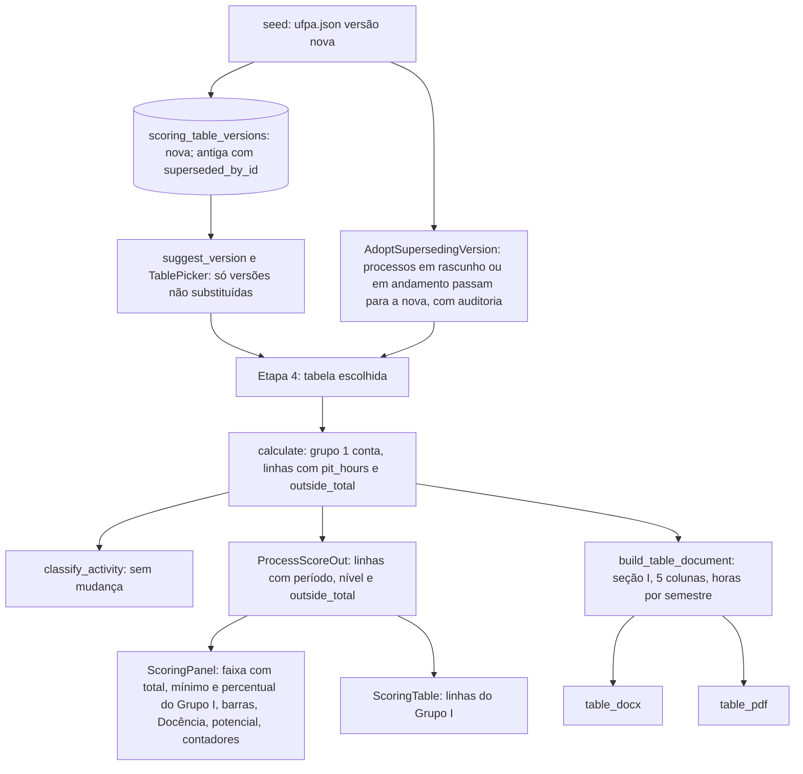

# Grupo I no total, Tabela sem Status nem Comprovante e resumo da Etapa 4 Design

**Spec**: `.specs/features/grupo-i-no-total/spec.md`
**Status**: Approved (o usuário aprovou o desenho revisado em 2026-11-19; AD-023 registrada em `STATE.md`)

Decisões do projeto que este desenho segue: AD-001 (a regra fica no `domain`, sem FastAPI nem SQLAlchemy), AD-002 (regra institucional é dado versionado, com referência normativa), AD-006 (o resultado é calculado na hora, nunca gravado), AD-007 (tabela de pontuação relacional), AD-011 (DOCX com python-docx, PDF com reportlab, mesmo conteúdo e mesma ordem) e AD-012 (versão gerada é imutável: só as gerações novas usam a regra nova). AD-022 segue valendo: `GRUPO_NAO_CONTA` e `classify_activity` não mudam. Este desenho pede uma AD nova, **AD-023** (ver D1 e D2), que substitui a decisão de 2026-11-17 do Grupo I em horas fora do total; ela só entra em `STATE.md` depois da aprovação.

---

## Decisões de arquitetura

| # | Escolha | Alternativa recusada | Por quê |
| - | ------- | -------------------- | ------- |
| D1 | O Grupo I entra no total por **dado**: nova versão `OFICIAL` da tabela UFPA, igual à anterior, com o grupo 1 `counts_in_total = true`, nome e referência normativa novos. Os pontos saem do cálculo de carga semanal que o motor já faz (`_weekly_load`): CH ÷ 17 × (1 + preparação), meio para cima, 2 casas | Regra no motor (chave por processo ou configuração global que diga "o Grupo I conta") | `counts_in_total` já é a chave que o motor, a validade, o subtotal e a Tabela leem. Uma chave fora da tabela quebra a AD-002 (regra institucional é dado versionado), exige coluna e tela novas e muda o resultado de processos e de documentos já gerados (AD-012, GI-06). O motor calcula os pontos certos (68 h = 8,00) sem alteração: só falta expor as horas e o novo estado nas linhas |
| D2 | A versão nova entra pelo **seed idempotente** (`ufpa.json` passa a descrever a versão nova; `seed_scoring_tables` já insere a versão cujo nome ainda não existe e o entrypoint roda o seed em toda partida). A marca de versão substituída exige uma **migração de esquema `0009`** que só acrescenta `scoring_table_versions.superseded_by_id` (UUID nulo, chave estrangeira para a própria tabela, `NO ACTION`); os dados não vão na migração | Migração de dados (copiar a versão para dentro do Alembic) | O `alembic upgrade head` roda também em banco de teste vazio e em instalação nova; copiar 1000 linhas de JSON para uma migração, ou fazê-la importar código da aplicação, duplica a fonte. Hoje só a tabela inteira pode ser arquivada (`scoring_tables.archived`), não uma versão: sem a coluna, a versão antiga continuaria sugerível e escolhível, contra a resposta do usuário ("o Grupo I não deve ficar separado") |
| D3 | **Troca automática** (GI-07, GI-10). Depois de inserir a versão nova, um caso de uso da aplicação (`AdoptSupersedingVersion`, chamado pelo seed, idempotente, numa transação) marca a versão antiga UFPA com `superseded_by_id` = versão nova e passa para a nova todo processo `RASCUNHO` ou `EM_ANDAMENTO` que usa a antiga, gravando um evento de auditoria `UPDATE` por processo (campo `scoring_table_version_id`, motivo "AD-023: Grupo I no total", ator do sistema). Processo `CONCLUIDO` ou `ARQUIVADO` continua com a antiga (somente leitura, AD-012). `suggest_version`, a lista do `TablePicker` e a escolha (`PUT /scoring/table`, 422 `VERSAO_SUBSTITUIDA`) ignoram versões substituídas; `_overlaps` e `close_open_version` do admin também as ignoram, o que elimina o `Conflict` de duas versões abertas | (a) As duas versões abertas, com desempate pela criada por último e aviso com botão no `TablePicker` (rascunho anterior); (b) `valid_from` novo e a antiga fechada no dia anterior; (c) alterar a versão antiga no lugar | (a) contraria a resposta do usuário: o processo em andamento ficaria com o Grupo I separado até alguém apertar o botão. (b) sugeriria a versão antiga para todo interstício que termina antes da data nova, inclusive o do processo real, e a vigência regulatória não mudou. (c) mudaria o resultado de processos concluídos, calculado na hora (AD-006), e o histórico (AD-002, AD-012). A troca automática é a única mudança de processo feita sem pedido do usuário; por isso ela é auditada, restrita aos estados editáveis e roda uma só vez |
| D4 | O motor expõe as **horas de PIT em toda linha de carga semanal do Grupo I**, nas duas versões: `pit_hours` passa a vir preenchido também na versão nova, onde vale os pontos. Um campo novo `ScoringRow.outside_total` (verdadeiro só na versão antiga) diz que a linha mostra horas e pontua 0 | Manter `pit_hours is None` como "esta linha conta pontos" | `pit_hours` não pode ser ao mesmo tempo "tem horas" e "não conta" (hoje `scoring.py:739` e `ScoringTable.tsx` usam esse sentido). A GI-03 exige horas por oferta e por período também na versão nova. O campo explícito evita que cada consumidor adivinhe |
| D5 | Predicado novo no domínio, `is_group1_load_criterion(criterion)` (grupo 1 e `CARGA_SEMANAL`, qualquer versão), usado para recusar `points_override` e para ignorá-lo no motor. `is_pit_criterion` (a mesma coisa, mas só com o grupo fora do total) fica, para saber se a linha é "só horas" | Reaproveitar só `is_pit_criterion` | Na versão nova o grupo conta no total e `is_pit_criterion` dá falso: o `points_override` voltaria a ser aceito, contra a GI-05 e a decisão da spec ("Pontos informados à mão no Grupo I: recusados") |
| D6 | A Tabela perde **toda referência a Comprovante e a status** (GTAB-04, GTAB-08): `build_table_document` deixa de receber os números de página e `_table` deixa de montar o plano; o alerta `NUMERACAO_DIVERGENTE` deixa de ser emitido, para a Tabela e para o Comprovante; os alertas `SEM_COMPROVANTE` saem da seção Alertas da Tabela; o rodapé deixa de ter os contadores de status e de comprovante. O motivo de uma linha não pontuar (por exemplo `FORA_DO_INTERSTICIO`) continua em Alertas (GTAB-05) | Manter o plano, o alerta e os contadores | Resposta do usuário à pergunta 7 ("Comprovante e status, se houver"). Sem o número na Tabela o alerta de numeração fica falso e manda o usuário gerar de novo sem motivo. Os rótulos continuam em `labels.ts` para as versões antigas que já os guardam. O `plan_hash` e o `layout` do instantâneo do Comprovante não mudam. A Etapa 4 continua com os contadores (GRES-07): a mudança é só no documento |
| D7 | Linha do Grupo I na Tabela: o **construtor do documento** monta Quantidade (horas de PIT), Pontuação unitária (`1,00`, constante do documento) e Total (pontos). Um teste de domínio garante `points == pit_hours` nas linhas da versão nova, para a constante não poder mentir | `unit_points = 1` e fator no `criterion` (pontos = horas × valor da tabela) | Mudar `_weekly_load` para multiplicar por `unit_points` alteraria qualquer tabela com `unit_points` num critério de carga semanal (o CSV do admin aceita o campo) e quebraria a GI-06. A regra "1 ponto por hora" é a da spec; se um dia variar, vira dado numa feature própria |
| D8 | Painel da Etapa 4 como componentes pequenos de leitura (sem estado, sem controle novo), no lugar de `ScoringSummary`. Os valores vêm da API como estão: o frontend não soma pontos nem horas (a barra proporcional é só desenho) | Calcular totais por semestre no navegador | O princípio de `table_document.py` vale também para a tela: tela e documento não podem divergir. As horas por período e o total vêm de `group1_hours_by_period` e `group1_total_hours` |
| D10 | **Oferta só com período letivo** (GI-09): no domínio, `evaluate_period` passa a julgar uma oferta do Grupo I sem data nem período de datas pelo ano do `academic_period` (AAAA.N): fora do interstício só quando o ano inteiro (1/1 a 31/12) está fora dele. Vale nas duas versões e na validade (`classify_activity` devolve `FORA_DO_INTERSTICIO`) | Datas de semestre (fevereiro a junho, agosto a dezembro) | Os calendários variam por ano e por unidade; inventar datas pode excluir uma disciplina válida. O ano inteiro só exclui o que está certamente fora. A oferta de um ano que cruza o interstício continua dentro |
| D11 | **Mínimo de referência** comparado com o total geral, que inclui o Grupo I (`scoring_verification.py` lê o total; nada muda além do total, que agora soma o grupo 1) | Comparar com o total sem o Grupo I | Resposta do usuário à pergunta 2; o painel diz "Grupos I a VIII" ao lado do mínimo |
| D12 | **Aviso de Tabela desatualizada** na Etapa 5 (GI-11): a API da lista de documentos gerados devolve, por geração, `table_version_id` lido do instantâneo (`snapshot.table_version.id`, que já existe) e a versão escolhida vem de `GET /scoring/table`, que já existe (o `ProcessOut` não a expõe); o frontend compara e mostra o aviso na última Tabela `PRONTO` diferente. Sem coluna nova | Gravar a versão numa coluna nova de `generated_documents` | O instantâneo já guarda a versão (`generation_snapshot.py`); as gerações antigas também a têm |
| D9 | A API de pontuação entrega por linha `academic_period`, `level` e `outside_total` (o bloco Docência precisa de disciplina, nível e período) | Uma lista nova `group1_offers` na resposta | As linhas já têm título, status e `pit_hours`; acrescentar três campos é menos código e a tabela de atividades da Etapa 4 usa os mesmos campos |

---

## Visão geral

---

## Reuso

| Componente | Local | Como usar |
| ---------- | ----- | --------- |
| `_weekly_load` | `backend/app/domain/rules/scoring_points.py:61` | Calcula as horas de PIT (e agora os pontos) sem mudança: `(h × (1 + prep) ÷ 17)` com `ROUND_HALF_UP` e 2 casas, por oferta |
| `_evaluate`, `_subtotals`, `_pit_hours_by_period` | `scoring_engine.py:179`, `:275`, `:310` | O subtotal do grupo 1 e as horas por período já somam as linhas `PONTUADA`; a versão nova só passa a alimentar os dois |
| `classify_activity` | `activity_validity.py:95` | A condição `not counts_in_total and not is_pit_criterion` já dá válida na versão nova e continua dando `GRUPO_NAO_CONTA` só para critério que não é de carga semanal em grupo fora do total. Nenhuma linha de código muda; entram testes |
| `seed_scoring_tables` | `database/seed.py:145` | Insere a versão pelo nome e não toca a existente |
| `build_table_document`, `table_text`, `format_period`, `two_places` | `table_document.py`, `table_text.py`, `pt_format.py` | A seção I é a faixa de grupo que já existe para os grupos que contam; só a linha do Grupo I é especial |
| `TablePicker` | `frontend/src/components/TablePicker.tsx` | Deixa de listar versões substituídas; sem aviso nem botão de troca (D3) |
| Padrão de foco e região viva da Etapa 3 | `ActivityWorkspace.tsx:112` (`role="status"` visualmente oculto), `role="alert"` para erro | O painel não tem controle; só anuncia a mudança do total |
| `GROUP_NAMES`, `MINIMUM_LABELS`, `formatDecimal`, `roman` | `frontend/src/labels.ts` | Nomes curtos dos grupos nas barras (resolve os "rótulos longos") |

Pontos de integração: `generated_documents.py` (`_table`, `_comprovante`, `_numbering_alert`), `repositories.py:629` e `:641` (ordenação das versões), `presentation/schemas/scoring.py` (`ScoreRowOut`), `frontend/src/api/types.ts`. Uma coluna nova, `scoring_table_versions.superseded_by_id`, pela migração `0009` (D2); nenhuma tabela nova.

---

## Motor e validade

**Tabela de comportamento** (a primeira coluna é o que o motor lê da versão; a regra é a mesma, o dado muda):

| Item | Versão antiga (grupo 1 fora do total) | Versão nova (grupo 1 no total) |
| ---- | ------------------------------------- | ------------------------------- |
| Validade da oferta (I.1, I.2) | válida (`is_pit_criterion`) | válida (grupo conta) |
| Validade de critério do grupo 1 que não é carga semanal | `GRUPO_NAO_CONTA` | válida, pontua pelo seu modo (a tabela oficial não tem item de valor informado; desde a `correcoes-auditoria` o grupo 1 só aceita os itens de carga semanal, CAREF-01) |
| `row.points` | 0 | horas de PIT |
| `row.pit_hours` | horas de PIT | horas de PIT |
| `row.outside_total` (novo) | verdadeiro | falso |
| Subtotal do grupo 1 | 0 | soma dos pontos das ofertas `PONTUADA` |
| Total geral | grupos II a VIII | grupos I a VIII |
| `group1_hours_by_period`, `group1_total_hours` | horas das ofertas `PONTUADA` | iguais ao subtotal (sem teto) |
| `points_override` (escrita) | 422 | 422 (D5) |
| `points_override` já gravado (leitura) | ignorado | ignorado |
| Percentual do grupo 1 | 0,00 | parte do total (sem alerta, GI-08) |
| Oferta fora do interstício | não vale (`FORA_DO_INTERSTICIO`), fora das horas | idem, fora do subtotal e do total (GI-04) |

**Mudanças**

- `domain/entities/scoring.py`: `is_group1_load_criterion(criterion) -> bool`. `is_pit_criterion` fica como está.
- `scoring_engine.py`: `ScoringRow.outside_total: bool = False`. Em `_evaluate`, `pit` (que descarta `points_override` e vira linha de horas) se divide em `load = is_group1_load_criterion(criterion)` (descarta o override e preenche `pit_hours = result.points` nas duas versões) e `outside = is_pit_criterion(...)` (zera `points` e marca `outside_total`). `_pit_hours_by_period` não muda de lógica. Docstring do módulo reescrito (hoje diz que o Grupo I "não conta").
- `application/use_cases/scoring.py`: `_check_criterion_inputs` usa `is_group1_load_criterion` (a mensagem 422 continua: "No Grupo I, as horas de PIT são calculadas da carga horária; não há pontos a informar"). `_describe_process` filtra `predicted_points` por `not row.outside_total` (hoje por `pit_hours is None`), de modo que a Etapa 3 passa a mostrar os pontos previstos do Grupo I na versão nova. `suggest_version` e `latest_version` escolhem a última de mesmo início (D3).
- **Arredondamento**: `Decimal`, por oferta, `ROUND_HALF_UP` a 2 casas, antes de somar; a soma das linhas é o subtotal (borda da spec). Caso que separa meio para cima de meio para par, só no domínio (a coluna `hours` é `Numeric(9,2)`): CH `0,0425` na graduação dá `0,085 ÷ 17 = 0,005`, que arredonda para `0,01`.
- **Tetos**: as horas por período são as horas sem teto. Se uma versão futura puser `max_points` no grupo 1 ou no critério, o subtotal fica menor que as horas e a GI-03 ("iguais aos pontos") deixa de valer. Hoje a tabela oficial não tem teto no grupo 1; há teste que fixa isso.
- **Oferta só com período letivo** (sem data): hoje `evaluate_period` devolve `SEM_DATA` e a oferta vale, sem checagem de interstício (e, desde `0422ac3`, sem alerta). Com GI-09 (D10) ela passa a ser julgada pelo ano do período letivo: fora do interstício quando o ano inteiro está fora.
- **Mínimo de referência**: `reference_minimum` compara `result.total`, que agora inclui o Grupo I. Confirmado pelo usuário (D11).

---

## Tabela de Pontuação (DOCX e PDF)

**`domain/rules/table_document.py`**

- `TableRow` fica com `item`, `title`, `quantity`, `unit_points`, `points` (cinco colunas). Saem `comprovante`, `status`, `NO_VOUCHER` e `_STATUS_TEXT`.
- `build_table_document(header, version, result, activities, process_alerts)` perde `comprovante_numbers`.
- Faixa do grupo 1: já nasce na versão nova (a faixa existe para todo grupo com `counts_in_total`, vazia ou não), com o nome da versão ("Docência/atividades de ensino/desempenho didático, avaliado com a participação do corpo discente") e o subtotal. Na versão antiga continua sem faixa.
- `_band_rows` deixa de excluir as linhas de carga semanal quando o grupo conta (`_is_pit` passa a testar `row.outside_total`).
- Linha do Grupo I (`I.1` ou `I.2`): Atividade = título cortado a 400 caracteres (o corte vale só para o título, como nas outras linhas) + ` (1º Período de 2023)` pelo `format_period`; Quantidade = `pit_hours`; Pontuação unitária = `1,00`; Total = `points`. Ordem das linhas do grupo 1: período letivo (sem período por último), depois título sem diferenciar maiúscula; os demais grupos seguem por item e depois pela ordem recebida, como hoje.
- Linha sem pontos mostra `0,00` (as linhas `NAO_PONTUADA` já têm `points = 0`); o motivo segue em Alertas (`_alerts` não muda). O contador "Não pontuadas" do rodapé fica.
- `PitHours` ganha `outside_total: bool`. `_pit_hours` passa a existir sempre que a versão tem critério de carga semanal no grupo 1 (`is_group1_load_criterion`), e não só quando o grupo está fora do total.

**`infrastructure/documents`**

- `table_text.py`: `COLUMNS = ("Item", "Atividade", "Quantidade", "Pontuação unitária", "Total")`. Dois títulos para a seção de horas: versão nova, "Horas de PIT por semestre (Grupo I)"; versão antiga, o atual "Horas de PIT por semestre (Grupo I, fora do total de pontos)" (a frase seria falsa na versão nova; ver S3). `PIT_COLUMNS` e `PIT_TOTAL_LABEL` ("Total em horas") não mudam.
- `table_docx.py`: `_FIXED_MM = (14, None, 26, 30, 26)` (a coluna Atividade ocupa o resto da linha, 201 mm). A faixa de grupo mescla as células 0 a 2 (título) e 3 a 4 (subtotal), de modo que o subtotal tem 56 mm; a linha do total mescla 0 a 4. O cabeçalho continua repetindo em cada página.
- `table_pdf.py`: `_FIXED_WIDTHS = (38, None, 64, 76, 64)`; `SPAN (0..2)` e `SPAN (3..4)` na faixa; `SPAN (0..4)` no total; `NOSPLIT` da faixa com a primeira linha continua.
- Os dois escritores desenham o mesmo `TableDocument`; nenhum soma nada.

**`application/use_cases/generated_documents.py`**: `_table` deixa de chamar `plan_comprovante`, de montar `numbers` e de acrescentar `_numbering_alert`; o instantâneo da Tabela deixa de levar `layout` (a Tabela não usa arranjo); `_Produced.plan_hash` da Tabela fica nulo (coluna já aceita nulo). `_comprovante` deixa de acrescentar `_numbering_alert`. Some `_OTHER_KIND`/`_NUMBERING_TEXT` e o parâmetro `latest` das duas funções. Efeito colateral bom: mudar o arranjo do Comprovante não deixa mais a Tabela "desatualizada".

---

## Etapa 4: Painel em blocos

Nenhum controle novo no painel; as ações (Editar, Validar, Rejeitar, Nova atividade) ficam na tabela de atividades, que não muda de lugar nem de colunas (a coluna de situação fica, por escopo).

**Componentes** (`frontend/src/components/`; `ScoringSummary` e o teste dele saem, portando os comportamentos, como foi com `ActivityReviewList`)

| Componente | Faz | Dados |
| ---------- | --- | ----- |
| `ScoringPanel` | Monta os blocos na ordem: faixa, barras, Docência, potencial, contadores; guarda a região viva | `ScoringResult`, nomes de grupo da versão, `group1OutsideTotal` |
| `PanelHeadline` | Total geral com o rótulo "Grupos I a VIII" (ou "Grupos II a VIII" na versão antiga) e, ao lado, o mínimo em texto curto ("Atinge o mínimo (100,00)", "Não atinge o mínimo (100,00)"); sem mínimo, "Mínimo não definido" em texto comum | `total`, `minimum` |
| `GroupBars` | Uma linha por grupo: nome curto (`GROUP_NAMES`), subtotal em texto e barra; grupos com 0,00 em tom discreto (`muted`); na versão antiga o grupo I não aparece | `subtotals`, `total` |
| `TeachingBlock` | "Docência (PIT)": períodos letivos em ordem; em cada um a lista de ofertas (disciplina, nível, horas), o total de horas do período e, no fim, o total geral de horas; sem ofertas, "Nenhuma disciplina lançada no Grupo I" | linhas com `pit_hours`, `group1_hours_by_period`, `group1_total_hours` |
| `PotentialCards` | Três cartões pequenos (potencial total, com data no interstício, sem data) só quando o potencial total é maior que 0 | `potential_*` |
| `CounterStrip` | A faixa única de contadores que já existe (`ul.counts`) | `counters` |

**Estados e regras**

- **Versão nova**: barras de I a VIII; Docência mostra as horas como na tabela, "= pontos" no rótulo do total ("Total do Grupo I: 92,00 horas = 92,00 pontos").
- **Versão antiga** (GRES-09): sem barra do grupo I; Docência em horas "fora do total", como hoje.
- **Oferta aguardando validação** (`POTENCIAL`): aparece na lista com a etiqueta de texto "Aguardando validação" e não entra no total do período, que é o do motor (só validadas). Confirmado pelo usuário (GRES-04).
- **Oferta sem período letivo**: vai para o grupo "Sem período letivo", sem total próprio (o motor a soma só no total geral).
- **Oferta fora do interstício**: não é linha do motor (não é válida), logo não aparece; um semestre que só tem ofertas fora some do bloco e da Tabela (edge case da spec) por construção.
- **Barra**: `div` decorativo com `aria-hidden="true"`; o valor sempre aparece em texto ao lado, de modo que nada depende de cor (GRES-08). A largura é percentual (`subtotal ÷ total`, só desenho; total 0 dá barra vazia, nunca divisão por zero).
- **Sem tabela escolhida nem sugerida**: o painel não aparece (como hoje o resumo, que só renderiza com `result`).

**Responsividade a 360 px**: a faixa e os cartões usam `flex-wrap` e `grid` com `minmax(0, 1fr)`; a linha da barra é `grid-template-columns: minmax(0, 1fr) auto` com a barra ocupando a linha de baixo; título de disciplina com `overflow-wrap: anywhere` e `min-width: 0`; nenhuma largura em px acima de 360 (o `styles.test.ts` já varre isso e ganha asserções das classes novas). A medição real a 360 e 320 px no Chrome headless com `iframe`, como a do SEC-12 (`revisao-simplificada/design.md`), repete-se à mão e fica fora do gate.

**Acessibilidade**

- Cada bloco é `<section aria-labelledby>` com `h3` sob o `h2` "Resumo"; a faixa é `dl` (rótulo e valor); as ofertas, `ul` dentro de um `h4` por período; as barras, `ul` com o texto do valor.
- Região viva: `role="status"` visualmente oculto, como na Etapa 3. Anuncia "Total geral atualizado: 303,00 pontos" (valor do cenário derivado) só quando o total muda depois da primeira carga (validar, rejeitar, trocar de tabela), nunca na abertura. Erro continua em `role="alert"` (o que já existe em `ProcessScoring`).
- Foco: o painel não tem controle e não recebe foco; o `Modal` já devolve o foco ao botão de origem. Após uma ação na tabela de atividades o foco não se perde porque a recarga não troca a linha de seção (a tabela da Etapa 4 é única).
- `LEVEL_LABELS` novo em `labels.ts`: `GRADUACAO` "Graduação", `POS_GRADUACAO` "Pós-graduação".

**Mudanças nos componentes existentes**

- `ScoringTable.tsx`: `inHours` deixa de ser `pit_hours != null` e passa a ser `outside_total`. Linha de carga semanal do Grupo I na versão nova: Quantidade = horas de PIT, unidade `1,00`, Total = pontos (igual à Tabela, D7); a faixa do grupo mostra "Subtotal" em vez de "Total de horas (PIT)".
- `ScoreEditor.tsx`: não muda o comportamento. Hoje `pit` é `row.pit_hours != null` (`ProcessScoring.edit`) e, com D4, passa a valer para as duas versões, o que está certo: a linha do Grupo I nunca tem valor a digitar. O texto da nota ganha "cada hora de PIT vale 1 ponto" quando a linha não é `outside_total` (o componente recebe `outsideTotal` junto de `pit`).
- `TablePicker.tsx`: não lista versões substituídas (`superseded_by_id` preenchido). Processo `CONCLUIDO` ou `ARQUIVADO` que ainda usa a versão antiga mostra o nome dela, sem troca (somente leitura). Não há aviso nem botão de troca: os processos editáveis já passam sozinhos para a versão nova (D3).
- `ProcessScoring.tsx`: `group1InHours` vira `group1OutsideTotal` (grupo 1 fora do total e com critério de carga semanal, como hoje, só renomeado); troca `ScoringSummary` por `ScoringPanel`.
- `api/types.ts`: `ScoringRow` ganha `academic_period: string | null`, `level: Level | null`, `outside_total: boolean`.

**Etapa 5**: a Tabela gerada traz as novas colunas e o novo total, sem nada de Comprovante ou de status. Versões já geradas com a tabela antiga continuam como estão (AD-012); quando a última Tabela `PRONTO` foi gerada com outra versão da tabela, a Etapa 5 mostra "Gerada com outra versão da tabela de pontuação; gere de novo" (GI-11, D12).

---

## Relatório e Comprovante

Não mudam de conteúdo. Conferido no código: `report_templates.json` já tem as seções 1.1 e 1.2 para os itens `1/1` e `1/2` (agrupadas por período letivo) e `eligible_activities` já deixa as ofertas validadas do Grupo I passarem para os três documentos nas duas versões; nenhum dos dois lê `counts_in_total`. O Comprovante só perde o alerta `NUMERACAO_DIVERGENTE` (D6).

---

## Modelo de dados e migração

- **Esquema**: migração `0009_version_superseded`, só `ALTER TABLE scoring_table_versions ADD COLUMN superseded_by_id UUID NULL REFERENCES scoring_table_versions(id)`; `downgrade` é `DROP COLUMN`. Entidade `ScoringTableVersion.superseded_by_id` e propriedade `is_superseded`.
- **Dados**: a versão nova (grupos e critérios) entra pelo seed na primeira partida depois do deploy; em seguida `AdoptSupersedingVersion` marca a antiga e troca os processos editáveis. Idempotente: na segunda partida não há processo a trocar e a marca já existe.
- **`ufpa.json`**: `version_name` "Tabela oficial de pontuação UFPA, Grupo I no total", `valid_from` igual ao da antiga, `status` `OFICIAL`, grupo 1 com `counts_in_total: true`, VI.14 com `unit_points` 3 (GI-12, decisão do usuário em 2026-11-19; `review_note` reescrita), `notes` e `norm_reference` com o texto aprovado (pergunta 8). `minimums` copiado. O seed passa a saber qual versão a nova substitui (campo `supersedes` no JSON, com o nome da antiga). Em instalação nova só a versão nova existe e não há o que substituir.
- **Quem muda**: processos `RASCUNHO` e `EM_ANDAMENTO` com a versão antiga (na VM, o processo real em rascunho). Cada troca gera um evento de auditoria. Processos `CONCLUIDO` e `ARQUIVADO` e todos os documentos já gerados ficam como estão; a Etapa 5 avisa que a Tabela foi gerada com outra versão (D12).
- **Reversão**: o caminho seguro é o dump do banco feito no deploy (a troca dos processos é dado). Sem dump: `UPDATE` da versão escolhida de volta, usando os eventos de auditoria da troca, e `superseded_by_id` nulo.

---

## Tratamento de erros

| Cenário | Tratamento | O que o usuário vê |
| ------- | ---------- | ------------------ |
| `points_override` em critério de carga semanal do Grupo I | 422 em `points_override` (D5) | "No Grupo I, as horas de PIT são calculadas da carga horária; não há pontos a informar" |
| Oferta do Grupo I fora do interstício | Não é válida (`FORA_DO_INTERSTICIO`); sai do subtotal, do total e das horas | Aparece em "Atividades não válidas" da Etapa 3, não no painel |
| Oferta do Grupo I sem categoria | Como hoje: válida com `needs_category`, a geração é recusada (`ATIVIDADE_SEM_CATEGORIA`) | Mensagem da Etapa 3 |
| Tabela sem Grupo I em carga semanal (tipo IFCH) | `is_group1_load_criterion` falso: sem horas, sem seção de horas | Painel sem bloco de horas, como a edge case da `tabela-oficial` |
| `GET /scoring` com versão antiga | `outside_total` verdadeiro | Painel em horas, "Grupos II a VIII" |
| Escolha manual de uma versão substituída (`PUT /scoring/table`) | 422 `VERSAO_SUBSTITUIDA` (D3) | "Esta versão da tabela foi substituída; use a versão atual" |
| Admin cria versão na tabela UFPA | `_overlaps` ignora a substituída (D3) | Sem `Conflict` por causa da versão antiga |
| Processo concluído ou arquivado com a versão antiga | Continua com ela, somente leitura | O total desse processo segue sem o Grupo I |
| Oferta do Grupo I só com período, ano inteiro fora do interstício | `FORA_DO_INTERSTICIO` (D10) | Aparece em "Atividades não válidas" com o motivo |
| Última Tabela gerada com outra versão | Aviso (D12) | "Gerada com outra versão da tabela de pontuação; gere de novo" |
| Documento gerado com a tabela antiga | Imutável (AD-012) | Continua como foi gerado |

---

## Riscos e preocupações

| Preocupação | Local | Impacto | Mitigação |
| ----------- | ----- | ------- | --------- |
| A oferta que só tem período letivo não era conferida contra o interstício; com o Grupo I no total ela somaria pontos, e o alerta de data ausente foi retirado em `0422ac3` | `scoring_periods.py` (`evaluate_period`), `scoring_engine.py:164` | Total inflado por disciplina de fora do interstício | Resolvido por GI-09 (D10), confirmado pelo usuário |
| `suggest_version` e `latest_version` usam `max` por `valid_from`, e as duas versões têm o mesmo início | `scoring.py:115`, `scoring_admin.py:135`, `repositories.py:629,641` | A sugestão ou a base do import CSV poderiam pegar a antiga | D3: os três filtram as substituídas antes do `max`; teste com as duas versões presentes |
| A troca automática muda processo sem pedido do usuário | `AdoptSupersedingVersion` | Surpresa para quem tinha gerado documentos | Só estados editáveis, auditoria por processo, aviso na Etapa 5 (D12); decisão explícita do usuário em 2026-11-19 |
| `is_pit_criterion` e `pit_hours is None` têm vários leitores (`scoring.py:739`, `ScoringTable.tsx`, `ScoringSummary.tsx`) | `scoring.py:739`, `table_document.py:180` | Um leitor esquecido trata a versão nova como horas | Campo `outside_total` explícito (D4) e teste por leitor: Etapa 3 (`predicted_points`), Tabela, tabela da Etapa 4, painel |
| Tabela de FASI antiga, se existir no banco, perde a aceitação de pontos digitados no Grupo I | `scoring.py:307`, `test_activity_group1_pit.py` | Comportamento muda para uma tabela fora de uso (a VM não tem processos nela) | Confirmado pelo usuário (pergunta 5); o teste que fixava "FASI aceita pontos informados" é trocado, com a decisão registrada |
| Mínimo de referência (60, 80, 100, 120) foi definido pela planilha sem o Grupo I e passa a ser comparado com o total que o inclui | `scoring_verification.py:44` | O docente pode atingir o mínimo só com horas de aula | Confirmado pelo usuário (pergunta 2, D11) |
| A Tabela real já gerada pelo usuário continua sem o Grupo I | `generated_documents`, AD-012 | Documento entregue com total diferente do da tela | Aviso na Etapa 5 (D12); o usuário gera de novo |
| Remover o plano da `_table` mexe em testes de instantâneo e de `NUMERACAO_DIVERGENTE` | `generated_documents.py:538,567` | Testes antigos quebram por motivo certo | Trocar esses testes junto com a mudança; as versões antigas guardadas com o alerta continuam legíveis (rótulo mantido) |
| O PDF com 5 colunas muda as quebras de página e as larguras | `table_pdf.py:47`, `table_docx.py:41` | Título longo ou subtotal grande quebra a linha | Teste com título de 400 caracteres e subtotal de 7 dígitos nos dois formatos; conferência visual do PDF e do DOCX (LibreOffice) no verificador |
| Teste que procura "Não pontuada" no documento inteiro | `table_text.py` (`counters_line`) | Falso negativo | O rodapé perde os contadores de status (D6); os testes da GTAB-04 e GTAB-08 olham células e rodapé |
| Specs de `documentos-gerados` (TAB-03, TAB-05), `tabela-oficial` (PIT-01..03, TELA-01..02) e `pontuacao` (premissa do item de valor informado de tabelas antigas, inexistente na tabela oficial, CALC-05/06) e o critério dos 211 pontos do cenário derivado ficam contraditórios | `.specs/features/documentos-gerados/spec.md:93,95`, `tabela-oficial/spec.md`, `pontuacao/spec.md:48` | Rastreabilidade enganosa | A nota de substituição da spec já cita TAB-03, TAB-05 e os 211 pontos do cenário derivado; a Tasks acrescenta a nota recíproca nas specs antigas |
| Processos em andamento no ar | VM | O processo real em rascunho muda de total no deploy | Dump antes do deploy, auditoria da troca, aviso na Etapa 5; deploy só com autorização |

---

## Decisões da spec que parecem erradas ou ambíguas (a spec não foi alterada)

- **S1 (GI-05), aplicada na spec em 2026-11-19.** O texto manda recusar `points_override` "numa versão em que o Grupo I é medido em horas de PIT". A versão nova também mede em horas de PIT (cada hora vale 1 ponto), mas conta no total; lida ao pé da letra, a recusa não valeria nela. Ajuste proposto: "em qualquer critério de carga semanal do Grupo I, esteja o grupo dentro ou fora do total" (D5).
- **S2 (nota de substituição), aplicada na spec em 2026-11-19.** A nota lista PIT-01..03 e TELA-01..02 de `tabela-oficial`, mas também ficam superados TAB-03 e TAB-05 de `documentos-gerados` (sete colunas, comprovante por linha, horas "sem somá-las aos pontos") e os critérios de 211 pontos e 92 horas do cenário derivado de `tabela-oficial` e `documentos-gerados` (passam a 303 pontos do cenário derivado com o Grupo I; as horas seguem 24, 24, 24 e 20). Ajuste: ampliar a nota e atualizar os dois testes de ouro.
- **S3 (GTAB-06 e GTAB-07).** O título "Horas de PIT por semestre (Grupo I)" vale para a versão nova; a versão antiga, que a GTAB-07 manda gerar "como antes", mantém o título com "fora do total de pontos", que é verdadeiro nela.
- **S4 (GI-03).** "Iguais aos pontos do Grupo I" só vale sem teto no grupo ou no critério. A tabela oficial não tem teto; o teste fixa isso e a regra fica dita.
- **S5 (GI-04), resolvida por GI-09.** A oferta fora do interstício só deixa de pontuar quando tem data; a oferta que só tem período letivo não é conferida. Com o Grupo I no total isso passaria a mexer no total (resolvido por GI-09).
- **S6 (NUMERACAO_DIVERGENTE).** A spec tira o número do Comprovante da Tabela e não diz o que fazer com o alerta que existe por causa dele (D6).
- **S7 (premissa "o Grupo I da planilha não tem teto").** Confere: `ufpa.json` não tem `max_points` no grupo 1 nem em I.1 e I.2, e a tabela oficial não traz o item de valor informado de tabelas antigas, inexistente na tabela oficial (`VALOR_INFORMADO`, que só existia na FASI antiga). A pergunta aberta da AD-022 sobre onde digitar pontos de item `VALOR_INFORMADO` não é afetada por esta feature.
- **S8 (GRES-04).** A spec não diz o que fazer com a oferta ainda não validada (hoje ela aparece na linha `POTENCIAL` e fica fora das horas do período). Resolvida: aparece com a etiqueta "Aguardando validação" e fora das horas (GRES-04).
- **S9 (GI-07, "vigente"), aplicada na spec.** A GI-07 passou a dizer "única versão sugerida e escolhível" e a antiga fica substituída (D3).

---

## Estratégia de testes (por requisito)

Gate do backend: `cd backend && ruff check . && pytest -q`; do frontend: `npm test`, `npm run lint` e `npm run build` em `frontend/`. Dados só sintéticos; nada de `Documentos/` nem de `Modelos/`. O banco de integração é PostgreSQL real (AD-004).

| Requisito | Teste | Nível |
| --------- | ----- | ----- |
| GI-01 | Quatro ofertas (68 h graduação = 8,00; 34 h = 4,00; 68 h pós = 12,00), `0,0425 h` na graduação = `0,01` (pino do `ROUND_HALF_UP`); `points == pit_hours` nas linhas | unitário do motor |
| GI-02 | Subtotal do grupo 1 = soma das ofertas `PONTUADA` dentro do interstício; total = soma dos grupos I a VIII; oferta `POTENCIAL` fora do subtotal | unitário do motor |
| GI-03 | `group1_hours_by_period` e `group1_total_hours` na versão nova, por período e total, iguais ao subtotal; versão com teto no grupo 1 diverge (documenta S4) | unitário do motor |
| GI-04 | Oferta com data fora do interstício: 0 ponto, 0 hora, `FORA_DO_INTERSTICIO`, fora de subtotal e total, não é linha do motor; as duas versões | unitário do motor e da validade |
| GI-05 | 422 em `points_override` na criação e na edição, com a versão nova e com a antiga; `points_override` gravado é ignorado pelo motor | integração (`test_activity_group1_pit.py` ampliado) |
| GI-06 | Mesmo conjunto de atividades calculado com a versão antiga e com a nova: antiga idêntica ao resultado de hoje (suíte atual de caracterização), nova com grupo 1 no total; processo que escolheu a antiga não muda ao semear a nova; documento gerado antes não muda | integração |
| GI-07 | Seed insere a versão nova uma vez (idempotente); a antiga fica com `superseded_by_id`; `suggest_version`, a lista do `TablePicker` e `latest_version` nunca devolvem a substituída; `PUT /scoring/table` com a substituída dá 422 `VERSAO_SUBSTITUIDA`; `_overlaps` ignora a substituída | integração (`test_seed_scoring.py`, repositório, API) |
| GI-09 | Oferta 2019.1 sem data num interstício 2022 a 2024: `FORA_DO_INTERSTICIO`, 0 ponto e 0 hora; 2022.1 com interstício começando em 23/11/2022: dentro (o ano cruza); oferta com data continua julgada pela data | unitário do domínio e da validade |
| GI-10 | Processos `RASCUNHO` e `EM_ANDAMENTO` com a antiga passam para a nova, com um evento de auditoria cada; `CONCLUIDO` e `ARQUIVADO` não mudam; segunda execução não muda nada nem audita de novo; falha no meio não troca nenhum (uma transação) | integração |
| GI-11 | Última Tabela `PRONTO` com `table_version` diferente da escolhida mostra o aviso; igual não mostra; Relatório e Comprovante não mostram | integração de API e componente |
| GTAB-08 | Nem DOCX nem PDF têm "Comprovante", "comprovante", "Status", "Pontuada", "Potencial", "Não pontuada" em célula, alerta ou rodapé; `NUMERACAO_DIVERGENTE` e `SEM_COMPROVANTE` não são emitidos para a Tabela; o motivo `FORA_DO_INTERSTICIO` continua em Alertas | unitário dos escritores e do documento |
| GI-08 | `group1_percent` na versão nova e nenhum alerta por ele (motor); o percentual aparece na faixa do topo do painel, `PanelHeadline` (componente) | unitário do motor e componente |
| Validade (AD-022) | Matriz de `classify_activity`: grupo 1 válido nas duas versões; critério do grupo 1 que não é carga semanal, `GRUPO_NAO_CONTA` na antiga e válido na nova | unitário (`test_activity_validity.py`) |
| GTAB-01 | A faixa "I. Docência/..." e o subtotal abrem a lista de grupos, no DOCX e no PDF | unitário do documento e dos escritores |
| GTAB-02 | Linha por oferta: item `I.1`/`I.2`, título e período, horas, `1,00`, total; ordem período depois título; título de 400 caracteres cortado | unitário do documento |
| GTAB-03 | "Pontuação geral" soma I a VIII | unitário do documento |
| GTAB-04 | Cinco cabeçalhos exatos no DOCX e no PDF; nenhuma célula de tabela com "Pontuada", "Potencial", "Não pontuada" ou "sem comprovante" (olha as células, não o rodapé) | unitário dos escritores |
| GTAB-05 | Linha sem pontos com `0,00`; o motivo aparece em Alertas; o rodapé não tem contadores de status (GTAB-08) | unitário do documento |
| GTAB-06 | Título e colunas da seção de horas na versão nova; total em horas | unitário dos escritores |
| GTAB-07 | Versão antiga: sem seção I, sem Status e Comprovante, título antigo da seção de horas | unitário do documento |
| Aceitação | Cenário derivado de 2022 a 2024: Grupo I 24, 24, 24 e 20, total 303, Tabela baixada em DOCX e PDF com a seção I; substitui os dois testes de ouro de 211 pontos do cenário derivado | integração de API (`test_scoring_golden.py`, `test_generated_table_acceptance.py`) |
| D6 | Tabela gerada sem `layout` e sem plano; Comprovante e Tabela sem `NUMERACAO_DIVERGENTE` depois de mudar o arranjo | integração de documentos |
| GRES-01, 02 | Faixa com total e rótulo "Grupos I a VIII"; "Mínimo não definido" sem destaque | componente |
| GRES-03 | Uma linha por grupo com nome curto e valor em texto; grupo com 0,00 em tom discreto; barra `aria-hidden`; total 0 sem divisão por zero | componente |
| GRES-04 | Docência por período com disciplina, nível e horas, total do período e total geral; oferta `POTENCIAL` com etiqueta e fora do total; oferta sem período em "Sem período letivo" | componente |
| GRES-05 | Mensagem "Nenhuma disciplina lançada no Grupo I" | componente |
| GRES-06 | Cartões de potencial só com potencial maior que 0 | componente |
| GRES-07 | Faixa única de contadores | componente |
| GRES-08 | Sem rolagem horizontal: asserções estáticas das classes novas em `styles.test.ts` (sem largura em px acima de 360, `min-width: 0`, `overflow-wrap`) e medição manual no Chrome headless a 360 e 320 px com controle negativo, fora do gate; o painel não tem foco próprio e a região viva anuncia só a mudança de total | estático e manual |
| GRES-09 | Versão antiga: "Grupos II a VIII", sem barra do grupo I, Docência em horas fora do total | componente |
| `TablePicker` | Não lista a versão substituída; processo concluído com a antiga mostra o nome dela sem permitir troca | componente |
| Leitores de `pit_hours` | Etapa 3 mostra `predicted_points` do Grupo I na versão nova e não na antiga; tabela da Etapa 4 mostra Quantidade, `1,00` e Total na nova | integração de API e componente |

**Sensor de discriminação (Verifier independente, depois da última tarefa).** Mutantes planejados, cada um precisa de teste que o mate: `counts_in_total` ignorado no subtotal; `ROUND_HALF_UP` trocado por `ROUND_HALF_EVEN` ou `ROUND_DOWN`; `GRUPO_NAO_CONTA` invertido; `outside_total` sempre falso ou sempre verdadeiro; `pit_hours` só na versão antiga; filtro de `predicted_points` voltando a `pit_hours is None`; `is_group1_load_criterion` trocado por `is_pit_criterion` na recusa do `points_override`; versão substituída voltando à sugestão ou à lista; troca automática alcançando processo `CONCLUIDO`; troca sem evento de auditoria; regra do ano inteiro trocada por "qualquer parte do ano fora"; aviso da Etapa 5 comparando com a versão errada; `SEM_COMPROVANTE` ou contador de status de volta na Tabela; ordem por título antes do período; coluna Status ou Comprovante de volta em um dos escritores; título da seção de horas igual nas duas versões; rótulo "II a VIII" na versão nova; barra com divisão por zero; oferta `POTENCIAL` somada no total do período; versão substituída aceita no `PUT /scoring/table`. Cobertura de mutação do frontend com o `jsdom` limitada ao que ele mede (CSS por regra, como no SEC-12).

---

## Fases de tarefas (o detalhe vem na fase Tasks)

1. **Motor e dados**: migração `0009`, `superseded_by_id`, `is_group1_load_criterion`, `outside_total`, `pit_hours` nas duas versões, recusa do override, regra do ano inteiro (GI-09), `predicted_points`, filtro das substituídas na sugestão, na escolha e no admin, `ufpa.json`, seed e `AdoptSupersedingVersion` (GI-10), testes de ouro (303 pontos do cenário derivado) e matriz da validade.
2. **Tabela**: `table_document` (cinco colunas, linha e ordem do Grupo I, seção de horas, sem `SEM_COMPROVANTE` nem contadores de status), `table_text`, `table_docx`, `table_pdf`, `generated_documents` sem plano nem `NUMERACAO_DIVERGENTE`, testes dos escritores e conferência visual.
3. **API**: campos novos de `ScoreRowOut`, `table_version_id` nas gerações, 422 `VERSAO_SUBSTITUIDA`, tipos do frontend.
4. **Frontend**: `ScoringPanel` e blocos (com as não validadas etiquetadas), `ScoringTable`, `ScoreEditor`, `TablePicker` sem a substituída, aviso da Etapa 5, `labels.ts`, CSS e `styles.test.ts`, remoção de `ScoringSummary`.
5. **Verifier independente**, medição a 360 px, notas de substituição nas specs de `documentos-gerados` e `tabela-oficial`, AD-023, `CLAUDE.md` (regra de negócio do Grupo I) e rastreabilidade.

---

## Respostas do usuário (2026-11-19)

1. **A tabela nova vale para qualquer período?** Sim (GI-07).
2. **O mínimo de pontos é comparado com o total que inclui o Grupo I?** Sim (D11).
3. **O processo real da VM troca sozinho?** O usuário respondeu: "o Grupo deve estar dentro do Total, não deve ficar separado". Aplicado como troca automática de todo processo em rascunho ou em andamento, com auditoria; concluídos, arquivados e documentos já gerados não mudam (GI-10, D3).
4. **Disciplina só com período e ano inteiro fora do interstício fica fora?** Sim (GI-09, D10).
5. **Pontos digitados no Grupo I recusados em qualquer tabela?** Sim (GI-05).
6. **Disciplinas não validadas no bloco Docência, com etiqueta e fora das horas?** Sim (GRES-04).
7. **Remover o aviso de numeração do Comprovante?** O usuário respondeu: "Comprovante e status (se houver)". Aplicado como nenhuma referência a Comprovante ou a status na Tabela: colunas, alerta de numeração, alertas "sem comprovante" e contadores de status do rodapé (GTAB-08, D6).
8. **Nome e referência da versão nova?** Aprovados como propostos.

---

## Pendências: o que não entra nesta feature

- Mínimo de carga horária de ensino por regime (Res. 4.644, art. 13, I) e regra dos 30% do Grupo I (a spec mantém só a exibição do percentual).
- Mudar a fórmula das horas de PIT (CH ÷ 17 × (1 + preparação)).
- Tirar a coluna de situação da tabela de atividades da Etapa 4.
- Relatório de Atividades e Comprovante (nenhum conteúdo muda; só o alerta de numeração).
- O texto do alerta de data das ofertas do Grupo I (corrigido em `0422ac3` antes desta feature).
- Digitação de pontos de itens `VALOR_INFORMADO` (pergunta aberta da AD-022; a tabela oficial não tem item de valor informado).
- Paginação do bloco Docência (esperam-se poucos períodos e ofertas).
- Deploy e push: só com a autorização do usuário; a migração `0009` (só esquema) roda no `alembic upgrade head` e a versão nova entra pelo seed na mesma partida, seguida da troca automática (D3); dump do banco antes.
