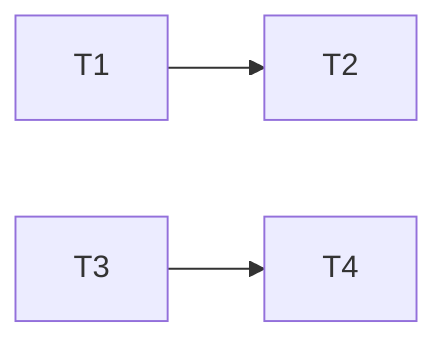
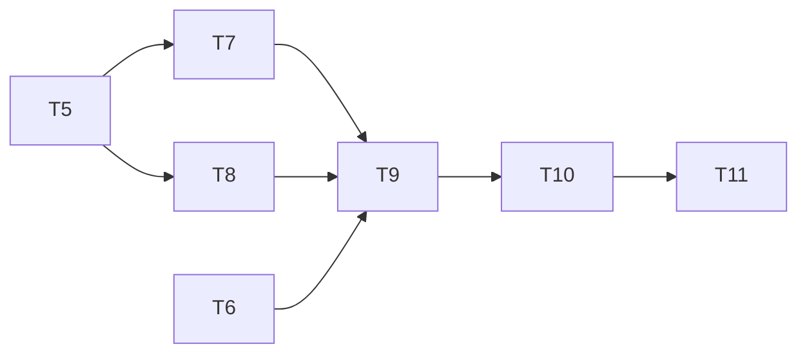
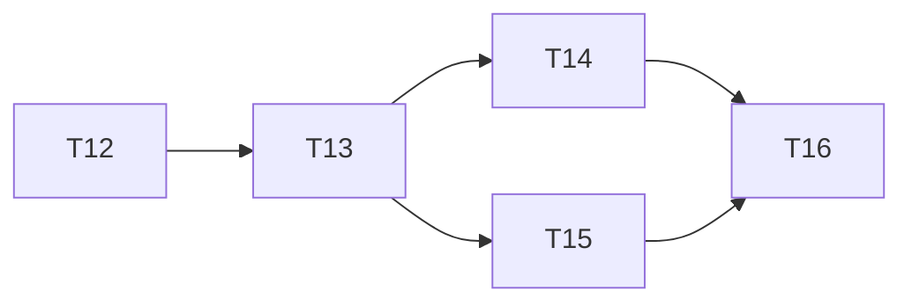
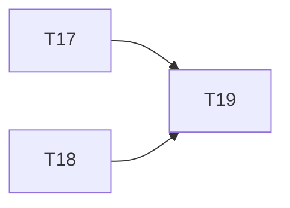
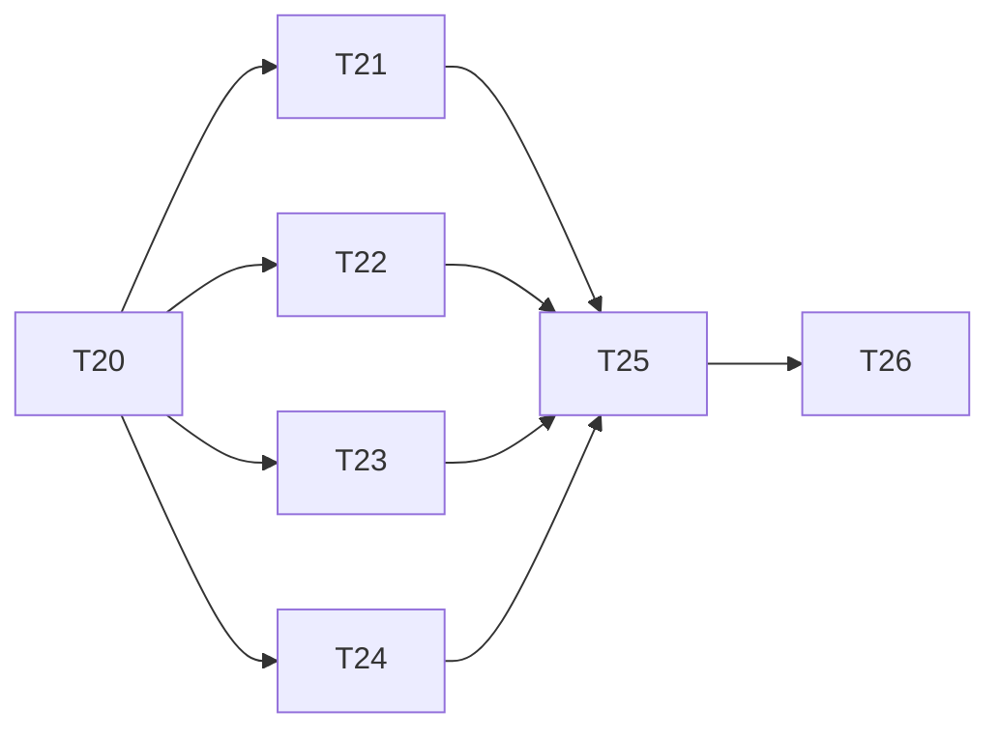
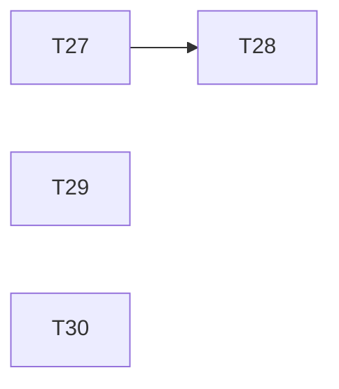
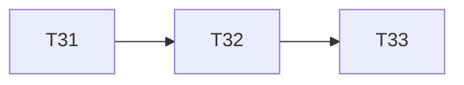
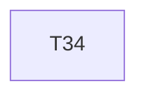

# Grupo I no total, Tabela sem Status nem Comprovante e resumo da Etapa 4 Tasks

## Execution Protocol (MANDATORY -- do not skip)

Implement these tasks with the `tlc-spec-driven` skill: **activate it by name and follow its Execute flow and Critical Rules.** Do not search for skill files by filesystem path. The skill is the source of truth for the full flow (per-task cycle, sub-agent delegation, adequacy review, Verifier, discrimination sensor).

**If the skill cannot be activated, STOP and tell the user - do not proceed without it.**

---

**Design**: `.specs/features/grupo-i-no-total/design.md`
**Spec**: `.specs/features/grupo-i-no-total/spec.md`
**Status**: Approved (usuário, 2026-11-20: "aprovado com as recomendações"; rodapé da Tabela só com "Atividades" e "Com divergências")

Regras de execução desta feature:

- **Pré-requisito**: a feature `correcoes-auditoria` roda antes desta e já terá limpado as referências a item fora da tabela oficial e o ramo especial de `_apply_group1`. Nenhuma tarefa daqui mexe nisso; se ao começar a T1 o `git log` não mostrar a `correcoes-auditoria` concluída, PARE e avise o usuário.
- Cada tarefa escreve primeiro os testes que derivam dos critérios de aceitação da spec e só então o código (os itens `Done when` começam pelo teste). Teste existente que muda por causa da regra nova é listado na tarefa com o requisito que justifica a mudança; nenhum teste é apagado sem substituto nem enfraquecido.
- Só dados sintéticos; `Documentos/`, `Modelos/`, `requeriment.txt`, `test/` e `corpus-reports/` nunca são abertos. Teste com tabela que não é a oficial declara no nome que ela é sintética (regra 11 do `CLAUDE.md`).
- Um commit por tarefa (Conventional Commits, terminando com `Co-Authored-By: Claude Sonnet 5.5 <noreply@anthropic.com>`), marcando a tarefa neste arquivo e a rastreabilidade da spec no mesmo commit.
- Sem push, deploy nem acesso à VM sem autorização explícita. A migração `0009` e a troca automática de versão (GI-10) chegam à VM só no deploy autorizado, com dump antes (T33).
- Documentos já gerados não mudam (AD-012); processos `CONCLUIDO` e `ARQUIVADO` ficam com a versão antiga.

---

## Test Coverage Matrix

> Generated from project guidelines, spec, design and the existing suites. Guidelines found: `CLAUDE.md` (regras de negócio 1 a 11, gate), AD-001 (teste de arquitetura: domínio sem FastAPI nem SQLAlchemy), AD-004 (integração em PostgreSQL real), AD-006, AD-011, AD-012, AD-022, AD-023. Existing tests sampled: `backend/tests/unit/{domain,infrastructure,presentation}`, `backend/tests/integration/{api,scoring,doc_usecases}`, `backend/tests/integration/test_migration_*.py`, `backend/tests/integration/test_seed_scoring.py`, `frontend/src/**/*.test.tsx`, `frontend/src/styles.test.ts`.

| Code Layer | Required Test Type | Coverage Expectation | Location Pattern | Run Command |
| --- | --- | --- | --- | --- |
| Domain (entities, rules, motor, documento da Tabela) | unit | All branches; 1:1 to spec ACs (GI-01..04, 08, 09, GTAB-01..08); every edge case of the spec (semestre só fora, arredondamento meio para cima, título de 400 caracteres); as duas versões (Grupo I fora e dentro do total) | `backend/tests/unit/domain/test_*.py` | `cd backend && .venv/bin/pytest tests/unit tests/architecture -q` |
| Writers DOCX/PDF (infrastructure/documents) | unit | Cabeçalhos exatos, faixa e linhas da seção I, título da seção de horas por versão, ausência de Status/Comprovante em célula, alerta e rodapé; título de 400 caracteres e subtotal de 7 dígitos | `backend/tests/unit/infrastructure/test_table_*.py` | `cd backend && .venv/bin/pytest tests/unit -q` |
| Use cases + services | integration | Happy + every listed edge case + error paths (422 `points_override`, 422 `VERSAO_SUBSTITUIDA`, 409 processo somente leitura); idempotência e atomicidade da troca automática; auditoria | `backend/tests/integration/{scoring,doc_usecases}/test_*.py` | `cd backend && .venv/bin/pytest tests/integration -q` |
| API routes and schemas | integration | Campos novos nas respostas (linhas, versões, gerações); happy + error paths das rotas em escopo | `backend/tests/integration/api/test_*.py`, `backend/tests/unit/presentation/test_*.py` | `cd backend && .venv/bin/pytest tests/integration/api tests/unit/presentation -q` |
| Repositories / migrations / seed | integration | `upgrade` e `downgrade` da `0009`, chave estrangeira, mapeamento de `superseded_by_id`, seed idempotente com e sem versão anterior | `backend/tests/integration/test_*.py` | `cd backend && .venv/bin/pytest tests/integration -q` |
| Frontend components/pages | unit | Cada GRES, GI-11 e comportamento do `TablePicker`, `ScoringTable` e `ScoreEditor`: render + interação + estados das duas versões, com a API simulada; teclado e região viva; sem depender de cor | `frontend/src/**/*.test.tsx` | `cd frontend && npm test -- --run` |
| CSS (360 px) | unit (estático) | Asserções das classes novas em `styles.test.ts` (sem largura em px acima de 360, `min-width: 0`, `overflow-wrap`); medição real no Chrome headless fica fora do gate (Verifier) | `frontend/src/styles.test.ts` | `cd frontend && npm test -- --run` |
| Types / docs | none | build gate only | - | build gate only |

## Gate Check Commands

| Gate Level | When to Use | Command |
| --- | --- | --- |
| Quick | Tarefas só com testes unitários de backend (domínio, escritores) | `cd backend && .venv/bin/ruff check . && .venv/bin/pytest tests/unit tests/architecture -q` |
| Full | Tarefas com testes de integração de backend | `cd backend && .venv/bin/ruff check . && .venv/bin/pytest -q` |
| Front | Tarefas de frontend | `cd frontend && npm run lint && npm run build && npm test -- --run` |
| Build | Fim de fase, tipos, documentação e verificação | `cd backend && .venv/bin/ruff check . && .venv/bin/pytest -q && cd ../frontend && npm run lint && npm run build && npm test -- --run` |

---

## Execution Plan

Phases are ordered and run sequentially - each phase completes before the next begins, and tasks within a phase execute in order. A tarefa que depende de fase anterior lista a dependência em `Depends on`; o diagrama de cada fase mostra só as dependências da própria fase.

Lotes de execução (fases inteiras, ~7 tarefas cada; uma fase nunca é dividida entre workers): **Lote 1** = Fase 1 (4 tarefas); **Lote 2** = Fase 2 (7); **Lote 3** = Fases 3 e 4 (8); **Lote 4** = Fase 5 (7); **Lote 5** = Fases 6 e 7 (7); a Fase 8 (Verifier) roda sozinha, por agente diferente do autor.

### Phase 1: Motor e validade no domínio

### Phase 2: Versão substituída, dados e troca automática

### Phase 3: Tabela de Pontuação (DOCX e PDF)

### Phase 4: API e tipos

### Phase 5: Painel da Etapa 4

### Phase 6: Demais telas (Etapas 4 e 5)

### Phase 7: Documentação e deploy descrito

### Phase 8: Verificação independente

---

## Task Breakdown

### Phase 1: Motor e validade no domínio

#### T1: Predicado `is_group1_load_criterion` e marca de versão substituída na entidade

**Status**: Done

**What**: Em `domain/entities/scoring.py`, a função `is_group1_load_criterion(criterion) -> bool` (grupo 1 e modo `CARGA_SEMANAL`, em qualquer versão; `is_pit_criterion` fica como está) e, em `ScoringTableVersion`, o campo `superseded_by_id: UUID | None = field(default=None, compare=False)` com a propriedade `is_superseded` (D1, D3, D5).
**Where**: `backend/app/domain/entities/scoring.py` (modify)
**Depends on**: None
**Reuses**: `is_pit_criterion` (mesmo arquivo), padrão do campo `id` com `compare=False`
**Requirement**: GI-05, GI-07

**Tools**:

- MCP: NONE
- Skill: NONE

**Done when**:

- [x] Testes primeiro em `backend/tests/unit/domain/test_scoring_entities.py`: critério `CARGA_SEMANAL` do grupo 1 é carga do Grupo I com o grupo fora do total e com o grupo dentro do total; critério `POR_UNIDADE` do grupo 1 e `CARGA_SEMANAL` de outro grupo não são; `is_pit_criterion` continua verdadeiro só com o grupo fora do total; versão sem `superseded_by_id` não é substituída e com ele é; duas versões iguais que diferem só em `superseded_by_id` são iguais na comparação
- [x] Teste de arquitetura passa (o domínio não importa FastAPI nem SQLAlchemy)
- [x] Gate check passes: `cd backend && .venv/bin/ruff check . && .venv/bin/pytest tests/unit tests/architecture -q`
- [x] Test count: os testes novos passam e nenhum teste existente foi apagado

**Tests**: unit
**Gate**: quick

**Commit**: `feat(domain): add the group I load predicate and the superseded mark of a version`

---

#### T2: O motor pontua o Grupo I quando o grupo conta no total

**Status**: Done

**What**: Em `_evaluate`, a variável `pit` se divide em `load = is_group1_load_criterion(criterion)` (descarta `points_override` e preenche `pit_hours = result.points` nas duas versões) e `outside = is_pit_criterion(version, criterion)` (zera `points` e marca `outside_total`); `ScoringRow` ganha `outside_total: bool = False`; o docstring do módulo deixa de dizer que o Grupo I "não conta" e descreve as duas versões (D4, D5, D7). `_pit_hours_by_period` e `_subtotals` não mudam de lógica.
**Where**: `backend/app/domain/rules/scoring_engine.py` (modify)
**Depends on**: T1
**Reuses**: `_weekly_load` (`scoring_points.py`), `_subtotals`, `_pit_hours_by_period`, versões sintéticas de `backend/tests/unit/domain/scenario_211.py`
**Requirement**: GI-01, GI-02, GI-03, GI-04, GI-05, GI-06, GI-08

**Tools**:

- MCP: NONE
- Skill: NONE

**Done when**:

- [x] Testes primeiro em `backend/tests/unit/domain/test_scoring_engine_group1_total.py` (novo), com versões sintéticas declaradas no nome: (GI-01) 68 h de graduação = 8,00 pontos, 34 h = 4,00, 68 h de pós-graduação = 12,00, e CH `0,0425` h na graduação = `0,01` (pino do `ROUND_HALF_UP`; mata `ROUND_HALF_EVEN` e `ROUND_DOWN`); `points == pit_hours` e `outside_total` falso em toda linha de carga semanal do grupo 1; (GI-02) subtotal do grupo 1 = soma das ofertas `PONTUADA`, oferta `POTENCIAL` fora do subtotal e o total = soma dos grupos I a VIII; (GI-03) `group1_hours_by_period` e `group1_total_hours` iguais ao subtotal na versão sem teto, e uma versão sintética com `max_points` no grupo 1 mostra horas maiores que o subtotal (documenta S4 do design); (GI-04) oferta com data fora do interstício não é linha, sai do subtotal, do total e das horas, nas duas versões; (GI-05) `points_override` gravado é ignorado nas duas versões; (GI-06) o mesmo conjunto calculado com a versão de grupo 1 fora do total dá `points` 0, `pit_hours` preenchido, `outside_total` verdadeiro, subtotal 1 = 0 e o total dos grupos II a VIII, idêntico ao de hoje; (GI-08) `group1_percent` = subtotal 1 × 100 ÷ total na versão nova e nenhum alerta por ele; a soma das linhas arredondadas é o subtotal (edge case)
- [x] Os testes existentes de `test_scoring_engine.py`, `test_scoring_engine_validity.py` e `scenario_211.py` passam sem mudar valor esperado (a versão do cenário tem o grupo 1 fora do total: GI-06)
- [x] Gate check passes: `cd backend && .venv/bin/ruff check . && .venv/bin/pytest tests/unit tests/architecture -q`
- [x] Test count: contagem antes e depois registrada; nenhum teste apagado

**Tests**: unit
**Gate**: quick

**Commit**: `feat(scoring): count group I in the total when the version says so`

---

#### T3: Oferta do Grupo I só com período letivo é julgada pelo ano inteiro

**Status**: Done

**What**: Em `evaluate_period`, a atividade do grupo 1 sem data nem período de datas e com período letivo bem formado (`has_academic_period`) é `FORA` quando o ano inteiro do período (1/1 a 31/12 do AAAA) está fora do interstício; nos demais casos continua `SEM_DATA` (nunca `PARCIAL` nem `DENTRO`, para não criar o alerta `INTERSTICIO_PARCIAL` nem mudar o tratamento atual das ofertas, D10). Atividade com data continua julgada pela data.
**Where**: `backend/app/domain/rules/scoring_periods.py` (modify)
**Depends on**: None
**Reuses**: `has_academic_period`, `ACADEMIC_PERIOD`, `activity_interval`
**Requirement**: GI-09

**Tools**:

- MCP: NONE
- Skill: NONE

**Done when**:

- [x] Testes primeiro em `backend/tests/unit/domain/test_scoring_periods.py`: oferta 2019.1 sem data num interstício de 23/11/2022 a 23/11/2024 → `FORA`; 2022.1 com o mesmo interstício → `SEM_DATA` (o ano cruza o início; mata o mutante "qualquer parte do ano fora"); 2025.2 → `FORA`; 2024.2 → `SEM_DATA`; interstício que começa em 1/1 do ano seguinte ao período → `FORA` e que termina em 31/12 do ano do período → `SEM_DATA` (bordas); oferta com data fora e período letivo dentro → julgada pela data; atividade de outro grupo com período letivo e sem data → `SEM_DATA`; período letivo malformado → `SEM_DATA`
- [x] Gate check passes: `cd backend && .venv/bin/ruff check . && .venv/bin/pytest tests/unit tests/architecture -q`
- [x] Test count: os testes novos passam; nenhum teste existente muda de valor esperado

**Tests**: unit
**Gate**: quick

**Commit**: `feat(domain): judge a group I offer without dates by the whole year of its term`

---

#### T4: Validade da oferta só com período letivo e matriz do Grupo I

**Status**: Done

**What**: `classify_activity` devolve `FORA_DO_INTERSTICIO` para a oferta da T3 com `academic_period` e as datas do interstício nos parâmetros (`_outside_params` passa a incluir `academic_period` quando a atividade não tem data); a regra de `GRUPO_NAO_CONTA` não muda (AD-022). Testes da matriz de validade nas duas versões.
**Where**: `backend/app/domain/rules/activity_validity.py` (modify)
**Depends on**: T3
**Reuses**: `evaluate_period` (T3), `is_pit_criterion`, os testes existentes de `test_activity_validity.py`
**Requirement**: GI-04, GI-09

**Tools**:

- MCP: NONE
- Skill: NONE

**Done when**:

- [x] Testes primeiro em `backend/tests/unit/domain/test_activity_validity.py`: oferta 2019.1 sem data → `NAO_VALIDA/FORA_DO_INTERSTICIO` com `academic_period` "2019.1", `interstice_start` e `interstice_end` nos parâmetros, também sem tabela escolhida; 2022.1 → válida; matriz com versões sintéticas: oferta do grupo 1 (`CARGA_SEMANAL`) válida com o grupo fora e dentro do total; critério sintético do grupo 1 que não é de carga semanal → `GRUPO_NAO_CONTA` com o grupo fora do total e válido com o grupo dentro (mata `GRUPO_NAO_CONTA` invertido); oferta com data fora → `FORA_DO_INTERSTICIO` nas duas versões
- [x] Teste de motor em `backend/tests/unit/domain/test_scoring_engine_group1_total.py`: a oferta 2019.1 sem data não vira linha, não entra no subtotal, no total nem nas horas, nas duas versões (GI-09)
- [x] Gate check passes: `cd backend && .venv/bin/ruff check . && .venv/bin/pytest tests/unit tests/architecture -q`
- [x] Test count: os testes novos passam; nenhum teste existente muda de valor esperado

**Tests**: unit
**Gate**: quick

**Commit**: `feat(domain): mark a group I offer whose whole year is outside the interstice as not valid`

---

### Phase 2: Versão substituída, dados e troca automática

#### T5: Migração `0009_version_superseded`, modelo e repositório

**Status**: Pending

**What**: Migração que só acrescenta `scoring_table_versions.superseded_by_id` (UUID nulo, chave estrangeira para a própria tabela, `NO ACTION`; `downgrade` é `DROP COLUMN`); coluna em `ScoringTableVersionModel` (`models.py`); `_versions` em `repositories.py` mapeia o campo para a entidade; método `set_superseded(version_id, superseded_by_id)` no repositório e na porta `ScoringTableRepository` (`domain/repositories/ports.py`); `add_version` e `update_version` não mexem na coluna.
**Where**: `backend/alembic/versions/0009_version_superseded.py` (novo)
**Depends on**: T1
**Reuses**: `0008_activity_merge.py` e `test_migration_unit_points_override.py` como modelo; `SqlScoringTableRepository._versions`
**Requirement**: GI-07

**Tools**:

- MCP: NONE
- Skill: NONE

**Done when**:

- [ ] Testes primeiro em `backend/tests/integration/test_migration_version_superseded.py` (novo): `upgrade` cria a coluna nula com a chave estrangeira; `downgrade` a remove e preserva as versões; apontar para versão inexistente é recusado pelo banco
- [ ] Testes em `backend/tests/integration/test_scoring_repositories.py`: `set_superseded` grava e `get_version`, `list_versions` e `list_versions_for_unit` devolvem `superseded_by_id`; versão nova vem com `None`; `update_version` não apaga a marca
- [ ] `alembic upgrade head` chega à `0009`; `test_migrations.py` passa
- [ ] Gate check passes: `cd backend && .venv/bin/ruff check . && .venv/bin/pytest -q`
- [ ] Test count: os testes novos passam; nenhum teste apagado

**Tests**: integration
**Gate**: full

**Commit**: `feat(db): add the superseded mark of a scoring table version`

---

#### T6: Recusa de pontos informados no Grupo I e pontos previstos da Etapa 3

**Status**: Pending

**What**: `_check_criterion_inputs` recusa `points_override` com `is_group1_load_criterion` (qualquer versão, mesma mensagem 422); `_describe_process` filtra `predicted_points` por `not row.outside_total` (hoje `pit_hours is None`), de modo que a Etapa 3 mostra os pontos previstos do Grupo I só na versão em que ele conta (D5, D4).
**Where**: `backend/app/application/use_cases/scoring.py` (modify)
**Depends on**: T1, T2
**Reuses**: `ValidationFailed`, `compute_process_score`, fixtures `official_chosen` e `points_chosen` de `tests/integration/scoring/conftest.py`
**Requirement**: GI-05

**Tools**:

- MCP: NONE
- Skill: NONE

**Done when**:

- [ ] Testes primeiro em `backend/tests/integration/scoring/test_activity_group1_pit.py`: criar e editar oferta do Grupo I com `points_override` dá 422 em `points_override` com a tabela oficial (grupo fora do total) e com a tabela sintética de grupo 1 em pontos (`points_chosen`), na graduação e na pós-graduação; oferta sem `points_override` é aceita
- [ ] Teste em `backend/tests/integration/api/test_activities_api.py` (lista da Etapa 3): `predicted_points` da oferta do Grupo I vem preenchido (= horas) com a tabela sintética de grupo 1 em pontos e ausente com a oficial de grupo fora do total (mata o filtro voltando a `pit_hours is None`)
- [ ] Testes existentes que mudam, todos por GI-05 (pontos digitados no Grupo I recusados em qualquer tabela, decisão do usuário à pergunta 5): `test_activity_group1_pit.py::test_group1_of_a_table_that_counts_points_still_accepts_informed_points` passa a esperar 422; `test_activities_api.py::test_points_override_without_justification_is_saved` e `::test_points_override_with_justification_is_saved_for_weekly_load` passam a esperar 422 no Grupo I (ou trocam para critério sintético de carga semanal de outro grupo, se o objetivo do teste for o salvamento do campo); `test_process_score.py` (atividade com `points_override=20`) passa a esperar os pontos do cálculo; cada mudança anotada no corpo do teste com "GI-05"
- [ ] Gate check passes: `cd backend && .venv/bin/ruff check . && .venv/bin/pytest -q`
- [ ] Test count: contagem antes e depois registrada; nenhum teste apagado sem substituto

**Tests**: integration
**Gate**: full

**Commit**: `feat(scoring): refuse informed points on group I in every table version`

---

#### T7: Sugestão e escolha ignoram a versão substituída

**Status**: Pending

**What**: `suggest_version` descarta as versões com `is_superseded` antes do `max` (com início igual, a sugestão nunca é a substituída); `ChooseProcessTable` recusa versão substituída com `ValidationFailed("version_id", "Esta versão da tabela foi substituída; use a versão atual", code="VERSAO_SUBSTITUIDA")` antes de gravar e de auditar (D3).
**Where**: `backend/app/application/use_cases/scoring.py` (modify)
**Depends on**: T5
**Reuses**: `ScoringTableRepository.set_superseded` (T5), `tests/support/scoring_variants.py`
**Requirement**: GI-07

**Tools**:

- MCP: NONE
- Skill: NONE

**Done when**:

- [ ] Testes primeiro em `backend/tests/integration/scoring/test_table_choice.py`: com duas versões da mesma tabela e mesmo `valid_from`, uma marcada como substituída, a sugestão é a outra; com a marca invertida, a sugestão inverte (mata "substituída de volta à sugestão"); escolher a substituída dá 422 com o código `VERSAO_SUBSTITUIDA` no campo `version_id`, o processo fica com a versão anterior e nenhuma auditoria é gravada
- [ ] Teste de API em `backend/tests/integration/api/test_scoring_table_api.py` (ou o arquivo de API de escolha de tabela existente): `PUT /api/processes/{id}/scoring/table` com a substituída responde 422 com `code` `VERSAO_SUBSTITUIDA`
- [ ] Gate check passes: `cd backend && .venv/bin/ruff check . && .venv/bin/pytest -q`
- [ ] Test count: os testes novos passam; nenhum teste apagado

**Tests**: integration
**Gate**: full

**Commit**: `feat(scoring): never suggest nor accept a superseded table version`

---

#### T8: Administração de tabelas ignora a versão substituída

**Status**: Pending

**What**: `latest_version` (base da cópia e do import CSV) descarta as substituídas; `add_version_closing_open` passa a `close_open_version` e à checagem de `_overlaps` só as versões não substituídas, de modo que a versão antiga com o mesmo início não gera `Conflict` nem é fechada (D3).
**Where**: `backend/app/application/use_cases/scoring_admin.py` (modify)
**Depends on**: T5
**Reuses**: `latest_version`, `_overlaps`, `close_open_version`, fixture `admin_uc`
**Requirement**: GI-07

**Tools**:

- MCP: NONE
- Skill: NONE

**Done when**:

- [ ] Testes primeiro em `backend/tests/integration/scoring/test_admin_versions.py`: com a versão antiga marcada como substituída e a nova aberta, criar versão com início posterior fecha a nova (não a antiga) e não dá `Conflict` por causa da antiga; `latest_version` com as duas de mesmo início devolve a não substituída; o import CSV parte da não substituída; sem marca, o comportamento atual (Conflict por sobreposição) continua
- [ ] Gate check passes: `cd backend && .venv/bin/ruff check . && .venv/bin/pytest -q`
- [ ] Test count: os testes novos passam; nenhum teste apagado

**Tests**: integration
**Gate**: full

**Commit**: `feat(admin): leave superseded versions out of the open-version and overlap rules`

---

#### T9: `ufpa.json` descreve a versão nova, com VI.14 a 3 e o campo `supersedes`

**Status**: Pending

**What**: `seed_data/ufpa.json` passa a descrever a versão nova: `version_name` "Tabela oficial de pontuação UFPA, Grupo I no total", `valid_from` igual ao da antiga, `status` `OFICIAL`, grupo 1 com `counts_in_total: true`, VI.14 com `unit_points` 3 e `review_note` reescrita (decisão do usuário em 2026-11-19), `notes` e `norm_reference` com o texto aprovado na spec (pergunta 8), `minimums` copiado e o campo novo `supersedes` com o nome da versão antiga. `seed.py` lê `supersedes` (só o lê; a marca e a troca vêm na T10). O auxiliar de teste `add_legacy_ufpa_version(uow, official)` em `tests/support/scoring_variants.py` recria a versão antiga na mesma tabela (nome antigo, grupo 1 fora do total, VI.14 = 6) para os testes da versão anterior (GI-06).
**Where**: `backend/app/infrastructure/database/seed_data/ufpa.json` (modify)
**Depends on**: T2, T6, T7, T8
**Reuses**: `seed_scoring_tables`, `_scoring_version`, `tests/support/scoring_variants.py` (`_with_criteria`)
**Requirement**: GI-06, GI-07, GI-12

**Tools**:

- MCP: NONE
- Skill: NONE

**Done when**:

- [ ] Testes primeiro em `backend/tests/unit/test_seed_ufpa.py` e `test_seed_ufpa_items.py`: VI.14 = 3 (GI-12); grupo 1 conta no total e não tem `max_points` no grupo nem em I.1 e I.2 (pino de S4); nome, `norm_reference`, `notes` e `supersedes` da versão nova; `minimums` iguais aos de antes
- [ ] Testes em `backend/tests/integration/test_seed_scoring.py`: banco vazio recebe só a versão nova; seed duas vezes não duplica; com a versão antiga presente (via `add_legacy_ufpa_version`), o seed insere a nova ao lado sem tocar a antiga
- [ ] Testes existentes que mudam e o requisito que justifica: `test_seed_ufpa.py` (`DECIDED_BY_USER` (6, 14) 6 → 3, soma do grupo VI 332 → 329 e total 1314 → 1311, `test_group_one_is_pit_hours_outside_the_total` → grupo 1 no total, metadados): GI-12, GI-07; `test_seed_ufpa_items.py` (VI.14 = 3): GI-12; `test_seed_scoring.py` (metadados da versão): GI-07; testes que fixam o Grupo I fora do total com a tabela semeada — `test_scoring_golden.py`, `test_scoring_characterization.py`, `test_scoring_pit_hours_api.py`, `test_generated_table_acceptance.py`, `test_run_generation_table.py`, os de `tests/integration/scoring/` que usam `official_version` para horas fora do total — passam a escolher a versão de `add_legacy_ufpa_version` e continuam com os valores de hoje (211, 92 horas fora do total): GI-06; teste que depender do VI.14 a 6 com a tabela semeada passa a 3: GI-12. Cada mudança anotada no corpo do teste com o requisito
- [ ] Gate check passes: `cd backend && .venv/bin/ruff check . && .venv/bin/pytest -q`
- [ ] Test count: contagem antes e depois registrada; nenhum teste apagado sem substituto

**Tests**: integration
**Gate**: full

**Commit**: `feat(seed): describe the official table version with group I in the total`

---

#### T10: Caso de uso `AdoptSupersedingVersion` chamado pelo seed

**Status**: Pending

**What**: Caso de uso da aplicação, numa transação e idempotente: marca a versão antiga UFPA (nome de `supersedes`) com `superseded_by_id` = versão nova e passa para a nova todo processo `RASCUNHO` ou `EM_ANDAMENTO` que usa a antiga, gravando um evento de auditoria `UPDATE` por processo (campo `scoring_table_version_id`, justificativa "AD-023: Grupo I no total", ator nulo = sistema); `CONCLUIDO` e `ARQUIVADO` não mudam. `seed_scoring_tables` o chama depois de inserir a versão; sem versão antiga (instalação nova), não faz nada. A porta de processos ganha a consulta dos processos por versão e estado, implementada em `repositories.py`.
**Where**: `backend/app/application/use_cases/scoring_adoption.py` (novo)
**Depends on**: T9
**Reuses**: `AuditService.record` (aceita `actor_id` nulo), `ProcessRepository.set_scoring_table_version`, `ScoringTableRepository.set_superseded` (T5), `ProcessStatus.is_read_only`
**Requirement**: GI-07, GI-10

**Tools**:

- MCP: NONE
- Skill: NONE

**Done when**:

- [ ] Testes primeiro em `backend/tests/integration/scoring/test_adopt_superseding_version.py` (novo): processos `RASCUNHO` e `EM_ANDAMENTO` com a antiga passam para a nova, cada um com um evento de auditoria (antes e depois de `scoring_table_version_id`, justificativa, `user_id` nulo); `CONCLUIDO` e `ARQUIVADO` ficam com a antiga e sem evento (mata "troca alcançando concluído"); a antiga fica com `superseded_by_id`; segunda execução não muda nada nem audita de novo; falha simulada no meio (repositório que levanta na segunda troca) não troca nenhum processo nem marca a versão; sem versão antiga, nada acontece; processo com outra tabela não muda; documentos já gerados não mudam (GI-10)
- [ ] Teste em `backend/tests/integration/test_seed_scoring.py`: seed sobre banco com a versão antiga e um processo em rascunho deixa a antiga substituída e o processo na nova; segunda partida não gera evento novo
- [ ] Gate check passes: `cd backend && .venv/bin/ruff check . && .venv/bin/pytest -q`
- [ ] Test count: os testes novos passam; nenhum teste apagado

**Tests**: integration
**Gate**: full

**Commit**: `feat(scoring): move editable processes to the superseding table version with audit`

---

#### T11: Cenário derivado de 2022 a 2024 com 303 pontos na versão nova

**Status**: Pending

**What**: Teste de aceitação da API sobre a tabela semeada (versão nova): o cenário derivado de 2022 a 2024 dá Grupo I 24, 24, 24 e 20 por período, subtotal 92, total geral 211 + 92 = 303 e o mínimo comparado com 303 (D11); a variante de `scenario_211.py` com o grupo 1 no total (`scenario_303`) para os testes de domínio da Fase 3. Os testes de 211 ficam na versão antiga (T9).
**Where**: `backend/tests/integration/api/test_scoring_golden.py` (modify)
**Depends on**: T10
**Reuses**: `backend/tests/unit/domain/scenario_211.py`, fixtures de `tests/integration/api/conftest.py`
**Requirement**: GI-01, GI-02, GI-03, GI-06, GI-08

**Tools**:

- MCP: NONE
- Skill: NONE

**Done when**:

- [ ] Testes primeiro: (versão nova) `GET /scoring` dá subtotal do grupo 1 "92.00", `total` "303.00", `group1_hours_by_period` 24, 24, 24 e 20, `group1_total_hours` "92.00", `group1_percent` "30.36", `minimum.total` "303.00", linhas do Grupo I com `points == pit_hours`; (versão antiga, escolhida antes) o mesmo processo continua com 211 e o Grupo I fora do total (GI-06); o resultado é o mesmo a cada consulta
- [ ] `scenario_211.py` ganha a variante com o grupo 1 no total, usada pelos testes da Fase 3, com o total 303 provado em teste unitário
- [ ] Gate check passes: `cd backend && .venv/bin/ruff check . && .venv/bin/pytest -q`
- [ ] Test count: os testes novos passam; os de 211 seguem verdes na versão antiga

**Tests**: integration
**Gate**: full

**Commit**: `test(scoring): accept the derived 2022-2024 scenario with 303 points`

---

### Phase 3: Tabela de Pontuação (DOCX e PDF)

#### T12: Seção I, ordem das ofertas e horas no documento da Tabela

**Status**: Pending

**What**: Em `build_table_document`: a faixa do grupo 1 nasce na versão em que ele conta (já existe para todo grupo com `counts_in_total`); `_is_pit` passa a testar `row.outside_total`; a linha de oferta do Grupo I tem Atividade = título cortado a 400 caracteres + ` (1º Período de 2023)` por `format_period`, Quantidade = `pit_hours`, Pontuação unitária = `1,00`, Total = `points` (D7); ordem das linhas do grupo 1 por período letivo (sem período por último) e depois título sem diferenciar maiúscula, os demais grupos como hoje; `PitHours` ganha `outside_total` e `_pit_hours` existe sempre que a versão tem critério de carga semanal no grupo 1 (`is_group1_load_criterion`); `_alerts` deixa de listar os alertas `SEM_COMPROVANTE` (GTAB-08) e mantém os motivos. Os campos `comprovante` e `status` de `TableRow` ainda ficam (saem na T13).
**Where**: `backend/app/domain/rules/table_document.py` (modify)
**Depends on**: T2, T11
**Reuses**: `format_period`, `two_places`, `_shown_title`, variante `scenario_303` (T11) e `scenario_211.py`
**Requirement**: GTAB-01, GTAB-02, GTAB-03, GTAB-05, GTAB-07, GTAB-08

**Tools**:

- MCP: NONE
- Skill: NONE

**Done when**:

- [ ] Testes primeiro em `backend/tests/unit/domain/test_table_document_rows.py` e `test_table_document_totals.py`: (GTAB-01) versão nova abre com a faixa "I", o nome do grupo e o subtotal "92,00"; (GTAB-02) uma linha por oferta com `I.1`/`I.2`, título e período, horas, "1,00" e total; ordem 2022.2 antes de 2023.1 e, no mesmo período, "álgebra" antes de "Banco" (mata "título antes do período"); oferta sem período por último; título de 401 caracteres cortado em 400 com "…" e o período depois; (GTAB-03) total "303,00" no cenário derivado; (GTAB-05) linha sem pontos com "0,00" e o motivo em Alertas; (GTAB-07) versão antiga sem faixa I, com a seção de horas e `outside_total` verdadeiro; (GTAB-08) nenhum alerta `SEM_COMPROVANTE` na lista, mesmo com atividade sem documento; (edge) semestre só com ofertas fora do interstício não gera linha
- [ ] Teste de domínio: em toda linha do grupo 1 da versão nova `points == pit_hours`, para a constante "1,00" não mentir (D7)
- [ ] Testes existentes que mudam: os que esperavam o alerta `SEM_COMPROVANTE` na Tabela (`test_table_document_rows.py`, `table_support.py`): GTAB-08
- [ ] Gate check passes: `cd backend && .venv/bin/ruff check . && .venv/bin/pytest tests/unit tests/architecture -q`
- [ ] Test count: contagem antes e depois registrada

**Tests**: unit
**Gate**: quick

**Commit**: `feat(table): list the group I offers as section I of the scoring table`

---

#### T13: Tabela com cinco colunas e rodapé sem contadores de status nem de comprovante

**Status**: Pending

**What**: Mudança única de colunas, por ser um só conceito em quatro arquivos: `TableRow` perde `comprovante` e `status` (saem `NO_VOUCHER` e `_STATUS_TEXT`) e `build_table_document` perde `comprovante_numbers`; em `table_text.py`, `COLUMNS = ("Item", "Atividade", "Quantidade", "Pontuação unitária", "Total")` e `counters_line` sem "Com comprovante", "Pendentes" e "Não pontuadas" (fica "Atividades" e "Com divergências"; ver nota de GTAB-08 no relatório); `table_docx.py` com `_FIXED_MM = (14, None, 26, 30, 26)`, faixa mesclando 0 a 2 e 3 a 4, total 0 a 4; `table_pdf.py` com `_FIXED_WIDTHS = (38, None, 64, 76, 64)`, `SPAN` 0..2 e 3..4 na faixa e 0..4 no total; a chamada em `generated_documents._table` deixa de passar os números.
**Where**: `backend/app/domain/rules/table_document.py` (modify)
**Depends on**: T12
**Reuses**: `table_text.py`, `table_docx.py`, `table_pdf.py`, `tests/unit/infrastructure/table_support.py`
**Requirement**: GTAB-04, GTAB-08

**Tools**:

- MCP: NONE
- Skill: `docx`, `pdf` (leitura dos arquivos gerados nos testes)

**Done when**:

- [ ] Testes primeiro em `backend/tests/unit/infrastructure/test_table_docx.py` e `test_table_pdf.py`: cabeçalho com exatamente as cinco colunas, nas duas versões; nenhuma célula com "Pontuada", "Potencial", "Não pontuada", "sem comprovante", "Comprovante" ou "Status"; o rodapé não tem "Com comprovante", "Pendentes" nem "Não pontuadas" (olha o rodapé à parte das células); título de 400 caracteres e subtotal de 7 dígitos ("1.234.567,00") cabem sem quebrar a faixa nos dois formatos; a faixa da seção I mostra o subtotal
- [ ] Testes existentes que mudam: `test_table_docx.py`, `test_table_pdf.py`, `table_support.py`, `test_table_document_rows.py`, `test_document_writer.py` (sete colunas, coluna Comprovante, rodapé com contadores) e `test_run_generation_table.py::test_the_table_quotes_the_comprovante_numbers_and_keeps_the_plan_hash` (a Tabela deixa de citar números; o plano sai na T15): GTAB-04, GTAB-08
- [ ] Gate check passes: `cd backend && .venv/bin/ruff check . && .venv/bin/pytest -q`
- [ ] Test count: contagem antes e depois registrada; nenhum teste apagado sem substituto

**Tests**: unit
**Gate**: full

**Commit**: `feat(table): write the scoring table with five columns and no status nor voucher`

---

#### T14: Título da seção de horas por versão

**Status**: Pending

**What**: `table_text.py` passa a ter dois títulos: versão em que o Grupo I conta, "Horas de PIT por semestre (Grupo I)"; versão antiga, o atual "Horas de PIT por semestre (Grupo I, fora do total de pontos)" (S3); a função `pit_heading(pit)` escolhe pelo `PitHours.outside_total` e os dois escritores (`table_docx.py`, `table_pdf.py`) a usam. `PIT_COLUMNS` e `PIT_TOTAL_LABEL` não mudam.
**Where**: `backend/app/infrastructure/documents/table_text.py` (modify)
**Depends on**: T13
**Reuses**: `PIT_COLUMNS`, `PIT_TOTAL_LABEL`, `_pit_table` e `_pit_section` dos escritores
**Requirement**: GTAB-06, GTAB-07

**Tools**:

- MCP: NONE
- Skill: NONE

**Done when**:

- [ ] Testes primeiro em `test_table_docx.py` e `test_table_pdf.py`: versão nova com o título "Horas de PIT por semestre (Grupo I)", as horas de cada período e "Total em horas"; versão antiga com o título "fora do total de pontos" (mata "título igual nas duas versões"); tabela sem carga semanal no grupo 1 não tem a seção
- [ ] Gate check passes: `cd backend && .venv/bin/ruff check . && .venv/bin/pytest tests/unit tests/architecture -q`
- [ ] Test count: os testes novos passam

**Tests**: unit
**Gate**: quick

**Commit**: `feat(table): title the PIT hours section by the table version`

---

#### T15: Geração da Tabela sem plano do Comprovante nem `NUMERACAO_DIVERGENTE`

**Status**: Pending

**What**: `_table` deixa de chamar `plan_comprovante`, de montar números e de acrescentar `_numbering_alert`; o instantâneo da Tabela deixa de levar `layout`; `_Produced.plan_hash` da Tabela fica nulo. `_comprovante` deixa de acrescentar `_numbering_alert`. Saem `_OTHER_KIND`, `_NUMBERING_TEXT`, `_numbering_alert` e o parâmetro `latest` das duas funções (D6). O código `NUMERACAO_DIVERGENTE` continua no enum e em `labels.ts` para as versões antigas que o guardam.
**Where**: `backend/app/application/use_cases/generated_documents.py` (modify)
**Depends on**: T13
**Reuses**: `build_snapshot` (`generation_snapshot.py`, `layout` opcional), `_left_out_alert`
**Requirement**: GTAB-08

**Tools**:

- MCP: NONE
- Skill: NONE

**Done when**:

- [ ] Testes primeiro em `backend/tests/integration/doc_usecases/test_run_generation_table.py` e `test_run_generation_comprovante.py`: a Tabela gerada não tem `layout` no instantâneo e tem `plan_hash` nulo; mudar o arranjo do Comprovante depois de gerar a Tabela não cria `NUMERACAO_DIVERGENTE` em nenhum dos dois; o Comprovante continua com `layout` e `plan_hash`; versão antiga já gravada com o alerta continua legível pela API
- [ ] Testes existentes que mudam: `test_run_generation_comprovante.py` (casos de `NUMERACAO_DIVERGENTE`), `test_run_generation_table.py` (plano e `plan_hash` da Tabela), `test_generation_snapshot.py` (`layout` na Tabela) e `test_generated_schemas.py` se exigir o alerta numa geração nova: GTAB-08 (D6)
- [ ] Gate check passes: `cd backend && .venv/bin/ruff check . && .venv/bin/pytest -q`
- [ ] Test count: contagem antes e depois registrada; nenhum teste apagado sem substituto

**Tests**: integration
**Gate**: full

**Commit**: `feat(generation): stop planning the voucher and the numbering alert for the scoring table`

---

#### T16: Aceitação da Tabela gerada com a seção I e 303 pontos

**Status**: Pending

**What**: Teste de aceitação ponta a ponta: o processo do cenário derivado na versão nova gera a Tabela pela API e o DOCX e o PDF baixados têm a seção I com uma linha por oferta, a "Pontuação geral: 303,00", as cinco colunas, o título novo da seção de horas e nada de Status ou Comprovante; na versão antiga, 211, sem seção I e sem as colunas removidas. Conferência visual do DOCX e do PDF (LibreOffice) registrada no corpo do commit, sem gerar arquivo no repositório.
**Where**: `backend/tests/integration/api/test_generated_table_acceptance.py` (modify)
**Depends on**: T11, T14, T15
**Reuses**: `scenario_211.py` e a variante de 303 (T11), leitores de DOCX e PDF de `tests/unit/infrastructure/table_support.py`
**Requirement**: GTAB-01, GTAB-02, GTAB-03, GTAB-04, GTAB-06, GTAB-07, GTAB-08

**Tools**:

- MCP: NONE
- Skill: `docx`, `pdf`

**Done when**:

- [ ] Testes primeiro: (versão nova) DOCX e PDF com a faixa "I. Docência/atividades de ensino/desempenho didático, avaliado com a participação do corpo discente", as linhas `I.1`/`I.2` ordenadas por período e título, "Pontuação geral: 303,00", cinco cabeçalhos, "Horas de PIT por semestre (Grupo I)" e nenhum "Comprovante", "Status", "Pontuada", "Potencial", "Não pontuada" ou "sem comprovante"; (versão antiga) 211, sem faixa I, cinco colunas, título antigo da seção de horas
- [ ] Gate check passes: `cd backend && .venv/bin/ruff check . && .venv/bin/pytest -q`
- [ ] Test count: os testes novos passam

**Tests**: integration
**Gate**: full

**Commit**: `test(table): accept the generated scoring table with section I and 303 points`

---

### Phase 4: API e tipos

#### T17: Linhas da pontuação com período, nível e `outside_total`; versões com `superseded_by_id`

**Status**: Pending

**What**: `ScoreRowOut` ganha `academic_period`, `level` (da atividade) e `outside_total` (da linha) (D9); `VersionRefOut` ganha `superseded_by_id` (lido da entidade pelo `of_version`, chega a `GET /scoring-tables`, às versões e a `TableRefOut`).
**Where**: `backend/app/presentation/schemas/scoring.py` (modify)
**Depends on**: T2, T5
**Reuses**: `ProcessScoreOut.of`, `VersionRefOut.of_version`
**Requirement**: GI-07, GRES-04, GRES-09

**Tools**:

- MCP: NONE
- Skill: NONE

**Done when**:

- [ ] Testes primeiro em `backend/tests/integration/api/test_scoring_pit_hours_api.py`: com a versão nova, a linha do Grupo I traz `academic_period`, `level`, `outside_total: false` e `pit_hours` igual a `points`; com a versão antiga, `outside_total: true` e `points` "0.00"; linha de outro grupo com `outside_total: false` e `level` nulo
- [ ] Teste em `backend/tests/integration/api/` (lista de tabelas): `GET /api/scoring-tables` traz `superseded_by_id` preenchido na antiga e nulo na nova
- [ ] Gate check passes: `cd backend && .venv/bin/ruff check . && .venv/bin/pytest -q`
- [ ] Test count: os testes novos passam

**Tests**: integration
**Gate**: full

**Commit**: `feat(api): expose the term, level and total flag of each scoring row`

---

#### T18: `table_version_id` em cada geração listada

**Status**: Pending

**What**: `GeneratedDocumentOut` ganha `table_version_id: UUID | None`, lido de `snapshot.table_version.id` (nulo sem instantâneo ou sem id), para a Etapa 5 comparar com a versão escolhida (D12). Sem coluna nova.
**Where**: `backend/app/presentation/schemas/generated.py` (modify)
**Depends on**: None
**Reuses**: `SnapshotSummaryOut.of` (mesma leitura de `table_version`)
**Requirement**: GI-11

**Tools**:

- MCP: NONE
- Skill: NONE

**Done when**:

- [ ] Testes primeiro em `backend/tests/unit/presentation/test_generated_schemas.py`: geração com instantâneo traz o id da versão; sem instantâneo (em andamento ou falhou) traz nulo; instantâneo com `id` nulo traz nulo
- [ ] Teste em `backend/tests/integration/api/` (lista de gerações): `GET /api/processes/{id}/generated-documents?kind=TABELA` traz `table_version_id` da versão usada
- [ ] Gate check passes: `cd backend && .venv/bin/ruff check . && .venv/bin/pytest -q`
- [ ] Test count: os testes novos passam

**Tests**: integration
**Gate**: full

**Commit**: `feat(api): return the table version used by each generated document`

---

#### T19: Tipos do frontend

**Status**: Pending

**What**: `ScoringRow` ganha `academic_period: string | null`, `level: Level | null`, `outside_total: boolean`; a versão de tabela (`VersionRef` e afins) ganha `superseded_by_id: string | null`; `GeneratedDocument` ganha `table_version_id: string | null`. Fixtures de teste do frontend que constroem esses tipos recebem os campos novos.
**Where**: `frontend/src/api/types.ts` (modify)
**Depends on**: T17, T18
**Reuses**: tipos existentes `Level`, `ScoringRow`, `GeneratedDocument`
**Requirement**: GI-07, GI-11, GRES-04

**Tools**:

- MCP: NONE
- Skill: NONE

**Done when**:

- [ ] Tipos compilam e as fixtures dos testes existentes (`ScoringTable.test.tsx`, `ScoringSummary.test.tsx`, `ProcessScoring.test.tsx`, `ProcessGenerated.test.tsx`, `TablePicker.test.tsx`) recebem os campos novos sem mudar o que asseguram
- [ ] Gate check passes: `cd backend && .venv/bin/ruff check . && .venv/bin/pytest -q && cd ../frontend && npm run lint && npm run build && npm test -- --run`
- [ ] Test count: nenhum teste apagado

**Tests**: none
**Gate**: build

**Commit**: `feat(frontend): type the new scoring, version and generation fields`

---

### Phase 5: Painel da Etapa 4

#### T20: Rótulos do painel e do motivo por período letivo

**Status**: Pending

**What**: Em `labels.ts`: `LEVEL_LABELS` (`GRADUACAO` "Graduação", `POS_GRADUACAO` "Pós-graduação"); textos do painel ("Grupos I a VIII", "Grupos II a VIII", "Mínimo não definido", "Atinge o mínimo", "Não atinge o mínimo", "Aguardando validação", "Nenhuma disciplina lançada no Grupo I", "Sem período letivo", "Docência (PIT)"); `GROUP_NAMES` curtos usados nas barras; o texto do motivo `FORA_DO_INTERSTICIO` escreve "período letivo 2019.1" quando os parâmetros trazem `academic_period` e não trazem data (T4).
**Where**: `frontend/src/labels.ts` (modify)
**Depends on**: T19
**Reuses**: `MINIMUM_LABELS`, `formatDecimal`, `roman`, a função do motivo de não validade
**Requirement**: GRES-01, GRES-02, GRES-04, GRES-05, GI-09

**Tools**:

- MCP: NONE
- Skill: NONE

**Done when**:

- [ ] Testes primeiro em `frontend/src/labels.test.ts`: os dois níveis; o motivo fora do interstício com `academic_period` "2019.1" e sem datas diz "período letivo 2019.1" e as datas do interstício; com datas, o texto de hoje
- [ ] Gate check passes: `cd frontend && npm run lint && npm run build && npm test -- --run`
- [ ] Test count: os testes novos passam

**Tests**: unit
**Gate**: front

**Commit**: `feat(frontend): add the labels of the scoring panel and of the term reason`

---

#### T21: `PanelHeadline` com o total, o mínimo e o percentual do Grupo I

**Status**: Pending

**What**: Componente de leitura: `dl` com o Total geral em pontos e o rótulo "Grupos I a VIII" (ou "Grupos II a VIII" quando `group1OutsideTotal`), ao lado a situação do mínimo em texto curto ("Atinge o mínimo (100,00)", "Não atinge o mínimo (100,00)") e, sem mínimo, "Mínimo não definido" em texto comum, sem classe de destaque; o percentual do Grupo I sobre o total ("—" sem total), que o resumo de hoje mostra e a GI-08 manda manter.
**Where**: `frontend/src/components/PanelHeadline.tsx` (novo)
**Depends on**: T20
**Reuses**: `MINIMUM_LABELS`, `formatDecimal`, o bloco do mínimo de `ScoringSummary.tsx`
**Requirement**: GRES-01, GRES-02, GRES-09, GI-08

**Tools**:

- MCP: NONE
- Skill: NONE

**Done when**:

- [ ] Testes primeiro em `frontend/src/components/PanelHeadline.test.tsx`: total "303,00" com "Grupos I a VIII"; versão antiga com "Grupos II a VIII" (mata o rótulo trocado); mínimo atingido e não atingido em texto; "Mínimo não definido" sem a classe de valor em destaque; percentual "30,36%" e "—" sem total
- [ ] Gate check passes: `cd frontend && npm run lint && npm run build && npm test -- --run`
- [ ] Test count: os testes novos passam

**Tests**: unit
**Gate**: front

**Commit**: `feat(scoring-panel): show the grand total, the minimum and the group I share`

---

#### T22: `GroupBars` com uma barra por grupo

**Status**: Pending

**What**: Componente de leitura: `ul` com uma linha por grupo (nome curto de `GROUP_NAMES` ou da versão, subtotal em texto e `div` decorativo `aria-hidden="true"` com largura `subtotal ÷ total` em %); total 0 dá barra vazia, sem divisão por zero; grupos com 0,00 com a classe `muted`; o grupo I não aparece quando `group1OutsideTotal`.
**Where**: `frontend/src/components/GroupBars.tsx` (novo)
**Depends on**: T20
**Reuses**: `GROUP_NAMES`, `roman`, `formatDecimal`
**Requirement**: GRES-03, GRES-08, GRES-09

**Tools**:

- MCP: NONE
- Skill: NONE

**Done when**:

- [ ] Testes primeiro em `frontend/src/components/GroupBars.test.tsx`: oito linhas na versão nova e sete na antiga (sem o I); cada valor em texto ao lado da barra; barra com `aria-hidden` e largura proporcional (92 de 303 ≈ 30,36%); grupo com 0,00 com `muted`; total 0 dá largura 0% e nenhum `NaN` ou `Infinity` (mata a divisão por zero)
- [ ] Gate check passes: `cd frontend && npm run lint && npm run build && npm test -- --run`
- [ ] Test count: os testes novos passam

**Tests**: unit
**Gate**: front

**Commit**: `feat(scoring-panel): draw one proportional bar per group`

---

#### T23: `TeachingBlock` com a docência por período e disciplina

**Status**: Pending

**What**: Componente de leitura "Docência (PIT)": a partir das linhas com `pit_hours`, períodos letivos em ordem (cada um com `h4`, a lista de ofertas com disciplina, nível de `LEVEL_LABELS` e horas, e o total do período de `group1_hours_by_period`); oferta `POTENCIAL` com a etiqueta de texto "Aguardando validação" e fora do total do período (o total vem do motor); ofertas sem período em "Sem período letivo", sem total próprio; total geral de `group1_total_hours`, com "= pontos" na versão nova ("Total do Grupo I: 92,00 horas = 92,00 pontos") e "fora do total" na antiga; sem ofertas, "Nenhuma disciplina lançada no Grupo I". O componente não soma nada (D8).
**Where**: `frontend/src/components/TeachingBlock.tsx` (novo)
**Depends on**: T20
**Reuses**: `LEVEL_LABELS`, `formatDecimal`, o bloco de horas de `ScoringSummary.tsx`
**Requirement**: GRES-04, GRES-05, GRES-09

**Tools**:

- MCP: NONE
- Skill: NONE

**Done when**:

- [ ] Testes primeiro em `frontend/src/components/TeachingBlock.test.tsx`: dois períodos em ordem com disciplinas, nível e horas; total do período igual ao da API mesmo com uma oferta `POTENCIAL` na lista (com a etiqueta "Aguardando validação"; mata "POTENCIAL somada no total do período"); oferta sem período em "Sem período letivo"; total geral com "= pontos" na nova e "fora do total" na antiga; sem ofertas, a mensagem; semestre sem linha (só ofertas fora do interstício) não aparece
- [ ] Gate check passes: `cd frontend && npm run lint && npm run build && npm test -- --run`
- [ ] Test count: os testes novos passam

**Tests**: unit
**Gate**: front

**Commit**: `feat(scoring-panel): list the teaching offers by term with their PIT hours`

---

#### T24: `PotentialCards` só com potencial maior que 0

**Status**: Pending

**What**: Componente de leitura: três cartões pequenos (potencial total, com data no interstício, sem data — aguardando revisão) exibidos só quando `potential_total` é maior que 0; com todos em 0, nada é renderizado.
**Where**: `frontend/src/components/PotentialCards.tsx` (novo)
**Depends on**: T20
**Reuses**: rótulos de potencial de `ScoringSummary.tsx`, `formatDecimal`
**Requirement**: GRES-06

**Tools**:

- MCP: NONE
- Skill: NONE

**Done when**:

- [ ] Testes primeiro em `frontend/src/components/PotentialCards.test.tsx`: potencial 12,00 mostra os três cartões com os valores; potencial 0 com os outros 0 não renderiza nada
- [ ] Gate check passes: `cd frontend && npm run lint && npm run build && npm test -- --run`
- [ ] Test count: os testes novos passam

**Tests**: unit
**Gate**: front

**Commit**: `feat(scoring-panel): show the potential cards only when there is potential`

---

#### T25: `ScoringPanel` substitui `ScoringSummary` na Etapa 4

**Status**: Pending

**What**: Componente que monta os blocos na ordem (faixa, barras, Docência, potencial e a faixa única de contadores `ul.counts` com atividades, com comprovante, pendentes, não pontuadas e com divergências), cada bloco em `<section aria-labelledby>` com `h3`; região viva `role="status"` visualmente oculta que anuncia "Total geral atualizado: 303,00 pontos" só quando o total muda depois da primeira carga. `ProcessScoring.tsx` troca `ScoringSummary` por `ScoringPanel` e renomeia `group1InHours` para `group1OutsideTotal`. `ScoringSummary.tsx` e o teste dele saem, com os comportamentos portados para os testes dos blocos.
**Where**: `frontend/src/components/ScoringPanel.tsx` (novo)
**Depends on**: T21, T22, T23, T24
**Reuses**: `PanelHeadline` (T21), `GroupBars` (T22), `TeachingBlock` (T23), `PotentialCards` (T24), região viva de `ActivityWorkspace.tsx`
**Requirement**: GRES-07, GRES-08, GRES-09

**Tools**:

- MCP: NONE
- Skill: NONE

**Done when**:

- [ ] Testes primeiro em `frontend/src/components/ScoringPanel.test.tsx`: os blocos aparecem na ordem; a faixa de contadores é uma lista única com os cinco contadores; a região viva fica vazia na abertura e anuncia o total novo depois de um recálculo que o muda, e não anuncia quando o total não muda; o painel não tem elemento focável próprio; versão antiga sem barra do I e com "Grupos II a VIII"
- [ ] `ProcessScoring.test.tsx` passa com o painel (as asserções que liam o `ScoringSummary` passam a ler os blocos: GRES-01..09); `ScoringSummary.test.tsx` removido só depois de cada asserção dele ter equivalente num teste de bloco, conferido item a item no corpo do commit
- [ ] Gate check passes: `cd frontend && npm run lint && npm run build && npm test -- --run`
- [ ] Test count: contagem antes e depois registrada; nenhuma asserção perdida

**Tests**: unit
**Gate**: front

**Commit**: `feat(scoring-panel): replace the summary cards with the scoring panel`

---

#### T26: CSS do painel a 360 px

**Status**: Pending

**What**: Classes do painel em `styles.css`: faixa e cartões com `flex-wrap` e `grid` com `minmax(0, 1fr)`; linha da barra com `grid-template-columns: minmax(0, 1fr) auto` e a barra na linha de baixo; título de disciplina com `overflow-wrap: anywhere` e `min-width: 0`; `muted` com contraste AA; nenhuma largura em px acima de 360.
**Where**: `frontend/src/styles.css` (modify)
**Depends on**: T25
**Reuses**: varredura existente de `styles.test.ts`, padrão do SEC-12 de `revisao-simplificada`
**Requirement**: GRES-08

**Tools**:

- MCP: NONE
- Skill: NONE

**Done when**:

- [ ] Testes primeiro em `frontend/src/styles.test.ts`: as classes novas existem; nenhuma tem largura em px acima de 360; a linha da barra e os títulos têm `min-width: 0` e `overflow-wrap: anywhere`; a grade usa `minmax(0, 1fr)`
- [ ] Gate check passes: `cd frontend && npm run lint && npm run build && npm test -- --run`
- [ ] Test count: os testes novos passam

**Tests**: unit
**Gate**: front

**Commit**: `style(scoring-panel): keep the panel inside a 360 px screen`

---

### Phase 6: Demais telas (Etapas 4 e 5)

#### T27: Tabela de atividades da Etapa 4 com a linha do Grupo I em pontos

**Status**: Pending

**What**: `inHours` deixa de ser `pit_hours != null` e passa a ser `outside_total`; na versão nova, a linha de carga semanal do Grupo I mostra Quantidade = horas de PIT, unidade "1,00" e Total = pontos (igual à Tabela, D7), e a faixa do grupo mostra "Subtotal" em vez de "Total de horas (PIT)".
**Where**: `frontend/src/components/ScoringTable.tsx` (modify)
**Depends on**: T19
**Reuses**: `formatDecimal`, `PIT_LABEL`
**Requirement**: GI-01, GRES-09

**Tools**:

- MCP: NONE
- Skill: NONE

**Done when**:

- [ ] Testes primeiro em `frontend/src/components/ScoringTable.test.tsx`: versão nova, linha do Grupo I com "8,00" em Quantidade, "1,00" e "8,00" em Total, faixa com "Subtotal"; versão antiga, linha em horas e "Total de horas (PIT)" como hoje (mata `outside_total` sempre falso ou sempre verdadeiro)
- [ ] Gate check passes: `cd frontend && npm run lint && npm run build && npm test -- --run`
- [ ] Test count: os testes novos passam; os existentes ajustados só nas fixtures (campo novo)

**Tests**: unit
**Gate**: front

**Commit**: `feat(scoring-table): show group I offers as points when the group counts`

---

#### T28: Nota do editor de pontuação do Grupo I

**Status**: Pending

**What**: `ScoreEditor` recebe `outsideTotal` junto de `pit`; quando `pit` e não `outsideTotal`, a nota diz que cada hora de PIT vale 1 ponto; o editor continua sem campo de pontos para o Grupo I. `ProcessScoring.edit` passa `outsideTotal: row.outside_total`.
**Where**: `frontend/src/components/ScoreEditor.tsx` (modify)
**Depends on**: T27
**Reuses**: a nota de PIT existente
**Requirement**: GI-05

**Tools**:

- MCP: NONE
- Skill: NONE

**Done when**:

- [ ] Testes primeiro em `frontend/src/components/ScoreEditor.test.tsx`: linha do Grupo I na versão nova mostra "cada hora de PIT vale 1 ponto" e não tem campo de pontos; versão antiga, a nota de hoje; outro grupo sem a nota
- [ ] Gate check passes: `cd frontend && npm run lint && npm run build && npm test -- --run`
- [ ] Test count: os testes novos passam

**Tests**: unit
**Gate**: front

**Commit**: `feat(score-editor): say that each PIT hour is one point when group I counts`

---

#### T29: `TablePicker` sem versões substituídas

**Status**: Pending

**What**: A lista de escolha não oferece versão com `superseded_by_id`; processo `CONCLUIDO` ou `ARQUIVADO` que ainda usa a versão antiga mostra o nome dela no cartão "Tabela escolhida", sem botão de troca. Nenhum aviso nem botão de "versão mais nova" (D3).
**Where**: `frontend/src/components/TablePicker.tsx` (modify)
**Depends on**: T19
**Reuses**: `TableCard`, a lista `options`
**Requirement**: GI-07

**Tools**:

- MCP: NONE
- Skill: NONE

**Done when**:

- [ ] Testes primeiro em `frontend/src/components/TablePicker.test.tsx`: com uma versão substituída e a nova, só a nova aparece na lista (mata "substituída de volta à lista"); processo somente leitura com a antiga escolhida mostra o nome dela e nenhum botão de troca; o erro 422 `VERSAO_SUBSTITUIDA` da API aparece em `role="alert"`
- [ ] Gate check passes: `cd frontend && npm run lint && npm run build && npm test -- --run`
- [ ] Test count: os testes novos passam

**Tests**: unit
**Gate**: front

**Commit**: `feat(table-picker): leave superseded versions out of the choice`

---

#### T30: Aviso da Etapa 5 para a Tabela gerada com outra versão

**Status**: Pending

**What**: A Etapa 5 lê a versão escolhida (`GET /api/processes/{id}/scoring/table`, já existente: `chosen.version.id`) e, quando a última Tabela `PRONTO` tem `table_version_id` diferente, mostra "Gerada com outra versão da tabela de pontuação; gere de novo" no bloco da Tabela; Relatório e Comprovante não mostram o aviso (D12).
**Where**: `frontend/src/pages/ProcessGenerated.tsx` (modify)
**Depends on**: T19
**Reuses**: `GeneratedBlock` (lista de gerações por tipo), `request`
**Requirement**: GI-11

**Tools**:

- MCP: NONE
- Skill: NONE

**Done when**:

- [ ] Testes primeiro em `frontend/src/pages/ProcessGenerated.test.tsx`: última Tabela `PRONTO` com versão diferente da escolhida mostra o aviso; igual não mostra; uma Tabela mais nova em andamento ou falha não esconde nem cria o aviso (compara só a última `PRONTO`; mata "comparando com a versão errada"); Relatório e Comprovante com versão diferente não mostram aviso; sem tabela escolhida, sem aviso
- [ ] Gate check passes: `cd frontend && npm run lint && npm run build && npm test -- --run`
- [ ] Test count: os testes novos passam

**Tests**: unit
**Gate**: front

**Commit**: `feat(generated): warn when the last scoring table used another table version`

---

### Phase 7: Documentação e deploy descrito

#### T31: Notas de substituição recíprocas nas specs antigas

**Status**: Pending

**What**: Conferir se a `correcoes-auditoria` já pôs as notas e completar só o que faltar: `tabela-oficial/spec.md` (PIT-01..03, TELA-01..02 e o critério de 211 pontos e 92 horas fora do total), `documentos-gerados/spec.md` (TAB-03, TAB-05, a premissa "Tabela de pontuação do Grupo I" e o critério de 211) e `pontuacao/spec.md` (nota de 2026-11-17 sobre o Grupo I fora do total) apontam para `grupo-i-no-total` e AD-023; `docs/referencias/normas/FONTES.md` registra o Grupo I no total e o VI.14 = 3 desde 2026-11-19, mantendo o histórico.
**Where**: `.specs/features/tabela-oficial/spec.md` (modify)
**Depends on**: T30
**Reuses**: a nota de substituição de `grupo-i-no-total/spec.md`, o modelo da nota de `pontuacao/spec.md`
**Requirement**: GI-06, GI-12

**Tools**:

- MCP: NONE
- Skill: NONE

**Done when**:

- [ ] Cada spec antiga citada tem uma nota que nomeia os requisitos substituídos, a feature e a data; nada além das notas muda nelas
- [ ] `python3 ~/.claude/skills/tlc-spec-driven/scripts/validate_spec.py tabela-oficial` e `documentos-gerados` sem erro novo
- [ ] Gate check passes: `cd backend && .venv/bin/ruff check . && .venv/bin/pytest -q && cd ../frontend && npm run lint && npm run build && npm test -- --run`

**Tests**: none
**Gate**: build

**Commit**: `docs(specs): point the replaced requirements to the group I in the total`

---

#### T32: Regra 11 do `CLAUDE.md`, `STATE.md` e rastreabilidade

**Status**: Pending

**What**: A regra 11 do `CLAUDE.md` passa a dizer que o Grupo I (I.1 e I.2) conta no total a 1 ponto por hora de PIT na versão "Tabela oficial de pontuação UFPA, Grupo I no total", que a versão anterior está substituída e que o VI.14 vale 3 (sem citar item fora da tabela oficial); AD-023 ganha a linha de implementação concluída e o Handoff de `STATE.md` é atualizado; `spec.md` desta feature com a rastreabilidade em `Implemented` e a cobertura 29/29; `design.md` com o status de implementação.
**Where**: `CLAUDE.md` (modify)
**Depends on**: T31
**Reuses**: texto de AD-023, regra 10 como modelo
**Requirement**: GI-01, GI-07

**Tools**:

- MCP: NONE
- Skill: NONE

**Done when**:

- [ ] Regra 11 reescrita; AD-023 e Handoff atualizados; os 29 requisitos com tarefa e status `Implemented`
- [ ] `python3 ~/.claude/skills/tlc-spec-driven/scripts/validate_spec.py grupo-i-no-total` sem erro
- [ ] Gate check passes: `cd backend && .venv/bin/ruff check . && .venv/bin/pytest -q && cd ../frontend && npm run lint && npm run build && npm test -- --run`
- [ ] Test count: contagem final registrada (backend e frontend)

**Tests**: none
**Gate**: build

**Commit**: `docs(specs): record that group I counts in the total`

---

#### T33: Procedimento de deploy da `0009` e da troca automática

**Status**: Pending

**What**: Seção nova em `docs/deploy/vm.md` (só descreve; nada é executado): dump do banco antes (`progressao-pre-grupo-i-no-total-<data>.sql.gz`); o `alembic upgrade head` aplica a `0009` e o seed, na partida, insere a versão nova e roda `AdoptSupersedingVersion`; consultas de conferência depois da partida (versão antiga com `superseded_by_id`, processos editáveis na nova, um evento de auditoria por processo trocado, concluídos e arquivados intocados); retorno pelo dump (caminho seguro) ou, sem dump, `UPDATE` da versão escolhida de volta pelos eventos de auditoria da troca e `superseded_by_id` nulo; aviso de que o processo real em rascunho muda de total e de que a Tabela já gerada mostra o aviso da Etapa 5.
**Where**: `docs/deploy/vm.md` (modify)
**Depends on**: T32
**Reuses**: seção "Deploy dos documentos gerados" como modelo
**Requirement**: GI-10

**Tools**:

- MCP: NONE
- Skill: NONE

**Done when**:

- [ ] Seção escrita com ordem, conferência e retorno; diz que deploy e push só com autorização do usuário
- [ ] Gate check passes: `cd backend && .venv/bin/ruff check . && .venv/bin/pytest -q && cd ../frontend && npm run lint && npm run build && npm test -- --run`

**Tests**: none
**Gate**: build

**Commit**: `docs(deploy): describe the 0009 migration and the automatic version switch`

---

### Phase 8: Verificação independente

#### T34: Verificador independente

**Status**: Pending

**What**: Agente diferente do autor confere os 29 requisitos com evidência (testes e leitura do código), roda o sensor de discriminação em cópia isolada (worktree temporária, nunca `git stash`) com os mutantes do design (`counts_in_total` ignorado no subtotal; `ROUND_HALF_UP` trocado por `ROUND_HALF_EVEN` ou `ROUND_DOWN`; `GRUPO_NAO_CONTA` invertido; `outside_total` sempre falso ou sempre verdadeiro; `pit_hours` só na versão antiga; filtro de `predicted_points` voltando a `pit_hours is None`; `is_group1_load_criterion` trocado por `is_pit_criterion` na recusa do `points_override`; versão substituída de volta à sugestão ou à lista; troca automática alcançando processo `CONCLUIDO`; troca sem evento de auditoria; regra do ano inteiro trocada por "qualquer parte do ano fora"; aviso da Etapa 5 comparando com a versão errada; `SEM_COMPROVANTE` ou contador de status de volta na Tabela; ordem por título antes do período; coluna Status ou Comprovante de volta em um dos escritores; título da seção de horas igual nas duas versões; rótulo "II a VIII" na versão nova; barra com divisão por zero; oferta `POTENCIAL` somada no total do período; versão substituída aceita no `PUT /scoring/table`), mede o painel a 360 e 320 px no Chrome headless com controle negativo, confere visualmente o DOCX e o PDF da Tabela e escreve o relatório.
**Where**: `.specs/features/grupo-i-no-total/validation.md` (novo)
**Depends on**: T33
**Reuses**: `references/validate.md` e `sub-agents.md` do skill; `validate_state.py`
**Requirement**: GI-01, GI-02, GI-03, GI-04, GI-05, GI-06, GI-07, GI-08, GI-09, GI-10, GI-11, GI-12, GTAB-01, GTAB-02, GTAB-03, GTAB-04, GTAB-05, GTAB-06, GTAB-07, GTAB-08, GRES-01, GRES-02, GRES-03, GRES-04, GRES-05, GRES-06, GRES-07, GRES-08, GRES-09

**Tools**:

- MCP: NONE
- Skill: `tlc-spec-driven`

**Done when**:

- [ ] `validation.md` com o veredito PASS, a evidência `arquivo:linha` por requisito, o resultado do sensor e o intervalo de commits; a árvore real com `git status --porcelain` igual ao de antes do sensor
- [ ] Mutantes sobreviventes e lacunas viram tarefas de correção; o ciclo corrigir e reverificar tem no máximo 3 voltas; lições distiladas com `lessons.py` quando houver falha fundamentada
- [ ] `python3 ~/.claude/skills/tlc-spec-driven/scripts/validate_state.py grupo-i-no-total` sem erro
- [ ] Gate check passes: `cd backend && .venv/bin/ruff check . && .venv/bin/pytest -q && cd ../frontend && npm run lint && npm run build && npm test -- --run`
- [ ] Test count: contagem final registrada

**Tests**: none
**Gate**: build

**Commit**: `docs(specs): verify the group I in the total`

---

## Requirement coverage

| Requisito | Tarefas | Requisito | Tarefas |
| --- | --- | --- | --- |
| GI-01 | T2, T11, T27, T32, T34 | GTAB-03 | T12, T16, T34 |
| GI-02 | T2, T11, T34 | GTAB-04 | T13, T16, T34 |
| GI-03 | T2, T11, T34 | GTAB-05 | T12, T34 |
| GI-04 | T2, T4, T34 | GTAB-06 | T14, T16, T34 |
| GI-05 | T1, T2, T6, T28, T34 | GTAB-07 | T12, T14, T16, T34 |
| GI-06 | T2, T9, T11, T31, T34 | GTAB-08 | T12, T13, T15, T16, T34 |
| GI-07 | T1, T5, T7, T8, T9, T10, T17, T19, T29, T32, T34 | GRES-01 | T20, T21, T34 |
| GI-08 | T2, T11, T21, T34 | GRES-02 | T20, T21, T34 |
| GI-09 | T3, T4, T20, T34 | GRES-03 | T22, T34 |
| GI-10 | T10, T33, T34 | GRES-04 | T17, T19, T20, T23, T34 |
| GI-11 | T18, T19, T30, T34 | GRES-05 | T20, T23, T34 |
| GI-12 | T9, T31, T34 | GRES-06 | T24, T34 |
| GTAB-01 | T12, T16, T34 | GRES-07 | T25, T34 |
| GTAB-02 | T12, T16, T34 | GRES-08 | T22, T25, T26, T34 |
| | | GRES-09 | T17, T21, T22, T23, T25, T27, T34 |

Edge cases da spec: semestre só com ofertas fora do interstício (T12, T23); arredondamento por oferta antes de somar (T2); título acima de 400 caracteres (T12, T13).

Cobertura: 29 de 29 requisitos mapeados.

---

## Diagram-Definition Cross-Check

| Task | Depends On (task body) | Diagram Shows | Status |
| ---- | ---------------------- | ------------- | ------ |
| T1 | None | - | ✅ Match |
| T2 | T1 | T1 → T2 | ✅ Match |
| T3 | None | - | ✅ Match |
| T4 | T3 | T3 → T4 | ✅ Match |
| T5 | T1 (fase 1) | - (fase anterior) | ✅ Match |
| T6 | T1, T2 (fase 1) | - (fase anterior) | ✅ Match |
| T7 | T5 | T5 → T7 | ✅ Match |
| T8 | T5 | T5 → T8 | ✅ Match |
| T9 | T2 (fase 1), T6, T7, T8 | T6 → T9, T7 → T9, T8 → T9 | ✅ Match |
| T10 | T9 | T9 → T10 | ✅ Match |
| T11 | T10 | T10 → T11 | ✅ Match |
| T12 | T2 (fase 1), T11 (fase 2) | - (fases anteriores) | ✅ Match |
| T13 | T12 | T12 → T13 | ✅ Match |
| T14 | T13 | T13 → T14 | ✅ Match |
| T15 | T13 | T13 → T15 | ✅ Match |
| T16 | T11 (fase 2), T14, T15 | T14 → T16, T15 → T16 | ✅ Match |
| T17 | T2, T5 (fases 1 e 2) | - (fases anteriores) | ✅ Match |
| T18 | None | - | ✅ Match |
| T19 | T17, T18 | T17 → T19, T18 → T19 | ✅ Match |
| T20 | T19 (fase 4) | - (fase anterior) | ✅ Match |
| T21 | T20 | T20 → T21 | ✅ Match |
| T22 | T20 | T20 → T22 | ✅ Match |
| T23 | T20 | T20 → T23 | ✅ Match |
| T24 | T20 | T20 → T24 | ✅ Match |
| T25 | T21, T22, T23, T24 | T21 → T25, T22 → T25, T23 → T25, T24 → T25 | ✅ Match |
| T26 | T25 | T25 → T26 | ✅ Match |
| T27 | T19 (fase 4) | - (fase anterior) | ✅ Match |
| T28 | T27 | T27 → T28 | ✅ Match |
| T29 | T19 (fase 4) | - (fase anterior) | ✅ Match |
| T30 | T19 (fase 4) | - (fase anterior) | ✅ Match |
| T31 | T30 (fase 6) | - (fase anterior) | ✅ Match |
| T32 | T31 | T31 → T32 | ✅ Match |
| T33 | T32 | T32 → T33 | ✅ Match |
| T34 | T33 (fase 7) | - (fase anterior) | ✅ Match |

---

## Test Co-location Validation

| Task | Code Layer Created/Modified | Matrix Requires | Task Says | Status |
| ---- | --------------------------- | --------------- | --------- | ------ |
| T1 | Domain entity | unit | unit | ✅ OK |
| T2 | Domain rules (motor) | unit | unit | ✅ OK |
| T3 | Domain rules | unit | unit | ✅ OK |
| T4 | Domain rules | unit | unit | ✅ OK |
| T5 | Migration, model, repository | integration | integration | ✅ OK |
| T6 | Use case | integration | integration | ✅ OK |
| T7 | Use case + API error | integration | integration | ✅ OK |
| T8 | Use case (admin) | integration | integration | ✅ OK |
| T9 | Seed data + seed | integration | integration | ✅ OK |
| T10 | Use case + seed + repository | integration | integration | ✅ OK |
| T11 | Acceptance (API) | integration | integration | ✅ OK |
| T12 | Domain rules (documento) | unit | unit | ✅ OK |
| T13 | Domain rules + writers + call site | unit (writers) and integration (call site) | unit, full gate | ✅ OK |
| T14 | Writers text | unit | unit | ✅ OK |
| T15 | Use case (geração) | integration | integration | ✅ OK |
| T16 | Acceptance (API e arquivos) | integration | integration | ✅ OK |
| T17 | API schema | integration | integration | ✅ OK |
| T18 | API schema | integration | integration | ✅ OK |
| T19 | Types | none | none | ✅ OK |
| T20 | Labels | unit | unit | ✅ OK |
| T21-T25 | Frontend components | unit | unit | ✅ OK |
| T26 | CSS | unit (estático) | unit | ✅ OK |
| T27-T29 | Frontend components | unit | unit | ✅ OK |
| T30 | Frontend page | unit | unit | ✅ OK |
| T31-T33 | Docs | none | none | ✅ OK |
| T34 | Verification report | none | none | ✅ OK |
