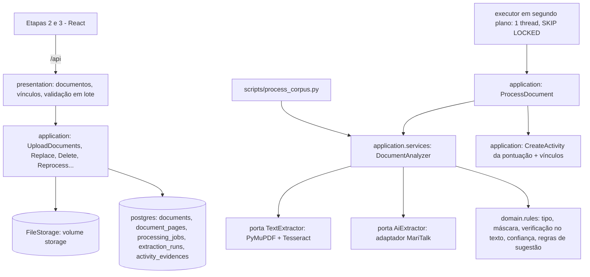

# Inteligência Documental Design

**Spec**: `.specs/features/inteligencia-documental/spec.md`
**Status**: Approved

---

## Architecture Overview

Um **analisador** puro de aplicação recebe o arquivo já guardado e devolve páginas, texto, JSON validado, avisos e atividades sugeridas. Quem o chama é o executor em segundo plano (grava o resultado e cria as atividades pelo caso de uso da `pontuacao`) ou o script local de corpus (só lê e relata). Texto, IA, OCR e disco ficam atrás de portas (AD-001). A IA é tratada como fonte não confiável: o schema e a verificação determinística "o valor está no texto?" decidem o que passa (AD-009).



### Abordagens consideradas

| Abordagem | Resumo | Veredito |
| --- | --- | --- |
| **A. Executor interno com fila no banco** | Uma thread no processo do backend pega tarefas com `FOR UPDATE SKIP LOCKED`; estados no PostgreSQL | **Recomendada** (prompt, seção 18; VM de 1 CPU; evolui para Celery sem mudar os casos de uso) |
| B. Celery + Redis agora | Fila externa | Descartada: mais um serviço na VM que já está no limite de memória; o prompt admite a evolução |
| C. Processar dentro da requisição de upload | Síncrono | Descartada: OCR de 12 páginas leva ~1 minuto e a requisição estouraria |

Tipo de documento: **regra por palavras-chave** escolhe o schema; a IA devolve o tipo e uma divergência vira aviso. Uma chamada a menos por documento, e a escolha do schema é determinística.

---

## Code Reuse Analysis

### Existing Components to Leverage

| Component | Location | How to Use |
| --- | --- | --- |
| `CreateActivity`, `Activity`, candidatos, `initial_status` | `backend/app/application/use_cases/scoring.py`, `domain/entities/activity.py` | A extração cria rascunhos `SUGERIDA_IA` / `AGUARDANDO_REVISAO`; itens alternativos entram como candidatos |
| `AccessPolicy`, `AuditService` | `backend/app/application/services/` | Acesso ao documento pelo acesso ao processo (404 fora); auditoria de toda operação, sem conteúdo |
| `Interstice`, `evaluate_period` | `backend/app/domain/rules/{interstice,scoring_periods}.py` | Sinalizar `FORA_DO_INTERSTICIO` na sugestão (CLS-09) |
| `normalize_title` | `backend/app/domain/rules/scoring_periods.py` | Base da verificação "está no texto?" e da comparação do nome do docente |
| `Alert`, `Severity`, `ScoringAlertCode` | `backend/app/domain/rules/{process_verification,scoring_alerts}.py` | Alertas de documento (`TEXTO_ILEGIVEL`, `DOCENTE_DIVERGENTE`...) em novo enum, mesma forma |
| Gatilho que impede alterar `audit_logs` | `backend/alembic/versions/0001_initial_schema.py` | Mesmo padrão para tornar `extraction_runs` imutável (EXT-13) |
| Rate limit de login | `backend/app/application/use_cases/auth.py` | Padrão de janela deslizante em tabela; aqui contado por `documents.uploaded_at` |
| Fixtures de integração, `act_as`, `factories` | `backend/tests/integration/` | PostgreSQL efêmero e usuários; a IA e o OCR entram falsos |
| `ProcessScoring`, `StepNav`, `AlertList`, `FieldError`, `api/client.ts` | `frontend/src/` | Etapas 2 e 3 seguem as telas da Etapa 4 |
| Volume `storage` em `/app/storage` | `docker-compose.yml` | Destino dos arquivos; só o backend o monta (nunca servido pelo nginx) |
| `MARITALK_*`, `test/test_maritalk.py` | `backend/app/core/config.py` | Credencial e modelo; o script de teste vira base do teste de contrato `maritalk_live` |

### Integration Points

| System | Integration Method |
| --- | --- |
| `activities` | Nova coluna `extraction_run_id` (FK anulável) na migração 0003; `CreateActivity` já aceita `source` |
| Pontuação (`calculate`) | `evidence_counts` por atividade entra no cálculo: `with_evidence` e `SEM_COMPROVANTE` passam a considerar vínculos (VINC-04) |
| nginx | `client_max_body_size 120m` no compose e, no deploy, no site do servidor |
| Imagem do backend | `apt install tesseract-ocr tesseract-ocr-por`; PyMuPDF e Pillow em `requirements.txt` |

---

## Components

### Domain — documento e extração

- **Purpose**: Entidades e estados, sem dependência de framework.
- **Location**: `backend/app/domain/entities/document.py`, `backend/app/domain/entities/extraction.py`
- **Interfaces**:
  - `DocumentStatus` (`PENDENTE`, `PROCESSANDO`, `PROCESSADO`, `REQUER_REVISAO`, `EXTRAIDO_SEM_IA`, `FALHOU`) e `can_transition(a, b)` (PIPE-02)
  - `Document(id, process_id, original_name, internal_name, mime, size_bytes, sha256, page_count, status, status_code, manual_type, manual_category, suggested_type, suggested_category, confidence, uploaded_by, uploaded_at, version)`
  - `PageText(document_id, run_id, page_number, method: TEXTO|OCR, char_count, ocr_confidence, text)`
  - `ExtractionRun(id, document_id, status: ATIVA|SUBSTITUIDA, model, duration_ms, raw_json, warnings)`
  - `ExtractedActivity(taxonomy, title, role, start_date, end_date, event_date, hours, course_hours, level, academic_period, identifier, page, evidence_text, confidence)`
  - `DocumentType` (`DECLARACAO_BANCA`, `DECLARACAO_ORIENTACAO`, `DECLARACAO_DISCIPLINAS`, `ATA_DEFESA`, `CERTIFICADO`, `PORTARIA`, `ARTIGO`, `REGISTRO_SOFTWARE`, `OUTRO`)
  - `DocAlertCode` (`SEM_ITEM_DE_PONTUACAO`, `TEXTO_ILEGIVEL`, `DOCENTE_DIVERGENTE`, `RESPOSTA_INVALIDA`, `NAO_ENCONTRADO_NO_TEXTO`, `TRUNCADO`, `NENHUMA_ATIVIDADE_ENCONTRADA`, `IA_CREDENCIAL_RECUSADA`, `IA_INDISPONIVEL`, `TEMPO_ESGOTADO`, `QUANTIDADE_ESTIMADA`)

### Domain — regras

- **Purpose**: Regras determinísticas, uma função pura por arquivo.
- **Location**: `backend/app/domain/rules/{upload_validation,text_quality,masking,document_type,grounding,confidence,suggestion_rules,quantity_rules}.py`
- **Interfaces**:
  - `validate_upload(facts: FileFacts, declared_mime, ext, limits) -> list[Rejection]`: extensão, MIME, assinatura, 20 MB, 100 páginas, 100 megapixels, ação ativa (DOC-02..04)
  - `is_text_layer_usable(text) -> bool`: menos de 50 caracteres úteis ou mais de 30% fora de letras, dígitos, pontuação comum e espaço = não usável (PIPE-05)
  - `mask_identifiers(text) -> MaskedText`: `[CPF]` (com e sem pontuação, 11 dígitos), `[RG]`, `[EMAIL]`, `[TELEFONE]`; nomes e SIAPE ficam (EXT-07)
  - `detect_document_type(text) -> DocumentType`: palavras-chave ("ata", "defesa"; "declaramos/declaro" + "banca/orientador/coorientador"; "certificamos/certificado"; "portaria"; "issn/doi/abstract/resumo"; "programa de computador"; componentes curriculares com "CH Docente")
  - `ground(extracted, pages) -> GroundingResult`: confere data, horas, número/identificador, título e nome no texto da página citada; o que falha vira `null` + `NAO_ENCONTRADO_NO_TEXTO(campo)`; devolve a fração de campos verificáveis encontrados (EXT-10)
  - `final_confidence(llm_confidence, grounded_ratio) -> Decimal` = o menor dos dois; `< 0.70` pede revisão (EXT-12)
  - `same_person(extracted_name, professor_name, siape, text) -> bool` (EXT-11)
  - `suggest_item(taxonomy, extras) -> Suggestion(principal | None, alternatives, source_note)` com a tabela da seção abaixo (CLS-02..05); `principal is None` significa sem item
  - `confirm_extension_course(taxonomy, text) -> taxonomy`: rebaixa `CURSO_EXTENSAO_CONCLUIDO` para `CURSO_CONCLUIDO` se o texto não contém "extensão" (CLS-10)
  - `derive_quantity(taxonomy, extracted) -> QuantityResult` (CLS-06)
- **Dependencies**: stdlib (`re`, `unicodedata`, `decimal`, `datetime`)
- **Reuses**: `normalize_title`

### Application — analisador

- **Purpose**: Do arquivo ao resultado, sem tocar no banco.
- **Location**: `backend/app/application/services/document_analyzer.py`
- **Interfaces**:
  - `DocumentAnalyzer(text_extractor, ai_extractor, settings)`
  - `analyze(file_path, kind, professor, process, table_version) -> AnalysisResult(pages, document_type, raw_json, activities, alerts, status, status_code, model, duration_ms)`
  - Ordem: extrair texto por página (TEXTO ou OCR) → qualidade → mascarar → escolher o schema pelo tipo → chamar a IA (tentativas, modelo reserva) → validar o schema → verificar no texto → confiança → docente → sugerir item e quantidade
- **Dependencies**: portas `TextExtractor` e `AiExtractor`; regras de domínio
- **Reuses**: nada de banco; também usado por `scripts/process_corpus.py`

### Application — casos de uso

- **Location**: `backend/app/application/use_cases/documents.py` (envio, listagem, download, substituição, exclusão, classificação manual, reprocessamento), `backend/app/application/use_cases/document_processing.py` (`ProcessDocument`, `RecoverStuckJobs`), `backend/app/application/use_cases/evidences.py` (`LinkEvidence`, `UnlinkEvidence`), e `BulkValidateActivities` em `use_cases/scoring.py`
- **Interfaces**:
  - `UploadDocuments.execute(actor, process_id, files: Sequence[IncomingFile]) -> list[UploadResult]`: um resultado por arquivo (201, 409, 422 ou 429), sem derrubar os demais
  - `ProcessDocument.execute(job_id)`: chama o analisador, grava páginas e execução, cria atividades e vínculos, atualiza o status
  - `ReprocessDocument`: marca a execução anterior `SUBSTITUIDA` e rejeita os rascunhos não editados dela (`version == 1`, status `AGUARDANDO_REVISAO`) com justificativa automática
  - `BulkValidateActivities.execute(actor, process_id, activity_ids, justification)`: uma auditoria por atividade
- **Reuses**: `CreateActivity`, `ChangeActivityStatus`, `AccessPolicy`, `AuditService`

### Infrastructure

- **Location**:
  - `backend/app/infrastructure/storage/local_storage.py`: `FileStorage.save/open/delete`; caminho `uploads/{process_id}/{uuid4}{ext}`, nunca derivado do nome enviado; permissões 0600
  - `backend/app/infrastructure/files/inspector.py`: `FileInspector.inspect(path) -> FileFacts` (assinatura, páginas, criptografia, JavaScript/lançamento/arquivo embutido via objetos do PDF, megapixels)
  - `backend/app/infrastructure/ocr/{pdf_text.py,render.py,tesseract.py}`: PyMuPDF por página; renderização a 300 dpi; tons de cinza e autocontraste com Pillow; Tesseract em português por subprocesso com a saída TSV (confiança média); sem OpenCV
  - `backend/app/infrastructure/ai/{maritalk.py,schemas.py}`: cliente `httpx`; esquemas JSON estritos por tipo; leitura de `choices[0].message.content` apenas
  - `backend/app/infrastructure/jobs/worker.py`: thread única iniciada no `lifespan` quando `WORKER_ENABLED`; pega tarefa com `FOR UPDATE SKIP LOCKED`, espera 2 s quando ociosa, para com o app; na partida chama `RecoverStuckJobs`
  - `backend/app/infrastructure/database/{models.py,repositories.py}` e `backend/alembic/versions/0003_documents.py`
- **Detalhes da MariTalk**: `temperature` 0; `max_tokens` 8000 (os modelos que raciocinam gastam tokens antes de responder); `content` vazio ou `finish_reason: length` conta como resposta inválida e a nova tentativa dobra o limite até 16000; `reasoning_content` nunca é lido nem guardado; modelo reserva `sabia-4-br-sp` só para erro de modelo (400/404); 401/403 sem repetir; 429, 5xx e tempo esgotado: 2 repetições com espera de 2 e 6 s.

### Presentation

- **Location**: `backend/app/presentation/api/{documents.py,evidences.py}`, `backend/app/presentation/schemas/documents.py`; `scoring.py` ganha `POST /api/processes/{id}/activities/validate-batch`
- **Rotas**:
  - `POST /api/processes/{id}/documents` (multipart, vários `file`), `GET /api/processes/{id}/documents?status=&type=`
  - `GET /api/documents/{id}` (páginas, JSON extraído, alertas, atividades), `GET /api/documents/{id}/file` (`?download=1` para anexo), `PUT /api/documents/{id}/file` (substituir), `DELETE /api/documents/{id}?justificativa=`
  - `POST /api/documents/{id}/reprocess`, `PUT /api/documents/{id}/classification`
  - `POST /api/activities/{id}/evidences`, `DELETE /api/activities/{id}/evidences/{evidence_id}`
- Visualização em linha só de PDF e imagem, com `X-Content-Type-Options: nosniff` e `Content-Security-Policy: sandbox`.

### Frontend

- **Location**: `frontend/src/pages/{ProcessDocuments.tsx,ProcessActivities.tsx}`; `frontend/src/components/{UploadDropzone.tsx,DocumentList.tsx,DocumentViewer.tsx,EvidenceChips.tsx,ActivityReviewList.tsx}`; `frontend/src/hooks/usePolling.ts`
- Rotas `processos/:id/documentos` e `processos/:id/atividades`; `StepNav` habilita as Etapas 2 e 3. O envio usa `FormData`: `api/client.ts` ganha uma opção para corpo não JSON (e o envio de CSV da `pontuacao` passa a usá-la).

---

## Regras de sugestão (taxonomia → item) — para revisão do usuário

A tabela vira `suggestion_rules.py`. A numeração é a da tabela oficial de pontuação da UFPA (planilha fornecida pelo usuário em 2026-11-17, feature `tabela-oficial`), que substitui a numeração do Anexo I da Res. 4.644/2015 usada na primeira versão desta tabela; só mudam o Grupo VIII, o Grupo III (III.11 e III.12 não existem) e o Grupo IV (IV.7 não existe). O item **principal** é o gravado como escolhido; os **alternativos** entram como candidatos. Tipo **sem item** não cria atividade: o documento fica `PROCESSADO` com o aviso `SEM_ITEM_DE_PONTUACAO`, e o usuário pode criar a atividade à mão. As quatro decisões de prática foram do usuário em 2026-11-17 (coorientação de TCC, palestra, curso concluído, treinamento).

| Código da taxonomia | Principal | Alternativos | Quantidade e horas | Observação |
| --- | --- | --- | --- | --- |
| `DISCIPLINA_MINISTRADA` | I.1 (graduação) ou I.2 (pós) pelo nível | — | CH docente em horas; período letivo; nível | Uma atividade por oferta |
| `ORIENTACAO_POS_DOUTORADO` | II.1 | — | 1 | Tutoria concluída |
| `ORIENTACAO_DOUTORADO` / `COORIENTACAO_DOUTORADO` | II.2 / II.4 | — | 1 | Defendida |
| `ORIENTACAO_MESTRADO` / `COORIENTACAO_MESTRADO` | II.3 / II.5 | — | 1 | Defendida |
| `ORIENTACAO_ESPECIALIZACAO` | II.6 | — | 1 | Concluída |
| `ORIENTACAO_TCC_GRADUACAO` | II.7 | — | 1 | Defendido |
| `COORIENTACAO_TCC_GRADUACAO` | sem item | — | — | Não pontua (decisão do usuário); não cria atividade |
| `ORIENTACAO_EM_ANDAMENTO_DOUTORADO` / `MESTRADO` / `TCC` | II.14 / II.15 / II.16 | — | 1 | Em andamento |
| `ORIENTACAO_PROJETO_INSTITUCIONAL` | II.8 | II.9 | 1 | Por aluno |
| `ORIENTACAO_ESTAGIO` / `MONITORIA` | II.12 / II.13 | — | 1 | Por aluno/ano; por aluno |
| `BANCA_DOUTORADO` / `MESTRADO` | III.1 / III.2 | — | 1 | Por banca |
| `BANCA_ESPECIALIZACAO` | III.3 | — | 1 | Monografia ou TCC de especialização |
| `BANCA_TCC_GRADUACAO` | III.4 | — | 1 | Graduação ou técnico |
| `BANCA_CONCURSO_SUBSTITUTO` / `EFETIVO` | III.5 / III.6 | — | 1 | Por banca |
| `BANCA_QUALIFICACAO` | III.7 | — | 1 | Pós-graduação |
| `BANCA_SELECAO_POS` / `BOLSAS` | III.8 / III.9 | — | 1 | Por banca |
| `BANCA_PROCESSO_SELETIVO` | sem item | — | — | Antes III.11 (alt. III.12); não existe na tabela oficial; não cria atividade |
| `EXTENSAO_PROJETO_COORDENACAO` / `PARTICIPACAO` | IV.1 / IV.2 | — | anos inteiros do período (`QUANTIDADE_ESTIMADA`) | Por ano |
| `EXTENSAO_CURSO_COORDENACAO` | IV.3 | — | 1 por documento; horas guardadas | Carga mínima de 20 h verificada pelo motor |
| `EXTENSAO_CURSO_MINISTRANTE` | IV.4 | IV.5 | 1 por documento; horas guardadas | Carga mínima de 20 h verificada pelo motor |
| `EXTENSAO_EVENTO_COORDENACAO` | IV.6 | — | 1 por documento; horas guardadas | |
| `EXTENSAO_EVENTO_MINISTRANTE` | sem item | — | — | Antes IV.7; não existe na tabela oficial; não cria atividade |
| `PESQUISA_PROJETO_COORDENACAO` | V.1 | — | 1 | Por projeto, com relatório final |
| `PESQUISA_GRUPO_COORDENACAO` / `MEMBRO` | V.2 / V.3 | — | anos (`QUANTIDADE_ESTIMADA`) | |
| `PESQUISA_BOLSA_PRODUTIVIDADE` | V.4 | — | anos | |
| `FUNCAO_DIRETOR_FACULDADE` | VI.6 | VI.3 | anos (`QUANTIDADE_ESTIMADA`) | Por portaria de designação |
| `FUNCAO_VICE_DIRETOR_FACULDADE` / `COORDENADOR_CURSO_GRADUACAO` | VI.7 | — | anos | |
| `COMISSAO_ADMINISTRACAO_SUPERIOR` / `NDE_MEMBRO` | VI.10 | VI.14 | 1 por designação | |
| `COMISSAO_UNIDADE` | VI.12 | VI.14 | 1 por designação | |
| `COLEGIADO_MEMBRO` | VI.13 | — | anos | |
| `CURSO_ESPECIALIZACAO_CONCLUIDO` | VII.7 | — | 1 | 360 horas |
| `CURSO_APERFEICOAMENTO_CONCLUIDO` | VII.8 | VII.9 | 1 | 180 horas |
| `CURSO_EXTENSAO_CONCLUIDO` | VII.9 | — | 1 | Só vale se o texto do documento contém "extensão"; senão vira `CURSO_CONCLUIDO` |
| `CURSO_CONCLUIDO` | VII.10 | — | 1 | Outro curso concluído |
| `PARTICIPACAO_EVENTO` | VII.10 | — | 1 | Congresso, seminário, curta duração |
| `TREINAMENTO_INTERNO` | VII.10 | — | 1 | Treinamentos corporativos (como os certificados PSI) |
| `ESTAGIO_CAPACITACAO` | VII.11 | — | horas (bloco 30 h) | |
| `LIVRO_COM_PARECERISTAS` / `SEM` | VIII.1 / VIII.2 | — | 1 | |
| `CAPITULO_INTERNACIONAL` / `NACIONAL` | VIII.3 / VIII.4 | — | 1 | |
| `ARTIGO_INTERNACIONAL_INDEXADO` | VIII.9 | VIII.11 | 1 | ISSN e Qualis (antes VIII.11, alt. VIII.13) |
| `ARTIGO_NACIONAL_INDEXADO` | VIII.10 | VIII.11 | 1 | Antes VIII.12, alt. VIII.13 |
| `ARTIGO_NAO_INDEXADO` | VIII.11 | — | 1 | Antes VIII.13 |
| `TRABALHO_COMPLETO_CONGRESSO` | VIII.19 | VIII.10 | 1 | Antes VIII.23, alt. VIII.12 |
| `COMUNICACAO_COM_RESUMO` / `SEM_RESUMO` | VIII.20 / VIII.21 | — | 1 | Antes VIII.24 / VIII.25 |
| `APRESENTACAO_TRABALHO_INTERNACIONAL` / `NACIONAL` | VIII.22 / VIII.23 | — | 1 | Antes VIII.26 / VIII.27 |
| `PALESTRA` | VIII.24 | — | 1 | Palestra, conferência ou mesa-redonda (decisão do usuário pela descrição; antes VIII.28) |
| `PATENTE_DEPOSITADA` / `CONCEDIDA` | VIII.29 / VIII.30 | — | 1 | Antes VIII.35 / VIII.36 |
| `REGISTRO_SOFTWARE` | VIII.33 | — | 1 | INPI (antes VIII.63) |
| `CONSULTORIA_AD_HOC` | VIII.36 | — | anos | Antes VIII.66 |
| `OUTRA` | sem item | — | — | Não cria atividade; `SEM_ITEM_DE_PONTUACAO` |

---

## Data Models

```python
documents(id uuid pk, process_id fk, original_name varchar(255), internal_name varchar(64) unique, mime varchar(40),
    size_bytes bigint, sha256 char(64), page_count smallint, status enum, status_code varchar(40) null,
    manual_type varchar(40) null, manual_category varchar(60) null, suggested_type varchar(40) null,
    suggested_category varchar(60) null, confidence numeric(3,2) null, uploaded_by fk users,
    uploaded_at timestamptz, updated_at timestamptz, version int, unique(process_id, sha256))
extraction_runs(id uuid pk, document_id fk, status enum(ATIVA, SUBSTITUIDA), model varchar(60), duration_ms int,
    raw_json jsonb, warnings jsonb, created_at)        # imutável: gatilho recusa UPDATE do conteúdo (só `status` muda)
document_pages(id uuid pk, document_id fk, run_id fk, page_number smallint, method enum(TEXTO, OCR),
    char_count int, ocr_confidence numeric(5,2) null, text text, unique(run_id, page_number))   # texto original, sem máscara
processing_jobs(id uuid pk, document_id fk, status enum(PENDENTE, PROCESSANDO, CONCLUIDA, FALHOU), attempts smallint,
    created_at, started_at null, finished_at null, error_code varchar(40) null)                 # índice parcial: uma tarefa ativa por documento
activity_evidences(id uuid pk, activity_id fk, document_id fk, page_number smallint, excerpt varchar(300),
    run_id fk null, created_by fk users, created_at, unique(activity_id, document_id, page_number))
activities.extraction_run_id uuid fk null                                                        # migração 0003
```

**Relationships**: processo 1—N documentos; documento 1—N execuções, páginas e tarefas; atividade N—N documentos por `activity_evidences`; atividade N—1 execução (o que decide, na reprocessagem, quais rascunhos rejeitar). Auditoria nas entidades `document` e `activity_evidence`, só com identificadores, nome e hash.

---

## Error Handling Strategy

| Error Scenario | Handling | User Impact |
| --- | --- | --- |
| Extensão, MIME, assinatura, tamanho, PDF ativo ou criptografado | 422 no campo `arquivo`, código `ARQUIVO_INVALIDO`; os demais arquivos do lote seguem | Motivo ao lado do arquivo |
| Mesmo hash no processo | 409 com o id do existente | "Já enviado" com link |
| Limite de 200 documentos ou de 60 envios por minuto | 422 `limite` / 429 | Mensagem clara |
| Processo concluído/arquivado, ou edição concorrente | 409 | Pede recarregar |
| OCR estoura 60 s por página ou 10 min por documento | `FALHOU` `TEMPO_ESGOTADO`, texto parcial mantido | Reprocessar ou classificar à mão |
| OCR ilegível | `REQUER_REVISAO` `TEXTO_ILEGIVEL` | Revisar ou substituir o arquivo |
| MariTalk: 401/403 | `EXTRAIDO_SEM_IA` `IA_CREDENCIAL_RECUSADA`, sem repetir | Aviso e cadastro manual |
| MariTalk: 429, 5xx, tempo | 2 repetições (2 s e 6 s); depois `EXTRAIDO_SEM_IA` `IA_INDISPONIVEL` | Aviso e cadastro manual |
| Modelo inválido | Uma nova tentativa com `sabia-4-br-sp` | Transparente |
| Resposta vazia, cortada ou fora do schema | Nova tentativa (limite dobrado); depois `REQUER_REVISAO` `RESPOSTA_INVALIDA` | Revisão manual |
| Valor da IA que não está no texto | `null` + `NAO_ENCONTRADO_NO_TEXTO(campo)` | Campo vazio a preencher |
| Servidor reinicia no meio do processamento | Tarefas `PROCESSANDO` voltam a `PENDENTE` na partida | Nada se perde |

---

## Risks & Concerns

| Concern | Location (file:line) | Impact | Mitigation |
| --- | --- | --- | --- |
| Dados de terceiros enviados a um serviço externo; o modelo do `.env` (`sabia-4-thinking`) não garante processamento no Brasil | `backend/app/infrastructure/ai/maritalk.py` (novo) | LGPD | Máscara de CPF, RG, e-mail e telefone; só texto; nenhum conteúdo em logs; troca para `sabia-4-br-sp` pelo `.env`; risco aceito pelo usuário e registrado na spec |
| Modelos que raciocinam gastam tokens e devolvem `content` vazio com limite baixo (confirmado em 2026-11-17 com `sabia-4-thinking`) | `maritalk.py` | Extração falha sem aviso | `max_tokens` 8000, nova tentativa com o dobro, `content` vazio tratado como inválido, teste com resposta falsa vazia |
| OCR pesado numa VM compartilhada de 1 CPU e 3,8 GB | `infrastructure/ocr/tesseract.py` | Lentidão para os outros sistemas | Uma tarefa por vez; processo `nice` para o Tesseract; limite de 100 páginas; tempo máximo por página |
| Antivírus ausente | `infrastructure/files/inspector.py` | Arquivo malicioso passa pela checagem estrutural | Armazenamento fora do caminho público, `nosniff`, `sandbox`, sem execução; ClamAV registrado como dívida de implantação |
| Verificação "está no texto" pode recusar valor certo por formatação (data por extenso, número com ponto) | `domain/rules/grounding.py` | Campo some e exige digitação | Normalizar datas por extenso e `dd.mm.aaaa`, números e identificadores; teste com os formatos dos documentos reais |
| Camada de texto com lixo (portarias reais) engana a leitura | `domain/rules/text_quality.py` | Texto errado vai para a IA | Limiar de 50 caracteres úteis e 30% de símbolos; fallback para OCR; teste com texto de portaria sintético ruidoso |
| `api/client.ts` só envia JSON | `frontend/src/api/client.ts` | Envio de arquivos sem CSRF | Opção `FormData` no cliente, com cabeçalho CSRF |
| Limite de corpo do nginx é 20 MB | `nginx/nginx.conf:5`, site do servidor na VM | Envio múltiplo recusado antes de chegar ao backend | 120 MB no compose e no deploy; teste de fumaça com 25 MB |
| Reprocessamento pode apagar trabalho humano | `use_cases/documents.py` | Perda de edição | Só rejeita rascunhos com `version == 1` e status `AGUARDANDO_REVISAO`; teste cobre o caso editado |
| Thread no processo do backend morre com o app | `infrastructure/jobs/worker.py` | Tarefa a meio | Estados no banco e `RecoverStuckJobs` na partida |

---

## Tech Decisions (only non-obvious ones)

| Decision | Choice | Rationale |
| --- | --- | --- |
| Biblioteca de OCR | Tesseract por subprocesso (`tesseract ... tsv`), não `pytesseract` | Menos uma dependência e acesso direto à confiança por palavra |
| Pré-processamento | Pillow (tons de cinza, autocontraste), sem OpenCV | OpenCV só se o benchmark real pedir; evita 60 MB na imagem |
| Escolha do schema | Regra por palavras-chave, e a IA confirma o tipo | Determinística e uma chamada a menos |
| Texto enviado | Máscara aplicada ao texto, citações verificadas contra o texto original | A verificação "está no texto" roda sobre o texto sem máscara |
| Imutabilidade da execução | Gatilho no banco, como em `audit_logs` | EXT-13 vale mesmo contra erro de código |
| Quantidades "por ano" | Anos inteiros do período, com aviso `QUANTIDADE_ESTIMADA` | Sem proporcionalizar às cegas; o usuário ajusta |
| Teste com documentos reais | Script local `scripts/process_corpus.py`, que só relata | Repositório público e LGPD |

> **Decisões de projeto**: AD-008 (executor interno com tarefas no banco) e AD-009 (saída da IA é não confiável: schema mais verificação no texto; classificação por regras versionadas) são registradas em `.specs/STATE.md`.
