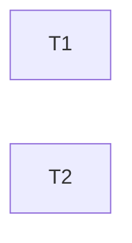
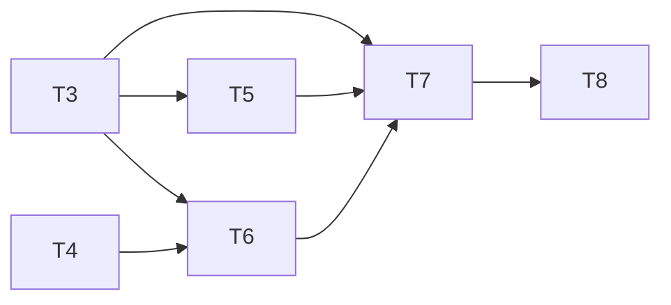
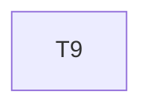
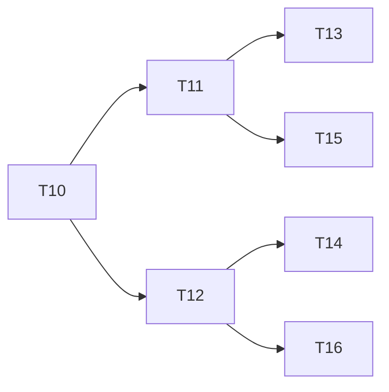
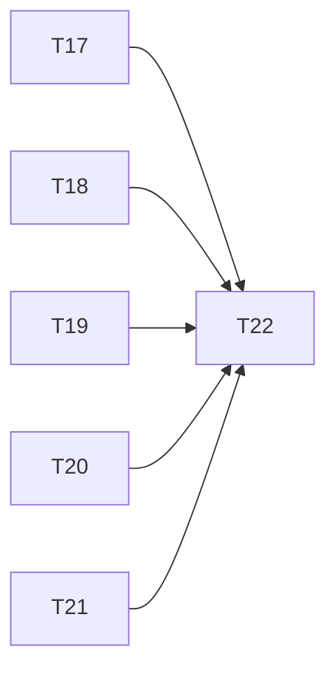
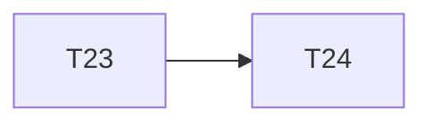
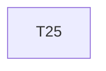

# Layout oficial: Parecer pelo modelo e brasão da UFPA (layout-oficial) Tasks

## Execution Protocol (MANDATORY -- do not skip)

Implement these tasks with the `tlc-spec-driven` skill: **activate it by name and follow its Execute flow and Critical Rules.** Do not search for skill files by filesystem path. The skill is the source of truth for the full flow (per-task cycle, sub-agent delegation, adequacy review, Verifier, discrimination sensor).

**If the skill cannot be activated, STOP and tell the user - do not proceed without it.**

---

**Design**: nenhum `design.md` (feature pequena); as decisões de desenho estão na seção Notas, no fim deste arquivo.
**Spec**: `.specs/features/layout-oficial/spec.md`
**Status**: Approved (usuário, 2026-11-23: "Aprovar tudo e executar"; 3 lotes por sub-agente + Verifier; dia sem zero na linha de local e data)

Regras de execução desta feature:

- Cada tarefa escreve primeiro os testes que derivam dos critérios de aceitação da spec e só então o código (os itens `Done when` começam pelo teste). Teste existente que muda por causa de requisito novo é listado na tarefa com o requisito que justifica a mudança e é reescrito para os valores do modelo oficial; nenhum teste é apagado sem substituto nem enfraquecido.
- Só dados sintéticos; `Documentos/`, `Modelos/`, `requeriment.txt`, `test/` e `corpus-reports/` nunca são abertos nem copiados para teste. O modelo oficial do Parecer (`Parecer.pdf`) não é aberto por agente: a estrutura vem da spec (PMOD-01 a PMOD-19), e nenhum arquivo ou teste traz nome real. O único arquivo do usuário que uma tarefa lê é `backend/img/ufpa.png` (o brasão), na T10, e só para copiá-lo; `backend/img/` fica sem versionar.
- Um commit por tarefa (Conventional Commits, terminando com `Co-Authored-By: Claude Sonnet 5.5 <noreply@anthropic.com>`), marcando a tarefa neste arquivo e a rastreabilidade da spec no mesmo commit.
- Sem push, deploy nem acesso à VM sem autorização explícita. Nenhuma migração nova: o banco não muda (a coluna `board_opinions.notes` fica, PMOD-28).
- **Gate em níveis** (o gate completo do backend leva cerca de 17 minutos): cada tarefa roda o nível `quick` ou `targeted` com os arquivos que ela escreve e os testes existentes que ela lista; o gate `full` roda só na **última tarefa de backend de cada fase de código** (T8, T16, T22); o `build` roda ao fim da documentação (T24) e na verificação (T25). Tarefas de frontend rodam o gate `front`.
- **Janela vermelha da Fase 2, por desenho**: a T3 reescreve no mesmo lugar o modelo `OpinionDocument` e `build_opinion`; os escritores (T5 e T6) e o caso de uso (T7) só passam a usá-lo nas tarefas deles. Entre a T3 e a T7 os testes de `test_opinion_docx.py`, `test_opinion_pdf.py`, `test_document_writer.py` (Parecer), `test_run_generation_opinion.py` e `test_banca_parecer_acceptance.py` ficam vermelhos, e cada tarefa roda só os arquivos que ela escreve. O gate `full` da T8 fecha a janela. A alternativa (modelo e escritores com nomes novos, para cada commit passar inteiro) foi descartada por duplicar dois escritores e um modelo só para apagá-los depois.
- Classe, denominação e nível do processo saem sempre dos seis campos que o servidor digitou na Etapa 1 (NMOV-01): nenhuma tarefa deduz a classe seguinte, a denominação ou o nível; só o nível é convertido para romanos.
- O Parecer continua sem IA (PMOD-25) e a conclusão continua sendo sempre da pessoa. A chave da MariTalk fica só no backend.
- Documentos já gerados não mudam (AD-012): só as versões novas levam o brasão e o novo texto do Parecer.
- O brasão é sempre lido do pacote (`app/infrastructure/documents/assets/ufpa.png`), nunca de `backend/img/`.

---

## Test Coverage Matrix

> Generated from project guidelines, spec and the existing suites. Guidelines found: `CLAUDE.md` (regras 1 a 11, regra 5 sem justificativa nas Etapas 2 a 4, gate do backend e do frontend), AD-001 (teste de arquitetura `backend/tests/architecture/test_layers.py`: domínio e aplicação sem FastAPI, SQLAlchemy nem `app.infrastructure`), AD-004 (integração em PostgreSQL real), AD-011 (DOCX com python-docx, PDF com reportlab, sem LibreOffice, mesmo conteúdo e mesma ordem), AD-012 (versão imutável), AD-025 (banca e Parecer), `backend/pyproject.toml` (`ruff` com `E,F,I,B,UP`, linha 100; marcador `integration`), `backend/Dockerfile` (copia só `app` e `alembic`) e `frontend/package.json` (`lint`, `build`, `vitest`). Existing tests sampled: `backend/tests/unit/domain/test_pt_format.py`, `test_opinion_document.py`, `test_request_document.py`, `backend/tests/unit/infrastructure/test_opinion_docx.py`, `test_opinion_pdf.py`, `test_report_docx.py`, `test_report_pdf.py`, `test_table_docx.py`, `test_table_pdf.py`, `test_front_matter.py`, `test_pdf_styles.py`, `test_document_writer.py`, `backend/tests/integration/doc_usecases/test_run_generation_opinion.py`, `test_request_opinion.py`, `test_opinion_save.py`, `backend/tests/integration/documents/test_board_opinion_repository.py`, `backend/tests/integration/api/test_board_api.py`, `test_banca_parecer_acceptance.py`, `frontend/src/components/OpinionForm.test.tsx`, `frontend/src/api/board.test.ts`.

| Code Layer | Required Test Type | Coverage Expectation | Location Pattern | Run Command |
| --- | --- | --- | --- | --- |
| Domain (rules, texto do Parecer) | unit | All branches; 1:1 to spec ACs (PMOD-01 a PMOD-19); every edge case (15 membros, nome de 200 caracteres, os doze meses, dia 1, 2, 21 e 31, anos 2000, 2025, 2100, 2101 e fora da faixa, nível fora da faixa, unidade-mãe que não é campus, só presidente, dois presidentes, sem presidente, data, local e número em branco) | `backend/tests/unit/domain/test_*.py` | `cd backend && .venv/bin/pytest tests/unit tests/architecture -q` |
| Infrastructure documents (escritores DOCX e PDF, ajudantes do brasão, fontes, pacote) | unit | Mesmo texto e mesma ordem em DOCX e PDF; brasão como primeiro elemento, centralizado, com 2,0 cm de largura, só na primeira página; falta do arquivo falha com erro claro; texto antigo intacto; só as fontes registradas listadas no PDF | `backend/tests/unit/infrastructure/test_*.py` | `cd backend && .venv/bin/pytest tests/unit tests/architecture -q` |
| Use cases + services | integration | Happy + cada recusa na ordem (PMOD-22, PMOD-23); instantâneo igual ao de antes; campus lido da unidade-mãe; geração que falha por brasão ausente; versões antigas com os mesmos bytes; auditoria sem `notes` | `backend/tests/integration/doc_usecases/test_*.py` | `cd backend && .venv/bin/pytest tests/integration -q` |
| Repositories | integration | `notes` não é lido nem escrito pelo repositório e o texto antigo da coluna sobrevive a um `update`; versão otimista como antes | `backend/tests/integration/documents/test_*.py` | `cd backend && .venv/bin/pytest tests/integration -q` |
| API routes and schemas | integration | `PUT /board/opinion` sem `notes` (happy), com `notes` (422), 401, 404 fora do acesso, 409 somente leitura e 409 de versão como antes; aceitação ponta a ponta do Parecer pelo modelo | `backend/tests/integration/api/test_*.py`, `backend/tests/unit/presentation/test_*.py` | `cd backend && .venv/bin/pytest tests/integration/api tests/unit/presentation -q` |
| Frontend components/api | unit | Formulário só com conclusão, data e local; salvar manda o corpo sem `notes`; 422 de `place` junto do campo; somente leitura | `frontend/src/**/*.test.tsx`, `frontend/src/api/*.test.ts` | `cd frontend && npm test -- --run` |
| Docs | none | build gate only | - | build gate only |

## Gate Check Commands

| Gate Level | When to Use | Command |
| --- | --- | --- |
| Quick | Tarefas só com testes unitários de backend (domínio e escritores) | `cd backend && .venv/bin/ruff check . && .venv/bin/pytest tests/unit tests/architecture -q` |
| Targeted | Tarefas com testes de integração de backend: só os arquivos que a tarefa escreve ou muda, mais os testes existentes que ela lista | `cd backend && .venv/bin/ruff check . && .venv/bin/pytest <arquivos da tarefa> -q` |
| Full | Última tarefa de backend de cada fase de código (cerca de 17 minutos) | `cd backend && .venv/bin/ruff check . && .venv/bin/pytest -q` |
| Front | Tarefas de frontend | `cd frontend && npm run lint && npm run build && npm test -- --run` |
| Build | Fim da documentação e verificação | `cd backend && .venv/bin/ruff check . && .venv/bin/pytest -q && cd ../frontend && npm run lint && npm run build && npm test -- --run` |

---

## Execution Plan

Phases are ordered and run sequentially - each phase completes before the next begins, and tasks within a phase execute in order. A tarefa que depende de fase anterior lista a dependência em `Depends on`; o diagrama de cada fase mostra só as dependências da própria fase.

Lotes de execução (fases inteiras, ~7 a 8 tarefas cada; uma fase nunca é dividida entre workers): **Lote 1** = Fases 1 e 2 (8 tarefas); **Lote 2** = Fases 3 e 4 (8); **Lote 3** = Fases 5 e 6 (8); a Fase 7 (Verifier) roda sozinha, por agente diferente do autor.

### Phase 1: Auxiliares puros do Parecer (domínio)

### Phase 2: Parecer pelo modelo oficial e sem Observações (backend)

### Phase 3: Observações saem da tela (frontend)

### Phase 4: Brasão, ajudantes, Tabela e Relatório

### Phase 5: Brasão no Comprovante, no Requerimento e no Parecer, e aceitação

### Phase 6: Documentação

### Phase 7: Verificação independente

---

## Task Breakdown

### Phase 1: Auxiliares puros do Parecer (domínio)

#### T1: Números por extenso

**Status**: Done

**What**: `spell_number(n: int) -> str` escreve o cardinal em português, de 1 a 2999 (`ValueError` fora da faixa): "um", "vinte e sete", "cento e um", "mil e cem", "mil cento e um", "dois mil e vinte e cinco", com o "e" depois de "mil" só quando o resto é menor que 100 ou centena exata.
**Where**: `backend/app/domain/rules/spelled_numbers.py` (new)
**Depends on**: None
**Reuses**: nada do código atual escreve número por extenso; o leitor inverso `numerals_from_words` (`backend/app/domain/rules/number_words.py:76`) serve só de conferência cruzada nos testes
**Requirement**: PMOD-08, PMOD-09

**Tools**:

- MCP: NONE
- Skill: NONE

**Done when**:

- [x] Testes primeiro em `backend/tests/unit/domain/test_spelled_numbers.py` (novo), com tabela de valores: 1 "um", 2 "dois", 3 "três", 10 "dez", 16 "dezesseis", 20 "vinte", 21 "vinte e um", 27 "vinte e sete", 31 "trinta e um", 100 "cem", 101 "cento e um", 110 "cento e dez", 200 "duzentos", 999 "novecentos e noventa e nove", 1000 "mil", 1001 "mil e um", 1100 "mil e cem", 1101 "mil cento e um", 1999 "mil novecentos e noventa e nove", 2000 "dois mil", 2020 "dois mil e vinte", 2025 "dois mil e vinte e cinco", 2026 "dois mil e vinte e seis", 2100 "dois mil e cem", 2101 "dois mil cento e um", 2200 "dois mil e duzentos", 2999 "dois mil novecentos e noventa e nove"; 0, -1 e 3000 dão `ValueError`
- [x] Conferência cruzada: para todo n de 1 a 2999, `numerals_from_words(normalize_title(spell_number(n)))` devolve `str(n)` (o leitor de números por extenso do projeto lê de volta o que este módulo escreve); a diferença que aparecer é investigada antes de mudar qualquer um dos dois e fica registrada nas Notas
- [x] O módulo não importa `app.infrastructure`, relógio nem IA (o teste de arquitetura passa)
- [x] Gate check passes: `cd backend && .venv/bin/ruff check . && .venv/bin/pytest tests/unit tests/architecture -q`
- [x] Test count: os testes novos passam e nenhum teste existente foi apagado

**Tests**: unit
**Gate**: quick

**Commit**: `feat(domain): spell Portuguese cardinal numbers in words`

---

#### T2: Algarismos romanos e linha de local e data

**Status**: Done

**What**: `to_roman(n: int) -> str` (1 a 3999, `ValueError` fora) e `format_place_date(value: date) -> str` ("2 de Abril de 2025": dia sem zero à esquerda, mês em português com inicial maiúscula, ano com quatro dígitos, sem depender do idioma do sistema), as duas em `pt_format.py`.
**Where**: `backend/app/domain/rules/pt_format.py` (modify)
**Depends on**: None
**Reuses**: `_MONTH_NAMES` e `format_long_date` do mesmo arquivo (o Requerimento continua com `format_long_date`, em minúsculas)
**Requirement**: PMOD-05, PMOD-12

**Tools**:

- MCP: NONE
- Skill: NONE

**Done when**:

- [x] Testes primeiro em `backend/tests/unit/domain/test_pt_format.py`: `to_roman` dá I, II, III, IV, V, IX, X, XIV, XL, XC, CD, MCMXCIV (1994) e MMMCMXCIX (3999); 0, -1 e 4000 dão `ValueError`; `format_place_date(date(2025, 4, 2))` é "2 de Abril de 2025"; os doze meses saem com a inicial maiúscula e a grafia certa, incluindo "Março"; dia 27 ("27 de Maio de 2025") e dia 7 sem zero ("7 de Maio de 2025"); 29 de fevereiro de 2024; o resultado não muda com `LC_TIME` diferente; `format_long_date` segue devolvendo "10 de março de 2025" (testes existentes intactos)
- [x] Gate check passes: `cd backend && .venv/bin/ruff check . && .venv/bin/pytest tests/unit tests/architecture -q`
- [x] Test count: os testes novos passam e nenhum teste existente foi apagado

**Tests**: unit
**Gate**: quick

**Commit**: `feat(domain): write Roman numerals and the place and date line with a capital month`

---

### Phase 2: Parecer pelo modelo oficial e sem Observações (backend)

#### T3: Texto do Parecer pelo modelo oficial (domínio)

**Status**: Done

**What**: `OpinionDocument` e `build_opinion` reescritos no mesmo arquivo para o modelo: `build_opinion(process, professor, unit, parent_unit, ordinance, opinion, page)` devolve o cabeçalho (`header_lines`: "Universidade Federal do Pará", o nome do `parent_unit` só se for do tipo `CAMPUS`, "<nome> – <sigla>"), o título "PARECER", a linha de local e data, o parágrafo único como `TextRun(text, bold)` (data por extenso, "Aos" ou "Ao primeiro dia", Portaria, titulares, denominação e nível em romanos, interstício, classe, decisão APROVARAM ou NÃO APROVARAM) e as linhas dos membros ("PRESIDENTE: ..." e "MEMBRO n: ..."), sem seções, tabela, totais nem observações. Continua levantando `ValueError` sem conclusão (PAR-12).
**Where**: `backend/app/domain/rules/opinion_document.py` (modify)
**Depends on**: T1, T2
**Reuses**: `spell_number` (T1), `to_roman` e `format_place_date` (T2), `format_date`, `format_interstice`, `Interstice`, `BLANK_TEXT` do próprio módulo, `BoardRole`, `OpinionConclusion`
**Requirement**: PMOD-01 a PMOD-19

**Tools**:

- MCP: NONE
- Skill: NONE

**Done when**:

- [x] Testes primeiro em `backend/tests/unit/domain/test_opinion_document.py` (reescrito para o modelo; os testes da estrutura antiga das seções, da identificação, dos documentos analisados, dos pontos, do mínimo, da conclusão antiga, das observações e das assinaturas com "Presidente"/"Membro"/"Suplente" são substituídos pelos abaixo): no cenário sintético (promoção do nível 4 da classe B, Adjunto, para o nível 1 da classe C, Associado, portaria "123/2025", presidente, dois membros e um suplente, data 27/05/2025, local "Belém", interstício 23/11/2022 a 23/11/2024) o texto do parágrafo, juntando as runs, é exatamente "Aos vinte e sete dias do mês de maio de dois mil e vinte e cinco, reuniram-se os membros da Banca de Análise, nomeados pela Portaria nº 123/2025, Ana Presidente Souza (presidente), Bruno Membro Lima, Carla Membro Reis, responsáveis por analisar o Relatório de Atividades do Professor Adjunto Nível IV Maria Docente da Silva, para fins de progressão funcional do docente, referente ao interstício de 23/11/2022 a 23/11/2024, para Classe C (Associado) Nível I. Após a análise, os membros APROVARAM o referido relatório." (PMOD-06, PMOD-10, PMOD-12)
- [x] Testes de negrito: as runs em negrito são só "vinte e sete dias do mês de maio de dois mil e vinte e cinco" e "Adjunto Nível IV Maria Docente da Silva", e "Aos " e "Professor " não estão em negrito (PMOD-07)
- [x] Testes de data: dia 1 de janeiro de 2026 dá "Ao primeiro dia do mês de janeiro de dois mil e vinte e seis" (PMOD-09); dias 2, 21 e 31 dão "Aos dois dias", "Aos vinte e um dias" e "Aos trinta e um dias"; os doze meses em minúsculas no parágrafo e com inicial maiúscula na linha de local e data ("Belém, 27 de Maio de 2025."); anos 2000, 2100 e 2101 por extenso; ano fora de 1000 a 2999 sai em algarismos (PMOD-05, PMOD-08)
- [x] Testes de decisão: `DESFAVORAVEL` termina com "os membros NÃO APROVARAM o referido relatório."; sem conclusão levanta `ValueError` (PMOD-10, PMOD-11)
- [x] Testes de romanos e NMOV-01: níveis 4 e 1 saem "IV" e "I"; nível 0 ou 4000 sai como digitado; classe, letra e denominações fora do padrão (salto de A para C, "Titular-Livre") saem como digitadas; "progressão" e "promoção" escrevem o mesmo "para fins de progressão funcional do docente" (PMOD-12)
- [x] Testes de membros: o suplente não aparece no parágrafo nem nas linhas; as linhas são "PRESIDENTE: Ana Presidente Souza", "MEMBRO 1: Bruno Membro Lima", "MEMBRO 2: Carla Membro Reis" (PMOD-13); presidente que não é o primeiro da portaria sai primeiro; sem presidente não há "(presidente)" e as linhas são "MEMBRO 1..n" (PMOD-14); só um presidente: "... (presidente), responsáveis por analisar" e uma linha; dois presidentes: os dois com "(presidente)" e "PRESIDENTE:" antes dos membros, que seguem de 1; 15 membros e nome de 200 caracteres saem inteiros; "Prof. Dr." digitado no nome sai como está e nada é acrescentado; o número "89/2025 - CCAME" sai como registrado (PMOD-15)
- [x] Testes de cabeçalho: com `parent_unit` do tipo `CAMPUS` são três linhas ("Universidade Federal do Pará", o nome do campus, "Faculdade de Testes Sintéticos – FATS" com travessão); `parent_unit=None` e `parent_unit` do tipo `INSTITUTO` dão duas linhas (PMOD-02, PMOD-03); o título é "PARECER" (PMOD-04)
- [x] Testes de branco: sem data, o parágrafo começa "Aos ______ dias do mês de ________ de ________, reuniram-se" e a linha é "Belém, ____ de ________ de ________."; sem local a linha é "__________, 27 de Maio de 2025."; sem número "Portaria nº __________," e nenhuma delas levanta erro (PMOD-16, PMOD-17, PMOD-18)
- [x] Teste de conteúdo proibido: o texto inteiro do documento (cabeçalho, título, linha, runs e linhas) não contém "Total geral", "Mínimo de referência", "Documentos analisados", "Pontuação por grupo", "Observações", "Identificação", "Portaria da banca:" nem "Conclusão"; o modelo não tem seções, linhas de tabela nem campo de total (PMOD-19, PMOD-01)
- [x] Teste de pureza mantido: o módulo não lê relógio nem chama IA (`test_the_module_reads_no_clock_and_calls_no_ai`) e a mesma entrada dá o mesmo documento
- [x] Os apoios de teste mudam com o modelo: `backend/tests/unit/domain/board_document_support.py` ganha uma unidade `CAMPUS` sintética (sem mexer em `opinion()`, que ainda tem `notes` até a T8) e `backend/tests/unit/infrastructure/board_writer_support.py` troca `opinion_model()` para a nova assinatura, sem `SNAPSHOT`, `VERSIONS`, `MINIMUM` e `GROUP_NAMES` (que só o Parecer antigo usava; `request_model` segue igual)
- [x] Teste de arquitetura passa; o gate roda só `tests/unit/domain/test_opinion_document.py` e `tests/architecture` (a janela vermelha da Fase 2 está nas regras de execução)
- [x] Gate check passes: `cd backend && .venv/bin/ruff check . && .venv/bin/pytest tests/unit/domain/test_opinion_document.py tests/unit/domain/test_pt_format.py tests/unit/domain/test_spelled_numbers.py tests/architecture -q`
- [x] Test count: os testes novos passam e nenhum teste existente foi apagado sem substituto

**Tests**: unit
**Gate**: quick

**Commit**: `feat(domain): build the Parecer text from the official model`

---

#### T4: Liberation Sans no PDF

**Status**: Done

**What**: `LiberationSans-Regular.ttf` e `LiberationSans-Bold.ttf` versionadas ao lado das Serif (mesma versão 2.1.5 e mesma licença OFL, copiadas de `/usr/share/fonts/truetype/liberation/`), registradas por `register_fonts` como `FONT_SANS` e `FONT_SANS_BOLD`; o `OFL.txt` passa a citar a Liberation Sans. As quatro faces Serif e todos os estilos existentes não mudam.
**Where**: `backend/app/infrastructure/documents/pdf_styles.py` (modify; os dois arquivos `.ttf` e o `OFL.txt` em `backend/app/infrastructure/documents/fonts/`)
**Depends on**: None
**Reuses**: `register_fonts` e `_FILES` (`pdf_styles.py:28-48`), o teste de pasta de fontes de `test_pdf_styles.py:40`
**Requirement**: PMOD-04, PMOD-05

**Tools**:

- MCP: NONE
- Skill: NONE

**Done when**:

- [x] Testes primeiro em `backend/tests/unit/infrastructure/test_pdf_styles.py`: a pasta de fontes tem os seis `.ttf` e o `OFL.txt` (o teste existente já aceita arquivos a mais; ganha a Sans); `register_fonts()` registra `FONT_SANS` e `FONT_SANS_BOLD` e pode ser chamada de novo; um PDF que escreve em `FONT_SANS_BOLD` lista só a face Sans em subconjunto e nenhuma fonte base 14 (como o teste de Serif); os testes existentes que exigem "só a Serif" nos PDFs dos outros documentos seguem passando
- [x] Os dois `.ttf` têm o mesmo conteúdo dos do sistema (comparação de hash no teste de pasta não é exigida; basta abrir com `TTFont`)
- [x] Gate check passes: `cd backend && .venv/bin/ruff check . && .venv/bin/pytest tests/unit tests/architecture -q`
- [x] Test count: os testes novos passam e nenhum teste existente foi apagado

**Tests**: unit
**Gate**: quick

**Commit**: `feat(documents): version Liberation Sans and register it for the PDFs`

---

#### T5: Parecer em DOCX pelo modelo

**Status**: Done

**What**: `write_opinion_docx(model, target)` reescrito para o modelo: A4 retrato com as margens do `page`, cabeçalho centralizado na fonte do `page` e linha horizontal (borda inferior do último parágrafo do cabeçalho), "PARECER" em Arial negrito centralizado, a linha de local e data em Arial com recuo à esquerda de metade da largura do texto, o parágrafo único justificado, com recuo de primeira linha de 1,25 cm, espaçamento 1,5 e as runs em negrito do modelo, e as linhas dos membros centralizadas. Corpo e cabeçalho a 12 pt. Sem tabela, sem rodapé de página.
**Where**: `backend/app/infrastructure/documents/opinion_docx.py` (modify)
**Depends on**: T3
**Reuses**: `set_default_font` (`docx_support.py`), `xml_safe`, o padrão de `write_request_docx` (`request_docx.py`)
**Requirement**: PMOD-01, PMOD-02, PMOD-04, PMOD-05, PMOD-06, PMOD-07, PMOD-13, PMOD-19, PMOD-20

**Tools**:

- MCP: NONE
- Skill: NONE

**Done when**:

- [x] Testes primeiro em `backend/tests/unit/infrastructure/test_opinion_docx.py` (reescrito; os testes da ordem de PAR-03, do Total geral, da tabela, das linhas de assinatura com função, do rodapé `PAGE`/`NUMPAGES` e da seção de observações são substituídos): o DOCX abre, é A4 retrato com as margens do modelo e escrito no caminho dado; os textos do corpo, na ordem, são o cabeçalho (duas ou três linhas), "PARECER", a linha de local e data, o parágrafo e as linhas dos membros, e nada mais; o parágrafo é justificado, tem recuo de primeira linha e espaçamento 1,5, e as runs em negrito são as do modelo; o título e a linha de local e data usam Arial, o cabeçalho e o corpo usam a fonte do `page`; a linha de local e data tem recuo à esquerda de metade da largura útil; o último parágrafo do cabeçalho tem a borda inferior (a linha horizontal); as linhas dos membros são centralizadas e sem linha de sublinhado; o rodapé não tem os campos `PAGE` e `NUMPAGES`; nenhuma tabela no corpo; caractere de controle num nome não quebra o arquivo
- [x] Gate check passes: `cd backend && .venv/bin/ruff check . && .venv/bin/pytest tests/unit/infrastructure/test_opinion_docx.py tests/architecture -q`
- [x] Test count: os testes novos passam e nenhum teste existente foi apagado sem substituto

**Tests**: unit
**Gate**: quick

**Commit**: `feat(documents): write the Parecer DOCX after the official model`

---

#### T6: Parecer em PDF pelo modelo

**Status**: Done

**What**: `write_opinion_pdf(model, target)` reescrito para o mesmo modelo: A4 retrato, cabeçalho centralizado em Liberation Serif com a linha horizontal na largura do texto, "PARECER" em Liberation Sans Bold centralizado, a linha de local e data em Liberation Sans a partir da metade da largura do texto, o parágrafo justificado com recuo de primeira linha, entrelinha 1,5 e as runs em negrito (`<b>`), e as linhas dos membros centralizadas. Corpo a 12 pt, sem rodapé de página (usa `PdfCanvas`, não `NumberedCanvas`).
**Where**: `backend/app/infrastructure/documents/opinion_pdf.py` (modify)
**Depends on**: T3, T4
**Reuses**: `build_styles`, `margins_from_page`, `PdfCanvas`, `FONT_SANS`, `FONT_SANS_BOLD` (T4), `xml_safe`, o padrão de `write_request_pdf`
**Requirement**: PMOD-01, PMOD-02, PMOD-04, PMOD-05, PMOD-06, PMOD-07, PMOD-13, PMOD-19, PMOD-20, PMOD-21

**Tools**:

- MCP: NONE
- Skill: NONE

**Done when**:

- [x] Testes primeiro em `backend/tests/unit/infrastructure/test_opinion_pdf.py` (reescrito; os testes das seções de PAR-03, do Total geral, das assinaturas com função e do rodapé "Página N de M" são substituídos): o arquivo começa com `%PDF` e é A4; o texto lido com `pymupdf` traz, na ordem, o cabeçalho, "PARECER", a linha de local e data, o parágrafo inteiro e as linhas dos membros, e é igual, depois de normalizar espaços, ao texto do DOCX do mesmo modelo (AD-011); com três membros titulares o PDF tem uma página (PMOD-21) e com 15 membros de nomes de 200 caracteres tem mais de uma página e todos os nomes aparecem; as palavras da data estão em fonte bold e "Aos" não; "PARECER" e a linha de local e data estão na face Sans e o resto na Serif (só as faces Liberation listadas); a linha de local e data começa na metade da largura do texto (posição `x0` das palavras); a linha horizontal existe (um desenho de traço na largura do texto); nenhum texto "Página"; caractere de controle não vira caixa e marcação num nome sai como texto; o texto fica dentro das margens do modelo
- [x] Gate check passes: `cd backend && .venv/bin/ruff check . && .venv/bin/pytest tests/unit/infrastructure/test_opinion_pdf.py tests/unit/infrastructure/test_opinion_docx.py tests/architecture -q`
- [x] Test count: os testes novos passam e nenhum teste existente foi apagado sem substituto

**Tests**: unit
**Gate**: quick

**Commit**: `feat(documents): write the Parecer PDF after the official model`

---

#### T7: Geração do Parecer com o campus e sem suplente titular

**Status**: Done

**What**: `_opinion` do executor de geração lê a unidade-mãe da unidade do processo (`uow.units.get(unit.parent_id)` quando há `parent_id`) e chama o novo `build_opinion`; o instantâneo grava os mesmos campos de antes (a conta do mínimo fica só para ele); `check_opinion_inputs` passa a recusar com `BANCA_SEM_MEMBROS` também a portaria sem nenhum membro `PRESIDENTE` ou `MEMBRO`, mantendo a ordem `CONCLUSAO_AUSENTE`, `BANCA_SEM_MEMBROS`, `TABELA_AUSENTE`, `TABELA_DESATUALIZADA`.
**Where**: `backend/app/application/use_cases/generated_documents.py` (modify)
**Depends on**: T3, T5, T6
**Reuses**: `_opinion` (`generated_documents.py:~756`), `check_opinion_inputs` (`:225`), `_opinion_minimum`, `uow.units`
**Requirement**: PMOD-02, PMOD-03, PMOD-20, PMOD-22, PMOD-23, PMOD-24, PMOD-25

**Tools**:

- MCP: NONE
- Skill: NONE

**Done when**:

- [x] Testes primeiro em `backend/tests/integration/doc_usecases/test_run_generation_opinion.py`, reescritos para o modelo (os testes que liam "Total geral", "Mínimo de referência", "Relatório de Atividades: versão 1", "Comprovante de Documentos: não gerado", "A banca manifesta-se FAVORÁVEL" e `"_" * 42` no texto passam a conferir o parágrafo do modelo e as linhas "PRESIDENTE:" e "MEMBRO n:"; os que conferem o instantâneo seguem, porque o instantâneo não muda): o texto do DOCX e do PDF traz "os membros APROVARAM o referido relatório" e, com `DESFAVORAVEL`, "NÃO APROVARAM"; nenhum dos dois arquivos contém "Total geral", "Mínimo de referência" nem "Observações" (PMOD-19, PMOD-24); a unidade da FASI sintética com a unidade-mãe `CAMPUS` mostra o nome do campus no cabeçalho, e uma unidade sem unidade-mãe sai sem essa linha (PMOD-02, PMOD-03); o instantâneo tem `table_generation_id`, `table_version`, `total`, `subtotals`, `minimum`, `versions_used`, `conclusion`, `opinion_date`, `place`, `ordinance_number`, `ordinance_date` e `members` como antes, e o total do instantâneo é o da Tabela (PMOD-24); os testes do mínimo no instantâneo ("the minimum saved in the table wins", "a table of before the field uses the minimum calculated now") passam a conferir só o instantâneo, sem texto de mínimo no documento; `test_the_parecer_is_made_without_calling_the_ai` segue (PMOD-25); uma segunda versão mantém a primeira no histórico e no disco
- [x] Testes primeiro em `backend/tests/integration/doc_usecases/test_request_opinion.py`: uma portaria só com suplentes é recusada com `BANCA_SEM_MEMBROS` mesmo com conclusão e Tabela em dia; uma portaria com um suplente e um membro é aceita; a ordem das recusas segue a do teste existente (`test_no_conclusion_is_refused_even_with_no_members_and_no_table` e os vizinhos intactos) (PMOD-22, PMOD-23)
- [x] Teste existente que muda por PMOD-01 e PMOD-19: `backend/tests/integration/api/test_banca_parecer_acceptance.py::test_the_parecer_has_the_total_of_the_tabela_the_conclusion_and_three_signature_lines` passa a conferir, para o DOCX e o PDF, o parágrafo do modelo (número "123/2025", data por extenso, "APROVARAM", nomes dos titulares) e as linhas "PRESIDENTE:" e "MEMBRO 1:" sem o suplente, e que o resumo da versão (`detail["summary"]["total"]`) segue igual ao da Tabela, que vem do instantâneo; o auxiliar `total_geral` do arquivo só serve à Tabela
- [x] Teste existente `backend/tests/unit/infrastructure/test_document_writer.py` (testes do Parecer em PDF e DOCX): deixa de exigir "211,00" e passa a exigir "PARECER" e "reuniram-se os membros da Banca de Análise"
- [x] Gate check passes: `cd backend && .venv/bin/ruff check . && .venv/bin/pytest tests/integration/doc_usecases/test_run_generation_opinion.py tests/integration/doc_usecases/test_request_opinion.py tests/integration/api/test_banca_parecer_acceptance.py tests/unit/infrastructure/test_document_writer.py tests/architecture -q`
- [x] Test count: os testes novos passam e nenhum teste existente foi apagado sem substituto

**Tests**: integration
**Gate**: targeted

**Commit**: `feat(generation): feed the Parecer with the campus and refuse a board with no titular member`

---

#### T8: Observações saem do caso de uso, da API e do repositório

**Status**: Done

**What**: `BoardOpinion` perde o campo `notes`; `validate_opinion_fields` valida só o local; `SaveOpinion.execute` perde o parâmetro `notes` e o `notes_length` da auditoria; `OpinionIn` e `OpinionOut` perdem `notes` (o corpo com `notes` vira 422 pelo `extra="forbid"` existente); o repositório deixa de ler e de escrever a coluna `notes` (a coluna e o `CHECK` de 5 000 caracteres ficam no banco, sem migração); `MAX_NOTES` sai de `board_rules.py`.
**Where**: `backend/app/domain/entities/board.py` (modify; `backend/app/domain/rules/board_rules.py`, `backend/app/application/use_cases/board.py`, `backend/app/presentation/schemas/board.py`, `backend/app/presentation/api/board.py`, `backend/app/infrastructure/database/repositories.py` e o docstring de `backend/app/domain/repositories/ports.py`)
**Depends on**: T7
**Reuses**: `SqlOpinionRepository` (`repositories.py:2525-2595`), `SaveOpinion` (`board.py:~460`), `OpinionOut.of`
**Requirement**: PMOD-26, PMOD-27, PMOD-28, PMOD-29

**Tools**:

- MCP: NONE
- Skill: NONE

**Done when**:

- [x] Testes primeiro, reescritos sem `notes` (o que cada um testava de `notes` é substituído pelo comportamento novo, nunca só apagado): `backend/tests/unit/domain/test_board.py::test_a_new_opinion_has_no_conclusion_date_place_or_notes` passa a ser sem `notes` (a entidade não tem o campo); `backend/tests/unit/domain/test_board_rules.py`: os testes de 5 000 e 5 001 caracteres de observações e o do erro duplo `["place", "notes"]` são substituídos por local com 100 passa e com 101 dá erro em `place` (PMOD-29); `backend/tests/integration/doc_usecases/test_opinion_save.py`: o salvamento de data, local e observações, o de 5 000 caracteres e o da auditoria com `notes_length` viram salvar data e local com a conclusão vazia, a auditoria só com código, data e `place_length` e sem nenhuma chave `notes_length`, e o texto do local fora da auditoria; `backend/tests/integration/doc_usecases/test_board_read.py` e `opinion_support.py` (`add_opinion` sem `notes`); `backend/tests/integration/documents/test_board_opinion_repository.py`: o teste de 5 000 caracteres de `notes` é substituído por "o `update` não toca a coluna `notes`": uma linha gravada por SQL com `notes = 'Texto antigo'` continua com o mesmo texto depois de `update` da conclusão, da data e do local, e `get` devolve uma entidade sem `notes` (PMOD-28); `backend/tests/integration/api/test_board_api.py`: o corpo e a resposta sem `notes`, e `PUT` com `notes` devolve 422 (PMOD-27); `backend/tests/integration/api/test_banca_parecer_acceptance.py` (o corpo salvo no fluxo sem `notes`); `backend/tests/integration/doc_usecases/test_run_generation_opinion.py:226` (a construção de `BoardOpinion` sem `saved.notes`)
- [x] `backend/tests/integration/test_migration_board.py` segue como está: os testes de `notes` (coluna nula no início, `CHECK` de 5 000 e 5 001) descrevem o banco, que não muda (PMOD-28)
- [x] Teste de pesquisa: nenhuma ocorrência de `notes` ligada ao Parecer resta em `backend/app` fora de `models.py`, da migração `0011` e dos testes de migração
- [x] Gate check passes (último de backend da fase, gate completo): `cd backend && .venv/bin/ruff check . && .venv/bin/pytest -q`
- [x] Test count: os testes novos passam e nenhum teste existente foi apagado sem substituto

**Tests**: integration
**Gate**: full

**Commit**: `refactor(board): drop the notes of the Parecer from the use case, the API and the repository`

---

### Phase 3: Observações saem da tela (frontend)

#### T9: Formulário da minuta do Parecer sem Observações

**Status**: Done

**What**: `OpinionForm` perde o campo "Observações da banca", o contador, `MAX_NOTES_LENGTH` e o `formatCount` que só ele usava ali; `saveOpinion` manda o corpo `{ conclusion, opinion_date, place, expected_version }`; os tipos `Opinion` e o corpo de `saveOpinion` perdem `notes`.
**Where**: `frontend/src/components/OpinionForm.tsx` (modify; `frontend/src/api/board.ts`)
**Depends on**: T8
**Reuses**: `OpinionForm` e os testes dele, `boardFailure`
**Requirement**: PMOD-26, PMOD-29

**Tools**:

- MCP: NONE
- Skill: NONE

**Done when**:

- [x] Testes primeiro, reescritos: `frontend/src/components/OpinionForm.test.tsx`: o formulário tem só a conclusão (dois botões de rádio sem seleção inicial), a data e o local e não tem o campo "Observações da banca" nem contador (PMOD-26); salvar manda um corpo sem a chave `notes`; o 422 de `place` aparece junto do campo (o teste do 422 de `notes` é substituído pelo de `place` sozinho); em somente leitura os três campos ficam desabilitados; `frontend/src/api/board.test.ts`: o objeto `opinion` das respostas simuladas e o corpo de `saveOpinion` sem `notes`
- [x] O TypeScript acusa qualquer uso restante de `notes` do Parecer (fixtures de `ProcessBoard` e outras páginas); `grep -rn "notes" frontend/src` só acha o campo "Observações" do processo (Etapa 1) e as normas, não o Parecer
- [x] Gate check passes: `cd frontend && npm run lint && npm run build && npm test -- --run`
- [x] Test count: os testes novos passam e nenhum teste existente foi apagado sem substituto

**Tests**: unit
**Gate**: front

**Commit**: `refactor(frontend): drop the notes field from the Parecer form`

---

### Phase 4: Brasão, ajudantes, Tabela e Relatório

#### T10: Arquivo do brasão e carregador

**Status**: Done

**What**: O PNG do usuário (`backend/img/ufpa.png`, só lido) é copiado, byte a byte, para `backend/app/infrastructure/documents/assets/ufpa.png`; `emblem.py` expõe `EMBLEM_FILE`, `EMBLEM_WIDTH_MM = 20.0`, `EMBLEM_GAP_MM = 3.0`, `emblem_size_mm()` (largura 20,0 e altura proporcional à imagem, lida do cabeçalho do PNG) e `emblem_path()`, que levanta `EmblemUnavailable(RuntimeError)` com o nome do arquivo quando ele não existe, está vazio ou não começa com a assinatura de PNG.
**Where**: `backend/app/infrastructure/documents/emblem.py` (new; o arquivo `backend/app/infrastructure/documents/assets/ufpa.png`)
**Depends on**: None
**Reuses**: o padrão de `FONTS_DIR` de `pdf_styles.py`; `detect_kind` de `backend/app/domain/rules/upload_validation.py` pode conferir a assinatura
**Requirement**: BRAS-06, BRAS-09, BRAS-10

**Tools**:

- MCP: NONE
- Skill: NONE

**Done when**:

- [x] Testes primeiro em `backend/tests/unit/infrastructure/test_emblem.py` (novo): o arquivo empacotado existe dentro de `backend/app` (o `COPY app ./app` do `Dockerfile` o leva; o teste confere que o caminho é filho da pasta `app`), é um PNG válido (assinatura e abre com Pillow) de 279 por 351 px; `emblem_size_mm()` dá 20,0 mm de largura e cerca de 25,16 mm de altura (20 × 351 ÷ 279); `emblem_path()` devolve o caminho do pacote; com `EMBLEM_FILE` apontado (por `monkeypatch`) para um caminho inexistente, para um arquivo vazio e para um arquivo de texto, levanta `EmblemUnavailable` e a mensagem traz o nome `ufpa.png` e não traz o caminho completo do servidor; o `Dockerfile` não copia `img/` e o teste confere que o brasão não depende de `backend/img/` (nenhum módulo de `backend/app` cita `img/ufpa.png`)
- [x] O original em `backend/img/ufpa.png` não é movido, apagado nem adicionado ao commit (`git status` do commit só mostra o arquivo novo em `assets/` e o módulo)
- [x] Gate check passes: `cd backend && .venv/bin/ruff check . && .venv/bin/pytest tests/unit tests/architecture -q`
- [x] Test count: os testes novos passam e nenhum teste existente foi apagado

**Tests**: unit
**Gate**: quick

**Commit**: `feat(documents): package the UFPA emblem and load it with a clear failure`

---

#### T11: Brasão nos DOCX

**Status**: Done

**What**: `add_emblem(document)` em `docx_support.py` insere, como primeiro parágrafo do corpo, um parágrafo centralizado com o brasão (largura 20,0 mm, altura proporcional, texto alternativo "Brasão da Universidade Federal do Pará"), espaço abaixo de 3 mm e `keep_with_next`; chamar antes de qualquer outro conteúdo.
**Where**: `backend/app/infrastructure/documents/docx_support.py` (modify)
**Depends on**: T10
**Reuses**: `emblem_path`, `emblem_size_mm` (T10), `add_page_footer` e `set_default_font` do mesmo módulo
**Requirement**: BRAS-06, BRAS-07, BRAS-10

**Tools**:

- MCP: NONE
- Skill: NONE

**Done when**:

- [x] Testes primeiro em `backend/tests/unit/infrastructure/test_emblem_docx.py` (novo), sobre um documento vazio: o primeiro elemento do corpo é um parágrafo com um `w:drawing` inline, com `jc` igual a `center`; a extensão da imagem é 720 000 EMU de largura (20 mm) e a altura mantém a proporção 351 ÷ 279 (diferença de no máximo 1 EMU); o espaço depois do parágrafo é de 3 mm; o texto alternativo (`descr`) é "Brasão da Universidade Federal do Pará"; o pacote `word/media` tem uma imagem PNG com o mesmo conteúdo do arquivo empacotado; sem o arquivo (por `monkeypatch`) levanta `EmblemUnavailable` e nada é escrito
- [x] Gate check passes: `cd backend && .venv/bin/ruff check . && .venv/bin/pytest tests/unit tests/architecture -q`
- [x] Test count: os testes novos passam e nenhum teste existente foi apagado

**Tests**: unit
**Gate**: quick

**Commit**: `feat(documents): add the centered emblem paragraph to DOCX documents`

---

#### T12: Brasão nos PDF

**Status**: Done

**What**: `emblem_flowables()` em `pdf_styles.py` devolve o brasão como `Image` centralizada (20,0 mm de largura, altura proporcional) seguido de um `Spacer` de 3 mm, para o início da história de um documento de fluxo; `draw_emblem(canvas, center_x, top_y)` desenha o mesmo brasão num canvas, para a capa do Comprovante, que é desenhada à mão.
**Where**: `backend/app/infrastructure/documents/pdf_styles.py` (modify)
**Depends on**: T10
**Reuses**: `emblem_path`, `emblem_size_mm` (T10), `PdfCanvas`
**Requirement**: BRAS-06, BRAS-07, BRAS-10

**Tools**:

- MCP: NONE
- Skill: NONE

**Done when**:

- [x] Testes primeiro em `backend/tests/unit/infrastructure/test_emblem_pdf.py` (novo): uma história de `SimpleDocTemplate` A4 que começa com `emblem_flowables()` e um parágrafo tem, na primeira página, uma imagem (`page.get_images()`) cujo retângulo (`page.get_image_rects`) tem 56,7 pt de largura (20 mm, tolerância de 0,5 pt), altura proporcional a 351 ÷ 279 e centro horizontal igual ao centro da área de texto (tolerância de 0,5 pt), e o topo da imagem fica acima da primeira linha de texto; o espaço entre a base da imagem e o texto é de pelo menos 3 mm; a mesma história numa página paisagem (`landscape(A4)`) centraliza na área de texto paisagem; `draw_emblem` num `PdfCanvas` desenha a imagem com o centro e o topo pedidos; sem o arquivo (por `monkeypatch`) as duas funções levantam `EmblemUnavailable`; o PDF só lista as fontes que já listava (a imagem não adiciona fonte)
- [x] Gate check passes: `cd backend && .venv/bin/ruff check . && .venv/bin/pytest tests/unit tests/architecture -q`
- [x] Test count: os testes novos passam e nenhum teste existente foi apagado

**Tests**: unit
**Gate**: quick

**Commit**: `feat(documents): add the centered emblem to PDF documents`

---

#### T13: Brasão na Tabela de Pontuação em DOCX

**Status**: Done

**What**: `write_table_docx` chama `add_emblem(document)` antes do título, depois de definir a orientação paisagem e as margens, e o brasão fica centralizado na largura do texto paisagem.
**Where**: `backend/app/infrastructure/documents/table_docx.py` (modify)
**Depends on**: T11
**Reuses**: `add_emblem` (T11)
**Requirement**: BRAS-01, BRAS-06, BRAS-07, BRAS-08

**Tools**:

- MCP: NONE
- Skill: NONE

**Done when**:

- [x] Testes primeiro em `backend/tests/unit/infrastructure/test_table_docx.py`: o primeiro elemento do corpo é o parágrafo do brasão (centralizado, 720 000 EMU de largura), antes de "TABELA DE PONTUAÇÃO"; só há uma imagem no pacote; o texto do corpo e das tabelas do documento sem o brasão é igual ao de antes (o teste existente que compara parágrafos e células segue passando, com o parágrafo vazio do brasão pulado); a orientação é paisagem; sem o arquivo do brasão o escritor levanta `EmblemUnavailable`
- [x] Testes existentes que leem o primeiro parágrafo do corpo passam a pular o do brasão, sem enfraquecer o que conferem
- [x] Gate check passes: `cd backend && .venv/bin/ruff check . && .venv/bin/pytest tests/unit tests/architecture -q`
- [x] Test count: os testes novos passam e nenhum teste existente foi apagado

**Tests**: unit
**Gate**: quick

**Commit**: `feat(documents): put the emblem on top of the Tabela DOCX`

---

#### T14: Brasão na Tabela de Pontuação em PDF

**Status**: Done

**What**: `write_table_pdf` começa a história com `emblem_flowables()` antes do título; o brasão aparece só na primeira página da Tabela paisagem, mesmo com muitas páginas.
**Where**: `backend/app/infrastructure/documents/table_pdf.py` (modify)
**Depends on**: T12
**Reuses**: `emblem_flowables` (T12)
**Requirement**: BRAS-01, BRAS-06, BRAS-07, BRAS-08

**Tools**:

- MCP: NONE
- Skill: NONE

**Done when**:

- [x] Testes primeiro em `backend/tests/unit/infrastructure/test_table_pdf.py`: a primeira página (paisagem) tem uma imagem de 56,7 pt de largura, centrada na área de texto, acima do título "TABELA DE PONTUAÇÃO"; numa Tabela de várias páginas as outras páginas não têm imagem; o texto lido com `pymupdf` é igual ao de antes (a Tabela em PDF e o DOCX seguem com o mesmo texto e a mesma ordem); a repetição do cabeçalho da tabela e o rodapé "Página N de M" seguem como estavam; sem o arquivo do brasão levanta `EmblemUnavailable`
- [x] Gate check passes: `cd backend && .venv/bin/ruff check . && .venv/bin/pytest tests/unit tests/architecture -q`
- [x] Test count: os testes novos passam e nenhum teste existente foi apagado

**Tests**: unit
**Gate**: quick

**Commit**: `feat(documents): put the emblem on top of the Tabela PDF`

---

#### T15: Brasão no Relatório de Atividades em DOCX

**Status**: Done

**What**: `write_report_docx` chama `add_emblem(document)` antes das linhas do cabeçalho institucional.
**Where**: `backend/app/infrastructure/documents/report_docx.py` (modify)
**Depends on**: T11
**Reuses**: `add_emblem` (T11)
**Requirement**: BRAS-02, BRAS-06, BRAS-07, BRAS-08

**Tools**:

- MCP: NONE
- Skill: NONE

**Done when**:

- [x] Testes primeiro em `backend/tests/unit/infrastructure/test_report_docx.py`: o primeiro elemento do corpo é o parágrafo do brasão, centralizado, com 720 000 EMU de largura, e logo depois vêm as três linhas do cabeçalho; só há uma imagem no pacote; sem o arquivo levanta `EmblemUnavailable`
- [x] Testes existentes que mudam por BRAS-02: `test_the_document_opens_with_the_institutional_header_centered_then_the_title` (lê `document.paragraphs[:3]`) passa a ler as três linhas depois do parágrafo do brasão, e `test_nothing_is_added_beyond_the_header_the_titles_the_subtitles_and_the_draft` segue passando (o parágrafo do brasão tem texto vazio, que já está no conjunto esperado); o texto de todos os outros parágrafos é o de antes
- [x] Gate check passes: `cd backend && .venv/bin/ruff check . && .venv/bin/pytest tests/unit tests/architecture -q`
- [x] Test count: os testes novos passam e nenhum teste existente foi apagado

**Tests**: unit
**Gate**: quick

**Commit**: `feat(documents): put the emblem on top of the Relatório DOCX`

---

#### T16: Brasão no Relatório de Atividades em PDF

**Status**: Done

**What**: `write_report_pdf` começa a história com `emblem_flowables()` antes das linhas do cabeçalho institucional.
**Where**: `backend/app/infrastructure/documents/report_pdf.py` (modify)
**Depends on**: T12
**Reuses**: `emblem_flowables` (T12)
**Requirement**: BRAS-02, BRAS-06, BRAS-07, BRAS-08

**Tools**:

- MCP: NONE
- Skill: NONE

**Done when**:

- [x] Testes primeiro em `backend/tests/unit/infrastructure/test_report_pdf.py`: a primeira página tem uma imagem de 56,7 pt de largura, centrada na largura do texto, acima da primeira linha do cabeçalho; num relatório longo (o teste de 120 entradas) as outras páginas não têm imagem; o texto do PDF segue igual ao do DOCX do mesmo modelo (`test_the_pdf_has_the_same_text_in_the_same_order_as_the_docx_of_the_model` e o do relatório longo passam sem mudança); sem o arquivo levanta `EmblemUnavailable`
- [x] Gate check passes (último de backend da fase, gate completo): `cd backend && .venv/bin/ruff check . && .venv/bin/pytest -q`
- [x] Test count: os testes novos passam e nenhum teste existente foi apagado

**Tests**: unit
**Gate**: full

**Commit**: `feat(documents): put the emblem on top of the Relatório PDF`

---

### Phase 5: Brasão no Comprovante, no Requerimento e no Parecer, e aceitação

#### T17: Brasão na capa do Comprovante

**Status**: Done

**What**: `_cover` desenha o brasão no topo da capa, centralizado em `PAGE_WIDTH / 2`, e só nela (o sumário, os separadores e as páginas originais não mudam); o título "COMPROVANTE DE DOCUMENTOS" continua em `PAGE_HEIGHT - 70 mm`, com espaço para o brasão acima.
**Where**: `backend/app/infrastructure/documents/front_matter.py` (modify)
**Depends on**: T12
**Reuses**: `draw_emblem` (T12), `_cover`, `_draw_paragraphs`
**Requirement**: BRAS-03, BRAS-06, BRAS-07, BRAS-08

**Tools**:

- MCP: NONE
- Skill: NONE

**Done when**:

- [x] Testes primeiro em `backend/tests/unit/infrastructure/test_front_matter.py`: a página 1 (a capa) tem uma imagem de 56,7 pt de largura com o centro em 297,6 pt (metade da A4) e o topo acima do título "COMPROVANTE DE DOCUMENTOS", sem encostar nele; as páginas do sumário e os separadores não têm imagem; o número de páginas geradas e a capacidade do sumário (`TOC_CAPACITY`) são os mesmos de antes; a capa continua sem número no rodapé e as demais com o próprio; o texto da capa é o de antes; sem o arquivo do brasão `write_front_matter` levanta `EmblemUnavailable`
- [x] Teste de montagem em `backend/tests/unit/infrastructure/test_comprovante_assembler.py`: sem o brasão a montagem falha e não deixa o arquivo de destino nem os temporários (`.front`, `.final`); com ele, o PDF montado tem imagem só na primeira página das geradas e o número de páginas do plano
- [x] Gate check passes: `cd backend && .venv/bin/ruff check . && .venv/bin/pytest tests/unit tests/architecture -q`
- [x] Test count: os testes novos passam e nenhum teste existente foi apagado

**Tests**: unit
**Gate**: quick

**Commit**: `feat(documents): put the emblem on the cover of the Comprovante`

---

#### T18: Brasão no Requerimento em DOCX

**Status**: Done

**What**: `write_request_docx` chama `add_emblem(document)` antes de "MINISTÉRIO DA EDUCAÇÃO".
**Where**: `backend/app/infrastructure/documents/request_docx.py` (modify)
**Depends on**: T11
**Reuses**: `add_emblem` (T11)
**Requirement**: BRAS-05, BRAS-06, BRAS-07, BRAS-08

**Tools**:

- MCP: NONE
- Skill: NONE

**Done when**:

- [x] Testes primeiro em `backend/tests/unit/infrastructure/test_request_docx.py`: o primeiro elemento do corpo é o parágrafo do brasão, centralizado, com 720 000 EMU de largura, e o segundo é "MINISTÉRIO DA EDUCAÇÃO"; só há uma imagem no pacote; a ordem e o texto dos demais parágrafos (saudação, opção, pedido, avaliação, local e data, fecho, assinatura, matrícula, LGPD) são os de antes; sem o arquivo levanta `EmblemUnavailable`
- [x] Testes existentes que leem os primeiros parágrafos do corpo passam a pular o do brasão, sem enfraquecer o que conferem
- [x] Gate check passes: `cd backend && .venv/bin/ruff check . && .venv/bin/pytest tests/unit tests/architecture -q`
- [x] Test count: os testes novos passam e nenhum teste existente foi apagado

**Tests**: unit
**Gate**: quick

**Commit**: `feat(documents): put the emblem on top of the Requerimento DOCX`

---

#### T19: Brasão no Requerimento em PDF

**Status**: Pending

**What**: `write_request_pdf` começa a história com `emblem_flowables()` antes de "MINISTÉRIO DA EDUCAÇÃO".
**Where**: `backend/app/infrastructure/documents/request_pdf.py` (modify)
**Depends on**: T12
**Reuses**: `emblem_flowables` (T12)
**Requirement**: BRAS-05, BRAS-06, BRAS-07, BRAS-08

**Tools**:

- MCP: NONE
- Skill: NONE

**Done when**:

- [ ] Testes primeiro em `backend/tests/unit/infrastructure/test_request_pdf.py`: a primeira página tem uma imagem de 56,7 pt de largura, centrada, acima de "MINISTÉRIO DA EDUCAÇÃO"; o texto lido do PDF é o de antes e igual ao do DOCX; o Requerimento segue em uma página A4 com o cenário sintético; só a Liberation Serif é listada; sem o arquivo levanta `EmblemUnavailable`
- [ ] Gate check passes: `cd backend && .venv/bin/ruff check . && .venv/bin/pytest tests/unit tests/architecture -q`
- [ ] Test count: os testes novos passam e nenhum teste existente foi apagado

**Tests**: unit
**Gate**: quick

**Commit**: `feat(documents): put the emblem on top of the Requerimento PDF`

---

#### T20: Brasão no Parecer em DOCX

**Status**: Pending

**What**: `write_opinion_docx` chama `add_emblem(document)` antes das linhas do cabeçalho.
**Where**: `backend/app/infrastructure/documents/opinion_docx.py` (modify)
**Depends on**: T5, T11
**Reuses**: `add_emblem` (T11)
**Requirement**: BRAS-04, BRAS-06, BRAS-07, BRAS-08

**Tools**:

- MCP: NONE
- Skill: NONE

**Done when**:

- [ ] Testes primeiro em `backend/tests/unit/infrastructure/test_opinion_docx.py`: o primeiro elemento do corpo é o parágrafo do brasão, centralizado, com 720 000 EMU de largura, e depois dele vêm "Universidade Federal do Pará", a linha do campus (quando há) e a da unidade; só há uma imagem no pacote; a ordem do restante é a da T5; sem o arquivo levanta `EmblemUnavailable`
- [ ] Gate check passes: `cd backend && .venv/bin/ruff check . && .venv/bin/pytest tests/unit tests/architecture -q`
- [ ] Test count: os testes novos passam e nenhum teste existente foi apagado

**Tests**: unit
**Gate**: quick

**Commit**: `feat(documents): put the emblem on top of the Parecer DOCX`

---

#### T21: Brasão no Parecer em PDF

**Status**: Pending

**What**: `write_opinion_pdf` começa a história com `emblem_flowables()` antes das linhas do cabeçalho, e o Parecer com três titulares continua em uma página.
**Where**: `backend/app/infrastructure/documents/opinion_pdf.py` (modify)
**Depends on**: T6, T12
**Reuses**: `emblem_flowables` (T12)
**Requirement**: BRAS-04, BRAS-06, BRAS-07, BRAS-08, PMOD-21

**Tools**:

- MCP: NONE
- Skill: NONE

**Done when**:

- [ ] Testes primeiro em `backend/tests/unit/infrastructure/test_opinion_pdf.py`: a primeira página tem uma imagem de 56,7 pt de largura, centrada na largura do texto, acima de "Universidade Federal do Pará"; com três titulares, com campus e com o texto da T6 o PDF continua com **uma** página (PMOD-21); com 15 membros as páginas seguintes não têm imagem; o texto lido segue igual ao do DOCX; sem o arquivo levanta `EmblemUnavailable`
- [ ] Gate check passes: `cd backend && .venv/bin/ruff check . && .venv/bin/pytest tests/unit tests/architecture -q`
- [ ] Test count: os testes novos passam e nenhum teste existente foi apagado

**Tests**: unit
**Gate**: quick

**Commit**: `feat(documents): put the emblem on top of the Parecer PDF`

---

#### T22: Aceitação dos cinco documentos e do brasão ausente

**Status**: Pending

**What**: Teste de aceitação em nível de caso de uso, sobre um processo sintético: os cinco documentos são gerados (Tabela, Relatório, Comprovante, Requerimento e Parecer) e cada arquivo gerado tem o brasão; o Parecer segue o modelo; sem o arquivo do brasão nenhuma geração produz arquivo; uma versão antiga não muda.
**Where**: `backend/tests/integration/doc_usecases/test_layout_oficial_generation.py` (new)
**Depends on**: T7, T8, T13, T14, T15, T16, T17, T18, T19, T20, T21
**Reuses**: `ready`, `ready_table`, `board`, `texts` e `file_path` de `test_run_generation_opinion.py` e `opinion_support.py`, os apoios de Comprovante de `generation_support.py`, `docx_text`/`pdf_text` de `backend/tests/integration/api/generated_readers.py`
**Requirement**: BRAS-01 a BRAS-05, BRAS-10, BRAS-11, PMOD-19, PMOD-20, PMOD-24

**Tools**:

- MCP: NONE
- Skill: NONE

**Done when**:

- [ ] Teste: para cada um dos cinco tipos gerados pelo executor, cada DOCX tem no pacote uma imagem PNG e o primeiro elemento do corpo é o parágrafo dela, centralizado com 2,0 cm de largura, e cada PDF tem imagem na primeira página, centrada e acima do primeiro texto, e nenhuma nas demais; o Comprovante (só PDF) tem a imagem só na capa (BRAS-01 a BRAS-05, BRAS-06, BRAS-07)
- [ ] Teste: o texto do Parecer gerado (DOCX e PDF) contém o parágrafo do modelo com "reuniram-se os membros da Banca de Análise", o número da portaria, a data por extenso e "APROVARAM o referido relatório", e **nenhum** dos textos "Total geral", "Mínimo de referência" e "Observações" (PMOD-19, PMOD-20); o instantâneo da versão tem o total da Tabela (PMOD-24)
- [ ] Teste de falha: com `EMBLEM_FILE` apontado para um caminho inexistente, pedir e rodar a Tabela, o Relatório, o Comprovante, o Requerimento e o Parecer deixa cada linha `FALHOU` com `ERRO_INTERNO` e a mensagem fixa do código, sem nenhum arquivo em `storage` para a versão, e o log de erro traz o tipo `EmblemUnavailable` e o identificador da geração, sem o caminho do servidor (BRAS-10)
- [ ] Teste de imutabilidade: depois de gerar a versão 1 do Parecer e da Tabela, os SHA-256 dos arquivos dela são os mesmos depois de gerar a versão 2 (BRAS-11, AD-012)
- [ ] Gate check passes (último de backend da fase, gate completo): `cd backend && .venv/bin/ruff check . && .venv/bin/pytest -q`
- [ ] Test count: os testes novos passam e nenhum teste existente foi apagado

**Tests**: integration
**Gate**: full

**Commit**: `test(generation): cover the emblem and the Parecer model end to end`

---

### Phase 6: Documentação

#### T23: Requisitos de banca-parecer substituídos

**Status**: Pending

**What**: Na spec de `banca-parecer`, PAR-03, PAR-04, PAR-05, PAR-06 e PAR-13 ficam marcados como substituídos por PMOD-01 a PMOD-19 e PMOD-26 a PMOD-29, e PAR-01 como alterado (o campo "observações" sai); a tabela de rastreabilidade ganha o estado `Superseded` com a referência, e o texto dos critérios fica como estava, para a história.
**Where**: `.specs/features/banca-parecer/spec.md` (modify)
**Depends on**: T22
**Reuses**: a tabela de rastreabilidade e o bloco de decisões da spec
**Requirement**: PMOD-01 a PMOD-29

**Tools**:

- MCP: NONE
- Skill: NONE

**Done when**:

- [ ] Cada um dos seis requisitos tem, na tabela, o estado `Superseded by layout-oficial PMOD-<ids>` (PAR-01: `Amended by layout-oficial PMOD-26`), e uma nota curta acima da tabela diz a data (2026-11-23) e o motivo (modelo oficial do Parecer); a linha "Coverage" e os requisitos que seguem em vigor (PAR-02, PAR-07 a PAR-12, PAR-14) não mudam
- [ ] `python3 ~/.claude/skills/tlc-spec-driven/scripts/validate_spec.py banca-parecer` continua passando
- [ ] Gate check passes: build gate only (documentação): `cd backend && .venv/bin/ruff check . && .venv/bin/pytest -q && cd ../frontend && npm run lint && npm run build && npm test -- --run` roda na T24

**Tests**: none
**Gate**: build

**Commit**: `docs(banca-parecer): mark the Parecer requirements superseded by layout-oficial`

---

#### T24: Decisão AD-026 e nota de deploy

**Status**: Pending

**What**: `STATE.md` ganha a AD-026 (Parecer pelo modelo oficial e brasão nos cinco documentos; o que mudou e o que ficou); `docs/deploy/vm.md` ganha uma seção curta "Deploy do layout oficial" (nenhuma migração, imagem do backend refeita porque o brasão está dentro de `app`, conferência do arquivo e fumaça sintética) e a fumaça da banca da seção anterior deixa de dizer "com o mesmo Total geral da Tabela".
**Where**: `.specs/STATE.md` (modify; uma seção em `docs/deploy/vm.md`)
**Depends on**: T23
**Reuses**: AD-025 e a seção "Deploy da banca e do Parecer" (`docs/deploy/vm.md:~240-262`)
**Requirement**: BRAS-09, BRAS-11, PMOD-28

**Tools**:

- MCP: NONE
- Skill: NONE

**Done when**:

- [ ] AD-026 registrada com decisão (Parecer segue o modelo oficial e não imprime totais, mínimo, documentos nem observações; as recusas e o instantâneo ficam; `notes` fica no banco sem uso; brasão de 2,0 cm no topo da primeira página dos cinco documentos, lido do pacote, e geração que falha sem ele com `ERRO_INTERNO`), motivo (pedidos do usuário de 2026-11-23), custo (a coluna `notes` morta; `BANCA_SEM_MEMBROS` agora também sem titulares; fontes Liberation Sans versionadas; versões já geradas ficam sem brasão e com o texto antigo), escopo e data
- [ ] A seção de deploy diz: nada de migração nem de semeadura; só imagem do backend nova (o brasão está em `app/infrastructure/documents/assets/ufpa.png`) e frontend novo; antes do deploy, nada em geração; conferência com `docker compose exec backend ls app/infrastructure/documents/assets/ufpa.png`; fumaça só com dados sintéticos (os cinco documentos com o brasão e o Parecer sem Total geral); retorno pelas imagens anteriores (nada no banco a desfazer); nada executado
- [ ] O passo 6 da fumaça da banca (`docs/deploy/vm.md:253`) passa a dizer que o Parecer segue o modelo oficial (sem Total geral); o registro histórico do deploy de 2026-11-23 (`:260`) não é alterado
- [ ] Gate check passes: `cd backend && .venv/bin/ruff check . && .venv/bin/pytest -q && cd ../frontend && npm run lint && npm run build && npm test -- --run`

**Tests**: none
**Gate**: build

**Commit**: `docs(layout-oficial): record AD-026 and the deploy note`

---

### Phase 7: Verificação independente

#### T25: Verifier

**Status**: Pending

**What**: Agente diferente do autor confere cada critério da spec contra os testes (valor esperado = valor da spec), roda o sensor de discriminação numa cópia isolada (mutantes de comportamento em `opinion_document.py`, `spelled_numbers.py`, `pt_format.py`, `emblem.py`, `docx_support.py`, `pdf_styles.py`, `front_matter.py` e `generated_documents.py`) e escreve `.specs/features/layout-oficial/validation.md` com veredito, evidência `file:line`, resultado do sensor e faixa de commits.
**Where**: `.specs/features/layout-oficial/validation.md` (new)
**Depends on**: T24
**Reuses**: `validation.md` de `banca-parecer`
**Requirement**: todos

**Tools**:

- MCP: NONE
- Skill: `tlc-spec-driven`

**Done when**:

- [ ] `validation.md` com veredito PASS ou lacunas viradas em tarefas de correção (até 3 voltas)
- [ ] `python3 <skill-dir>/scripts/validate_state.py layout-oficial` passa
- [ ] A árvore real fica igual à de antes do sensor (`git status --porcelain`)
- [ ] Gate check passes: `cd backend && .venv/bin/ruff check . && .venv/bin/pytest -q && cd ../frontend && npm run lint && npm run build && npm test -- --run`

**Tests**: none
**Gate**: build

**Commit**: `docs(layout-oficial): record the independent verification`

---

## Phase Execution Map

Fases e lotes (as fases rodam em sequência e as tarefas de uma fase rodam na ordem; não há paralelismo dentro da fase):

| Fase | Tarefas | Quantidade | Lote | Gate `full` na última tarefa de backend |
| --- | --- | --- | --- | --- |
| 1. Auxiliares puros do Parecer | T1 a T2 | 2 | Lote 1 | só `quick` |
| 2. Parecer pelo modelo oficial e sem Observações | T3 a T8 | 6 | Lote 1 | T8 |
| 3. Observações saem da tela | T9 | 1 | Lote 2 | só `front` |
| 4. Brasão, ajudantes, Tabela e Relatório | T10 a T16 | 7 | Lote 2 | T16 |
| 5. Brasão no Comprovante, no Requerimento e no Parecer, e aceitação | T17 a T22 | 6 | Lote 3 | T22 |
| 6. Documentação | T23 a T24 | 2 | Lote 3 | `build` na T24 |
| 7. Verifier | T25 | 1 | sozinho | `build` |

O orquestrador conta as tarefas, empacota fases inteiras em lotes de cerca de 7 a 8 tarefas e oferece despachar um sub-agente por lote; cada lote executa todas as suas tarefas em ordem e devolve um resumo compacto antes do próximo. O Verifier (T25) roda sempre sozinho e por agente diferente do autor.

---

## Rastreabilidade (requisito para tarefa)

Conferência de cobertura: os 40 requisitos da spec têm ao menos uma tarefa. A linha "Coverage" da spec é atualizada na execução, não agora.

| Requisito | Tarefas |
| --- | --- |
| PMOD-01 | T3, T5, T6 |
| PMOD-02 | T3, T5, T6, T7 |
| PMOD-03 | T3, T7 |
| PMOD-04 | T3, T4, T5, T6 |
| PMOD-05 | T2, T3, T4, T5, T6 |
| PMOD-06 | T3, T5, T6 |
| PMOD-07 | T3, T5, T6 |
| PMOD-08 | T1, T3 |
| PMOD-09 | T1, T3 |
| PMOD-10 | T3 |
| PMOD-11 | T3 |
| PMOD-12 | T2, T3 |
| PMOD-13 | T3, T5, T6 |
| PMOD-14 | T3 |
| PMOD-15 | T3 |
| PMOD-16 | T3 |
| PMOD-17 | T3 |
| PMOD-18 | T3 |
| PMOD-19 | T3, T5, T6, T22 |
| PMOD-20 | T5, T6, T7, T22 |
| PMOD-21 | T6, T21 |
| PMOD-22 | T7 |
| PMOD-23 | T7 |
| PMOD-24 | T7, T22 |
| PMOD-25 | T7 |
| PMOD-26 | T8, T9 |
| PMOD-27 | T8 |
| PMOD-28 | T8, T24 |
| PMOD-29 | T8, T9 |
| BRAS-01 | T13, T14, T22 |
| BRAS-02 | T15, T16, T22 |
| BRAS-03 | T17, T22 |
| BRAS-04 | T20, T21, T22 |
| BRAS-05 | T18, T19, T22 |
| BRAS-06 | T10, T11, T12, T13, T14, T15, T16, T17, T18, T19, T20, T21, T22 |
| BRAS-07 | T11, T12, T13, T14, T15, T16, T17, T18, T19, T20, T21, T22 |
| BRAS-08 | T13, T14, T15, T16, T17, T18, T19, T20, T21 |
| BRAS-09 | T10, T24 |
| BRAS-10 | T10, T11, T12, T22 |
| BRAS-11 | T22, T24 |

---

## Verificações antes da aprovação

**Diagrama e definições**: `python3 ~/.claude/skills/tlc-spec-driven/scripts/validate_tasks.py layout-oficial` confere, por código, que cada seta do diagrama de uma fase tem o `Depends on` correspondente e que nenhuma tarefa depende de tarefa de fase posterior; o resultado está nas Notas.

**Co-localização de testes** (cada tarefa com código leva os testes na própria tarefa; "Tests: none" só para documentação):

| Tarefa | Camada | A matriz exige | A tarefa diz | Estado |
| --- | --- | --- | --- | --- |
| T1, T2, T3 | Domínio | unit | unit | OK |
| T4, T5, T6 | Documentos (infraestrutura) | unit | unit | OK |
| T7, T8 | Caso de uso e repositório, API | integration | integration | OK |
| T9 | Frontend | unit | unit | OK |
| T10 a T21 | Documentos (infraestrutura) | unit | unit | OK |
| T22 | Caso de uso (aceitação) | integration | integration | OK |
| T23, T24, T25 | Documentação | none | none | OK |

---

## Notas

**Decisões de desenho** (sem `design.md`, por ser feature pequena; as marcadas com `n` na spec o usuário confirma na aprovação):

1. **Modelo trocado no lugar.** `OpinionDocument` e `build_opinion` continuam no mesmo arquivo e com os mesmos nomes (a porta `DocumentWriter` e `FileDocumentWriter` não mudam de assinatura); o modelo novo é de texto corrido: `header_lines`, `title`, `place_date_line`, o parágrafo como `TextRun(text, bold)` e as linhas dos membros. Os escritores só desenham; nada de texto é montado neles (como em `request_document.py`).
2. **A unidade-mãe vem da unidade.** `AcademicUnit` já tem `parent_id`, `name`, `acronym` e `kind`, e `uow.units.get` lê a mãe; nenhum método novo no repositório. A regra "só se for `CAMPUS`" fica no domínio, que recebe a unidade-mãe inteira (`parent_unit`) e decide.
3. **Parágrafo em runs.** O DOCX precisa de negrito em trechos e o PDF aceita `<b>`; por isso o modelo carrega `TextRun` em vez de uma string. Os nomes continuam passando por `xml_safe` no escritor.
4. **Dia 1.** O modelo diz "Aos <cardinal> dias"; para o dia 1 a frase usa o singular "Ao primeiro dia do mês de ..." (decisão do usuário em 2026-11-23). Os demais dias, de 2 a 31, usam o cardinal e o plural. `spell_number` escreve "um" (a T3 troca por "primeiro" só no dia 1).
5. **Dia sem zero na linha de local e data** (decisão do usuário em 2026-11-23): "7 de Maio de 2025", como o Requerimento, mas com o mês em maiúscula, como o modelo.
6. **Fontes do Parecer.** Corpo e cabeçalho em Times New Roman (Liberation Serif no PDF) a 12 pt; título e linha de local e data em Arial (Liberation Sans, versionada na T4 com a licença OFL, como a Serif). O `page` do modelo do Relatório só empresta margens e nome da fonte; o tamanho de 9 pt do Relatório não serve a uma página de parecer.
7. **Sem rodapé no Parecer.** O modelo é uma página sem "Página N de M"; o PDF usa `PdfCanvas` em vez de `NumberedCanvas` e o DOCX não chama `add_page_footer`.
8. **Instantâneo intacto.** A versão do Parecer segue gravando o total, os subtotais, o mínimo e as versões usadas, embora o documento não os imprima: o resumo da versão na API e a conferência `TABELA_DESATUALIZADA` leem o instantâneo (AD-012), e o teste existente que compara o total do Parecer com o da Tabela continua valendo pelo instantâneo. Por isso a conta do mínimo (`_opinion_minimum`) continua em `_opinion`.
9. **Brasão como arquivo do pacote.** `backend/app/infrastructure/documents/assets/ufpa.png` (a imagem do usuário, copiada na T10); o `Dockerfile` não muda. `EmblemUnavailable` (um `RuntimeError`) leva a geração a `FALHOU` com `ERRO_INTERNO`, o código que já existe, para não criar valor novo no enum do banco (um `ALTER TYPE ... ADD VALUE` não se desfaz). O log já registra só o `error_type` e o identificador da geração, então o nome da classe do erro (`EmblemUnavailable`) diz a causa sem caminho de servidor.
10. **Um só ajudante por formato.** `add_emblem` (DOCX) e `emblem_flowables`/`draw_emblem` (PDF) são os únicos pontos que sabem o tamanho e o espaço do brasão; os nove escritores só os chamam. O Comprovante desenha a capa à mão, por isso usa `draw_emblem` com o canvas.
11. **Uma tarefa por escritor.** São nove tarefas pequenas (T13 a T21, com T20 e T21 do Parecer) em vez de cinco por par DOCX e PDF, para cada commit mudar um escritor e levar o próprio teste de "primeiro elemento, centralizado, 2,0 cm".
12. **`BANCA_SEM_MEMBROS` com só suplentes.** A condição da PAR-08 ("nenhum membro registrado") ganha o caso de a portaria ter só suplentes, porque o Parecer sairia sem nome algum; a ordem das recusas não muda.
13. **Observações no banco.** O repositório deixa de ler e de escrever `notes`, então o `update` nunca apaga o texto antigo; o `CHECK` de 5 000 caracteres e a coluna ficam (sem migração) e os testes de migração que os descrevem seguem como estão.
14. **`notes` na API é 422.** O corpo de `PUT /board/opinion` já recusa campo desconhecido; o frontend e o backend sobem juntos, então um cliente antigo que ainda mande `notes` recebe 422 em vez de ser ignorado em silêncio.

**Tarefas com `Where` de mais de um arquivo (aviso do validador, aceito).** Cada uma é uma mudança inseparável:

- T4: o código de registro das fontes e os dois arquivos `.ttf` (e o texto da licença) que ele carrega; o teste de pasta exige os dois juntos.
- T8: remover um campo de ponta a ponta (entidade, regra, caso de uso, esquema, rota e repositório); separar deixaria um commit que não compila ou que apaga as observações antigas no `update`.
- T9: o formulário e o tipo da API que ele usa (`Opinion` e o corpo de `saveOpinion`); o compilador acusa o tipo que sobrar.
- T10: o carregador e o arquivo PNG que ele carrega.
- T24: `STATE.md` e `docs/deploy/vm.md` (a decisão e a nota de deploy dela).

**Janela vermelha da Fase 2.** Entre a T3 e a T7 os testes de Parecer dos escritores, do caso de uso e da aceitação ficam vermelhos de propósito (ver Regras de execução); cada tarefa roda só os arquivos dela, e o gate completo da T8 confere o todo. O mesmo vale para `board_writer_support.py`, que a T3 troca junto com o modelo.

**`Tests: none` (T23, T24, T25).** São de documentação e de verificação; a matriz diz "none" para essa camada, e o gate `build` roda o conjunto inteiro.

**Diferenças entre a spec e o código real, achadas ao explorar** (a spec já as reflete):

- O seed da unidade-mãe se chama "Campus Universitário do Tocantins/Cametá" (com "do"); o modelo do usuário tem "Campus Universitário Tocantins/Cametá". O sistema escreve o nome cadastrado (só o ADMIN o muda; nenhuma tarefa mexe no seed).
- O seed liga a FASI ao campus, mas o IFCH não tem unidade-mãe, e não há tela para escolher a unidade-mãe (só a API de unidades aceita `parent_id`); o Parecer do IFCH sai com o cabeçalho de duas linhas até o ADMIN ligá-lo.
- O cabeçalho antigo do Parecer tinha "Serviço Público Federal"; o modelo não tem essa linha e ela sai.
- O Relatório usa 9 pt e margens de 31,75 mm; o Parecer usa as margens e 12 pt.

**Resultado dos validadores** (rodados em 2026-11-23, antes da aprovação): `validate_spec.py layout-oficial` e `validate_tasks.py layout-oficial` terminam com código 0; os avisos do segundo são os `Where` de mais de um arquivo acima (T4, T8, T9, T10 e T24) e os `Tests: none` de T23 a T25, todos aceitos.
