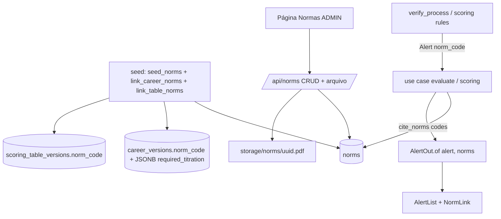

# Base de normas e regras de elegibilidade (normativo) Design

**Spec**: `.specs/features/normativo/spec.md`
**Status**: Approved

---

## Architecture Overview

A norma vira entidade própria (`norms`), cadastrada pelo ADMIN e semeada com as sete fontes de `FONTES.md`. As regras que já existem passam a guardar um **código de norma** (`norm_code`), sem chave estrangeira, ao lado do texto atual de `norm_reference` (artigo). O alerta do domínio ganha `norm_code`. O caso de uso resolve os códigos dos alertas numa só consulta (`cite_norms`) e devolve o mapa ao schema, que monta `norm_title`, `norm_url`, `norm_file_url` e `norm_archived`. A titulação é um campo opcional por classe na definição JSONB da versão de carreira, conferido em `verify_process`. A ligação dos dados que já estão na VM é feita pelo seed, idempotente e auditado (como na AD-023); a migração `0010` só muda o esquema.



---

## Code Reuse Analysis

### Existing Components to Leverage

| Component | Location | How to Use |
| --------- | -------- | ---------- |
| `Alert` e `verify_process` | `backend/app/domain/rules/process_verification.py:43-48`, `_structure_alerts` | Acrescentar `norm_code: str \| None = None` (o padrão mantém as ~20 construções); inserir `TITULACAO_INSUFICIENTE` |
| `select_version` | `backend/app/domain/entities/career.py:55-57` | Escolhe a estrutura pela data final; a titulação usa a mesma versão (Edge Case do cruzamento de 01/01/2025) |
| Versão otimista | `repositories.py:114-143` (`_versioned_update`), `use_cases/professors.py:128-174` | Mesmo padrão para `UpdateNorm`, `ArchiveNorm`, `AttachNormFile` |
| CRUD só ADMIN com arquivamento | `use_cases/units.py`, `api/units.py` | `require_admin`, `AuditAction.ARCHIVE` |
| Auditoria | `application/services/audit_service.py:43-53` | Eventos de cadastro, edição, anexo, arquivamento e das ligações do seed (`actor=None`) |
| Upload e validação | `api/documents.py:43-59` (`_stage`), `domain/rules/upload_validation.py:37-38`, `use_cases/documents.py:596-649` (troca de arquivo) | PDF até 20 MB; grava o novo, confirma, apaga o antigo |
| Download seguro | `api/documents.py:111-126` | `FileResponse` com `nosniff` e `CSP sandbox` |
| Seed idempotente | `infrastructure/database/seed.py:55-62, 148-180` | `seed_norms` e passos de ligação no mesmo arquivo, depois das inserções existentes |
| Página de ADMIN | `frontend/src/pages/ScoringAdmin.tsx`, `components/ScoringAdminForms.tsx:161` (`FormData`) | Modelo da página "Normas" |
| Lista de alertas | `frontend/src/components/AlertList.tsx:22` | Único lugar que mostra a referência: recebe o `NormLink` |

### Integration Points

| System | Integration Method |
| ------ | ------------------ |
| Verificação do processo | `processes.evaluate` (`use_cases/processes.py:71-86`) passa `professor.titration` a `verify_process` e resolve as normas dos alertas |
| Escolha de tabela e pontuação | `scoring.py:144,148,880` resolvem as normas dos alertas do estado da tabela e da pontuação |
| Mínimo | `scoring_verification.py:78-87` (`MINIMO_NAO_DEFINIDO`) recebe `norm_code="RES-4644-2015-CONSEPE"`; `MinimumOut` ganha `norm` para o `PanelHeadline` |
| API de carreira | `schemas/career.py:10-24`, `career_definition`, `_audit_view` (`use_cases/career.py:31-47`) passam a ler e gravar `norm_code`, `required_titration` e `required_titration_norm_code` |
| Banco | Migração `0010_norms`: tabela `norms`, enum `norm_kind`, colunas `career_versions.norm_code` e `scoring_table_versions.norm_code` |

---

## Components

### Entidade e regras de domínio

- **Purpose**: Norma e citação puras; ordem das titulações; regra de titulação.
- **Location**: `backend/app/domain/entities/norm.py` (novo), `domain/entities/professor.py`, `domain/entities/career.py`, `domain/rules/process_verification.py`, `domain/rules/norm_rules.py` (novo, validação de campos)
- **Interfaces**:
  - `Norm(id, code, title, kind: NormKind, issuer, published_on, valid_from, valid_to, source_url, file: NormFile | None, notes, archived, version)`
  - `NormCitation(code, title, source_url, has_file, archived, id)`
  - `validate_norm(fields) -> list[FieldError]` — NBASE-02/03/04 (código `^[A-Z0-9][A-Z0-9-]{1,49}$`, URL `http(s)://`, vigência)
  - `TITRATION_ORDER: tuple[Titration, ...]` em `professor.py`
  - `CareerClass.required_titration: Titration | None = None`; `CareerVersion.norm_code: str | None = None`; `CareerVersion.required_titration_norm_code: str | None = None`
  - `verify_process(p, versions, titration: Titration | None = None) -> list[Alert]` — com a classe pretendida ≠ atual, `required_titration` definido e titulação menor: `Alert(TITULACAO_INSUFICIENTE, ALERTA, "A classe C (Associado) exige doutorado; a titulação cadastrada do docente é mestrado.", "Manual do Servidor da PROGEP, progressão e promoção", "MANUAL-PROGEP-PROGRESSAO")`
- **Dependencies**: nenhuma fora do domínio (AD-001)
- **Reuses**: `Alert`, `Severity`, `select_version`

### Origem e destino informados (NMOV)

- **Location**: `backend/app/domain/rules/process_verification.py` (`_structure_alerts`, linhas 125-146, e `verify_process`, linhas 210-220)
- **Mudança**: os dois `MODALIDADE_INCOMPATIVEL` passam de `Severity.ERRO` para `Severity.ALERTA`, com os textos de NMOV-02 (promoção) e NMOV-03 (progressão). A condição não muda: a sequência usual continua sendo a referência do aviso.
- **Sem dedução**: nenhum caminho novo calcula a classe seguinte, a denominação ou o nível; `version.next_class` só alimenta o aviso. Documentos gerados (feature `banca-parecer`) leem os seis campos do processo.
- **Denominações**: continuam na definição JSONB da versão de carreira, editáveis pelo ADMIN na rota atual; `DENOMINACAO_DIVERGENTE` já lê a versão a cada verificação (NMOV-05 é coberto por teste, sem código novo).
- **Testes afetados**: os testes que esperam `ERRO` em `MODALIDADE_INCOMPATIVEL` passam a esperar `ALERTA`, por causa da mudança de requisito (NMOV-02/03), não para acomodar a implementação.

### Tabela de citação dos alertas existentes

Um código por alerta (NLINK-03), pela origem da regra:

| Alerta / origem | `norm_code` |
| --------------- | ----------- |
| Alertas que vêm da estrutura de carreira (interstício, classe, nível, denominação) | `version.norm_code` da estrutura aplicável |
| Conclusão do interstício, dados incompletos, sem estrutura aplicável | `RES-4644-2015-CONSEPE` |
| Reestruturação (cruza 01/01/2025), modalidade | `LEI-12772-2012` |
| Escolha da tabela e linhas de pontuação (`scoring_table_choice.py`, `scoring_engine.py:115`) | `version.norm_code` da tabela |
| `TABELA_NAO_ENCONTRADA` | `TABELA-OFICIAL-UFPA` |
| Mínimo (`MINIMO_NAO_DEFINIDO`, comparação) | `RES-4644-2015-CONSEPE` |
| Extensão e pesquisa (`REF_EXTENSION_RESEARCH`) | `RES-4644-2015-CONSEPE` |
| `TITULACAO_INSUFICIENTE` | `version.required_titration_norm_code` |

O texto de `norm_reference` continua como está (cita o artigo e, quando já cita, as duas normas).

### Casos de uso de normas

- **Purpose**: CRUD só ADMIN, leitura para todos, arquivo.
- **Location**: `backend/app/application/use_cases/norms.py` (novo), `application/services/norm_citations.py` (novo)
- **Interfaces**:
  - `ListNorms.execute(actor, include_archived: bool) -> list[NormWithLinks]` — com as regras ligadas (estruturas, versões de tabela, regras de titulação) para NLIST-01
  - `CreateNorm.execute(actor, fields) -> Norm` — 403 fora do ADMIN; 422 com campo (inclui código repetido, conferido antes de inserir)
  - `UpdateNorm.execute(actor, norm_id, fields, expected_version) -> Norm` — o código não muda; 409 em versão velha; auditoria com valores anteriores
  - `ArchiveNorm.execute(actor, norm_id, expected_version) -> Norm`
  - `AttachNormFile.execute(actor, norm_id, staged_file, expected_version) -> Norm` — PDF até 20 MB; troca segura do arquivo
  - `DownloadNormFile.execute(actor, norm_id) -> (path, original_name)` — qualquer autenticado; 404 sem arquivo
  - `cite_norms(uow, codes: Iterable[str]) -> Mapping[str, NormCitation]` — uma consulta; código ausente gera `logger.warning("norma não cadastrada: %s", code)` e fica fora do mapa (NLINK-05)
- **Dependencies**: `uow.norms` (porta nova `NormRepository`), `NormFileStorage` (porta nova), `AuditService`
- **Reuses**: padrões de `professors.py` e `units.py`

### Persistência e seed

- **Purpose**: tabela, repositório, armazenamento e semeadura.
- **Location**: `infrastructure/database/models.py`, `repositories.py` (`SqlNormRepository`; `SqlCareerVersionRepository.set_links`; `norm_code` nos mapeamentos de versão de tabela em `:629,674,711`), `infrastructure/storage/norm_storage.py` (novo, `{storage_dir}/norms/{uuid}.pdf`, diretório 0700, arquivo 0600, nome interno por regex), `alembic/versions/0010_norms.py`, `seed.py`, `seed_data/norms.json` (novo), `seed_data/ufpa.json` (`"norm_code": "TABELA-OFICIAL-UFPA"`), `domain/rules/career_catalog.py`
- **Interfaces**:
  - `seed_norms(uow)` — insere as sete normas cujo código não existe (NBASE-11/12), sem auditoria quando nada muda
  - `link_career_norms(uow)` — casa a versão de carreira pelo nome do catálogo e preenche `norm_code`, `required_titration` (C e D = `DOUTORADO` na estrutura nova) e `required_titration_norm_code` só onde estão nulos, por `set_links` (contorna a trava de versão em uso, que vale para a edição pela API), com auditoria `UPDATE` e `actor=None`
  - `link_table_norms(uow)` — preenche `norm_code = "TABELA-OFICIAL-UFPA"` nas versões da tabela "Tabela de Pontuação da UFPA" com `norm_code` nulo, com auditoria
  - Ordem na partida: inserções atuais → `seed_norms` → `link_career_norms` → `link_table_norms` → `AdoptSupersedingVersion` (atual)
- **Reuses**: `ensure_structure`, `seed_scoring_tables`, `_insert`, `_versioned_update`

### API

- **Location**: `presentation/api/norms.py` (novo), `presentation/schemas/norms.py` (novo), `schemas/processes.py`, `schemas/scoring.py`, `schemas/career.py`, `main.py`, `dependencies.py`
- **Interfaces**:
  - `GET /api/norms?include_archived=false` → `list[NormOut]` (com `linked_rules`)
  - `GET /api/norms/{id}` → `NormOut`
  - `POST /api/norms` (ADMIN) → 201 `NormOut`
  - `PUT /api/norms/{id}` (ADMIN, `expected_version`) → `NormOut`
  - `POST /api/norms/{id}/archive` (ADMIN, `expected_version`) → `NormOut`
  - `PUT /api/norms/{id}/file` (ADMIN, multipart, `expected_version`) → `NormOut`
  - `GET /api/norms/{id}/file` (autenticado) → PDF
  - `AlertOut.of(alert, norms)` ganha `norm_code`, `norm_title`, `norm_url`, `norm_file_url`, `norm_archived` (NLINK-06); o inline de `ProcessOut.of` (`schemas/processes.py:110-118`) passa a usar `.of`
  - `MinimumOut.norm: NormRefOut | None` (NMIN-02); `VersionRefOut.norm_code`
- **Reuses**: `errors.py` (409 de `StaleVersion`), `_stage`, `FileResponse` seguro

### Frontend

- **Location**: `frontend/src/components/NormLink.tsx` (novo), `AlertList.tsx`, `PanelHeadline.tsx`, `pages/Norms.tsx` (novo), `components/NormForms.tsx` (novo), `Layout.tsx`, `App.tsx`, `api/types.ts`, `labels.ts`
- **Interfaces**:
  - `NormLink({title, url, fileUrl, archived})` — link "Ver norma" para o arquivo, senão a URL, senão só o título; acrescenta "(arquivada)" (NLINK-04, NBASE-08)
  - `AlertList` mostra título da norma + `norm_reference` + `NormLink`; sem norma, só o texto, como hoje (NLINK-05)
  - `PanelHeadline` com mínimo não definido: "Mínimo não definido: a Res. 4.644/2015, art. 12, fixa mínimos só para as classes da estrutura antiga" + `NormLink` (NMIN-02)
  - Página "Normas" (rota `/normas`, menu para todos): tabela com título, tipo, órgão, publicação, vigência, link, regras ligadas; filtro "Mostrar arquivadas"; botões Cadastrar, Editar, Anexar PDF, Arquivar só para ADMIN (NLIST-01..03)
  - `labels.ts`: `TITULACAO_INSUFICIENTE`, `NORM_KIND_LABELS`
- **Reuses**: `ScoringAdmin.tsx`, `ScoringAdminForms.tsx`, `request` com `FormData` (`api/client.ts:26-31`), link de arquivo com cookie (`DocumentViewer.tsx:17`)

---

## Data Models

### `norms` (migração `0010_norms`, só esquema)

```python
class NormKind(StrEnum):  # enum Postgres norm_kind
    LEI = "LEI"; RESOLUCAO = "RESOLUCAO"; INSTRUCAO_NORMATIVA = "INSTRUCAO_NORMATIVA"
    MANUAL = "MANUAL"; TABELA = "TABELA"; OUTRO = "OUTRO"

# norms
id UUID PK
code VARCHAR(50) UNIQUE NOT NULL          # LEI-12772-2012
title VARCHAR(500) NOT NULL
kind norm_kind NOT NULL
issuer VARCHAR(255) NOT NULL
published_on DATE NOT NULL
valid_from DATE NULL
valid_to DATE NULL                         # CHECK valid_to >= valid_from quando ambos existem
source_url TEXT NULL
file_internal_name VARCHAR(64) NULL
file_original_name VARCHAR(255) NULL
file_size_bytes INTEGER NULL
file_sha256 CHAR(64) NULL
notes TEXT NULL
archived BOOLEAN NOT NULL DEFAULT false
version INTEGER NOT NULL DEFAULT 1
created_at TIMESTAMPTZ NOT NULL DEFAULT now()
```

Mais `career_versions.norm_code VARCHAR(50) NULL` e `scoring_table_versions.norm_code VARCHAR(50) NULL`. Sem chave estrangeira para `norms.code`. O `downgrade` remove a tabela, o enum e as duas colunas.

### JSONB da versão de carreira

```json
{"classes": [{"code": "C", "denominations": ["Associado"], "levels": [1,2,3,4],
              "min_months": 24, "required_titration": "DOUTORADO"}],
 "required_titration_norm_code": "MANUAL-PROGEP-PROGRESSAO"}
```

Chaves opcionais lidas com `.get`: as linhas atuais continuam válidas.

### Normas semeadas (`seed_data/norms.json`)

| Código | Título | Tipo | Órgão | URL |
| ------ | ------ | ---- | ----- | --- |
| `LEI-12772-2012` | Lei nº 12.772/2012 (texto compilado, com as Leis 15.141/2025 e 15.367/2026) | LEI | Presidência da República | planalto (FONTES.md) |
| `RES-4644-2015-CONSEPE` | Resolução nº 4.644/2015-CONSEPE | RESOLUCAO | CONSEPE/UFPA | sege.ufpa.br (FONTES.md) |
| `RES-4074-2010-CONSEPE` | Resolução nº 4.074/2010-CONSEPE (Planos Acadêmicos) | RESOLUCAO | CONSEPE/UFPA | ppga.propesp (FONTES.md) |
| `IN-01-2026-IFCH` | Instrução Normativa nº 1/2026-IFCH | INSTRUCAO_NORMATIVA | IFCH/UFPA | ifch.ufpa.br (FONTES.md) |
| `MANUAL-PROGEP-PROGRESSAO` | Manual do Servidor: Progressão, promoção e revisão (Magistério Superior e EBTT) | MANUAL | PROGEP/UFPA | progep.ufpa.br (FONTES.md) |
| `CORRELACAO-PROGEP-2025` | Tabela de correlação do Magistério Superior (jan/2025) | TABELA | PROGEP/UFPA | progep.ufpa.br (FONTES.md) |
| `TABELA-OFICIAL-UFPA` | Tabela oficial de pontuação para progressão docente da UFPA | TABELA | UFPA | sem URL |

As datas de publicação vêm de `FONTES.md` e dos títulos (ano); onde a fonte não diz o dia, o seed usa 1º de janeiro do ano e a observação registra "data de publicação aproximada pelo ano". A tarefa de seed confere cada data contra `FONTES.md`.

---

## Error Handling Strategy

| Error Scenario | Handling | User Impact |
| -------------- | -------- | ----------- |
| Campo obrigatório ausente, código repetido, URL ou vigência inválida | `CreateNorm`/`UpdateNorm` validam antes de gravar → 422 com `field` | Mensagem no campo do formulário |
| Arquivo não PDF ou acima de 20 MB | `validate_upload` → 422 | Mensagem com o limite |
| Edição concorrente | `StaleVersion` → 409 | "A norma foi alterada por outra pessoa; recarregue" |
| Não ADMIN escrevendo | `require_admin` → 403 | Botões não aparecem; API recusa |
| Código ligado inexistente | `cite_norms` omite e registra aviso no log | Alerta só com o texto (NLINK-05) |
| Falha ao gravar o arquivo | Arquivo novo apagado; registro não muda | Erro 500 genérico, arquivo anterior intacto |

---

## Risks & Concerns

| Concern | Location (file:line) | Impact | Mitigation |
| ------- | -------------------- | ------ | ---------- |
| `PUT` de versão de carreira sem os campos novos apagaria `norm_code` e `required_titration` | `backend/app/presentation/schemas/career.py:10-24`, `use_cases/career.py:31-47` | Perda silenciosa da ligação | Campos novos em `CareerVersionIn`/`CareerClassIn`, `career_definition` e `_audit_view`, com teste de ida e volta |
| Seed só insere pelo nome; VM ficaria com tudo nulo | `backend/app/infrastructure/database/seed.py:58-62, 173-175` | Alertas sem norma na VM | `link_career_norms` e `link_table_norms` idempotentes, auditados, testados numa base com versões antigas já em uso |
| `ProcessSnapshot` montado por `getattr` de cada campo | `backend/app/application/use_cases/processes.py:76-78` | Campo novo no snapshot quebraria a montagem | Titulação passa como parâmetro de `verify_process`, não no snapshot |
| `test_seed.py` compara versões semeadas com o catálogo por igualdade | `backend/tests/integration/test_seed.py:42-51` | Teste falha quando o catálogo ganha campos | Atualizar o teste para os campos novos na mesma tarefa |
| Montagem de `AlertOut` duplicada | `backend/app/presentation/schemas/processes.py:110-118` | Um dos caminhos ficaria sem norma | Trocar o inline por `AlertOut.of` |
| `reference_minimum` decide pelo prefixo do nome | `backend/app/domain/rules/scoring_verification.py:20,51` | Frágil, mas fora do escopo | Mantido; registrado como dívida no `STATE.md` |
| `AlertList` sem teste próprio | `frontend/src/components/AlertList.tsx` | Mudança sem rede | Teste de componente novo (com e sem norma, arquivada, arquivo × URL) |
| URL da Res. 4.644 em `FONTES.md` é uma pasta, não o PDF | `docs/referencias/normas/FONTES.md:7` | Link pouco útil | Semeada como está; o ADMIN anexa o PDF público depois |
| Documentos gerados guardam só `norm_reference` | `backend/app/application/services/generation_snapshot.py:49` | Nenhum (AD-012) | Documentos já gerados não mudam; nada a fazer |

---

## Tech Decisions

| Decision | Choice | Rationale |
| -------- | ------ | --------- |
| Referência à norma | `norm_code` texto, sem chave estrangeira | Permite migrar antes do seed e tratar código inexistente como "sem norma" (Edge Case) |
| Um código por alerta | Tabela de citação acima | O alerta tem uma fonte principal; o texto continua citando as duas quando cita |
| Norma da titulação | `required_titration_norm_code` na definição da versão | A estrutura nova aponta a Lei 12.772, mas a titulação vem do Manual da PROGEP |
| Ligação dos dados da VM | Seed idempotente e auditado; migração `0010` só de esquema | Mesmo caminho da AD-023; reversível pelo dump |
| Resolver citações | Mapa `norms` no resultado do caso de uso; `AlertOut.of(alert, norms)` | Uma consulta por leitura; domínio sem infraestrutura |
| PDFs públicos de `docs/referencias/normas/` | Não anexados pelo seed | Spec: "sem arquivo anexado"; o ADMIN anexa |
| Tabelas legadas arquivadas (IFCH, FASI) | Ficam sem `norm_code` | A spec não as cita; não são usadas |

Decisão de projeto para o `STATE.md` (AD-024, ao executar): regras institucionais passam a citar a norma por `norm_code` resolvido na base `norms`, além do texto de `norm_reference`; norma nunca é excluída.
