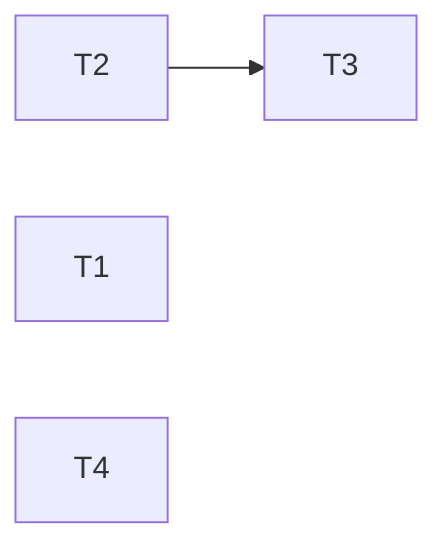
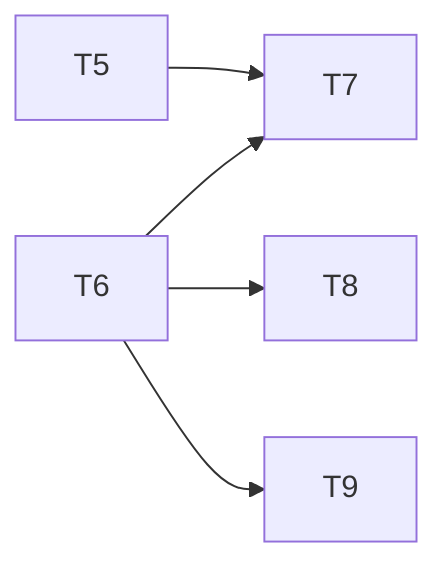
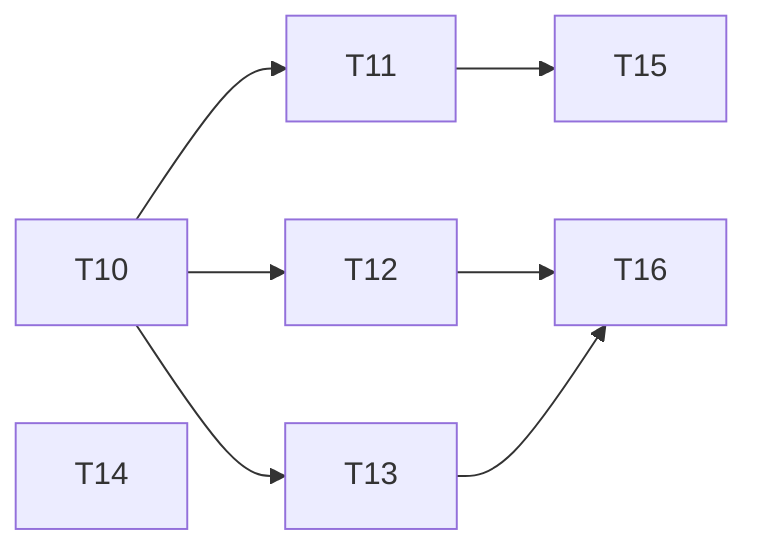
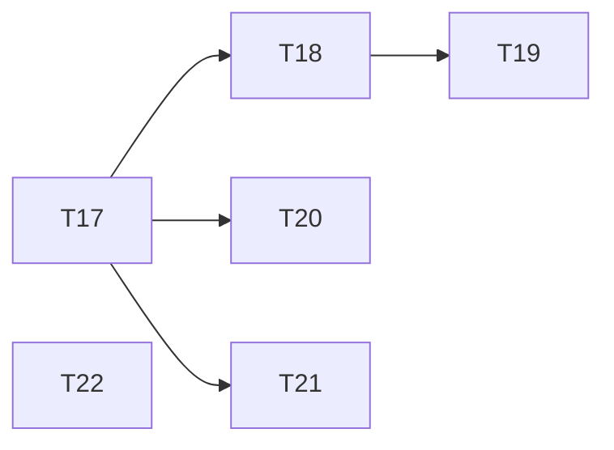
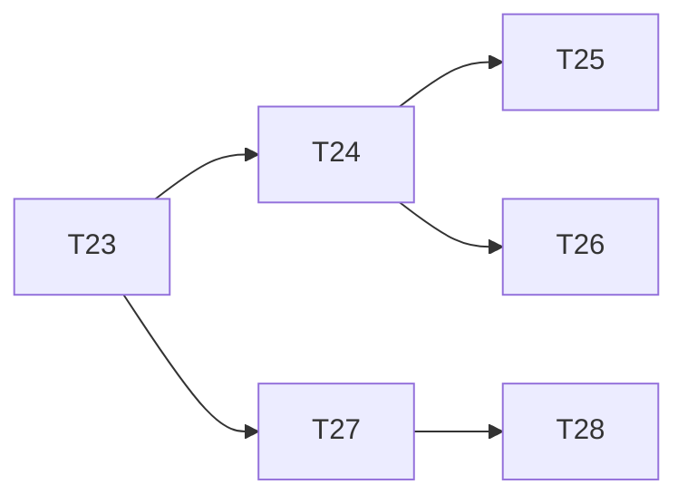
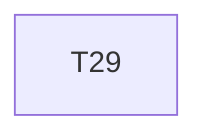
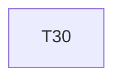

# Base de normas e regras de elegibilidade (normativo) Tasks

## Execution Protocol (MANDATORY -- do not skip)

Implement these tasks with the `tlc-spec-driven` skill: **activate it by name and follow its Execute flow and Critical Rules.** Do not search for skill files by filesystem path. The skill is the source of truth for the full flow (per-task cycle, sub-agent delegation, adequacy review, Verifier, discrimination sensor).

**If the skill cannot be activated, STOP and tell the user - do not proceed without it.**

---

**Design**: `.specs/features/normativo/design.md`
**Spec**: `.specs/features/normativo/spec.md`
**Status**: Approved (usuário, 2026-11-22: "Sim"; 4 lotes por sub-agente + Verifier)

Regras de execução desta feature:

- Cada tarefa escreve primeiro os testes que derivam dos critérios de aceitação da spec e só então o código (os itens `Done when` começam pelo teste). Teste existente que muda por causa de requisito novo é listado na tarefa com o requisito que justifica a mudança; nenhum teste é apagado sem substituto nem enfraquecido.
- Só dados sintéticos; `Documentos/`, `Modelos/`, `requeriment.txt`, `test/` e `corpus-reports/` nunca são abertos. Os PDFs de teste são gerados no próprio teste.
- Um commit por tarefa (Conventional Commits, terminando com `Co-Authored-By: Claude Sonnet 5.5 <noreply@anthropic.com>`), marcando a tarefa neste arquivo e a rastreabilidade da spec no mesmo commit.
- Sem push, deploy nem acesso à VM sem autorização explícita. A migração `0010` e as ligações do seed chegam à VM só no deploy autorizado, com dump antes.
- Classe, denominação e nível do processo são sempre os informados pelo servidor (NMOV-01): nenhuma tarefa deduz a classe seguinte, a denominação ou o nível.
- Documentos já gerados não mudam (AD-012).

---

## Test Coverage Matrix

> Generated from project guidelines, spec, design and the existing suites. Guidelines found: `CLAUDE.md` (regras 1 a 11, gate), AD-001 (teste de arquitetura: domínio sem FastAPI nem SQLAlchemy), AD-002 (regras como dados, alertas não bloqueiam), AD-004 (integração em PostgreSQL real), AD-012, AD-023. Existing tests sampled: `backend/tests/unit/domain/test_process_verification.py`, `test_career.py`, `test_career_catalog.py`, `backend/tests/integration/test_seed.py`, `test_migration_version_superseded.py`, `backend/tests/integration/api/test_career_api.py`, `test_units_api.py`, `test_processes_api.py`, `frontend/src/components/PanelHeadline.test.tsx`, `frontend/src/pages/ScoringAdmin.test.tsx`.

| Code Layer | Required Test Type | Coverage Expectation | Location Pattern | Run Command |
| --- | --- | --- | --- | --- |
| Domain (entities, rules) | unit | All branches; 1:1 to spec ACs (NBASE-02..04, NTIT-01..08, NMOV-01..05, citações da NLINK-03); every edge case of the spec (código inexistente, titulação ausente, cruzamento de 01/01/2025) | `backend/tests/unit/domain/test_*.py` | `cd backend && .venv/bin/pytest tests/unit tests/architecture -q` |
| Storage (infrastructure/storage) | unit | Caminho interno por regex, permissões 0700/0600, troca e remoção do arquivo, recusa de nome fora do padrão | `backend/tests/unit/infrastructure/test_*.py` | `cd backend && .venv/bin/pytest tests/unit -q` |
| Use cases + services | integration | Happy + every listed edge case + error paths (403, 409, 422 por campo, 404 sem arquivo); auditoria de cada escrita; `cite_norms` com código ausente e aviso no log | `backend/tests/integration/**/test_*.py` | `cd backend && .venv/bin/pytest tests/integration -q` |
| API routes and schemas | integration | Todas as rotas `/api/norms` (happy + 403 + 409 + 422 + 404); campos de norma nos alertas de processo e de pontuação; ida e volta da estrutura de carreira sem perder os campos novos | `backend/tests/integration/api/test_*.py`, `backend/tests/unit/presentation/test_*.py` | `cd backend && .venv/bin/pytest tests/integration/api tests/unit/presentation -q` |
| Repositories / migrations / seed | integration | `upgrade` e `downgrade` da `0010`; mapeamento de `norm_code` e dos campos JSONB; seed idempotente numa base vazia e numa base com as versões antigas já em uso (ligação só onde é nulo, auditoria uma vez) | `backend/tests/integration/test_*.py` | `cd backend && .venv/bin/pytest tests/integration -q` |
| Frontend components/pages | unit | Cada NLINK-03..05, NLIST-01..03, NMIN-02: render + interação + estados (com e sem norma, arquivada, arquivo × URL × só título, ADMIN × DOCENTE), API simulada | `frontend/src/**/*.test.tsx` | `cd frontend && npm test -- --run` |
| Types / docs | none | build gate only | - | build gate only |

## Gate Check Commands

| Gate Level | When to Use | Command |
| --- | --- | --- |
| Quick | Tarefas só com testes unitários de backend | `cd backend && .venv/bin/ruff check . && .venv/bin/pytest tests/unit tests/architecture -q` |
| Full | Tarefas com testes de integração de backend | `cd backend && .venv/bin/ruff check . && .venv/bin/pytest -q` |
| Front | Tarefas de frontend | `cd frontend && npm run lint && npm run build && npm test -- --run` |
| Build | Fim de fase, tipos, documentação e verificação | `cd backend && .venv/bin/ruff check . && .venv/bin/pytest -q && cd ../frontend && npm run lint && npm run build && npm test -- --run` |

---

## Execution Plan

Phases are ordered and run sequentially - each phase completes before the next begins, and tasks within a phase execute in order. A tarefa que depende de fase anterior lista a dependência em `Depends on`; o diagrama de cada fase mostra só as dependências da própria fase.

Lotes de execução (fases inteiras, ~7 tarefas cada; uma fase nunca é dividida entre workers): **Lote 1** = Fases 1 e 2 (9 tarefas, todas de domínio e curtas); **Lote 2** = Fase 3 (7); **Lote 3** = Fase 4 (6); **Lote 4** = Fases 5 e 6 (7); a Fase 7 (Verifier) roda sozinha, por agente diferente do autor.

### Phase 1: Origem e destino, entidade da norma

### Phase 2: Carreira, titulação e citações no domínio

### Phase 3: Persistência, armazenamento e seed

### Phase 4: Casos de uso e API

### Phase 5: Frontend

### Phase 6: Documentação

### Phase 7: Verificação independente

---

## Task Breakdown

### Phase 1: Origem e destino, entidade da norma

#### T1: Salto na carreira vira `ALERTA` com o texto da sequência usual

**Status**: Done

**What**: Os dois `MODALIDADE_INCOMPATIVEL` (promoção em `_structure_alerts`, progressão em `verify_process`) passam de `Severity.ERRO` para `Severity.ALERTA`, com os textos exatos de NMOV-02 e NMOV-03; a condição não muda e nada deduz classe, denominação ou nível.
**Where**: `backend/app/domain/rules/process_verification.py` (modify)
**Depends on**: None
**Reuses**: `_structure_alerts`, `version.next_class` (só para o aviso)
**Requirement**: NMOV-01, NMOV-02, NMOV-03, NMOV-04

**Tools**:

- MCP: NONE
- Skill: NONE

**Done when**:

- [x] Testes primeiro em `backend/tests/unit/domain/test_process_verification.py`: promoção sintética A1→C1 na estrutura da Lei 15.141 dá `MODALIDADE_INCOMPATIVEL` `ALERTA` com o texto exato de NMOV-02; progressão C1→C3 e progressão B4→C1 dão `ALERTA` com o texto exato de NMOV-03; promoção B4→C1 e progressão C1→C2 não dão alerta de modalidade; nenhum alerta do processo com salto tem severidade `ERRO` por modalidade (NMOV-04)
- [x] Os testes existentes que esperam `ERRO` em `MODALIDADE_INCOMPATIVEL` (`test_process_verification.py`, `tests/integration/api/test_processes_api.py`, `test_process_updates_api.py`) passam a esperar `ALERTA` e o texto novo, citando NMOV-02/03 no commit
- [x] Teste de integração: processo com salto é criado, editado e iniciado (`EM_ANDAMENTO`) sem recusa (NMOV-04)
- [x] Gate check passes: `cd backend && .venv/bin/ruff check . && .venv/bin/pytest -q`
- [x] Test count: contagem antes e depois registrada; nenhum teste apagado

**Tests**: unit
**Gate**: full

**Commit**: `fix(verification): report a career jump as an alert, not an error`

---

#### T2: Entidade `Norm`

**Status**: Done

**What**: `NormKind` (`LEI`, `RESOLUCAO`, `INSTRUCAO_NORMATIVA`, `MANUAL`, `TABELA`, `OUTRO`), `NormFile(internal_name, original_name, size_bytes, sha256)`, `Norm(id, code, title, kind, issuer, published_on, valid_from, valid_to, source_url, file, notes, archived, version)` e `NormCitation(id, code, title, source_url, has_file, archived)` com o método `Norm.citation()`.
**Where**: `backend/app/domain/entities/norm.py` (new)
**Depends on**: None
**Reuses**: padrão de `domain/entities/academic_unit.py` (dataclass com `version`)
**Requirement**: NBASE-01, NBASE-08, NLINK-06

**Tools**:

- MCP: NONE
- Skill: NONE

**Done when**:

- [x] Testes primeiro em `backend/tests/unit/domain/test_norm.py`: `citation()` copia código, título, URL e `archived`, e `has_file` é verdadeiro só com `file`; os seis valores de `NormKind`
- [x] Teste de arquitetura passa
- [x] Gate check passes: `cd backend && .venv/bin/ruff check . && .venv/bin/pytest tests/unit tests/architecture -q`
- [x] Test count: os testes novos passam e nenhum teste existente foi apagado

**Tests**: unit
**Gate**: quick

**Commit**: `feat(domain): add the norm entity`

---

#### T3: Validação dos campos da norma

**Status**: Done

**What**: `validate_norm(fields) -> list[FieldError]`: código obrigatório no padrão `^[A-Z0-9][A-Z0-9-]{1,49}$`; título (até 500), tipo, órgão (até 255) e data de publicação obrigatórios; fim da vigência não anterior ao início; URL que começa com `https://` ou `http://`; observação até 5 000.
**Where**: `backend/app/domain/rules/norm_rules.py` (new)
**Depends on**: T2
**Reuses**: `FieldError` já usado nas validações de domínio (`domain/rules/upload_validation.py` e casos de uso de docente)
**Requirement**: NBASE-02, NBASE-03, NBASE-04

**Tools**:

- MCP: NONE
- Skill: NONE

**Done when**:

- [x] Testes primeiro em `backend/tests/unit/domain/test_norm_rules.py`: cada campo obrigatório ausente dá erro no campo certo; código em minúscula, com espaço ou com 51 caracteres é recusado e com 50 passa; fim igual ao início passa e um dia antes é recusado no campo do fim; `ftp://` e `www.` são recusados no campo da URL, `http://` e `https://` passam; URL vazia passa (é opcional)
- [x] Gate check passes: `cd backend && .venv/bin/ruff check . && .venv/bin/pytest tests/unit tests/architecture -q`
- [x] Test count: os testes novos passam e nenhum teste existente foi apagado

**Tests**: unit
**Gate**: quick

**Commit**: `feat(domain): validate the fields of a norm`

---

#### T4: Ordem das titulações

**Status**: Done

**What**: `TITRATION_ORDER = (GRADUACAO, ESPECIALIZACAO, MESTRADO, DOUTORADO)` e `titration_at_least(actual, required) -> bool`.
**Where**: `backend/app/domain/entities/professor.py` (modify)
**Depends on**: None
**Reuses**: enum `Titration` do mesmo arquivo
**Requirement**: NTIT-01, NTIT-03

**Tools**:

- MCP: NONE
- Skill: NONE

**Done when**:

- [x] Testes primeiro em `backend/tests/unit/domain/test_titration_order.py`: a ordem dos quatro valores; mestrado não atinge doutorado; doutorado atinge doutorado e mestrado; todo valor de `Titration` está na ordem (um valor novo sem lugar faz o teste falhar)
- [x] Gate check passes: `cd backend && .venv/bin/ruff check . && .venv/bin/pytest tests/unit tests/architecture -q`
- [x] Test count: os testes novos passam e nenhum teste existente foi apagado

**Tests**: unit
**Gate**: quick

**Commit**: `feat(domain): order the titrations`

---

### Phase 2: Carreira, titulação e citações no domínio

#### T5: Campos de norma e titulação na estrutura de carreira

**Status**: Pending

**What**: `CareerClass.required_titration: Titration | None = None`, `CareerVersion.norm_code: str | None = None` e `CareerVersion.required_titration_norm_code: str | None = None`, todos com padrão, para as construções atuais continuarem válidas.
**Where**: `backend/app/domain/entities/career.py` (modify)
**Depends on**: T4
**Reuses**: `CareerClass`, `CareerVersion`
**Requirement**: NLINK-01, NTIT-05

**Tools**:

- MCP: NONE
- Skill: NONE

**Done when**:

- [ ] Testes primeiro em `backend/tests/unit/domain/test_career.py`: versão e classe sem os campos novos têm `None`; com eles, os valores ficam guardados; `get_class` e `next_class` não mudam
- [ ] `test_career_catalog.py` passa sem mudança
- [ ] Gate check passes: `cd backend && .venv/bin/ruff check . && .venv/bin/pytest tests/unit tests/architecture -q`
- [ ] Test count: os testes novos passam e nenhum teste existente foi apagado

**Tests**: unit
**Gate**: quick

**Commit**: `feat(domain): add the norm code and the required titration to a career version`

---

#### T6: `Alert.norm_code` e citação dos alertas da verificação do processo

**Status**: Pending

**What**: `Alert` ganha `norm_code: str | None = None`; cada alerta de `process_verification.py` recebe o código da tabela de citação do design: os que vêm da estrutura usam `version.norm_code`; conclusão do interstício, dados incompletos e sem estrutura usam `RES-4644-2015-CONSEPE`; reestruturação e modalidade usam `LEI-12772-2012`. O texto de `norm_reference` não muda.
**Where**: `backend/app/domain/rules/process_verification.py` (modify)
**Depends on**: T1
**Reuses**: constantes `REF_*` do mesmo arquivo
**Requirement**: NLINK-01, NLINK-03, NLINK-06

**Tools**:

- MCP: NONE
- Skill: NONE

**Done when**:

- [ ] Testes primeiro em `backend/tests/unit/domain/test_process_verification_citations.py` (novo): um cenário sintético por alerta (`CLASSE_INEXISTENTE_NA_ESTRUTURA`, `DENOMINACAO_DIVERGENTE`, `INTERSTICIO_INSUFICIENTE` com a estrutura ligada a um código sintético; `INTERSTICIO_NAO_CONCLUIDO`, `DADOS_INCOMPLETOS`, `ESTRUTURA_NAO_CADASTRADA` com `RES-4644-2015-CONSEPE`; `INTERSTICIO_CRUZA_REESTRUTURACAO` e os dois `MODALIDADE_INCOMPATIVEL` com `LEI-12772-2012`); estrutura sem `norm_code` dá alerta com `norm_code` nulo e o mesmo `norm_reference` de hoje
- [ ] Teste de NMOV-05: a mesma verificação com a classe C da versão trocando "Associado" por uma denominação sintética passa a dar `DENOMINACAO_DIVERGENTE` para o processo que informou "Associado", sem alterar o processo
- [ ] Gate check passes: `cd backend && .venv/bin/ruff check . && .venv/bin/pytest tests/unit tests/architecture -q`
- [ ] Test count: os testes novos passam e nenhum teste existente foi apagado

**Tests**: unit
**Gate**: quick

**Commit**: `feat(verification): cite a norm code in each process alert`

---

#### T7: Alerta `TITULACAO_INSUFICIENTE`

**Status**: Pending

**What**: `verify_process(p, versions, titration: Titration | None = None)`; com a classe pretendida diferente da atual, a classe pretendida com `required_titration` na estrutura escolhida por `select_version` e `titration` abaixo dela, emite `Alert(TITULACAO_INSUFICIENTE, ALERTA, "A classe <X> exige <titulação>; a titulação cadastrada do docente é <titulação>.", <norm_reference da regra>, version.required_titration_norm_code)`; os nomes das titulações em minúscula por extenso ("doutorado", "mestrado").
**Where**: `backend/app/domain/rules/process_verification.py` (modify)
**Depends on**: T5, T6
**Reuses**: `select_version`, `titration_at_least`
**Requirement**: NTIT-01, NTIT-02, NTIT-03, NTIT-04, NTIT-05, NTIT-07

**Tools**:

- MCP: NONE
- Skill: NONE

**Done when**:

- [ ] Testes primeiro em `backend/tests/unit/domain/test_titration_verification.py` (novo), com uma estrutura sintética declarada no nome: mestrado em promoção B→C com C exigindo doutorado dá o alerta com o texto exato e o código da regra (NTIT-01, 02); doutorado não dá (NTIT-03); progressão C1→C2 com mestrado não dá (NTIT-04); salto A1→C1 com mestrado dá (a classe pretendida difere); estrutura sem regra para a classe não dá (NTIT-05); `titration=None` não dá (Edge Case); processo que cruza 01/01/2025 confere pela estrutura do fim do interstício (Edge Case); severidade sempre `ALERTA` (NTIT-07)
- [ ] Chamadas atuais de `verify_process` sem `titration` continuam passando
- [ ] Gate check passes: `cd backend && .venv/bin/ruff check . && .venv/bin/pytest tests/unit tests/architecture -q`
- [ ] Test count: os testes novos passam e nenhum teste existente foi apagado

**Tests**: unit
**Gate**: quick

**Commit**: `feat(verification): alert when the target class requires a higher titration`

---

#### T8: Citação nos alertas de mínimo e de extensão e pesquisa

**Status**: Pending

**What**: Os alertas de `scoring_verification.py` (`MINIMO_NAO_DEFINIDO`, comparação com o mínimo, extensão e pesquisa) recebem `norm_code="RES-4644-2015-CONSEPE"`.
**Where**: `backend/app/domain/rules/scoring_verification.py` (modify)
**Depends on**: T6
**Reuses**: `REF_MINIMUM`, `REF_EXTENSION_RESEARCH`
**Requirement**: NLINK-03, NMIN-01

**Tools**:

- MCP: NONE
- Skill: NONE

**Done when**:

- [ ] Testes primeiro em `backend/tests/unit/domain/test_scoring_verification.py`: cada um dos três alertas traz `RES-4644-2015-CONSEPE` e o mesmo `norm_reference` de hoje; na estrutura da Lei 15.141 o mínimo continua `NAO_DEFINIDO`, sem número (NMIN-01)
- [ ] Gate check passes: `cd backend && .venv/bin/ruff check . && .venv/bin/pytest tests/unit tests/architecture -q`
- [ ] Test count: os testes novos passam e nenhum teste existente foi apagado

**Tests**: unit
**Gate**: quick

**Commit**: `feat(scoring): cite the norm code in the minimum and extension alerts`

---

#### T9: `norm_code` na versão de tabela e nos alertas da pontuação

**Status**: Pending

**What**: `ScoringTableVersion.norm_code: str | None = field(default=None, compare=False)`; os alertas de `scoring_table_choice.py` e de `scoring_engine.py:115` usam `version.norm_code` (escolha) ou `chosen.norm_code`; `TABELA_NAO_ENCONTRADA` usa `TABELA-OFICIAL-UFPA`.
**Where**: `backend/app/domain/entities/scoring.py` (modify; os dois usos em `domain/rules/scoring_table_choice.py` e `domain/rules/scoring_engine.py` são uma linha cada)
**Depends on**: T6
**Reuses**: padrão de `superseded_by_id` com `compare=False`
**Requirement**: NLINK-01, NLINK-03

**Tools**:

- MCP: NONE
- Skill: NONE

**Done when**:

- [ ] Testes primeiro em `backend/tests/unit/domain/test_scoring_citations.py` (novo), com versões sintéticas declaradas no nome: alerta da escolha da tabela e alerta de linha do motor trazem o `norm_code` da versão; versão sem código dá `None`; `TABELA_NAO_ENCONTRADA` traz `TABELA-OFICIAL-UFPA`; duas versões que diferem só em `norm_code` são iguais na comparação
- [ ] Gate check passes: `cd backend && .venv/bin/ruff check . && .venv/bin/pytest tests/unit tests/architecture -q`
- [ ] Test count: os testes novos passam e nenhum teste existente foi apagado

**Tests**: unit
**Gate**: quick

**Commit**: `feat(scoring): cite the norm code of the table version in scoring alerts`

---

### Phase 3: Persistência, armazenamento e seed

#### T10: Migração `0010_norms` e modelos

**Status**: Pending

**What**: Migração só de esquema: enum `norm_kind`, tabela `norms` (campos e `CHECK valid_to >= valid_from` do design, `code` único), colunas `career_versions.norm_code` e `scoring_table_versions.norm_code` (`VARCHAR(50) NULL`, sem chave estrangeira); `downgrade` remove tudo; `NormModel` e as duas colunas em `models.py`.
**Where**: `backend/alembic/versions/0010_norms.py` (new; o modelo correspondente em `backend/app/infrastructure/database/models.py`)
**Depends on**: T2
**Reuses**: `0009_version_superseded.py`, `test_migration_version_superseded.py`
**Requirement**: NBASE-01, NLINK-01

**Tools**:

- MCP: NONE
- Skill: NONE

**Done when**:

- [ ] Testes primeiro em `backend/tests/integration/test_migration_norms.py` (novo): `upgrade` cria a tabela, o enum, o índice único de `code` e as duas colunas nulas; inserir dois códigos iguais falha; `valid_to < valid_from` falha; `downgrade` remove tudo e volta a `0009`; linhas existentes de `career_versions` e `scoring_table_versions` ficam com `norm_code` nulo
- [ ] `test_migrations.py` passa (cabeça `0010`)
- [ ] Gate check passes: `cd backend && .venv/bin/ruff check . && .venv/bin/pytest -q`
- [ ] Test count: os testes novos passam e nenhum teste existente foi apagado

**Tests**: integration
**Gate**: full

**Commit**: `feat(db): add the norms table and the norm code columns`

---

#### T11: Repositório de normas

**Status**: Pending

**What**: Porta `NormRepository` (`get`, `get_by_code`, `list(include_archived)`, `by_codes(codes)`, `add`, `update` com versão otimista) em `ports.py`, `SqlNormRepository` e `uow.norms`.
**Where**: `backend/app/infrastructure/database/repositories.py` (modify; a porta em `backend/app/domain/repositories/ports.py`)
**Depends on**: T10
**Reuses**: `_versioned_update`, `SqlAcademicUnitRepository`
**Requirement**: NBASE-01, NBASE-07, NBASE-10, NLINK-05

**Tools**:

- MCP: NONE
- Skill: NONE

**Done when**:

- [ ] Testes primeiro em `backend/tests/integration/test_norm_repository.py` (novo): grava e lê uma norma com e sem arquivo; `list` sem arquivadas e com elas; `by_codes` ignora código ausente; `update` com versão velha levanta `StaleVersion`
- [ ] Gate check passes: `cd backend && .venv/bin/ruff check . && .venv/bin/pytest -q`
- [ ] Test count: os testes novos passam e nenhum teste existente foi apagado

**Tests**: integration
**Gate**: full

**Commit**: `feat(db): add the norm repository`

---

#### T12: Mapeamento de norma e titulação na versão de carreira

**Status**: Pending

**What**: `SqlCareerVersionRepository` lê e grava `norm_code` (coluna) e `required_titration` por classe e `required_titration_norm_code` (JSONB, lidos com `.get`); método `set_links(version_id, norm_code, titrations, titration_norm_code)` que grava sem a trava de versão em uso.
**Where**: `backend/app/infrastructure/database/repositories.py` (modify)
**Depends on**: T5, T10
**Reuses**: mapeamento atual das linhas 410-450
**Requirement**: NLINK-01, NTIT-06

**Tools**:

- MCP: NONE
- Skill: NONE

**Done when**:

- [ ] Testes primeiro em `backend/tests/integration/test_career_repository_norms.py` (novo): linha antiga sem as chaves novas lê `None`; ida e volta com os três campos; `set_links` numa versão usada por processo grava os campos e não muda classes, níveis nem denominações
- [ ] Gate check passes: `cd backend && .venv/bin/ruff check . && .venv/bin/pytest -q`
- [ ] Test count: os testes novos passam e nenhum teste existente foi apagado

**Tests**: integration
**Gate**: full

**Commit**: `feat(db): map the norm code and the required titration of a career version`

---

#### T13: Mapeamento de `norm_code` na versão de tabela

**Status**: Pending

**What**: Os mapeamentos de versão de tabela (`repositories.py:629,674,711`) leem e gravam `norm_code`; `seed_data/ufpa.json` ganha `"norm_code": "TABELA-OFICIAL-UFPA"` nas versões, e a leitura do JSON o repassa.
**Where**: `backend/app/infrastructure/database/repositories.py` (modify; uma chave em `seed_data/ufpa.json`)
**Depends on**: T9, T10
**Reuses**: mapeamento de `superseded_by_id`
**Requirement**: NLINK-01, NLINK-02

**Tools**:

- MCP: NONE
- Skill: NONE

**Done when**:

- [ ] Testes primeiro em `backend/tests/integration/test_scoring_version_norm_code.py` (novo): ida e volta de `norm_code`; versão sem código lê `None`; a versão semeada numa base vazia vem com `TABELA-OFICIAL-UFPA`
- [ ] `test_seed_scoring.py` passa
- [ ] Gate check passes: `cd backend && .venv/bin/ruff check . && .venv/bin/pytest -q`
- [ ] Test count: os testes novos passam e nenhum teste existente foi apagado

**Tests**: integration
**Gate**: full

**Commit**: `feat(db): map the norm code of a scoring table version`

---

#### T14: Armazenamento do PDF da norma

**Status**: Pending

**What**: Porta `NormFileStorage` (`save(staged) -> NormFile`, `open(internal_name) -> Path`, `delete(internal_name)`) e `LocalNormStorage` em `{storage_dir}/norms/{uuid}.pdf`, diretório 0700, arquivo 0600, nome interno validado por regex.
**Where**: `backend/app/infrastructure/storage/norm_storage.py` (new; a porta em `ports.py`)
**Depends on**: None
**Reuses**: `local_storage.py`
**Requirement**: NBASE-05

**Tools**:

- MCP: NONE
- Skill: NONE

**Done when**:

- [ ] Testes primeiro em `backend/tests/unit/infrastructure/test_norm_storage.py` (novo), em diretório temporário: grava e abre; permissões 0700 e 0600; `sha256` e tamanho corretos; `open` e `delete` recusam nome com `..` ou fora do padrão; `delete` de arquivo ausente não falha
- [ ] Gate check passes: `cd backend && .venv/bin/ruff check . && .venv/bin/pytest tests/unit tests/architecture -q`
- [ ] Test count: os testes novos passam e nenhum teste existente foi apagado

**Tests**: unit
**Gate**: quick

**Commit**: `feat(storage): store the PDF of a norm`

---

#### T15: Semeadura das sete normas

**Status**: Pending

**What**: `seed_data/norms.json` com as sete normas do design (URLs e datas conferidas em `docs/referencias/normas/FONTES.md`; dia aproximado com a observação "data de publicação aproximada pelo ano") e `seed_norms(uow)`, chamado em `seed_reference_data`, que insere só código ausente, com auditoria só quando insere.
**Where**: `backend/app/infrastructure/database/seed.py` (modify; dados em `seed_data/norms.json`, novo)
**Depends on**: T11
**Reuses**: `_insert`, `seed_scoring_tables`
**Requirement**: NBASE-11, NBASE-12

**Tools**:

- MCP: NONE
- Skill: NONE

**Done when**:

- [ ] Testes primeiro em `backend/tests/integration/test_seed_norms.py` (novo): base vazia recebe as sete normas, sem arquivo, com a URL de cada uma (a tabela oficial sem URL); rodar de novo não cria duplicata nem auditoria; norma com o mesmo código e título editado não é alterada (NBASE-12)
- [ ] Gate check passes: `cd backend && .venv/bin/ruff check . && .venv/bin/pytest -q`
- [ ] Test count: os testes novos passam e nenhum teste existente foi apagado

**Tests**: integration
**Gate**: full

**Commit**: `feat(seed): seed the seven norms`

---

#### T16: Ligação das estruturas e das tabelas às normas

**Status**: Pending

**What**: O catálogo (`career_catalog.py`) ganha `norm_code` nas duas estruturas e, na da Lei 15.141, `required_titration=DOUTORADO` nas classes C e D com `required_titration_norm_code="MANUAL-PROGEP-PROGRESSAO"`; `link_career_norms(uow)` e `link_table_norms(uow)` preenchem só os campos nulos (por `set_links` e pelo repositório de versões de tabela), com auditoria `UPDATE` e `actor=None`, na ordem do design (antes de `AdoptSupersedingVersion`).
**Where**: `backend/app/infrastructure/database/seed.py` (modify; dados em `backend/app/domain/rules/career_catalog.py`)
**Depends on**: T12, T13
**Reuses**: `set_links`, auditoria da AD-023
**Requirement**: NLINK-01, NLINK-02, NTIT-06

**Tools**:

- MCP: NONE
- Skill: NONE

**Done when**:

- [ ] Testes primeiro em `backend/tests/integration/test_seed_links.py` (novo): numa base com as versões de carreira e de tabela gravadas antes (sem os campos) e um processo usando cada uma, a partida liga `RES-4644-2015-CONSEPE`, `LEI-12772-2012`, `TABELA-OFICIAL-UFPA` e a titulação de C e D, com uma auditoria por versão; rodar de novo não grava nada; um `norm_code` já preenchido pelo ADMIN não é sobrescrito; tabelas legadas arquivadas ficam sem código
- [ ] `test_seed.py` atualizado para os campos novos do catálogo (risco do design), sem perder as comparações atuais
- [ ] Gate check passes: `cd backend && .venv/bin/ruff check . && .venv/bin/pytest -q`
- [ ] Test count: os testes novos passam e nenhum teste existente foi apagado

**Tests**: integration
**Gate**: full

**Commit**: `feat(seed): link the career structures and the scoring table to their norms`

---

### Phase 4: Casos de uso e API

#### T17: Resolução das citações (`cite_norms`)

**Status**: Pending

**What**: `cite_norms(uow, codes) -> Mapping[str, NormCitation]`, numa só consulta (`by_codes`), ignorando `None`; código ausente fica fora do mapa e gera `logger.warning("norma não cadastrada: %s", code)`.
**Where**: `backend/app/application/services/norm_citations.py` (new)
**Depends on**: T11
**Reuses**: `NormRepository.by_codes`, `Norm.citation()`
**Requirement**: NLINK-03, NLINK-05

**Tools**:

- MCP: NONE
- Skill: NONE

**Done when**:

- [ ] Testes primeiro em `backend/tests/integration/test_norm_citations.py` (novo): dois códigos cadastrados viram duas citações; código ausente fica fora e o aviso com o código aparece no log (`caplog`); lista vazia não consulta o banco; norma arquivada vem com `archived` verdadeiro
- [ ] Gate check passes: `cd backend && .venv/bin/ruff check . && .venv/bin/pytest -q`
- [ ] Test count: os testes novos passam e nenhum teste existente foi apagado

**Tests**: integration
**Gate**: full

**Commit**: `feat(norms): resolve the norm citations of a set of alerts`

---

#### T18: Casos de uso de normas

**Status**: Pending

**What**: `ListNorms` (com as regras ligadas: estruturas de carreira, versões de tabela, regras de titulação), `GetNorm`, `CreateNorm`, `UpdateNorm` (código imutável, auditoria com valores anteriores), `ArchiveNorm`, `AttachNormFile` (PDF até 20 MB, grava o novo, confirma, apaga o anterior) e `DownloadNormFile`; escrita só ADMIN.
**Where**: `backend/app/application/use_cases/norms.py` (new)
**Depends on**: T3, T14, T17
**Reuses**: `use_cases/units.py`, `use_cases/professors.py:128-174`, `validate_upload`, troca de arquivo de `use_cases/documents.py:596-649`, `AuditService`
**Requirement**: NBASE-01..10, NLIST-01, NLIST-02

**Tools**:

- MCP: NONE
- Skill: NONE

**Done when**:

- [ ] Testes primeiro em `backend/tests/integration/test_norm_usecases.py` (novo): criar grava ativa e audita (NBASE-01); código repetido e cada campo ausente dão 422 com o campo (NBASE-02); vigência e URL inválidas (NBASE-03, 04); anexar PDF sintético grava e audita, anexar de novo apaga o anterior do disco (NBASE-05); não PDF e 20 MB + 1 byte dão 422 (NBASE-06); editar não muda o código e a auditoria guarda os valores anteriores (NBASE-07); arquivar mantém as ligações (NBASE-08); DOCENTE e SECRETARIA recebem `Forbidden` em toda escrita (NBASE-09); versão velha dá `StaleVersion` (NBASE-10); listar esconde arquivadas sem o filtro e traz as regras ligadas (NLIST-01, 02); falha ao gravar o arquivo deixa o registro e o arquivo anterior intactos
- [ ] Gate check passes: `cd backend && .venv/bin/ruff check . && .venv/bin/pytest -q`
- [ ] Test count: os testes novos passam e nenhum teste existente foi apagado

**Tests**: integration
**Gate**: full

**Commit**: `feat(norms): add the norm use cases`

---

#### T19: Rotas `/api/norms`

**Status**: Pending

**What**: `GET /api/norms?include_archived`, `GET /api/norms/{id}`, `POST`, `PUT /{id}`, `POST /{id}/archive`, `PUT /{id}/file` (multipart) e `GET /{id}/file` (PDF com `nosniff` e `CSP sandbox`), schemas `NormIn`/`NormOut` e registro em `main.py`.
**Where**: `backend/app/presentation/api/norms.py` (new; schemas em `presentation/schemas/norms.py`, registro em `main.py`)
**Depends on**: T18
**Reuses**: `api/units.py`, `_stage` de `api/documents.py`, download seguro de `api/documents.py:111-126`, `errors.py`
**Requirement**: NBASE-01..10, NLIST-01, NLIST-02

**Tools**:

- MCP: NONE
- Skill: NONE

**Done when**:

- [ ] Testes primeiro em `backend/tests/integration/api/test_norms_api.py` (novo): cada rota no caminho feliz; 403 para DOCENTE nas escritas; 401 sem sessão; 409 em versão velha; 422 com `field`; 404 para norma inexistente e para arquivo ausente; download com `Content-Type: application/pdf`, `X-Content-Type-Options: nosniff` e `Content-Security-Policy` com `sandbox`; DOCENTE lê lista e arquivo
- [ ] Gate check passes: `cd backend && .venv/bin/ruff check . && .venv/bin/pytest -q`
- [ ] Test count: os testes novos passam e nenhum teste existente foi apagado

**Tests**: integration
**Gate**: full

**Commit**: `feat(api): add the norm routes`

---

#### T20: Alertas do processo com a norma e a titulação do docente

**Status**: Pending

**What**: `processes.evaluate` passa `professor.titration` a `verify_process` e devolve o mapa de `cite_norms`; `AlertOut.of(alert, norms)` ganha `norm_code`, `norm_title`, `norm_url`, `norm_file_url` (`/api/norms/{id}/file` quando há arquivo), `norm_archived`; o inline de `ProcessOut.of` (`schemas/processes.py:110-118`) passa a usar `AlertOut.of`.
**Where**: `backend/app/presentation/schemas/processes.py` (modify; o caso de uso em `application/use_cases/processes.py`)
**Depends on**: T7, T17
**Reuses**: `AlertOut`, `processes.evaluate`
**Requirement**: NLINK-03, NLINK-04, NLINK-05, NLINK-06, NTIT-01, NTIT-08

**Tools**:

- MCP: NONE
- Skill: NONE

**Done when**:

- [ ] Testes primeiro em `backend/tests/integration/api/test_process_alert_norms.py` (novo): processo sintético com interstício curto na estrutura ligada traz `norm_code`, `norm_title` e `norm_url` da Lei 12.772 (NLINK-03, 06); norma com arquivo traz `norm_file_url` (NLINK-04); norma arquivada traz `norm_archived` verdadeiro; regra sem norma traz só `norm_reference` (NLINK-05); docente com mestrado em promoção para C traz `TITULACAO_INSUFICIENTE` com o Manual da PROGEP (NTIT-01); corrigir a titulação do docente para doutorado faz o alerta sumir na leitura seguinte (NTIT-08); os dois caminhos de montagem do alerta (lista e detalhe do processo) trazem os campos
- [ ] Gate check passes: `cd backend && .venv/bin/ruff check . && .venv/bin/pytest -q`
- [ ] Test count: os testes novos passam e nenhum teste existente foi apagado

**Tests**: integration
**Gate**: full

**Commit**: `feat(processes): return the cited norm and check the titration in process alerts`

---

#### T21: Alertas da pontuação e mínimo com a norma

**Status**: Pending

**What**: Os casos de uso de pontuação (`scoring.py:144,148,880`) resolvem as citações e os schemas passam `norms` a `AlertOut.of`; `MinimumOut.norm: NormRefOut | None` (NMIN-02); `VersionRefOut.norm_code`.
**Where**: `backend/app/presentation/schemas/scoring.py` (modify; os casos de uso em `application/use_cases/scoring.py`)
**Depends on**: T8, T17
**Reuses**: `AlertOut.of`, `cite_norms`
**Requirement**: NLINK-03, NLINK-06, NMIN-01, NMIN-02

**Tools**:

- MCP: NONE
- Skill: NONE

**Done when**:

- [ ] Testes primeiro em `backend/tests/integration/api/test_scoring_alert_norms.py` (novo): alerta de linha da pontuação traz `TABELA-OFICIAL-UFPA`; na estrutura da Lei 15.141 o mínimo vem `NAO_DEFINIDO` com `norm` da `RES-4644-2015-CONSEPE` (NMIN-01, 02); na estrutura antiga o mínimo numérico vem como hoje; a versão da tabela traz `norm_code`
- [ ] Gate check passes: `cd backend && .venv/bin/ruff check . && .venv/bin/pytest -q`
- [ ] Test count: os testes novos passam e nenhum teste existente foi apagado

**Tests**: integration
**Gate**: full

**Commit**: `feat(scoring): return the cited norm in scoring alerts and in the minimum`

---

#### T22: API de carreira com norma e titulação

**Status**: Pending

**What**: `CareerVersionIn/Out` e `CareerClassIn/Out` ganham `norm_code`, `required_titration` e `required_titration_norm_code`; `career_definition` e `_audit_view` os gravam, para o `PUT` não apagar a ligação (risco do design).
**Where**: `backend/app/presentation/schemas/career.py` (modify; o caso de uso em `application/use_cases/career.py`)
**Depends on**: T12
**Reuses**: schemas e caso de uso atuais
**Requirement**: NLINK-01, NMOV-05

**Tools**:

- MCP: NONE
- Skill: NONE

**Done when**:

- [ ] Testes primeiro em `backend/tests/integration/api/test_career_api.py`: `GET` traz os três campos; `PUT` com eles grava e devolve; `PUT` sem eles (corpo antigo) mantém os valores gravados; titulação inválida dá 422; o ADMIN troca a denominação de uma classe sintética e a verificação do processo passa a mostrar `DENOMINACAO_DIVERGENTE` sem mudar a denominação gravada no processo (NMOV-05)
- [ ] Gate check passes: `cd backend && .venv/bin/ruff check . && .venv/bin/pytest -q`
- [ ] Test count: os testes novos passam e nenhum teste existente foi apagado

**Tests**: integration
**Gate**: full

**Commit**: `feat(career): carry the norm code and the required titration in the career API`

---

### Phase 5: Frontend

#### T23: Tipos e rótulos

**Status**: Pending

**What**: Tipos `Norm`, `NormKind`, `NormRef` e os campos novos de `Alert`, `Minimum`, `VersionRef` e da estrutura de carreira; rótulos `TITULACAO_INSUFICIENTE` e `NORM_KIND_LABELS`.
**Where**: `frontend/src/api/types.ts` (modify; rótulos em `frontend/src/labels.ts`)
**Depends on**: T19, T20, T21
**Reuses**: tipos atuais
**Requirement**: NLINK-06, NLIST-01

**Tools**:

- MCP: NONE
- Skill: NONE

**Done when**:

- [ ] `npm run build` sem erro de tipo
- [ ] Gate check passes: `cd frontend && npm run lint && npm run build && npm test -- --run`

**Tests**: none
**Gate**: build

**Commit**: `feat(frontend): add the norm types and labels`

---

#### T24: Componente `NormLink`

**Status**: Pending

**What**: `NormLink({title, url, fileUrl, archived})`: "Ver norma" aponta para o arquivo, senão para a URL, senão mostra só o título; acrescenta "(arquivada)"; link externo com `rel="noopener noreferrer"`.
**Where**: `frontend/src/components/NormLink.tsx` (new)
**Depends on**: T23
**Reuses**: link de arquivo com cookie de `DocumentViewer.tsx:17`
**Requirement**: NLINK-04, NBASE-08

**Tools**:

- MCP: NONE
- Skill: NONE

**Done when**:

- [ ] Testes primeiro em `frontend/src/components/NormLink.test.tsx` (novo): com arquivo e URL o link vai ao arquivo; só URL vai à URL; nenhum dos dois mostra só o título, sem link; arquivada mostra "(arquivada)"
- [ ] Gate check passes: `cd frontend && npm run lint && npm run build && npm test -- --run`
- [ ] Test count: os testes novos passam e nenhum teste existente foi apagado

**Tests**: unit
**Gate**: build

**Commit**: `feat(frontend): add the norm link`

---

#### T25: `AlertList` com a norma

**Status**: Pending

**What**: Cada alerta mostra o título da norma, o `norm_reference` e o `NormLink`; sem norma, só o texto, como hoje.
**Where**: `frontend/src/components/AlertList.tsx` (modify)
**Depends on**: T24
**Reuses**: `NormLink`
**Requirement**: NLINK-03, NLINK-05, NTIT-02

**Tools**:

- MCP: NONE
- Skill: NONE

**Done when**:

- [ ] Testes primeiro em `frontend/src/components/AlertList.test.tsx` (novo, risco do design): alerta com norma mostra título, referência e "Ver norma"; sem norma mostra só a referência; `TITULACAO_INSUFICIENTE` mostra o rótulo e a mensagem; alerta `ALERTA` de modalidade não usa o estilo de erro
- [ ] Gate check passes: `cd frontend && npm run lint && npm run build && npm test -- --run`
- [ ] Test count: os testes novos passam e nenhum teste existente foi apagado

**Tests**: unit
**Gate**: build

**Commit**: `feat(frontend): show the cited norm in each alert`

---

#### T26: Mínimo não definido com a norma

**Status**: Pending

**What**: Com o mínimo `NAO_DEFINIDO`, o `PanelHeadline` mostra "Mínimo não definido: a Res. 4.644/2015, art. 12, fixa mínimos só para as classes da estrutura antiga" e o `NormLink` de `minimum.norm`.
**Where**: `frontend/src/components/PanelHeadline.tsx` (modify)
**Depends on**: T24
**Reuses**: `NormLink`
**Requirement**: NMIN-02

**Tools**:

- MCP: NONE
- Skill: NONE

**Done when**:

- [ ] Testes primeiro em `frontend/src/components/PanelHeadline.test.tsx`: o texto exato e "Ver norma" com o mínimo não definido; o mínimo numérico como hoje na estrutura antiga
- [ ] Gate check passes: `cd frontend && npm run lint && npm run build && npm test -- --run`
- [ ] Test count: os testes novos passam e nenhum teste existente foi apagado

**Tests**: unit
**Gate**: build

**Commit**: `feat(frontend): explain the undefined minimum with its norm`

---

#### T27: Formulários de norma

**Status**: Pending

**What**: `NormForm` (cadastrar e editar, com erro por campo de 422 e mensagem de 409) e `NormFileForm` (anexar PDF por `FormData`, com a mensagem do limite).
**Where**: `frontend/src/components/NormForms.tsx` (new)
**Depends on**: T23
**Reuses**: `ScoringAdminForms.tsx`, `FieldError.tsx`, `request` com `FormData` (`api/client.ts:26-31`)
**Requirement**: NBASE-01..07, NBASE-10

**Tools**:

- MCP: NONE
- Skill: NONE

**Done when**:

- [ ] Testes primeiro em `frontend/src/components/NormForms.test.tsx` (novo): envia os campos; mostra o erro de 422 no campo; mostra a mensagem de 409; o código fica só leitura na edição; anexo envia `FormData` com o arquivo e `expected_version`
- [ ] Gate check passes: `cd frontend && npm run lint && npm run build && npm test -- --run`
- [ ] Test count: os testes novos passam e nenhum teste existente foi apagado

**Tests**: unit
**Gate**: build

**Commit**: `feat(frontend): add the norm forms`

---

#### T28: Página "Normas"

**Status**: Pending

**What**: Página na rota `/normas`, com item de menu para todos: tabela com título, tipo, órgão, publicação, vigência, `NormLink` e regras ligadas; filtro "Mostrar arquivadas"; botões Cadastrar, Editar, Anexar PDF e Arquivar só para ADMIN.
**Where**: `frontend/src/pages/Norms.tsx` (new; rota em `App.tsx`, menu em `components/Layout.tsx`)
**Depends on**: T27
**Reuses**: `ScoringAdmin.tsx`, `NormForms`, `NormLink`
**Requirement**: NLIST-01, NLIST-02, NLIST-03, NBASE-08

**Tools**:

- MCP: NONE
- Skill: NONE

**Done when**:

- [ ] Testes primeiro em `frontend/src/pages/Norms.test.tsx` (novo): DOCENTE vê as normas e nenhum botão de edição; ADMIN vê os botões; o filtro pede `include_archived=true` e mostra "(arquivada)"; arquivar pede confirmação e atualiza a linha; o menu "Normas" aparece para DOCENTE e ADMIN
- [ ] Gate check passes: `cd frontend && npm run lint && npm run build && npm test -- --run`
- [ ] Test count: os testes novos passam e nenhum teste existente foi apagado

**Tests**: unit
**Gate**: build

**Commit**: `feat(frontend): add the norms page`

---

### Phase 6: Documentação

#### T29: Decisão AD-024, dívida e passos de deploy

**Status**: Pending

**What**: `STATE.md` ganha a AD-024 (regras citam a norma por `norm_code` resolvido em `norms`; norma nunca é excluída; salto na carreira é `ALERTA` e origem e destino são do servidor) e a dívida do prefixo de nome em `reference_minimum`; `docs/deploy/vm.md` ganha a seção do deploy do `normativo` (migração `0010`, ligações auditadas na partida, dump antes, conferência pós-deploy), sem executar nada.
**Where**: `.specs/STATE.md` (modify; seção em `docs/deploy/vm.md`)
**Depends on**: T28
**Reuses**: seção do deploy do `grupo-i-no-total`
**Requirement**: NLINK-01, NMOV-01

**Tools**:

- MCP: NONE
- Skill: NONE

**Done when**:

- [ ] AD-024 e a dívida registradas; seção de deploy com os comandos de conferência (cabeça `0010`, sete normas, auditorias das ligações)
- [ ] Gate check passes: `cd backend && .venv/bin/ruff check . && .venv/bin/pytest -q && cd ../frontend && npm run lint && npm run build && npm test -- --run`

**Tests**: none
**Gate**: build

**Commit**: `docs(normativo): record AD-024 and the deploy steps`

---

### Phase 7: Verificação independente

#### T30: Verifier

**Status**: Pending

**What**: Agente diferente do autor confere cada critério da spec contra os testes (valor esperado = valor da spec), roda o sensor de discriminação numa cópia isolada (mutantes de comportamento em `process_verification.py`, `norm_rules.py`, `norm_citations.py`, `seed.py` e `NormLink.tsx`) e escreve `.specs/features/normativo/validation.md` com veredito, evidência `file:line`, resultado do sensor e faixa de commits.
**Where**: `.specs/features/normativo/validation.md` (new)
**Depends on**: T29
**Reuses**: `validation.md` do `grupo-i-no-total`
**Requirement**: todos

**Tools**:

- MCP: NONE
- Skill: `tlc-spec-driven`

**Done when**:

- [ ] `validation.md` com veredito PASS ou lacunas viradas em tarefas de correção (até 3 voltas)
- [ ] `python3 <skill-dir>/scripts/validate_state.py normativo` passa
- [ ] A árvore real fica igual à de antes do sensor (`git status --porcelain`)

**Tests**: none
**Gate**: build

**Commit**: `docs(normativo): record the independent verification`
