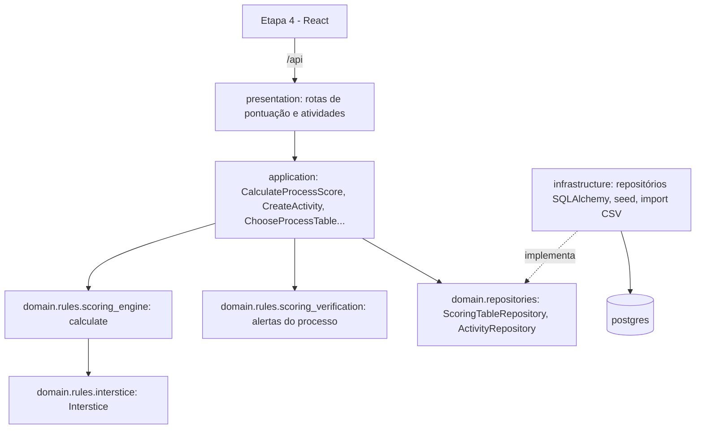

# Pontuação Design

**Spec**: `.specs/features/pontuacao/spec.md`
**Status**: Draft (aguarda aprovação do usuário)

---

## Architecture Overview

O motor de pontuação é uma função pura do domínio: recebe a versão da tabela, as atividades e o intervalo do interstício, e devolve o resultado completo, com razões e alertas. A camada de aplicação carrega os dados, injeta o contexto do processo (carreira, regime, tabela escolhida) e acrescenta os alertas de nível de processo. A infraestrutura guarda tabelas, versões, critérios e atividades. Nada passa por modelo de linguagem (AD-002).



### Abordagens consideradas

| Abordagem | Resumo | Veredito |
| --- | --- | --- |
| **A. Tabelas relacionais (versão → grupos → critérios)** | Critérios são linhas, consultáveis por (grupo, item), editáveis, comparáveis e importáveis | **Recomendada** |
| B. JSONB por versão (como as versões de carreira) | Uma coluna com toda a definição | Descartada: critérios são editados um a um, importados por CSV, comparados entre versões e consultados por item; o JSON esconde isso do banco e das migrações |
| C. Calcular na consulta SQL | Pontuação em views/SQL | Descartada: quebra AD-001 e dificulta testar as regras |

A seção 16 do prompt já pede as tabelas `scoring_tables`, `scoring_table_versions`, `scoring_groups` e `scoring_criteria`, o que confirma a abordagem A.

---

## Code Reuse Analysis

### Existing Components to Leverage

| Component | Location | How to Use |
| --- | --- | --- |
| `Interstice` | `backend/app/domain/rules/interstice.py` | Janela do interstício para a verificação de datas das atividades |
| `Alert`, `Severity` | `backend/app/domain/rules/process_verification.py` | Mesma forma de alerta (código, severidade, mensagem, referência normativa); códigos novos em `ScoringAlertCode` |
| `select_version` | `backend/app/domain/entities/career.py` | Descobrir a estrutura de carreira do processo (mínimos de referência só na Res. 4.644) |
| `AccessPolicy` | `backend/app/application/services/access_policy.py` | `can_read_process` decide o acesso às atividades (404 fora do acesso) |
| `AuditService` | `backend/app/application/services/audit_service.py` | Evento de auditoria em toda criação, alteração, mudança de status e escolha de tabela |
| Erros de domínio e mapeamento HTTP | `backend/app/domain/errors.py`, `backend/app/presentation/errors.py` | 404, 409, 422 com `{"detail":[{"field","message"}]}` |
| `UnitOfWork`, `ProcessRepository` | `backend/app/domain/repositories/ports.py` | Novas portas seguem o mesmo padrão; `ProcessRepository` ganha `set_scoring_table_version` |
| Fixtures de integração | `backend/tests/integration/conftest.py`, `tests/integration/api/factories.py` | PostgreSQL efêmero, `act_as`, `add_professor`, `process_payload` |
| `StepNav`, `AlertList`, `FieldError`, `api/client.ts` | `frontend/src/components/`, `frontend/src/api/` | Navegação por etapas, alertas por severidade, erro junto ao campo |
| Regra "criar a próxima versão fecha a aberta" | `backend/app/application/use_cases/career.py` (`_close_open_version`) | Mesma regra para novas versões de tabela (ADM-05, ADM-06) |

### Integration Points

| System | Integration Method |
| --- | --- |
| `functional_processes` | Nova coluna `scoring_table_version_id` (FK anulável) na migração 0002 |
| `academic_units` | Associação N–N com tabelas (`scoring_table_units`) |
| `audit_logs` | Eventos de entidades `scoring_table`, `scoring_version`, `activity` e `process` (escolha de tabela) |
| Carreira (`fundacao`) | O motor recebe a versão de carreira já escolhida por `verify_process` para decidir o mínimo de referência |

---

## Components

### Domain — entidades de tabela

- **Purpose**: Representar a tabela versionada, grupos e critérios, sem depender de framework.
- **Location**: `backend/app/domain/entities/scoring.py`
- **Interfaces**:
  - `ScoringMode` (`POR_UNIDADE`, `POR_BLOCO_DE_HORAS`, `CARGA_SEMANAL`, `VALOR_INFORMADO`), `TableStatus` (`OFICIAL`, `PENDENTE_VALIDACAO`)
  - `ScoringCriterion(group_number, item_number, description, unit_label, mode, unit_points: Decimal | None, hours_per_block, weeks_per_semester, prep_ratio, max_points, accepted_evidence, rules, review_note)`
  - `ScoringGroup(number, name, counts_in_total, max_points, criteria)`
  - `ScoringTableVersion(id, table_id, name, valid_from, valid_to, norm_reference, status, minimums, groups)`; `.get_criterion(group, item)`; `.covers(date)`
- **Dependencies**: stdlib (`decimal`, `dataclasses`, `datetime`)
- **Reuses**: padrão de `CareerVersion`

### Domain — entidade de atividade

- **Purpose**: Guardar o que o usuário (ou, depois, a IA) informou sobre uma atividade.
- **Location**: `backend/app/domain/entities/activity.py`
- **Interfaces**:
  - `Activity(id, process_id, group_number, item_number, title, description, event_date, period_start, period_end, period_precision, academic_period, level, quantity, hours, course_hours, informed_points, points_override, evidence_note, source, status, distinct_justification, candidates, created_by, created_at, version)`
  - `ActivityStatus` (`AGUARDANDO_REVISAO`, `VALIDADA`, `REJEITADA`), `ActivitySource` (`MANUAL`, `SUGERIDA_IA`, `IMPORTADA`), `Level` (`GRADUACAO`, `POS_GRADUACAO`), `PeriodPrecision` (`DAY`, `MONTH`)
  - `initial_status(source) -> ActivityStatus`: `MANUAL` → `VALIDADA`, demais → `AGUARDANDO_REVISAO` (ATV-03)
  - `group1_item(level) -> int`: 1 para graduação, 2 para pós (ATV-02)

### Domain — motor de pontuação

- **Purpose**: Calcular pontos, situação, razões, limites, subtotais e contadores de forma determinística.
- **Location**: `backend/app/domain/rules/scoring_engine.py`
- **Interfaces**:
  - `calculate(version, activities, interstice) -> ScoringResult`
  - `criterion_points(criterion, activity) -> ActivityPoints(points, effective_quantity, formula_text)`: um ramo por `ScoringMode`; `CARGA_SEMANAL` usa `Decimal.quantize(0.01, ROUND_HALF_UP)`
  - `evaluate_period(activity, interstice) -> PeriodState` (`DENTRO`, `PARCIAL`, `FORA`, `SEM_DATA`, `NAO_VERIFICAVEL`); data com mês e ano expande para o mês inteiro (VERIF-01)
  - `normalize_title(text) -> str` (minúsculas, sem acentos, espaços colapsados)
  - `find_duplicates(activities) -> set[UUID]`: mesmo título normalizado e períodos que se sobrepõem; a atividade criada depois sai; `distinct_justification` preenchida libera; atividade sem datas nunca é duplicata
  - `ScoringResult(rows, group_subtotals, total, potential_total, group1_percent, counters, limit_adjustments)`; cada linha com critério, pontos unitários, quantidade efetiva, fórmula, pontos, situação (`PONTUADA`, `POTENCIAL`, `NAO_PONTUADA`), razões e alertas
- **Dependencies**: `Interstice`, entidades acima
- **Reuses**: `Interstice.start/end`

Ordem da avaliação de cada atividade: critério existe → status `REJEITADA` → período → grupo conta no total → duplicidade → cálculo dos pontos → limites por critério e por grupo. A atividade `AGUARDANDO_REVISAO` percorre o mesmo caminho e termina como `POTENCIAL`.

### Domain — alertas de processo

- **Purpose**: Alertas que dependem do processo e da carreira, não de uma atividade.
- **Location**: `backend/app/domain/rules/scoring_verification.py`
- **Interfaces**:
  - `ScoringAlertCode` (`TABELA_NAO_ENCONTRADA`, `TABELA_DE_OUTRA_UNIDADE`, `TABELA_PENDENTE_VALIDACAO`, `TABELA_FORA_DE_VIGENCIA`, `SEM_EXTENSAO_OU_PESQUISA`, `MINIMO_NAO_DEFINIDO`, `INTERSTICIO_PARCIAL`, `DATA_AUSENTE`, `SEM_COMPROVANTE`, `PONTOS_AJUSTADOS_MANUALMENTE`, `LIMITE_APLICADO`)
  - `verify_scoring(ctx: ScoringContext, result) -> list[Alert]` e `reference_minimum(version, current_class, career_version) -> MinimumComparison(status, minimum, total)`
- **Reuses**: `Alert`, `Severity`

### Application — casos de uso

- **Purpose**: Autorizar, validar entradas, persistir, auditar e orquestrar o cálculo.
- **Location**: `backend/app/application/use_cases/scoring.py` (processo e atividades), `backend/app/application/use_cases/scoring_admin.py` (administração), `backend/app/application/services/criteria_csv.py` (parser do CSV)
- **Interfaces**:
  - `SuggestScoringTable.execute(actor, process_id) -> TableSuggestion`
  - `ChooseProcessTable.execute(actor, process_id, version_id, expected_version, justification)`
  - `CreateActivity`, `UpdateActivity(expected_version, justification)`, `ChangeActivityStatus`, `MarkActivitiesDistinct`, `ListActivities(process_id, group, status)`
  - `CalculateProcessScore.execute(actor, process_id) -> ProcessScore` (resultado do motor + alertas de processo + comparação com o mínimo)
  - Administração: `ListScoringTables`, `GetScoringVersion`, `CreateScoringTable`, `DuplicateScoringTable`, `UpdateVersionCriteria`, `CreateVersionFrom`, `ImportCriteriaCsv`, `SetTableUnits`
- **Dependencies**: portas do domínio, `AccessPolicy`, `AuditService`, relógio injetado
- **Reuses**: `require_admin`, `_close_open_version`

### Infrastructure

- **Location**: `backend/app/infrastructure/database/{models.py,repositories.py,seed.py}`, `backend/app/infrastructure/database/seed_data/{ifch.json,fasi.json}`, `backend/alembic/versions/0002_scoring.py`
- **Interfaces**: `SqlScoringTableRepository`, `SqlActivityRepository`, `seed_scoring_tables(uow)` idempotente
- Os JSON de semente ficam fora do domínio (leitura de arquivo é infraestrutura) e têm testes de integridade: contagem por grupo (3, 16, 12, 7, 6, 14, 11, 66), soma dos pontos conferida contra o caso real e lista exata das divergências da FASI.
- O JSON da FASI é transcrito da tabela preenchida pela numeração do Anexo I da Res. 4.644; cada critério divergente leva `review_note`.

### Presentation

- **Location**: `backend/app/presentation/api/{scoring_tables.py,scoring.py,activities.py}`, `backend/app/presentation/schemas/{scoring.py,activities.py}`
- **Rotas**:
  - Tabelas (leitura para todos): `GET /api/scoring-tables`, `GET /api/scoring-tables/{id}/versions`, `GET /api/scoring-versions/{id}`
  - Administração (ADMIN): `POST /api/scoring-tables`, `POST /api/scoring-tables/{id}/duplicate`, `POST /api/scoring-tables/{id}/versions`, `PUT /api/scoring-versions/{id}/criteria/{group}/{item}`, `POST /api/scoring-tables/{id}/versions/import` (multipart CSV), `PUT /api/scoring-tables/{id}/units`
  - Processo: `GET /api/processes/{id}/scoring/table` (escolhida, sugestão e alertas), `PUT /api/processes/{id}/scoring/table`, `GET /api/processes/{id}/scoring`
  - Atividades: `GET/POST /api/processes/{id}/activities`, `GET/PUT /api/activities/{id}`, `POST /api/activities/{id}/status`, `POST /api/activities/{id}/distinct`
- Decimais saem como texto com 2 casas (`"8.00"`), nunca como `float`. Datas com só mês e ano entram como `{"period_start":"2022-05","period_end":"2022-05"}`; o esquema converte para `period_precision=MONTH`.

### Frontend

- **Location**: `frontend/src/pages/ProcessScoring.tsx`, `frontend/src/components/{ScoringTable.tsx,ActivityForm.tsx,ScoringSummary.tsx,TablePicker.tsx}`; `StepNav.tsx` passa a receber as etapas habilitadas
- **Comportamento**: tabela com as colunas Grupo, Item, Atividade, Quantidade, Pontuação unitária, Total, Comprovante e Status; em 360 px vira cartões; formulário muda os campos conforme o modo do critério (Grupo I: período letivo, nível, horas); justificativa obrigatória na edição.
- Administração (P3): `pages/ScoringAdmin.tsx`, adiada para depois do P1 e do P2.

---

## Data Models

```python
scoring_tables(id uuid pk, name unique, archived bool)
scoring_table_units(table_id fk, unit_id fk, pk(table_id, unit_id))
scoring_table_versions(id uuid pk, table_id fk, name, valid_from date not null, valid_to date null,
    norm_reference text not null, status enum(OFICIAL, PENDENTE_VALIDACAO),
    minimums jsonb null,          # {"structure":"Res. 4.644/2015-CONSEPE","norm_reference":"...","by_current_class":{"A":60,"B":80,"C":100,"D":120}}
    notes text null, created_at)
scoring_groups(id uuid pk, version_id fk, number smallint check 1..8, name, counts_in_total bool,
    max_points numeric(9,2) null, unique(version_id, number))
scoring_criteria(id uuid pk, group_id fk, item_number smallint, description text, unit_label text,
    mode enum, unit_points numeric(9,2) null, hours_per_block numeric(9,2) null,
    weeks_per_semester smallint null, prep_ratio numeric(4,2) null, max_points numeric(9,2) null,
    accepted_evidence text, rules text, review_note text null, unique(group_id, item_number))
activities(id uuid pk, process_id fk, group_number smallint null, item_number smallint null,
    title varchar(300), description text, event_date date null, period_start date null, period_end date null,
    period_precision enum(DAY, MONTH), academic_period varchar(7) null, level enum null,
    quantity numeric(9,2) null, hours numeric(9,2) null, course_hours numeric(9,2) null,
    informed_points numeric(9,2) null, points_override numeric(9,2) null, evidence_note varchar(500) null,
    source enum(MANUAL, SUGERIDA_IA, IMPORTADA), status enum(AGUARDANDO_REVISAO, VALIDADA, REJEITADA),
    distinct_justification text null, created_by fk users, created_at, updated_at, version int)
activity_candidates(activity_id fk, group_number, item_number, justification, pk(activity_id, group_number, item_number))
functional_processes.scoring_table_version_id uuid fk null   # migração 0002
```

**Relationships**: tabela 1—N versões; versão 1—N grupos; grupo 1—N critérios; tabela N—N unidades; processo N—1 versão de tabela (fixada na escolha); processo 1—N atividades; atividade 1—N candidatas. Atividade referencia o critério por (grupo, item), e não por FK, porque a troca de tabela do processo deve reavaliar a atividade pela nova numeração (SEL-09). Os eventos de auditoria usam as tabelas já existentes. O prompt lista `scoring_results`, `activity_evidences` e `activity_classifications`; elas ficam para `documentos-gerados` e `inteligencia-documental` (AD-006).

### Versão "em uso"

Uma versão de tabela está em uso quando algum processo a escolheu (`functional_processes.scoring_table_version_id`). A consulta é uma consulta SQL (`EXISTS`), sem varrer processos em memória (a regra de carreira faz uma varredura; aqui não).

---

## Error Handling Strategy

| Error Scenario | Handling | User Impact |
| --- | --- | --- |
| Entrada inválida (quantidade, horas, título, CSV) | `ValidationFailed` → 422 `{detail:[{field,message}]}`; CSV lista todas as linhas | Mensagem junto ao campo; CSV mostra linha e coluna |
| Justificativa ausente na edição | 422 no campo `justificativa` | Campo destacado |
| Atividade ou processo fora do acesso | `NotFound` → 404 | "Processo não encontrado" |
| Versão da tabela em uso, processo concluído, edição concorrente | `Conflict` / `StaleVersion` → 409 | Mensagem pedindo nova versão ou recarregar |
| Critério da atividade inexistente na versão | Não é erro: a atividade fica `SEM_ENQUADRAMENTO` | Linha marcada, com razão |
| Divergências normativas (mínimo, tabela pendente, estrutura nova) | Alertas, nunca bloqueio (AD-002) | Lista de alertas com a referência |
| Processo sem tabela escolhida | Cálculo responde total 0 com razão `SEM_TABELA` e a sugestão | Tela pede para confirmar a tabela |
| Banco indisponível | 500 hoje, como em `fundacao` (dívida registrada) | "Serviço indisponível" |

---

## Risks & Concerns

| Concern | Location (file:line) | Impact | Mitigation |
| --- | --- | --- | --- |
| Transcrição das tabelas: ~270 pontuações copiadas de PDF; um erro muda o total | `backend/app/infrastructure/database/seed_data/*.json` | Pontuação errada em todos os processos | Testes de contagem por grupo, de soma dos subtotais do caso real (92, 120, 15, 95, 0, 30, 6, 56 = 414) e de igualdade item a item com os PDFs; `review_note` nos itens duvidosos; FASI fica `PENDENTE_VALIDACAO` |
| Tabela da FASI sem norma e com erros aparentes de numeração | `docs/referencias/normas/FONTES.md`, itens 9 e 10 | Sistema pontuaria por valor errado sem aviso | Situação `PENDENTE_VALIDACAO` gera `TABELA_PENDENTE_VALIDACAO` em todo cálculo |
| `Alert.code` está tipado como `AlertCode` | `backend/app/domain/rules/process_verification.py:44` | Novos códigos ficam fora do enum | Alargar o tipo para `StrEnum` genérico; os códigos de `fundacao` não mudam; teste de arquitetura cobre os imports |
| Dependência de `fastapi` ao receber CSV multipart | `backend/app/presentation/api/scoring_tables.py` | `python-multipart` pode faltar | Adicionar ao `requirements.txt` na tarefa da rota; o parser fica em `application/services` e recebe `str` |
| Frontend hoje fixa as etapas 2–9 como "em breve" | `frontend/src/components/StepNav.tsx:1` | Etapa 4 não abre | `StepNav` recebe a lista de etapas habilitadas; teste existente UI-04 é ajustado para refletir a etapa 4 |
| Cálculo sob demanda com muitas atividades | `scoring_engine.calculate` | Latência | Ordem de centenas de atividades é trivial em memória; duplicidade por agrupamento por título normalizado (O(n)), não por pares |
| Divergência 118,35 × 76 × 92 do Grupo I real | `FONTES.md` item 8 e 10 | Ninguém explica os 16 pontos restantes | O sistema não corrige: pontos informados com justificativa e alerta `PONTOS_AJUSTADOS_MANUALMENTE`; decisão humana |

---

## Tech Decisions (only non-obvious ones)

| Decision | Choice | Rationale |
| --- | --- | --- |
| Tipo numérico | `Decimal` com `quantize` só em `CARGA_SEMANAL`; JSON como texto | Sem erro de ponto flutuante; total auditável |
| Item do Grupo I | Derivado do nível (I.1 graduação, I.2 pós) | Evita classificar errado a mesma oferta (ATV-02) |
| Duplicidade | Agrupa por título normalizado, compara intervalos; sem datas nunca duplica | Segue a spec ao pé da letra; evita falso positivo sem data |
| Limites | O limite do critério e do grupo corta a soma, e `LIMITE_APLICADO` registra antes e depois; os pontos por atividade continuam sem corte | Mantém cada linha rastreável |
| Atividade `AGUARDANDO_REVISAO` | Calculada e mostrada como `POTENCIAL`, fora do total | Resposta do usuário (2026-11-17) |
| Troca de tabela do processo | Atividades reavaliadas por (grupo, item); inexistente vira `SEM_ENQUADRAMENTO` | SEL-09 |
| Origem das sementes | JSON em `infrastructure/database/seed_data/` | Revisão humana da transcrição por diff; domínio sem I/O |

> **Decisões de projeto**: AD-006 (resultado não persistido) e AD-007 (tabelas relacionais, não JSONB) são registradas em `.specs/STATE.md`.
