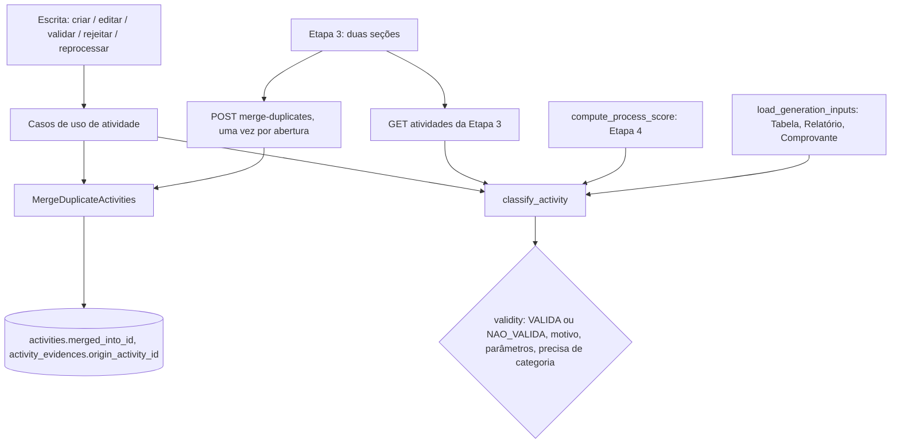

# Revisão simplificada das atividades Design

**Spec**: `.specs/features/revisao-simplificada/spec.md`
**Status**: Approved (o usuário aprovou o desenho completo em 2026-11-19; AD-022 vai para o STATE.md na tarefa T43)

Decisões do projeto que este desenho segue: AD-001 (a regra de validade fica no `domain`, sem FastAPI nem SQLAlchemy), AD-006 (o resultado da pontuação é calculado na hora, nunca gravado: a validade também), AD-019 (atividade ligada só a documento fora do interstício é rejeitada com auditoria: aparece como "Rejeitada" nas não válidas) e AD-018 (o `DELETE` do processo apaga tudo: a coluna nova não pode travá-lo).

---

## Decisões de arquitetura (AD-022, proposta)

| # | Escolha | Alternativa recusada | Por quê |
| - | ------- | -------------------- | ------- |
| D1 | Atividade mesclada = coluna `activities.merged_into_id` (UUID, nulo, aponta para a mantida). O `status` da mesclada não muda | Novo valor `MESCLADA` em `activity_status` | `ALTER TYPE ... ADD VALUE` não se desfaz (como o `DELETE` da `0007`); um valor novo mexeria em toda lista que compara status; a coluna guarda para quem foi mesclada e a migração reverte com `DROP COLUMN` |
| D2 | A validade é decidida no servidor, numa função pura do domínio (`classify_activity`), usada pelo motor, pelos documentos, pela Etapa 4 e pela lista da Etapa 3, que devolve `validity` pronto | O frontend derivar das linhas de pontuação | Uma regra só; os dados do motivo (data, interstício, horas, mínimo) vêm prontos; a tela não depende do cálculo da Etapa 4 |
| D3 | Paginação, busca e filtros no navegador: o servidor devolve a lista inteira (100 a 300 atividades) e o frontend mostra 25 por vez | Paginar no servidor | A lista é pequena, os filtros precisam das contagens de tudo e o servidor continuaria calculando a validade de todas |
| D4 | Mesclar na escrita (criar, editar, fim da leitura do documento) e uma vez por abertura da Etapa 3 por uma chamada explícita (`POST`), nunca num `GET` | Detectar duplicadas a cada leitura | `find_duplicates` é O(n²) com comparação de títulos (cerca de 45 mil pares com 300 atividades) e repetiria a conta em toda leitura |

---

## Visão geral



---

## Reuso

| Componente | Local | Como usar |
| ---------- | ----- | --------- |
| `_evaluate` e `NotScoredReason` | `backend/app/domain/rules/scoring_engine.py:167`, `scoring_alerts.py:20` | A cadeia de saídas antecipadas (sem categoria, rejeitada, fora do interstício, grupo que não conta, duplicidade, carga insuficiente) sai para `classify_activity`; `_evaluate` passa a chamá-la, e os testes do motor garantem a mesma ordem |
| `find_duplicates`, `similar_titles` | `scoring_duplicates.py:60`, `title_similarity.py` | A mesclagem usa a mesma regra de duplicidade; ganha `duplicate_pairs` (duplicada, original) |
| `evaluate_period` | `scoring_periods.py:88` | Estado do período (DENTRO, PARCIAL, FORA, SEM_DATA) para a validade e para a checagem de data |
| `MarkActivitiesDistinct` | `scoring.py:517` | "Não é duplicada" reaproveita `distinct_justification` |
| `eligible_activities` | `activity_order.py:13` | Passa a receber o conjunto de atividades válidas; um único lugar cobre Tabela, Relatório e Comprovante |
| `activityBody` | `frontend/src/activityBody.ts` | O `PUT` da atividade substitui tudo; o formulário enxuto continua mandando o corpo completo |
| `Modal`, `FieldError`, `usePolling`, `labels.ts`, `StepNav` | `frontend/src/components/`, `hooks/`, `labels.ts` | Reuso direto; `StepNav` ganha a propriedade `blocked` |

Pontos de integração: a migração `0008` (a última é a `0007`); `ProcessDocument._store` (`document_processing.py`), que cria atividades e reprocessa; `process_purge` de `gestao-processos`, que apaga as atividades de um processo numa instrução (a chave estrangeira da coluna nova é `NO ACTION`, conferida ao fim da instrução).

---

## Componentes

### `classify_activity` (domínio)

- **Local**: `backend/app/domain/rules/activity_validity.py`
- **Interface**: `classify_activity(activity, version, interstice, duplicates, evidence_count) -> Validity`, com `Validity(state: VALIDA|NAO_VALIDA, reason: InvalidReason | None, needs_category: bool, params: Mapping)`.
- **Ordem** (igual à do motor): rejeitada; período fora (sem categoria, avalia como período por dia; com categoria por ano, avalia por ano); sem categoria (válida com `needs_category`); grupo que não conta; duplicidade residual; carga horária abaixo do mínimo.
- **Motivos**: `REJEITADA`, `FORA_DO_INTERSTICIO`, `CARGA_HORARIA_INSUFICIENTE`, `GRUPO_NAO_CONTA`, `DUPLICIDADE` (só se a mesclagem ainda não rodou; some quando roda).
- **Parâmetros do motivo**: `event_date` ou `period_start`/`period_end`; `interstice_start`/`interstice_end`; `hours` e `min_hours`.
- **Sem tabela escolhida**: avalia só o que não depende dela (rejeitada, data como dia, categoria); a carga horária e o grupo que não conta ficam para depois da escolha da tabela.
- **Reusa**: `evaluate_period`, `is_yearly_unit`, `find_duplicates`.

### `MergeDuplicateActivities` (aplicação)

- **Local**: `backend/app/application/services/activity_merge.py`
- **Interface**: `merge_process(uow, process_id, actor) -> MergeReport`; `separate(uow, actor, activity_id) -> Activity`.
- **Regra**: agrupa as duplicadas (união por pares de `duplicate_pairs`, o que resolve cadeias A, B, C); em cada grupo fica a validada mais antiga, ou a mais antiga se nenhuma ou todas estão validadas; as outras recebem `merged_into_id`. As provas da mesclada passam para a mantida, menos os pares (documento, página) que a mantida já tem; as que passam guardam `origin_activity_id`. A auditoria grava um `UPDATE` com `operation: MERGE`.
- **`separate`**: zera `merged_into_id`, devolve as provas com `origin_activity_id` igual ao id, marca as duas atividades como distintas (`distinct_justification`) e audita.
- **Idempotente**; roda na mesma unidade de trabalho do chamador, de modo que a falha reverte tudo (DUP-04, DUP-05).
- **Chamado por**: `CreateActivity` e `UpdateActivity` (depois de gravar), `ProcessDocument` (fim da leitura e do reprocessamento) e a rota `POST /api/processes/{id}/activities/merge-duplicates`, só em processo gravável (em processo somente leitura a rota responde com 0 mesclagens).

### Escrita de atividade

- **`ChangeActivityStatus`** para `VALIDADA`: sem categoria, 422 no campo `categoria` ("Escolha a categoria antes de validar"); atividade não válida, 422 no campo `status` com o código do motivo (`ATIVIDADE_NAO_VALIDA`); rejeitar e reabrir seguem livres.
- **`BulkValidateActivities`**: valida as que podem e devolve `{activities, skipped: [{id, reason}]}`; a versão alterada (409) e a atividade de outro processo (404) continuam derrubando tudo.
- **`CreateActivity` manual e `UpdateActivity`**: a data tem de estar dentro do interstício (422 no campo `event_date`, `period_start` ou `period_end`, mensagem "A data deve estar entre dd/mm/aaaa e dd/mm/aaaa"); nas categorias por ano basta o período cruzar o interstício. A checagem **não** vale para a criação a partir de documento (`document_processing.py:364` repete com só título e data se a validação falha: a atividade sumiria em vez de aparecer como não válida).
- **Motor**: `QUANTIDADE_ASSUMIDA` (novo `ScoringAlertCode`) quando o item é por unidade e a quantidade falta; `scoring_points.py:39` já assume 1 sem avisar.
- **Documentos gerados**: `load_generation_inputs` usa `classify_activity`; se há atividade válida, validada ou não, sem categoria, recusa com `ATIVIDADE_SEM_CATEGORIA` (422) (SEG-05, novo).

### API da Etapa 3

- **`GET /api/processes/{id}/activities`**: deixa de listar mescladas; cada `ActivityOut` ganha `validity` (`state`, `reason`, `needs_category`, `params`), `merged` (`[{id, title}]`) e `predicted_points` (da regra do motor sem exigir validação). A lista continua inteira, sem paginação.
- **`POST /api/processes/{id}/activities/merge-duplicates`** → `{merged: n}`.
- **`POST /api/activities/{id}/separate`** na atividade mesclada → a atividade restaurada.
- **`POST /api/processes/{id}/activities/validate`** (lote) com o corpo novo.

### Frontend

- **`ProcessActivities.tsx`** chama o `POST` de mesclagem uma vez e carrega a lista.
- **Novos**: `ActivityWorkspace` (filtros, duas seções), `ActivityRow` (linha responsiva: título, data, categoria e pontos previstos, selos, ações), `ActivityFilters` (busca, chips com contagem, grupo), `CategoryPicker` (seletor com grupos, na linha e no formulário), `ReasonText` (texto do motivo a partir de `validity.params`), `MergedNote` (N duplicadas mescladas, Não é duplicada).
- **Alterados**: `ActivityForm` (Título, Data ou Início e Fim, Categoria, Horas só com carga mínima; nova atividade acrescenta Quantidade), `ScoreEditor` (Quantidade ou Horas e valor manual), `StepNav` (`blocked` e mensagem), `labels.ts` (motivos, selos, mensagens).
- **Removido**: `ActivityReviewList.tsx` (a tabela única), depois de portar seus comportamentos (seleção, validar em lote, validar as confiáveis, vincular documento).
- **Seção de não válidas**: fechada ao abrir; botão com `aria-expanded`; título com total e contagem por motivo. Cada linha traz o motivo em texto e a ação Editar (e Reabrir nas rejeitadas).
- **Listas**: 25 por vez com "Mostrar mais"; os filtros e a busca rodam em memória sobre a lista inteira.

---

## Modelo de dados (migração `0008_activity_merge`)

```sql
ALTER TABLE activities
  ADD COLUMN merged_into_id uuid NULL REFERENCES activities(id);       -- NO ACTION
CREATE INDEX ix_activities_merged_into ON activities (merged_into_id) WHERE merged_into_id IS NOT NULL;
ALTER TABLE activity_evidences
  ADD COLUMN origin_activity_id uuid NULL REFERENCES activities(id);   -- NO ACTION
```

- Nenhum gatilho toca `activities` ou `activity_evidences`; mover provas é livre.
- `downgrade` remove as duas colunas e o índice; nada mais muda no esquema.
- Os dados existentes não mudam: a mesclagem das duplicadas já gravadas acontece na primeira abertura da Etapa 3 (a rota de mesclagem).

```typescript
type Validity = {
  state: "VALIDA" | "NAO_VALIDA";
  reason: null | "REJEITADA" | "FORA_DO_INTERSTICIO" | "CARGA_HORARIA_INSUFICIENTE" | "GRUPO_NAO_CONTA" | "DUPLICIDADE";
  needs_category: boolean;
  params: { event_date?: string; period_start?: string; period_end?: string;
            interstice_start: string; interstice_end: string; hours?: string; min_hours?: string };
};
```

---

## Tratamento de erros

| Cenário | Tratamento | O que o usuário vê |
| ------- | ---------- | ------------------ |
| Validar sem categoria | 422 `categoria` | "Escolha a categoria antes de validar"; o seletor da linha recebe o foco |
| Validar atividade não válida | 422 `ATIVIDADE_NAO_VALIDA` | O botão nem aparece; se a lista estava velha, mensagem e recarga |
| Data fora do interstício | 422 no campo da data | "A data deve estar entre dd/mm/aaaa e dd/mm/aaaa" no formulário |
| Validar em lote com atividades sem categoria | Valida as outras, devolve `skipped` | "12 validadas; 3 ficaram sem categoria" com a lista |
| Mesclagem falha no meio | A unidade de trabalho reverte tudo | Nada muda; a atividade segue como estava e o erro vai ao log |
| `POST` de mesclagem em processo somente leitura | 0 mesclagens | Nada |
| Versão da atividade mudou (409) | Como hoje | Mensagem e recarga da lista |
| Gerar documento com atividade válida sem categoria | 422 `ATIVIDADE_SEM_CATEGORIA` | "Há atividades sem categoria na Etapa 3" |

---

## Riscos e preocupações

| Preocupação | Mitigação |
| ----------- | --------- |
| `_to_entity` faz uma consulta de candidatos por atividade (`repositories.py:779`): 300 atividades, 300 consultas por cálculo | Carregar os candidatos em lote na mesma fase em que a lista passa a calcular a validade (tarefa própria, com teste de número de consultas) |
| `find_duplicates` é O(n²) com a comparação de títulos | Mesclar na escrita e na abertura da Etapa 3, e não em toda leitura; `classify_activity` recebe o conjunto já calculado |
| A detecção atual marca a posterior como duplicada; a spec manda ficar a validada | `duplicate_pairs` devolve os pares e a rotina de mesclagem decide quem fica; testes de cadeia e de idempotência |
| O `PUT` substitui todos os campos; o formulário enxuto poderia zerar Quantidade e Horas | O frontend manda o corpo completo; teste de API garante que o que não foi editado se mantém |
| A checagem de data quebraria o processamento de documentos | Vale só para `MANUAL` e para `UpdateActivity`; teste de que uma atividade lida fora do interstício nasce e aparece como não válida |
| Chave estrangeira da coluna nova poderia travar o `DELETE` do processo | `NO ACTION` (checada ao fim da instrução); teste que exclui um processo com atividade mesclada |
| A mudança do filtro dos documentos pode alterar os totais dos documentos já gerados | As versões geradas são imutáveis (AD-012); só as gerações novas usam a regra |
| A reescrita da Etapa 3 troca 22 testes de `ActivityReviewList` e mexe em 7 arquivos de teste do frontend | Portar os comportamentos antes de remover o componente; cada fase tem seu gate |
| Falta de trava de avanço no servidor | O frontend bloqueia o avanço e o servidor recusa a geração com atividade sem categoria (SEG-05) |

---

## Fases de tarefas (o detalhe vem na fase Tasks)

1. **Validade no domínio e no motor**: `classify_activity`, `_evaluate` passa a usá-la, `QUANTIDADE_ASSUMIDA`, exclusão das não válidas na Etapa 4, nos contadores e nos documentos (`eligible_activities`, `load_generation_inputs`, `table_document`, `generation_snapshot`), `ATIVIDADE_SEM_CATEGORIA`.
2. **Mesclagem**: migração `0008`, `duplicate_pairs`, `MergeDuplicateActivities`, `separate`, rota e auditoria, teste do `DELETE` do processo.
3. **Escrita**: categoria exigida ao validar, atividade não válida recusada, lote com `skipped`, data dentro do interstício, mesclagem chamada em criar, editar e reprocessar.
4. **API da lista**: `validity`, `merged`, `predicted_points`, candidatos em lote.
5. **Frontend, Etapa 3**: `ActivityWorkspace` e componentes, seções, filtros, selo, bloqueio do avanço, `StepNav`.
6. **Frontend, formulário e Etapa 4**: `ActivityForm` enxuto, `CategoryPicker`, `ScoreEditor` com Quantidade e Horas.
7. **Verificador independente**, correções e documentação (AD-022, `CLAUDE.md`, rastreabilidade).
